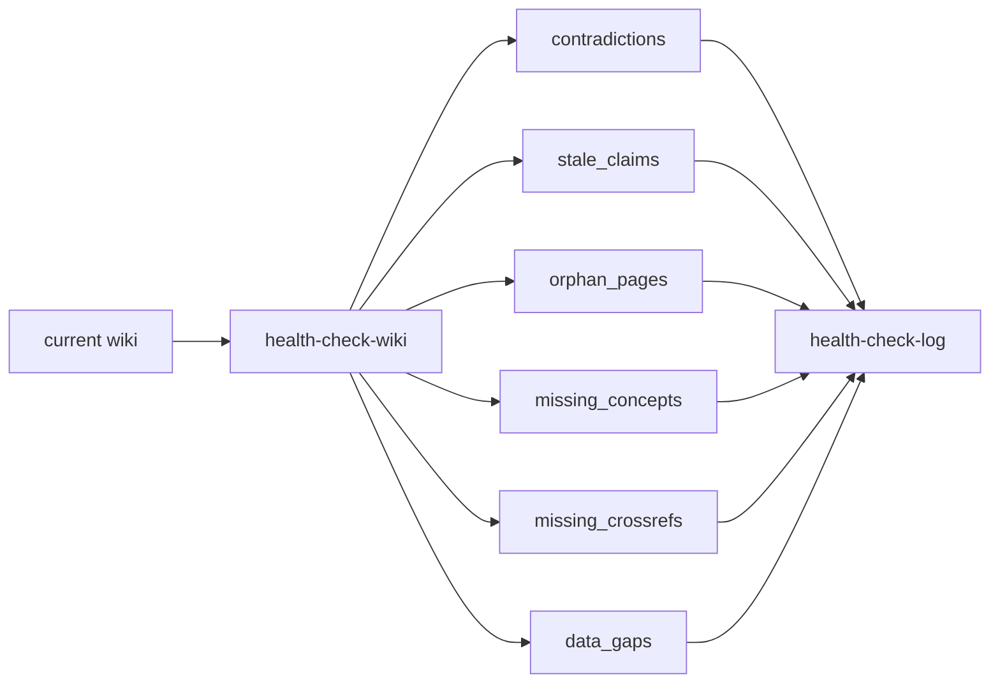

# 2026年5月24日 開発基盤：LLM Wikiのhealth-check-wikiスキルを作る

> 状態：⑧ Closing
> 次のゲート：なし

---

## 1) Journey（どこへ行くか）

> 補足：深層的目的 tasknote 由来の知見が多い wiki でも、fix と混ぜずに健全性を点検できるようにする
> 補足：やらないこと page 修正、schema 更新、自動 crossref 追加まで同じ skill に混ぜない
> 補足：責務分担厳格度 basic

1. 前提条件
   1. 💦 `health-check-wiki` は current wiki と logs を読む
   2. 💦 結果は `health-check-log` に分類付きで残す
   3. 💦 core 5 に加えて `data_gaps` も拾う
   4. 💦 点検 route は read-only に固定する

2. Before
   1. 💦 既存の health-check はあるが、skill として 1 本に固定されていない
   2. 💦 点検と fix を同じ流れで扱うと、誤修正や誤昇格が起きやすい
   3. 💦 tasknote 由来の compiled knowledge が多く、incident と rule の切り分けが難しい
   4. ❌ 不安

3. After
   1. 💦 `health-check-wiki` が read-only 点検 route を持つ
   2. ✅ 6分類と `data_gaps` を log に残せる
   3. ✅ `fix_now` `next_ingest` `candidate_source` で後工程へ渡せる
   4. ✅ `no issue` の回でも点検履歴を残せる
   5. ❤️ 安心

4. 例外
   1. issue が無いときも health-check log は残してよい
   2. fix 候補が見えても、この skill 自体では page を直さずに止めてよい

5. 境界条件
   1. `health-check-wiki` は schema を更新しない
   2. `health-check-wiki` は raw source や tasknote 原文でなく compiled wiki を主に読む
   3. 既存 log 形式は活かしつつ、必要なら `data_gaps` を明示項目として足す

6. 委任度
   1. 🟢 read-only 点検 route と log schema は実装準備まで進められる
   2. 🟢 CCのみで可：current wiki 中心の scope と分類項目を維持できる
   3. 🟢 CCのみで可：fix 分離と `data_gaps` 出力を skill contract に落とせる

---

## 2) ユーザーストーリーマップ

> 点検 skill を read-only に固定し、fix と昇格の前で必ず止まる。
> 委任度：🟢 点検対象、分類項目、停止条件は固まり、dry-run 観点まで CC が進められる
> 残る曖昧さ：なし

### 事前確認

- [x] tasknote確認済み
- [x] skill・tool・MCP確認済み
  - [x] `manage-tasknotes`
  - [x] `brainstorming`
  - [x] `skill-creator`
  - [x] shared `tasknote-lint`
- [x] 永続的ドキュメント確認済み
  - [x] `AGENTS.md`
  - [x] `manage-tasknotes/TEMPLATE.md`
  - [x] `manage-tasknotes/RULES.md`
  - [x] `llm-wiki/wiki/logs/health-check-log.md`
  - [x] `docs/llm-wiki-ops-schema.md`
  - [x] `llm-wiki/wiki/areas/ingest-query-lint-loop.md`

### 本体

#### 話題1：どこを点検するかを固定する

##### ユーザー：佐藤さん（wiki maintainer）

1. 当初計画
    1. 👀 `master-index`、`areas`、`query`、`summaries`、必要な logs を読む
    2. 🧭 既存の active graph から scope を決める
    3. 🚫 raw source と page 修正は既定で扱わない

#### 話題2：何を分類して log に残すかを固定する

##### ユーザー：佐藤さん（lint reader）

1. 当初計画
    1. 🪵 `contradictions` `stale_claims` `orphan_pages` `missing_concepts` `missing_crossrefs` `data_gaps` を残す
    2. 🪵 追加で `fix_now` `next_ingest` `candidate_source` `notes` を残す
    3. 🪵 issue が無い項目は `none` と明記する

#### 話題3：この skill 自体では直さずに止まる

##### ユーザー：佐藤さん（safe operator）

1. 当初計画
    1. ✋ health-check は read-only で止まる
    2. 🧾 修正候補は log に残して別 route へ渡す
    3. 🔒 schema 更新は `update-schema` に渡す

---

## 3) Gherkin（完了条件）

> 委任度：🟢 read-only 点検 route と dry-run 観点までは CC が進められる
> 残る曖昧さ：なし

### シナリオ一覧

- [ ] シナリオ1：current wiki を読んで 6分類+`data_gaps` を残せる

1. 🧱 active な wiki graph が存在する
2. 🎬 current wiki を読んで issue を分類する
3. ✅ `health-check-log` に分類付きで残せる

```gherkin
Given `master-index` `areas` `query` `summaries` が current wiki に存在する
When `health-check-wiki` が current graph を点検する
Then `contradictions` `stale_claims` `orphan_pages` `missing_concepts` `missing_crossrefs` `data_gaps` を記録できる
And issue が無い項目は `none` として残せる
```

- [ ] シナリオ2：fix 候補が見えても read-only で止まる

1. 🧱 missing crossrefs や orphan page が見つかる
2. 🎬 修正候補を整理する
3. ✅ page 修正せずに log だけ残す

```gherkin
Given `health-check-wiki` が current wiki の issue を見つけている
When AI が `fix_now` `next_ingest` `candidate_source` を整理する
Then `health-check-log` に結果を残して止まる
And page 修正や schema 更新は行わない
```

- [ ] シナリオ3：no issue の回でも時系列 log を残せる

1. 🧱 current graph に矛盾が見つからない
2. 🎬 health-check を実行する
3. ✅ `none` を含む log が残る

```gherkin
Given current wiki graph に重大 issue が見つからない
When `health-check-wiki` を実行する
Then `health-check-log` に `none` を含む記録を残せる
And 点検時刻と scope を後から追える
```

---

## 4) Design（どうやるか）

### 責務分担概要

- `health-check-wiki` は current wiki を読む
- issue を 6分類+`data_gaps` へ落とす
- 出力は `health-check-log` の記録だけにする
- fix 実行と schema 更新は別 route に渡す

### 責務分担概要図



### 責務分担詳細

- `llm-wiki/wiki/indexes/master-index.md` （➕：点検の入口として読む）
- `llm-wiki/wiki/areas/` （➕：crossref と concept の厚みを見る）
- `llm-wiki/wiki/query/` （➕：saved answer の活用状態を見る）
- `llm-wiki/wiki/summaries/knowledge/` （➕：source summary の活性状態を見る）
- `llm-wiki/wiki/logs/health-check-log.md` （✏️：点検結果の保存先）
- `docs/llm-wiki-ops-schema.md` （➕：health-check defaults の参照先）

### 【参照】

- Steering: `steering/done/2026年5月23日 開発基盤：Wikiの健全性チェックを試す.md`
- Architecture: `docs/llm-wiki-ops-schema.md`
- Source: `llm-wiki/wiki/logs/health-check-log.md`

### 変更範囲

- やること:
  - `health-check-wiki` の scope を current wiki に固定する
  - 6分類+`data_gaps` の log 出力を定義する
  - read-only で止まる境界を明文化する
- やらないこと:
  - page 修正を同じ skill に入れること
  - schema 更新を同じ skill に入れること
  - batch ingest の判断まで混ぜること

### 検証

- 検証コマンド:
  - `node /home/exedev/dotfiles/shared/linter/coding-rules/tasknote/run_tasknote_lint.mjs --config ./tasknote-lint.config.json 'steering/2026年5月24日 開発基盤：LLM Wikiのhealth-check-wikiスキルを作る.md'`
- 成功条件:
  - tasknote が lint を通る
  - read-only 境界が note 上で明示されている
  - `data_gaps` を含む log 項目が読める
- 未実施時の扱い:
  - lint 未実施なら draft 止まりとして扱う

---

## 5) Tasklist

- [x] skill 名と保存先を決める
- [x] current wiki の点検 scope を固定する
- [x] 6分類+`data_gaps` の log schema を決める
- [x] read-only で止まる境界を決める
- [x] 既存 `health-check-log` を使った dry-run 観点を決める

---

## 6) 作業ログ

- [x] global skill 前提で `health-check-wiki` の名前と保存先を確定
- [x] read-only / compiled wiki / 6分類+`data_gaps` の contract を反映
- [x] `/home/exedev/dotfiles/claude/.claude/skills/health-check-wiki/SKILL.md` を追加した
- [x] `docs/llm-wiki-ops-schema.md` の Health-Check Defaults を skill contract に揃えた
- [x] `health-check-log` の既存 entry 順を dry-run 観点として固定した
- [x] sync script、markdownlint、tasknote lint、diff check を通した

---

## 7) 評価と成果物

> 評価：🟢 shared skill、schema 整合、dry-run 観点、verification まで完了している

### 成果物

- `/home/exedev/dotfiles/claude/.claude/skills/health-check-wiki/SKILL.md`
- `steering/2026年5月24日 開発基盤：LLM Wikiのhealth-check-wikiスキルを作る.md`
- `llm-wiki/wiki/logs/health-check-log.md`
- `docs/llm-wiki-ops-schema.md`
- `docs/superpowers/plans/2026-05-24-health-check-wiki-skill.md`

---

## 8) Discussion

- 関連tasknote: `steering/2026年5月24日 開発基盤：LLM Wikiの点検スキルとルール更新スキルを分ける.md`
- `health-check-wiki` は tasknote 原文でなく compiled wiki と logs を主に読む
- `health-check-wiki` は issue を見つけても fix を実行せず、log に分類して止まる
- `data_gaps` は `candidate_source` の前段判断として残す
- read-only は lint/log の役割に絞り、fix を混ぜない
- dry-run 観点は既存 `health-check-log` の entry 順と `none` 表記をそのまま使う
- discovery 反映は `sync_claude_skills_to_agents.py` で確認した

---

## 9) Closing

- 状態: done
- 次のゲート: なし
- close 条件:
  - [x] `health-check-wiki` の scope が current wiki に固定される
  - [x] 6分類+`data_gaps` の log schema が固まる
  - [x] read-only で止まる境界が固まる
  - [x] 既存 `health-check-log` を使った dry-run 観点が固まる

---

## 10) 参考資料

- `steering/done/2026年5月23日 開発基盤：Wikiの健全性チェックを試す.md`
- `llm-wiki/wiki/logs/health-check-log.md`
- `docs/llm-wiki-ops-schema.md`
