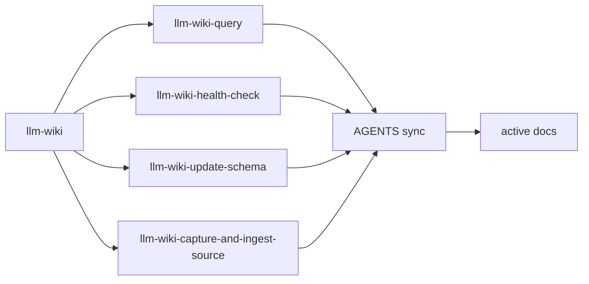

# 2026年5月24日 開発基盤：LLM Wikiスキルの命名を整理して親スキルを作る

> 状態：⑧ Closing
> 次のゲート：なし

---

## 1) Journey（どこへ行くか）

> 補足：深層的目的 llm-wiki 系 skill を見つけやすくし、用途の迷いを減らす
> 補足：やらないこと skill 本体の workflow を大きく作り替えない
> 補足：責務分担厳格度 basic

1. 前提条件
   1. 💦 llm-wiki 系の shared skill は複数ある
   2. 💦 flat namespace では skill 名だけで系統が伝わる方がよい
   3. 💦 既存の運用文書と AGENTS 追従も必要になる

2. Before
   1. 💦 `query-wiki` など単体名だと llm-wiki 系と分かりにくい
   2. 💦 個別 skill が増えるほど discovery が散らばる
   3. 💦 rename だけだと入口案内が弱く、親 skill だけだと検索性が弱い
   4. ❌ もどかしい

3. After
   1. 💦 llm-wiki 系 skill に共通の見出しが付く
   2. ✅ 親 skill が入口として各 route を案内できる
   3. ✅ AGENTS と active docs が current naming に追従する
   4. ❤️ スッキリ

4. 例外
   1. done tasknote や過去 plan は履歴として旧名のまま残してよい
   2. backward alias を増やして namespace を再び濁らせない

5. 境界条件
   1. current で使う skill 名は llm-wiki 系と分かる形に寄せる
   2. 親 skill は薄い router にとどめ、各 skill の本体を重複しない
   3. 正本は shared skill と active docs に限って追従する

6. 委任度
   1. 🟢 rename 方針と親 skill の薄い責務なら CC 単独で進められる
   2. 🟢 CCのみで可：shared skill 本体、AGENTS sync、active docs の追従まで実行できる
   3. 🟢 CCのみで可：done tasknote を履歴として残す境界も判断できる

---

## 2) ユーザーストーリーマップ

> 命名整理と親 skill 追加を分けて進め、最後に active docs と discovery を追従させる。
> 委任度：🟢 命名方針と反映先は見えており、実装から検証まで CC が進められる
> 残る曖昧さ：なし

### 事前確認

- [x] tasknote確認済み
- [x] skill・tool・MCP確認済み
  - [x] `brainstorming`
  - [x] `writing-skills`
  - [x] `create-skill`
  - [x] `manage-tasknotes`
- [x] 永続的ドキュメント確認済み
  - [x] `AGENTS.md`
  - [x] `manage-tasknotes/TEMPLATE.md`
  - [x] `docs/llm-wiki-ops-schema.md`
  - [x] shared skill 本体 4 本

### 本体

#### 話題1：個別 skill を llm-wiki 系と分かる名前へ寄せる

##### ユーザー：wiki maintainer

1. 当初計画
    1. 🏷️ `query-wiki` などの単体名を `llm-wiki-*` に寄せる
    2. 👀 directory 名、frontmatter 名、description をそろえる
    3. 🚫 alias skill は増やさない

#### 話題2：薄い親 skill を入口として置く

##### ユーザー：skill 利用者

1. 当初計画
    1. 🧭 `llm-wiki` を router として追加する
    2. 🪶 各 route の本体は親 skill に重複記述しない
    3. ✅ 質問、点検、schema 昇格、ingest の振り分けだけを担う

#### 話題3：active docs と discovery を current naming に追従させる

##### ユーザー：repo operator

1. 当初計画
    1. 🔄 AGENTS 自動登録を sync で更新する
    2. 📝 `docs/llm-wiki-ops-schema.md` など active docs を追従させる
    3. 📚 done tasknote と旧 plan は履歴として残す

## 3) Gherkin（完了条件）

> 委任度：🟢 rename、親 skill 追加、active docs 追従、verification まで CC が進められる
> 残る曖昧さ：なし

### シナリオ一覧

- [x] シナリオ1：llm-wiki 系 skill が一覧だけで見分けやすくなる

1. 🧱 利用者が skill 一覧を見る
2. 🎬 llm-wiki 系 skill 名を確認する
3. ✅ 各 skill が同じ接頭辞で並び、系統が分かる

```gherkin
Given 共有 skill に query health-check update-schema capture ingest の route がある
When 利用者が skill 一覧や AGENTS 登録を見る
Then llm-wiki 系 skill は共通 prefix で並ぶ
And 個別 route の用途を名前から推測できる
```

- [x] シナリオ2：親 skill が用途ごとの入口案内を持つ

1. 🧱 利用者がどの route を使うか迷っている
2. 🎬 親 skill を読む
3. ✅ 質問、点検、schema、ingest のどれへ行くか分かる

```gherkin
Given 利用者が llm-wiki 系の仕事をしたいが個別 route を決めていない
When `llm-wiki` 親 skill を読む
Then 目的ごとに使う child skill が分かる
And 親 skill 自身は薄い router にとどまる
```

- [x] シナリオ3：active docs と discovery が current naming に追従する

1. 🧱 shared skill の rename と親 skill 追加が終わっている
2. 🎬 schema と AGENTS を確認する
3. ✅ 現役の参照先だけが新しい名前を向く

```gherkin
Given shared skill の current naming が決まっている
When `docs/llm-wiki-ops-schema.md` と AGENTS discovery を確認する
Then active docs は current naming を参照する
And done tasknote や historical plan は履歴として残せる
```

## 4) Design（どうやるか）

### 責務分担概要

- shared skill 4 本を `llm-wiki-*` 命名へ寄せる
- `llm-wiki` 親 skill を薄い router として追加する
- active docs と AGENTS 登録だけを追従させる
- done tasknote と historical plan は履歴として残す

### 責務分担概要図



### 責務分担詳細

- `/home/exedev/dotfiles/claude/.claude/skills/` （✏️：shared skill の rename と親 skill の追加先）
- `/home/exedev/.codex/AGENTS.md` （✏️：sync により discovery 表示を更新する）
- `docs/llm-wiki-ops-schema.md` （✏️：active な skill 名参照を current naming へそろえる）
- `steering/2026年5月24日 開発基盤：LLM Wikiスキルの命名を整理して親スキルを作る.md` （✏️：今回の判断を残す）

### 【参照】

- Steering: `steering/2026年5月24日 開発基盤：LLM Wikiのhealth-check-wikiスキルを作る.md`
- Architecture: `docs/llm-wiki-ops-schema.md`
- Source: `/home/exedev/dotfiles/claude/.claude/skills/llm-wiki-query/SKILL.md`

### 変更範囲

- やること:
  - llm-wiki 系 skill を prefix 付きの名前へ寄せる
  - `llm-wiki` 親 skill を追加する
  - AGENTS と active docs を新 naming に追従させる
- やらないこと:
  - 各 skill の workflow を大きく作り替えること
  - historical plan や done tasknote を全面 rename すること
  - alias skill を増やして namespace を二重化すること

### 検証

- 検証コマンド:
  - `python3 /home/exedev/dotfiles/codex/.codex/scripts/sync_claude_skills_to_agents.py --check`
  - `npx -y markdownlint-cli2 '/home/exedev/dotfiles/claude/.claude/skills/llm-wiki/SKILL.md' '/home/exedev/dotfiles/claude/.claude/skills/llm-wiki-query/SKILL.md' '/home/exedev/dotfiles/claude/.claude/skills/llm-wiki-health-check/SKILL.md' '/home/exedev/dotfiles/claude/.claude/skills/llm-wiki-update-schema/SKILL.md' '/home/exedev/dotfiles/claude/.claude/skills/llm-wiki-capture-and-ingest-source/SKILL.md' 'docs/llm-wiki-ops-schema.md' 'steering/2026年5月24日 開発基盤：LLM Wikiスキルの命名を整理して親スキルを作る.md'`
  - `git -C /home/exedev/dotfiles diff --check && git diff --check`
- 成功条件:
  - skill 一覧で llm-wiki 系が prefix でまとまる
  - 親 skill が router として存在する
  - active docs と AGENTS が current naming を向く
- 未実施時の扱い:
  - sync か lint 未実施なら draft 止まりとして扱う

---

## 5) Tasklist

- [x] tasknote の初期内容を固めて commit する
- [x] shared skill の rename 先を作る
- [x] `llm-wiki` 親 skill を追加する
- [x] active docs と AGENTS sync を current naming に揃える
- [x] verification を通して tasknote を閉じる

---

## 6) 作業ログ

- [x] tasknote を起票し、`tasknote: create llm wiki skill naming note` で commit した
- [x] shared skill 4 本を `llm-wiki-*` 命名へ rename した
- [x] `llm-wiki` 親 skill を追加し、child route の案内だけを持たせた
- [x] `docs/llm-wiki-ops-schema.md` に current shared skill routes を明記した
- [x] `sync_claude_skills_to_agents.py` を実行し、AGENTS discovery を更新した
- [x] markdownlint、sync check、diff check、pytest を通した

---

## 7) 評価と成果物

> 評価：🟢 skill discovery、親 route、active docs、verification まで完了している

### 成果物

- `/home/exedev/dotfiles/claude/.claude/skills/llm-wiki/SKILL.md`
- `/home/exedev/dotfiles/claude/.claude/skills/llm-wiki-query/SKILL.md`
- `/home/exedev/dotfiles/claude/.claude/skills/llm-wiki-health-check/SKILL.md`
- `/home/exedev/dotfiles/claude/.claude/skills/llm-wiki-update-schema/SKILL.md`
- `/home/exedev/dotfiles/claude/.claude/skills/llm-wiki-capture-and-ingest-source/SKILL.md`
- `docs/llm-wiki-ops-schema.md`
- `steering/2026年5月24日 開発基盤：LLM Wikiスキルの命名を整理して親スキルを作る.md`

---

## 8) Discussion

- prefix と親 skill を併用し、検索性と入口案内を分ける
- active docs だけ current naming に追従させ、done tasknote は履歴として残す
- alias を増やさず flat namespace を整理する
- `capture-and-ingest-source` も llm-wiki 系の入口だと分かるように prefix へ寄せた
- AGENTS の skill 数は親 skill 追加により 1 件増えた

---

## 9) Closing

- 状態: done
- 次のゲート: なし
- close 条件:
  - [x] llm-wiki 系 skill が prefix 付き命名にそろう
  - [x] `llm-wiki` 親 skill が追加される
  - [x] AGENTS と active docs が current naming に追従する
  - [x] verification が通る

---

## 10) 参考資料

- `/home/exedev/dotfiles/claude/.claude/skills/llm-wiki/SKILL.md`
- `/home/exedev/dotfiles/claude/.claude/skills/llm-wiki-query/SKILL.md`
- `/home/exedev/dotfiles/claude/.claude/skills/llm-wiki-health-check/SKILL.md`
- `/home/exedev/dotfiles/claude/.claude/skills/llm-wiki-update-schema/SKILL.md`
- `/home/exedev/dotfiles/claude/.claude/skills/llm-wiki-capture-and-ingest-source/SKILL.md`
- `docs/llm-wiki-ops-schema.md`
