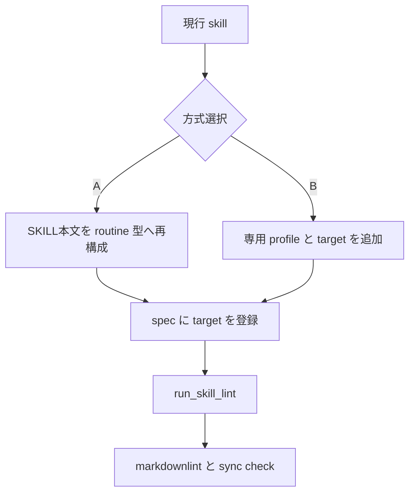
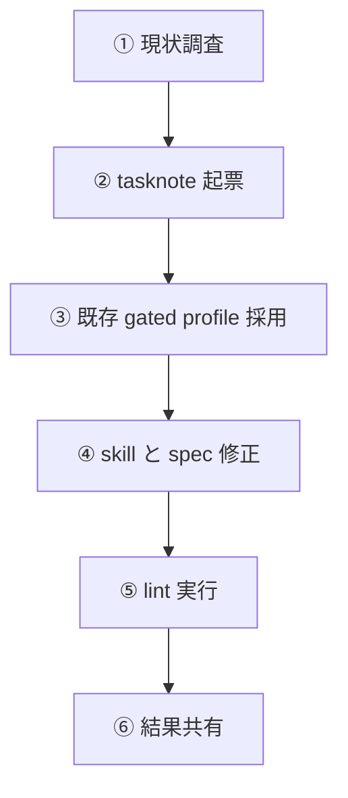

# 2026年5月24日 開発基盤：capture-and-ingest-sourceにルーチン型lintゲートを足す

> 状態：⑨ Closing
> 次のゲート：なし

---

## 1) Journey（どこへ行くか）

> 補足：深層的目的 ingest skill の停止点を人にも lint にも読める形へ寄せる
> 補足：やらないこと 今回は ingest 本体の挙動変更や wiki 内容追加まで広げない
> 補足：責務分担厳格度 basic

1. 前提条件
   1. 💦 `capture-and-ingest-source` は user skill として運用中である
   2. 💦 dotfiles には routine-skill lint の spec と runner がある
   3. 💦 いまはこの skill が lint target に入っていない

2. Before
   1. 💦 要約確認や continue mode は本文にあるが lint では見えない
   2. 💦 親ノートどおりの 2 つの user gate も明示されていない
   3. 💦 gated profile は `状態` `次のゲート` と `Public API` を求める
   4. 💦 今の skill 本文はその shape にまだ寄っていない
   5. ❌ 迷う

3. After
   1. 💦 2 つの user gate が skill 本文で読める
   2. ✅ skill 更新時に停止点の崩れを lint で止められる
   3. ✅ `textlint` と呼んでいた gate の実体も repo 基準でそろう
   4. ✅ `go ahead` でも gate 1 と gate 2 を飛ばさない
   5. ❤️ 安心

4. 例外
   1. full rewrite が重ければ lighter profile を選んでもよい
   2. 呼び名が `textlint` でも実装は custom runner でよい

5. 境界条件
   1. scope は skill 文書と lint 設定までに絞る
   2. raw ingest の logic や wiki 更新は今回触らない
   3. tasknote 起票を先に行い実装は次ゲート後に回す

6. 委任度
   1. 🟢 既存 profile に寄せる方針まで固まった
   2. 🟢 CCのみで可：2 つの gate を skill 本文へ埋め込む
   3. 🟢 CCのみで可：target 登録と lint 検証
   4. 🟡 一部判断要：運用時に gate wording をさらに短くするか

---

## 2) ユーザーストーリーマップ

> 今回は調査結果を、現状把握、差分整理、2 つの gate を含む routine 化の順に進める。
> 委任度：🟢 既存 profile に寄せる方針と 2 つの user gate 追加まで CC が進められる
> 残る曖昧さ：なし

### 事前確認

- [x] tasknote確認済み
- [x] skill・tool・MCP確認済み
  - [x] `manage-tasknotes`
  - [x] `research`
- [x] skill・tool・MCP
  - [x] `manage-tasknotes`
  - [x] `research`
- [x] 永続的ドキュメント確認済み
  - [x] `AGENTS.md`
  - [x] `~/dotfiles/claude/.claude/skills/manage-tasknotes/TEMPLATE.md`
  - [x] `~/dotfiles/claude/.claude/skills/capture-and-ingest-source/SKILL.md`
  - [x] `~/dotfiles/shared/linter/specs/routine-skill/routine_skill_rules.yml`
  - [x] `~/dotfiles/shared/linter/coding-rules/routine-skill/run_skill_lint.mjs`
  - [x] `~/dotfiles/shared/linter/coding-rules/routine-skill/batch_gate.mjs`
  - [x] `~/dotfiles/shared/linter/coding-rules/routine-skill/doc_fields.mjs`

#### 話題1：いまある routine-skill lint を確認する

##### ユーザー：この repo の skill 運用者（現状確認）

1. 当初計画
    1. 👀 spec の profile と target を確認する
    2. 👀 runner が target 未登録なら skip することを確認する
    3. 👀 `batch_gate` と `doc_fields` の必須形を抜き出す

#### 話題2：capture-and-ingest-source の現状差分を出す

##### ユーザー：この repo の skill 運用者（差分整理）

1. 当初計画
    1. 👀 skill 内の preview、review、continue gate を拾う
    2. ✂️ `状態` `次のゲート` `Public API` の欠けを整理する
    3. 📝 lint target 未登録も差分として固定する

#### 話題3：どこまで routine 型へ寄せるか

##### ユーザー：この repo の skill 運用者（方針選択）

1. 当初計画
    1. ✅ 既存 `skill_procedural_gated` に乗るよう本文を再構成する
    2. ✅ gate 1 を `要点候補フィードバック` として明示する
    3. ✅ gate 2 を `summary draft review` として明示する
    4. ✅ `go ahead` でも 2 つの gate を省略しない

---

## 3) Gherkin（完了条件）

> 委任度：🟢 受け入れ条件の更新から実装まで CC が進められる
> 残る曖昧さ：なし

### シナリオ一覧

- [x] シナリオ1：capture-and-ingest-source が routine lint の target として解決される

1. 🧱 routine-skill spec と runner がある
2. 🎬 `capture-and-ingest-source` の path を lint 対象へ登録する
3. ✅ `run_skill_lint` がこの skill を skip せず評価する

```gherkin
Given routine-skill spec と runner が dotfiles にある
When `capture-and-ingest-source` の path を target に登録する
Then `run_skill_lint` はこの skill を skip しない
And 適用された profile 群が結果から分かる
```

- [x] シナリオ2：2 つの user gate が機械的に読める

1. 🧱 skill の gate 位置を本文で表現している
2. 🎬 gate 1 と gate 2 を既存 gated profile に乗る shape で書く
3. ✅ `状態` と `次のゲート` 相当の停止点ずれを検出できる

```gherkin
Given skill に candidate review と summary review の 2 つの gate がある
When 既存 gated profile と rule で lint を実行する
Then gate 1 と gate 2 の位置が機械的に読める
And 本文とのずれがあれば lint finding として返る
```

- [x] シナリオ3：skill の読みやすさを落とさず gate を追加できる

1. 🧱 skill は user invocable な長い運用手順を持つ
2. 🎬 本文再構成を行い、`go ahead` でも 2 つの gate を残す
3. ✅ summary draft と continue mode の流れが今より読みにくくならない

```gherkin
Given `capture-and-ingest-source` は summary draft と continue mode を含む
When skill 本文を既存 gated profile に合わせて更新する
Then user は candidate review preview review finalize の流れを追える
And lint のためだけの不自然な構造増殖は起きない
```

---

## 4) Design（どうやるか）

### 責務分担概要

- 第一案は `capture-and-ingest-source` を routine 型の shape へ寄せる
- その場合は既存 `skill_procedural_gated` を再利用し target 追加で済ませる
- gate 1 と gate 2 は明示し、`go ahead` でも省略しない
- どちらでも `run_skill_lint` と markdownlint の両方で止める

### 責務分担概要図





### 責務分担詳細

- `steering/2026年5月24日 開発基盤：capture-and-ingest-sourceにルーチン型lintゲートを足す.md`
  （➕：今回の調査結果と方式分岐を固定する）
- `~/dotfiles/claude/.claude/skills/capture-and-ingest-source/SKILL.md`
  （✏️：routine 型へ寄せるか現行 shape を残すかの主対象）
- `~/dotfiles/shared/linter/specs/routine-skill/routine_skill_rules.yml`
  （✏️：target と profile を登録する正本）
- `~/dotfiles/shared/linter/coding-rules/routine-skill/run_skill_lint.mjs`
  （➕：target 解決の動作確認に使う runner）
- `~/dotfiles/shared/linter/coding-rules/routine-skill/batch_gate.mjs`
  （➕：既存 gate rule の要件確認に使う）
- `~/dotfiles/shared/linter/coding-rules/routine-skill/doc_fields.mjs`
  （➕：`Public API` block 要件の確認に使う）

### 調査結果

- current skill は要約確認 gate を本文に持つが routine target ではない
- 親ノートどおりの gate 1 と gate 2 を、routine 本文として明示する必要がある
- `skill_procedural_gated` は `doc_fields` と `batch_gate` を含む
- `batch_gate` は `> 状態` と `> 次のゲート` を本文見出しへ解決する
- `doc_fields` は `## Public API` 内の番号 block に `Goal` `Returns` `Policy` を求める
- つまり既存 gated profile をそのまま使うなら、skill 本文の shape をかなり寄せつつ 2 つの user gate を書き直す必要がある

### 【参照】

- Steering: `steering/2026年5月24日 開発基盤：capture-and-ingest-sourceに要約確認ゲートを追加する.md`
- Steering: `steering/2026年5月24日 開発基盤：capture-and-ingest-sourceにrelated page更新とingest logを足す.md`
- Architecture: `AGENTS.md`
- Skill: `~/dotfiles/claude/.claude/skills/capture-and-ingest-source/SKILL.md`
- LintSpec: `~/dotfiles/shared/linter/specs/routine-skill/routine_skill_rules.yml`
- Runner: `~/dotfiles/shared/linter/coding-rules/routine-skill/run_skill_lint.mjs`

### 変更範囲

- やること:
  - routine lint と現行 skill の差分を既存 gated profile に寄せる
  - gate 1 と gate 2 を skill 本文へ明示する
  - target 追加と skill 本文の再構成を行う
  - gate 崩れを止める検証コマンドを残す
- やらないこと:
  - ingest の中身や wiki 反映の挙動を変えること
  - `entities/` や `concepts/` などの新構造を作ること
  - `go ahead` で gate 自体を省略すること

### 検証

- 検証コマンド:
  - `node /home/exedev/dotfiles/shared/linter/coding-rules/routine-skill/run_skill_lint.mjs /home/exedev/dotfiles/claude/.claude/skills/capture-and-ingest-source/SKILL.md --root /home/exedev/dotfiles`
  - `npx -y markdownlint-cli2 '/home/exedev/dotfiles/claude/.claude/skills/capture-and-ingest-source/SKILL.md'`
  - `python3 /home/exedev/dotfiles/codex/.codex/scripts/sync_claude_skills_to_agents.py --check`
- 成功条件:
  - `capture-and-ingest-source` が lint target として評価される
  - gate の summary と本文ずれが lint で止まる
  - summary draft と continue mode の流れが still readable である
- 未実施時の扱い:
  - いずれか未実施なら gate 追加完了扱いにしない

---

## 5) Tasklist

- [x] 現状調査をして差分を整理する
- [x] tasknote を起票する
- [x] 方式 A/B を確定する
- [x] skill 本文または lint profile を更新する
- [x] lint と sync check で検証する

---

## 6) 作業ログ

- `capture-and-ingest-source` は routine lint の target 未登録だった
- 既存 gated profile は `状態` `次のゲート` `Public API` を前提にしていた
- gate 1 は `要点候補フィードバック`、gate 2 は `summary draft review` として明示した
- `go ahead` でも gate を飛ばさない方針に切り替えた
- target は `skill_procedural_gated` として spec に追加した
- 個別 family lint、markdownlint、tasknote lint、skill registry check は通った
- `run_skill_lint.mjs` 本体は VM に `ruby` が無く `spawnSync ruby ENOENT` で未通過だった

---

## 7) 評価と成果物

- 調査対象:
  - `~/dotfiles/claude/.claude/skills/capture-and-ingest-source/SKILL.md`
  - `~/dotfiles/shared/linter/specs/routine-skill/routine_skill_rules.yml`
  - `~/dotfiles/shared/linter/coding-rules/routine-skill/run_skill_lint.mjs`
- 変更対象:
  - `~/dotfiles/claude/.claude/skills/capture-and-ingest-source/SKILL.md`
  - `~/dotfiles/shared/linter/specs/routine-skill/routine_skill_rules.yml`
  - `~/dotfiles/shared/linter/coding-rules/routine-skill/tests/run_skill_lint.test.mjs`
- 成果物:
  - `steering/2026年5月24日 開発基盤：capture-and-ingest-sourceにルーチン型lintゲートを足す.md`
- 検証結果:
  - `module_intent.mjs` OK
  - `section_markers.mjs` OK
  - `step_list_only.mjs` OK
  - `control_flow.mjs` OK
  - `doc_fields.mjs` OK
  - `batch_gate.mjs` OK
  - `markdownlint-cli2` OK
  - `sync_claude_skills_to_agents.py --check` OK
- 評価:
  - current skill を gated target へ移せた
  - 2 つの user gate を routine profile に乗る形で明示できた
  - actual runner だけは `ruby` 非搭載のため環境依存で未通過だった

---

## 8) Discussion

- 既存 gated profile を使い回す方が rule の増殖を防げる
- user が気にしていたのは gate の数なので、`go ahead` path でも gate 1 と gate 2 を残すのが本筋である
- routine lint は停止点の崩れを止め、運用側は 2 回の user 確認を守る役に分けられる
- residual risk は `run_skill_lint.mjs` が `ruby` 前提のままな点だけで、skill 本文自体の family lint は通っている

---

## 9) Closing

- 今回は tasknote 起票まで
- 既存 gated profile への寄せと 2 つの user gate 追加まで完了した
- `run_skill_lint.mjs` の環境依存は別論点として残る
- 関連tasknote:
  - `steering/2026年5月24日 開発基盤：capture-and-ingest-sourceに要約確認ゲートを追加する.md`
  - `steering/2026年5月24日 開発基盤：capture-and-ingest-sourceにrelated page更新とingest logを足す.md`

---

## 10) 参考資料

- `~/dotfiles/claude/.claude/skills/capture-and-ingest-source/SKILL.md`
- `~/dotfiles/shared/linter/specs/routine-skill/routine_skill_rules.yml`
- `~/dotfiles/shared/linter/coding-rules/routine-skill/run_skill_lint.mjs`
- `~/dotfiles/shared/linter/coding-rules/routine-skill/batch_gate.mjs`
- `~/dotfiles/shared/linter/coding-rules/routine-skill/doc_fields.mjs`
