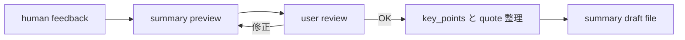

# 2026年5月24日 開発基盤：capture-and-ingest-sourceに要約確認ゲートを追加する

> 状態：⑧ Closing
> 次のゲート：なし

---

## 1) Journey（どこへ行くか）

> 補足：深層的目的 summary draft を file に落とす前に、人が要約の方向を止められるようにする
> 補足：やらないこと related page 更新や ingest log 更新まで同時に広げない
> 補足：責務分担厳格度 basic

1. 前提条件
   1. 💦 対象は `capture-and-ingest-source` の ingest 後半である
   2. 💦 いまは feedback 後すぐ summary draft 作成へ進む
   3. 💦 変えたいのは [18]-[21] 相当の流れである
   4. 💦 要約確認は file 書き込み前に入れる

2. Before
   1. 💦 user の返答後すぐ `key_points` と quote 選定へ進む
   2. 💦 summary file も user 最終確認より先に作られる
   3. 💦 強調のズレを chat 上で止めにくい
   4. ❌ 怖い

3. After
   1. 💦 AI はまず summary preview を user へ返す
   2. ✅ user が preview を見て OK/修正を返せる
   3. ✅ 承認後だけ `key_points` と summary file へ進む
   4. ❤️ 安心

4. 例外
   1. `go ahead` でも preview 提示は省略しない
   2. preview で止める capture-only 依頼は許す

5. 境界条件
   1. related pages と index 更新は今回も scope 外
   2. preview は chat で見せ、final file 前に止まる
   3. quote 捏造や transcript 補完は禁止のまま

6. 委任度
   1. 🟢 review gate の目的と挿入位置は固まっている
   2. 🟢 CCのみで可：tasknote draft と skill 修正方針の初稿作成
   3. 🟢 承認待ち位置が明確なので実装判断も local に閉じる

---

## 2) ユーザーストーリーマップ

> feedback 後の後半を、preview 提示、user 確認、finalize の 3 段に分けてそろえる。
> 委任度：🟢 review gate の設計と skill 反映まで CC が進められた
> 残る曖昧さ：なし

### 事前確認

- [x] tasknote確認済み
- [x] skill・tool・MCP確認済み
  - [x] `manage-tasknotes`
  - [x] `create-skill`
  - [x] shared `tasknote-lint`
- [x] 永続的ドキュメント確認済み
  - [x] `AGENTS.md`
  - [x] `manage-tasknotes/TEMPLATE.md`
  - [x] `manage-tasknotes/RULES.md`
  - [x] `steering/done/2026年5月23日 開発基盤：Karpathy型LLM Wiki運用の親ノート.md`
  - [x] `~/.claude/skills/capture-and-ingest-source/SKILL.md`

### 本体

#### 話題1：feedback の直後に summary preview を返す

##### ユーザー：Karpathy 型の知識キュレーター（preview）

1. 当初計画
    1. 👀 AI が human feedback を受け取る
    2. 📝 AI は file 化前の summary preview を chat に返す
    3. 📌 preview に provisional かどうかを明記する

#### 話題2：preview を user が確認してから先へ進む

##### ユーザー：Karpathy 型の知識キュレーター（review）

1. 当初計画
    1. 👆 user は preview を見て OK か修正を返す
    2. ✋ OK が出るまでは finalize へ進まない
    3. 🔁 修正があれば preview を出し直す

#### 話題3：承認後だけ key_points と file 作成へ進む

##### ユーザー：Karpathy 型の知識キュレーター（finalize）

1. 当初計画
    1. ✂️ AI は承認後に `key_points` を 3〜7 個へ絞る
    2. 🧾 `important_quotes` と `open_questions` を整理する
    3. 📝 summary draft file を作る
    4. ✅ file に `summary` `key_points` `important_quotes` `open_questions` を書く

#### 話題4：fast path でも review gate は残す

##### ユーザー：この repo の運用者（boundary）

1. 当初計画
    1. ⚡ `go ahead` でも preview 生成までは AI が進めてよい
    2. ⛔ ただし final file 作成は user check 後だけにする
    3. 🔗 related pages 更新は引き続き別 route に残す

---

## 3) Gherkin（完了条件）

> 委任度：🟢 review gate の受け入れ条件と skill 修正まで CC が完了した
> 残る曖昧さ：なし

### シナリオ一覧

- [x] シナリオ1：feedback 後に AI が summary preview を先に返せる

1. 🧱 raw source と human feedback がそろっている
2. 🎬 AI が finalize 前の要約を返す
3. ✅ user は file 化前の summary preview を見られる

```gherkin
Given raw source file があり human feedback も返っている
When AI が ingest 後半へ進む
Then AI はまず summary preview を chat に返す
And その時点では summary draft file をまだ作らない
And preview が provisional かどうかを明記する
```

- [x] シナリオ2：user が preview を確認するまで finalize へ進まない

1. 🧱 summary preview が chat に出ている
2. 🎬 user の OK または修正待ちになる
3. ✅ `key_points` と file 作成は保留される

```gherkin
Given AI が summary preview を chat に返している
When user がまだ OK を返していない
Then AI は `key_points` を確定しない
And `important_quotes` と `open_questions` も final 版にしない
And summary draft file を書き出さない
```

- [x] シナリオ3：preview 承認後にだけ summary draft file を作れる

1. 🧱 user が preview を確認して OK を返している
2. 🎬 AI が finalize へ進む
3. ✅ `summary` `key_points` `important_quotes` `open_questions` を file に書ける

```gherkin
Given user が summary preview を確認して OK を返している
When AI が ingest 後半の finalize を行う
Then `key_points` は 3〜7 個に絞られる
And `important_quotes` と `open_questions` が整理される
And summary draft file に `summary` `key_points` `important_quotes` `open_questions` が書かれる
```

- [x] シナリオ4：fast path でも preview までは出すが finalize は止まる

1. 🧱 user が `go ahead` などの自律実行を求めている
2. 🎬 AI が provisional preview を作る
3. ✅ final file は user check 後まで待つ

```gherkin
Given user が `go ahead` や `開始` のように自律実行を求めている
When AI が `why_saved` と `first_impression` を使って provisional preview を作る
Then preview の提示自体は省略しない
And final file 作成は user check 後まで待つ
And review gate を fast path で飛ばさない
```

---

## 4) Design（どうやるか）

### 責務分担概要

- `capture-and-ingest-source` の feedback 後半に `summary preview` 段を 1 つ挟む
- preview 承認が出るまでは `key_points` 確定と file 作成を止める
- fast path は preview 生成までは許し、finalize だけを止める
- related pages、index、ingest log 更新は今回も別 route に残す

### 責務分担概要図



### 責務分担詳細

- `steering/2026年5月24日 開発基盤：capture-and-ingest-sourceに要約確認ゲートを追加する.md` （➕：review gate 追加の tasknote）
- `~/.claude/skills/capture-and-ingest-source/SKILL.md` （✏️：preview 提示と approval 待ちの手順を追加する）
- `steering/2026年5月24日 開発基盤：URLからraw保存と対話型ingest下書きまでを一気に行うスキルを作る.md` （➕：元の skill scope と boundary を参照する）
- `steering/done/2026年5月23日 開発基盤：Karpathy型LLM Wiki運用の親ノート.md` （➕：[18]-[21] の元 flow を参照する）

### 【参照】

- Steering: `steering/2026年5月24日 開発基盤：URLからraw保存と対話型ingest下書きまでを一気に行うスキルを作る.md`
- Architecture: `AGENTS.md`
- Source: `~/.claude/skills/capture-and-ingest-source/SKILL.md`

### 変更範囲

- やること:
  - feedback 後に summary preview を返す段を足す
  - user check 前は finalize を止める条件を書く
  - fast path の boundary を review gate ありに直す
- やらないこと:
  - related pages や index 更新まで同時に修正すること
  - source capture の前半 path を作り直すこと
  - skill 名や保存先を変えること

### 検証

- 検証コマンド:
  - `node /home/exedev/dotfiles/shared/linter/coding-rules/tasknote/run_tasknote_lint.mjs --config ./tasknote-lint.config.json 'steering/2026年5月24日 開発基盤：capture-and-ingest-sourceに要約確認ゲートを追加する.md'`
  - `npx -y markdownlint-cli2 '/home/exedev/dotfiles/claude/.claude/skills/capture-and-ingest-source/SKILL.md'`
  - `python3 /home/exedev/dotfiles/codex/.codex/scripts/sync_claude_skills_to_agents.py --check`
- 成功条件:
  - tasknote が lint を通る
  - preview -> review -> finalize の順が読める
  - review 前に file を書かない条件が明記されている
- 未実施時の扱い:
  - いずれか未実施なら extension 完了扱いにしない

---

## 5) Tasklist

- [x] review gate の挿入位置を skill 本文に書く
- [x] preview と approval 待ちの手順を skill 本文に追加する
- [x] fast path の boundary を review 必須に直す
- [x] skill markdown を lint する
- [x] tasknote に実行結果を戻す

---

## 6) 作業ログ

- review gate 追加専用の tasknote を起票した
- 変更対象を [18]-[21] 相当の後半に絞った
- preview -> review -> finalize の 3 段を先に固定した
- `capture-and-ingest-source` に `summary preview` と `user review` 段を追加した
- fast path を provisional preview 止まりに修正した

---

## 7) 評価と成果物

> 評価：🟢 review gate を skill 本体へ反映し、検証まで完了した

### 成果物

- `steering/2026年5月24日 開発基盤：capture-and-ingest-sourceに要約確認ゲートを追加する.md`
- `docs/superpowers/plans/2026-05-24-source-summary-review-gate-extension-plan.md`
- `/home/exedev/dotfiles/claude/.claude/skills/capture-and-ingest-source/SKILL.md`

---

## 8) Discussion

- いまの skill は `human feedback -> key_points 確定 -> summary draft file` が直結している
- 今回はその直結をほどき、preview を chat 上で承認してから final file へ進む形に変える
- fast path があっても review gate は飛ばさない方針にしておくと、方向ズレを file 化前に止めやすい
- 既存の AGENTS 登録名は変えていないので、sync は check のみで足りる

---

## 9) Closing

- 状態: done
- 次のゲート: なし
- close 条件:
  - [x] review gate の位置が skill に反映されている
  - [x] preview 承認前は file を書かないと読める
  - [x] tasknote と skill の両方が検証済みである

---

## 10) 参考資料

- `steering/done/2026年5月23日 開発基盤：Karpathy型LLM Wiki運用の親ノート.md`
- `steering/2026年5月24日 開発基盤：URLからraw保存と対話型ingest下書きまでを一気に行うスキルを作る.md`
- `docs/superpowers/plans/2026-05-24-source-summary-review-gate-extension-plan.md`
- `~/.claude/skills/capture-and-ingest-source/SKILL.md`
