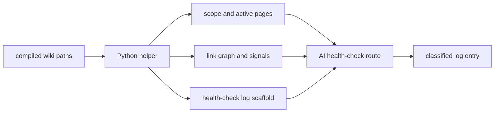

# 2026年5月24日 開発基盤：llm-wiki-health-checkの下ごしらえをPythonに寄せる

> 状態：⑧ Closing
> 次のゲート：なし

---

## 1) Journey（どこへ行くか）

> 補足：深層的目的 health-check の遅い下ごしらえを減らし、AI が分類判断に集中できるようにする
> 補足：やらないこと page 修正、schema 更新、最終 log 文面の確定までを Python に渡さない
> 補足：責務分担厳格度 basic

1. 前提条件
   1. 💦 対象は `llm-wiki-health-check` の compiled wiki 点検だけに絞る
   2. 💦 Python 化は `読む` `拾う` `並べる` の単純作業に限る
   3. 💦 矛盾や stale の意味判断は AI が持つ
   4. 💦 出力先は `health-check-log` の下書きに寄せる

2. Before
   1. 💦 `master-index` から active graph を拾う手順が毎回重い
   2. 💦 path 一覧や link 関係の整理が会話コストを食う
   3. 💦 log 骨組みの並びも毎回少しずつぶれやすい
   4. ❌ だるい

3. After
   1. 💦 Python が scope と graph 材料を先にそろえる
   2. ✅ AI は 6分類と `data_gaps` の判断に集中できる
   3. ✅ `health-check-log` の下書き形を速くそろえられる
   4. ❤️ ラク

4. 例外
   1. current wiki の link が弱いときは Python が不足として返してよい
   2. 構造信号だけで言い切れない項目は AI 側に残してよい

5. 境界条件
   1. 今回は compiled wiki と logs だけを対象にする
   2. Python は scope 検出と page inventory まで担当する
   3. Python は link graph と orphan 候補整理まで担当する
   4. Python は log entry の骨組み生成まで担当する
   5. 分類名の採否と prose は AI に残す

6. 委任度
   1. 🟢 起票と scope 固定は CC 単独で進められる
   2. 🟢 CCのみで可：Python の担当を構造整理までに固定する
   3. 🟢 ユーザー確認済み：Python は graph 下ごしらえと log 骨組みまでに留める

---

## 2) ユーザーストーリーマップ

> Python に渡す部分を、scope 検出、graph 下ごしらえ、log 骨組みの順にそろえる。
> 委任度：🟢 provisional map までは CC が進められる
> 残る曖昧さ：なし

### 事前確認

- [x] tasknote確認済み
- [x] skill・tool・MCP確認済み
  - [x] `manage-tasknotes`
  - [x] `brainstorming`
  - [x] `llm-wiki-health-check`
- [x] 永続的ドキュメント確認済み
  - [x] `AGENTS.md`
  - [x] `~/dotfiles/claude/.claude/skills/manage-tasknotes/TEMPLATE.md`
  - [x] `~/dotfiles/claude/.claude/skills/manage-tasknotes/RULES.md`
  - [x] `~/dotfiles/claude/.claude/skills/llm-wiki-health-check/SKILL.md`
  - [x] `docs/llm-wiki-ops-schema.md`
  - [x] `steering/2026年5月24日 開発基盤：LLM Wikiのhealth-check-wikiスキルを作る.md`
  - [x] `steering/2026年5月24日 開発基盤：raw tasknote ingestの単純作業をPythonに寄せる.md`
  - [x] `steering/2026年5月24日 開発基盤：steeringの完了タスクノート10件取り込み定型をPythonに寄せる.md`

#### 話題1：scope と active graph を Python が先に決める

##### ユーザー：この repo の llm-wiki 運用者（scope prep）

1. 当初計画
    1. 👀 `master-index` と主要 subtree の path を固定する
    2. 🧭 entrypoint から active page 一覧を拾う
    3. 📝 archive や raw を既定対象から外す

#### 話題2：構造信号を Python が並べる

##### ユーザー：この repo の llm-wiki 運用者（graph prep）

1. 当初計画
    1. 🔗 page ごとの outlink と backlink を数える
    2. 🧾 orphan 候補と missing target 候補を返す
    3. 🪵 summaries query areas logs の件数と path を返す

#### 話題3：AI は分類判断と文面を担当する

##### ユーザー：この repo の llm-wiki 運用者（lint judgment）

1. 当初計画
    1. 🤖 AI は helper の返した構造材料を読む
    2. 🧠 contradictions と stale と data gaps を判断する
    3. 📝 `health-check-log` の最終文面は AI が作る

#### 話題4：log 骨組みは Python が先に作る

##### ユーザー：この repo の llm-wiki 運用者（log scaffold）

1. 当初計画
    1. 🪵 `scope` と各 category 見出しを固定順で出す
    2. 🪵 issue 無しの項目は `none` の骨組みを返す
    3. ✋ helper は append せず、下書き text を返して止まる

---

## 3) Gherkin（完了条件）

> 委任度：🟢 helper の責務境界と I/O たたき台までは CC が進められる
> 残る曖昧さ：なし

### シナリオ一覧

- [ ] シナリオ1：compiled wiki から scope と active graph を返せる

1. 🧱 current wiki の入口 page が存在する
2. 🎬 Python helper に repo root か scope を渡す
3. ✅ scope と active page 一覧が返る

```gherkin
Given `llm-wiki/wiki/indexes/master-index.md` と `areas` `query` `summaries/knowledge` `logs` が存在する
When Python helper に repo root か scope 指定を渡す
Then helper は `scope_label` `scope_paths` `graph_entrypoints` を返せる
And active page の path 一覧も返せる
And raw source や archive は既定で主入力に含めない
```

- [ ] シナリオ2：link graph の構造信号を捏造せず返せる

1. 🧱 active page 一覧が決まっている
2. 🎬 helper が page 間 link を集計する
3. ✅ orphan 候補や missing target 候補が返る

```gherkin
Given helper が active page 一覧を持っている
When helper が wiki page の outlink と backlink を集計する
Then helper は orphan 候補 page を返せる
And missing target 候補や crossref の薄い page 候補も返せる
And 判定根拠が弱いときは issue 断定ではなく signal として返す
```

- [ ] シナリオ3：health-check-log の骨組みを固定順で返せる

1. 🧱 scope と graph signal がそろっている
2. 🎬 helper が log scaffold を組み立てる
3. ✅ AI がそのまま肉付けできる下書きが返る

```gherkin
Given helper が scope と graph signal を返せている
When helper が health-check-log scaffold を組み立てる
Then scaffold は `scope` `contradictions` `stale_claims` `orphan_pages` `missing_concepts` `missing_crossrefs` `data_gaps` `fix_now` `next_ingest` `candidate_source` `notes` の順を持つ
And issue が未確定の項目は `none` を初期値として持てる
And helper 自体は file append を行わない
```

- [ ] シナリオ4：分類判断と prose は AI に残る

1. 🧱 Python が構造材料と scaffold を返している
2. 🎬 health-check 後半へ進む
3. ✅ AI が分類判断と最終文面を担当する

```gherkin
Given Python helper が scope と graph signal と log scaffold を返している
When `llm-wiki-health-check` の後半工程へ進む
Then contradictions や stale claims や data gaps の意味判断は AI が行う
And `fix_now` `next_ingest` `candidate_source` `notes` の prose も AI が作る
And page 修正や schema 更新は行わない
```

---

## 4) Design（どうやるか）

### 責務分担概要

- 新しい Python helper は compiled wiki から決定的な構造材料だけを返す
- 返す材料は `scope` `active_pages` `link_graph` `orphan_signals` `missing_target_signals` `log_scaffold` を基本にする
- helper の返り値形式は JSON に固定する
- `llm-wiki-health-check` は helper 出力を読んで 6分類+`data_gaps` と prose を整える
- Python は read-only 下ごしらえに留め、append や page 修正は行わない

### 責務分担概要図



### 責務分担詳細

- `steering/2026年5月24日 開発基盤：llm-wiki-health-checkの下ごしらえをPythonに寄せる.md` （➕：今回の scope と境界を固定する）
- `~/dotfiles/claude/.claude/skills/llm-wiki-health-check/SKILL.md` （✏️：Python helper を前段で呼ぶ flow に将来合わせる）
- `steering/2026年5月24日 開発基盤：raw tasknote ingestの単純作業をPythonに寄せる.md` （➕：読む・拾う・並べるの境界を引き継ぐ）
- `steering/2026年5月24日 開発基盤：steeringの完了タスクノート10件取り込み定型をPythonに寄せる.md` （➕：scaffold と append block の切り分けを参照する）
- `llm-wiki/wiki/indexes/master-index.md` （👀：active graph の入口）
- `llm-wiki/wiki/areas/` （👀：crossref と concept の接続を見る）
- `llm-wiki/wiki/query/` （👀：saved answer の接続を見る）
- `llm-wiki/wiki/summaries/knowledge/` （👀：summary の活性を見る）
- `llm-wiki/wiki/logs/health-check-log.md` （👀：log scaffold の出力形を合わせる）
- `tools/` （➕：health-check helper の置き場候補）

### JSON I/O contract

- input:
  - `repo_root`: repo root の絶対 path
  - `scope_hint`: 任意の subtree 指定
- output:
  - `scope_label`: 点検対象ラベル
  - `scope_paths`: 実際に見た path 配列
  - `graph_entrypoints`: 入口 page 配列
  - `active_pages`: active page 情報の配列
  - `outlinks`: page ごとの outlink 情報
  - `backlinks`: page ごとの backlink 件数
  - `orphan_signals`: orphan 候補の配列
  - `missing_target_signals`: link 先不足候補の配列
  - `crossref_signals`: 導線が薄い page 候補の配列
  - `log_scaffold`: `health-check-log` の markdown 骨組み
  - `missing_paths`: 見つからなかった path 配列
- policy:
  - helper は issue を断定せず、構造 signal を返す
  - `contradictions` `stale_claims` `missing_concepts` `data_gaps` の意味判断は AI に残す
  - helper は file append や page 修正を行わない

### 【参照】

- Steering: `steering/2026年5月24日 開発基盤：LLM Wikiのhealth-check-wikiスキルを作る.md`
- Steering: `steering/2026年5月24日 開発基盤：LLM Wikiスキルの命名を整理して親スキルを作る.md`
- Architecture: `docs/llm-wiki-ops-schema.md`
- Skill: `~/dotfiles/claude/.claude/skills/llm-wiki-health-check/SKILL.md`

### 変更範囲

- やること:
  - compiled wiki の scope 検出を Python に置く
  - active graph と link signal の収集を Python に置く
  - `health-check-log` の骨組み生成を Python に置く
- やらないこと:
  - issue の最終分類を Python に任せること
  - page 修正や schema 更新まで同じ helper に混ぜること
  - raw source や tasknote 原文を既定入力へ戻すこと

### 検証

- 検証コマンド:
  - `node /home/exedev/dotfiles/shared/linter/coding-rules/tasknote/run_tasknote_lint.mjs --config ./tasknote-lint.config.json 'steering/2026年5月24日 開発基盤：llm-wiki-health-checkの下ごしらえをPythonに寄せる.md'`
- 成功条件:
  - tasknote が lint を通る
  - Python と AI の責務境界が note から読める
  - scope と graph signal と log scaffold の 3 段が note から読める
- 未実施時の扱い:
  - lint 未実施なら仮起票止まりとする

---

## 5) Tasklist

- [x] helper が返す構造材料の最小セットを確定する
- [x] scope 検出と active graph 収集の I/O を固定する
- [x] orphan と crossref を signal として返す shape を決める
- [x] `health-check-log` scaffold の markdown shape を決める
- [x] `llm-wiki-health-check` 側の呼び出し位置を決める

---

## 6) 作業ログ

- [x] `llm-wiki-health-check` と今日の Python 化タスクノート 3 本を読み、切り分けをそろえた
- [x] Python は `scope` `graph signal` `log scaffold` までに留める draft を起票した
- [x] AI に残す責務を 6分類の判断と prose に固定した
- [x] 保存先を `steering/` に固定した
- [x] ユーザー承認として、Python は graph 下ごしらえと log 骨組みまでに留める方針を確定した
- [x] `test/test_llm_wiki_health_check_helper.py` を先に追加し、health-check helper の contract を red で固定した
- [x] `tools/llm_wiki_health_check_helper.py` を追加し、scope / active graph / signal / log scaffold の JSON helper を実装した
- [x] `~/dotfiles/claude/.claude/skills/llm-wiki-health-check/SKILL.md` に repo-local helper 呼び出し前提を反映した
- [x] focused pytest、helper family pytest、CLI dry-run、tasknote lint を通した

---

## 7) 評価と成果物

> 評価：🟢 helper 実装、skill 反映、verification まで完了している

### 成果物

- `steering/2026年5月24日 開発基盤：llm-wiki-health-checkの下ごしらえをPythonに寄せる.md`
- `tools/llm_wiki_health_check_helper.py`
- `test/test_llm_wiki_health_check_helper.py`
- `~/dotfiles/claude/.claude/skills/llm-wiki-health-check/SKILL.md`
- `docs/superpowers/plans/2026-05-24-llm-wiki-health-check-python-helper.md`

---

## 8) Discussion

- 今日の先行例に合わせ、Python は deterministic prep に限定する
- health-check の意味判断は source ingest より曖昧さが強いため、signal と judgment を分ける
- orphan や stale の候補は helper では signal 止まりにし、issue 断定は AI に残す
- repo-local helper は `master-index` 起点の active graph と thin connectivity を先に返し、skill 側はそれを読んで 6分類へ落とす

---

## 9) Closing

- 状態: done
- 次のゲート: なし
- close 条件:
  - [x] Python に渡す範囲が確定している
  - [x] helper の I/O が確定している
  - [x] skill 側へ反映する前提が固まっている

---

## 10) 参考資料

- `~/dotfiles/claude/.claude/skills/llm-wiki-health-check/SKILL.md`
- `docs/llm-wiki-ops-schema.md`
- `steering/2026年5月24日 開発基盤：LLM Wikiのhealth-check-wikiスキルを作る.md`
- `steering/2026年5月24日 開発基盤：raw tasknote ingestの単純作業をPythonに寄せる.md`
- `steering/2026年5月24日 開発基盤：steeringの完了タスクノート10件取り込み定型をPythonに寄せる.md`
