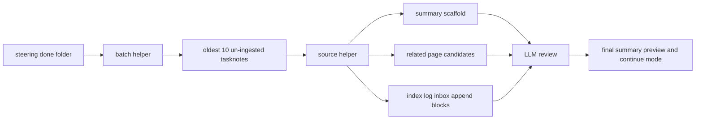

# 2026年5月24日 開発基盤：steeringの完了タスクノート10件取り込み定型をPythonに寄せる

> 状態：⑧ Closing
> 次のゲート：なし（batch helper 実装と dry-run 10 件の検証まで完了）

---

## 1) Journey（どこへ行くか）

> 補足：深層的目的 steering の古い done tasknote 10 件ずつの ingest を速くし、LLM は意味づけと文面判断に集中できるようにする
> 補足：やらないこと article や video への横展開、summary 本文の完成、area page の最終文面決定までを Python に渡さない
> 補足：責務分担厳格度 basic

1. 前提条件
   1. 💦 今後の対象は `steering/done/` の古い未 ingest tasknote を 10 件ずつ取る
   2. 💦 raw tasknote の材料抽出は既存 helper の延長で扱う
   3. 💦 Python は定型生成を担当し、重要度判断は LLM に残す
   4. 💦 inbox と index と ingest log は append block の生成までを Python に任せる

2. Before
   1. 💦 10 件まとめ ingest でも選定と整形を毎回ほぼ手でやっている
   2. 💦 summary の型と related page 候補出しが source ごとに少しずつぶれる
   3. 💦 index と log と inbox の追記文も同じ形を何度も手で書いている
   4. ❌ だるい

3. After
   1. 💦 Python が oldest 10 件の対象選定を先に終える
   2. ✅ Python が summary scaffold と related page 候補と append block を返す
   3. ✅ LLM は何が大事かとどう書くかだけに集中できる
   4. ❤️ ラク

4. 例外
   1. section が弱い tasknote は Python が捏造せず不足として返してよい
   2. related page 候補が薄い source は 2 件未満でもよい

5. 境界条件
   1. 対象は `steering/done/` の未 ingest tasknote に限る
   2. 1 回の batch は古い順 10 件固定とする
   3. Python は summary の型を作るが最終 prose は書かない
   4. Python は related page 候補を出すが最終採用は LLM が決める
   5. Python は log と index と inbox の追記文を作るが最終適用は LLM が確認する

6. 委任度
   1. 🟢 全体として CC が起票と scope 固定まで進められる
   2. 🟢 CCのみで可：対象 10 件選定と scaffold 生成の Python 化方針を固める
   3. 🟢 CCのみで可：LLM に残す責務を note に明文化する

---

## 2) ユーザーストーリーマップ

> Gherkin の前に、10件 batch ingest をどこまで Python に寄せるかだけをそろえる。
> 委任度：🟢 当初計画はこのまま CC が進められる
> 残る曖昧さ：なし

### 事前確認

- [x] tasknote確認済み
- [x] skill・tool・MCP確認済み
  - [x] `manage-tasknotes`
  - [x] `llm-wiki-capture-and-ingest-source`
- [x] 永続的ドキュメント確認済み
  - [x] `AGENTS.md`
  - [x] `~/dotfiles/claude/.claude/skills/manage-tasknotes/TEMPLATE.md`
  - [x] `~/dotfiles/claude/.claude/skills/manage-tasknotes/RULES.md`
  - [x] `~/dotfiles/claude/.claude/skills/llm-wiki-capture-and-ingest-source/SKILL.md`
  - [x] `steering/2026年5月24日 開発基盤：raw tasknote ingestの単純作業をPythonに寄せる.md`

#### 話題1：oldest 10 件の batch 対象を自動で決める

##### ユーザー：この repo の llm-wiki 運用者（batch target selection）

1. 当初計画
    1. 👀 `steering/done/` から未 ingest を拾う
    2. 🕒 古い順に並べる
    3. 🔟 先頭 10 件を batch 対象として返す

#### 話題2：summary の型と related page 候補を Python が先に作る

##### ユーザー：この repo の llm-wiki 運用者（scaffold and routing）

1. 当初計画
    1. 📝 各 source の summary draft 用 scaffold を作る
    2. 🧭 既存 area page から related page 候補を 2〜4 件返す
    3. 🧾 候補ごとに短い理由と source ref を返す

#### 話題3：append block を Python が作り LLM が最終適用する

##### ユーザー：この repo の llm-wiki 運用者（append block generation）

1. 当初計画
    1. 📥 `source-inbox` 更新用 block を作る
    2. 📚 `master-index` 追加用 block を作る
    3. 📜 `ingest-log` 追加用 block を作る
    4. 🤖 LLM は意味づけと最終文面だけを見る

---

## 3) Gherkin（完了条件）

> 委任度：🟢 このまま Design の素案までは CC が進められる
> 残る曖昧さ：なし

### シナリオ一覧

- [x] シナリオ1：oldest 10 件の未 ingest tasknote を決定的に選べる

1. 🧱 `steering/done/` に複数の完了 tasknote がある
2. 🎬 batch helper を実行する
3. ✅ 未 ingest の古い順 10 件が返る

```gherkin
Given `steering/done/` 配下に複数の完了 tasknote が存在する
And 一部には対応する summary がまだ存在しない
When batch helper が oldest steering done mode で実行される
Then helper は未 ingest tasknote だけを拾う
And 古い順に並べる
And 先頭 10 件を返す
```

- [x] シナリオ2：各 source の summary scaffold を Python が返せる

1. 🧱 batch 対象 10 件が決まっている
2. 🎬 helper が source 材料を読む
3. ✅ summary の型が source ごとに返る

```gherkin
Given batch 対象の steering tasknote 10 件が決まっている
When helper が各 source の frontmatter と section 材料を読む
Then helper は source ごとに summary scaffold を返す
And scaffold には title source_id summary_draft_path key_points slot quote slot open_questions slot が含まれる
And 最終 prose は未確定のまま残る
```

- [x] シナリオ3：related page 候補と append block を Python が返せる

1. 🧱 source ごとの材料が取れている
2. 🎬 helper が page 候補と追記 block を組み立てる
3. ✅ LLM がそのまま review できる材料が返る

```gherkin
Given source ごとの材料と source_id が helper に渡っている
When helper が既存 area page と log target を参照して下ごしらえを行う
Then source ごとに related page 候補 2 から 4 件が返る
And `source-inbox` `master-index` `ingest-log` の append block も返る
And block は LLM が review して適用できる markdown 形式である
```

- [x] シナリオ4：意味づけと自然な文面は LLM に残る

1. 🧱 Python が batch 材料を返している
2. 🎬 ingest 後半へ進む
3. ✅ LLM が最終判断を担当する

```gherkin
Given Python が batch ingest 用の定型材料を返している
When summary preview と continue mode の文面を整える
Then 何が大事かの判断は LLM が行う
And open questions のやさしい言い換えも LLM が行う
And area page の最終的な意味づけも LLM が行う
```

---

## 4) Design（どうやるか）

### 責務分担概要

- 既存の `tools/llm_wiki_tasknote_helper.py` は source 単位の材料抽出に使い続ける
- 新しい batch helper は `steering/done/` の oldest 10 件選定と batch 定型生成を担当する
- batch helper は source ごとに `summary scaffold` `related page candidates` `append blocks` を返す
- `summary scaffold` は見出しと slot を持つが、最終 prose は空欄または draft 候補のままにする
- related page 候補は area page 名、score、短い理由の組で返す
- LLM は helper 出力を review し、summary preview と continue mode の最終文章を整える

### 責務分担概要図



### 責務分担詳細

- `steering/2026年5月24日 開発基盤：raw tasknote ingestの単純作業をPythonに寄せる.md` （➕：source 単位 helper の既存境界を引き継ぐ）
- `~/dotfiles/claude/.claude/skills/llm-wiki-capture-and-ingest-source/SKILL.md` （✏️：batch helper を先に呼ぶ flow に更新する）
- `tools/llm_wiki_tasknote_helper.py` （✏️：source 単位 helper を batch helper から再利用する）
- `tools/` （➕：oldest steering done batch helper の置き場）
- `llm-wiki/wiki/areas/` （👀：related page 候補の探索対象）
- `llm-wiki/wiki/logs/source-inbox.md` （👀：processed / inbox 判定と append block の出力先）
- `llm-wiki/wiki/indexes/master-index.md` （👀：source 追加 block の出力先）
- `llm-wiki/wiki/logs/ingest-log.md` （👀：ingest record block の出力先）

### 【参照】

- Steering: `steering/2026年5月24日 開発基盤：raw tasknote ingestの単純作業をPythonに寄せる.md`
- Architecture: `docs/llm-wiki-ops-schema.md`
- Skill: `~/dotfiles/claude/.claude/skills/llm-wiki-capture-and-ingest-source/SKILL.md`

### 変更範囲

- やること:
  - `steering/done/` oldest 10 未 ingest source の決定ロジックを Python に置く
  - summary scaffold と related page 候補出しを Python に置く
  - `source-inbox` `master-index` `ingest-log` の append block 生成を Python に置く
- やらないこと:
  - final summary prose を Python に書かせること
  - area page の最終的な意味づけを Python に任せること
  - steering 以外の source type までこの task で広げること

### 検証

- 検証コマンド:
  - `node /home/exedev/dotfiles/shared/linter/coding-rules/tasknote/run_tasknote_lint.mjs --config ./tasknote-lint.config.json 'steering/2026年5月24日 開発基盤：steeringの完了タスクノート10件取り込み定型をPythonに寄せる.md'`
  - `python -m pytest test/test_llm_wiki_steering_batch_helper.py -q`
  - `python -m pytest test/test_llm_wiki_tasknote_helper.py -q`
  - `python tools/llm_wiki_steering_batch_helper.py --limit 10`
  - `python -m pytest test/ -q`
- 成功条件:
  - tasknote lint が通る
  - oldest 10 選定が再現可能である
  - summary scaffold と append block の shape が固定される
  - real repo dry-run で 10 件分の候補と related page shortlist が返る

---

## 5) Tasklist

- [x] oldest 10 steering done 未 ingest source の選定 rule を helper に落とす
- [x] source helper を batch から再利用できる形に整理する
- [x] summary scaffold の JSON / markdown shape を決める
- [x] related page 候補出しの scoring rule を決める
- [x] `source-inbox` `master-index` `ingest-log` の append block 生成を実装する
- [x] skill を batch helper 呼び出し前提へ更新する
- [x] dry-run 10 件で batch 出力を検証する

---

## 6) 作業ログ

- 2026-05-24 CC: user が今後の対象を `steering/done/` の古い 10 件ずつに固定した
- 2026-05-24 CC: user が `summary の型作り` `related page 候補出し` `log/index/inbox の追記文生成` も Python に寄せる方針を選んだ
- 2026-05-24 CC: LLM に残す責務は `何が大事かの判断` `自然な文面` `open questions の言い換え` と整理した
- 2026-05-24 CC: `test/test_llm_wiki_steering_batch_helper.py` を先に追加し、oldest 10 選定、scaffold 生成、related page 候補、CLI 出力を TDD で固定した
- 2026-05-24 CC: `tools/llm_wiki_tasknote_helper.py` に `prepare_tasknote_material()` を足し、`steering/done/` の source を logical raw path 付きで再利用できるようにした
- 2026-05-24 CC: `tools/llm_wiki_steering_batch_helper.py` を追加し、`summary_scaffold` `related_page_candidates` `append_blocks` を JSON で返すようにした
- 2026-05-24 CC: real repo で dry-run 10 件を流し、先頭が `20260418-cj31-explicit-preview-promotion` から始まる oldest batch と shortlist を確認した
- 2026-05-24 CC: `llm-wiki-capture-and-ingest-source` skill を更新し、steering oldest 10 batch mode では batch helper を先に呼ぶ前提に揃えた

---

## 7) 評価と成果物

> 評価：🟢 10件 batch ingest の下ごしらえを Python helper に移し、LLM が review と意味づけへ寄れる状態まで進められた

### 成果物

- `steering/2026年5月24日 開発基盤：steeringの完了タスクノート10件取り込み定型をPythonに寄せる.md`
- `tools/llm_wiki_steering_batch_helper.py`
- `tools/llm_wiki_tasknote_helper.py`
- `test/test_llm_wiki_steering_batch_helper.py`
- `~/dotfiles/claude/.claude/skills/llm-wiki-capture-and-ingest-source/SKILL.md`

---

## 8) Discussion

- 関連tasknote: `steering/2026年5月24日 開発基盤：raw tasknote ingestの単純作業をPythonに寄せる.md`
- 1 本ずつの source helper だけでは batch ingest の定型コストがまだ残る
- Python に寄せるのは `決まった形に並べる仕事` までで、意味づけは LLM に残す
- related page 候補出しは完全自動確定ではなく、LLM review 前提の shortlist 生成として扱う
- shortlist の scoring は `ingest-log` 履歴 token と text overlap の弱い合算に留め、過剰な意味づけを避ける
- helper は `append_blocks` まで返すが、`TODO_SUMMARY_INDEX_DESCRIPTION` や risk / note は LLM が埋める前提にした

---

## 9) Closing

- 状態: done
- 次のゲート: なし
- close 条件:
  - [x] steering done oldest 10 batch を対象にする方針が note にある
  - [x] Python に寄せる対象が note にある
  - [x] LLM に残す責務が note にある
  - [x] batch helper 実装と source helper 再利用が入っている
  - [x] skill 更新が入っている
  - [x] dry-run 10 件の検証結果がある

---

## 10) 参考資料

- `~/dotfiles/claude/.claude/skills/llm-wiki-capture-and-ingest-source/SKILL.md`
- `steering/2026年5月24日 開発基盤：raw tasknote ingestの単純作業をPythonに寄せる.md`
- `llm-wiki/wiki/logs/source-inbox.md`
- `llm-wiki/wiki/logs/ingest-log.md`
- `llm-wiki/wiki/indexes/master-index.md`
