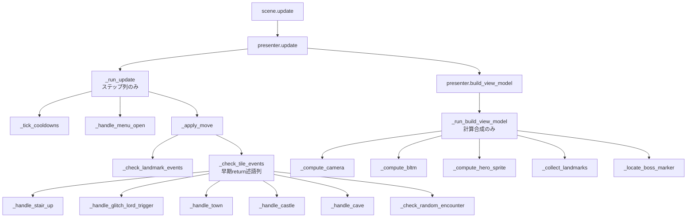
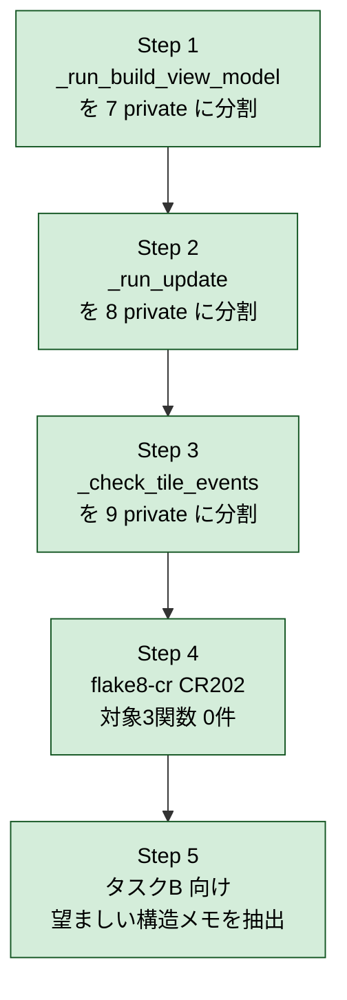

# 2026年5月17日 src/scenes の CR202 大物 3 件を AI で個別リファクタ（タスク A）

> 状態：⑨ Closing（完了）
> 次のゲート：なし（done へ退避済み）

---

## 1) Journey（どこへ行くか）

> 補足：深層的目的 機械的に直しにくい大物 3 関数を、責務が読み取れる単位まで AI 判断で分割する
> 補足：やらないこと 残り 27 件のリファクタ、SKILL.md 改訂、flake8-cr ルール改訂
> 補足：責務分担厳格度 basic

1. 前提条件
   1. 💦 親 `steering/done/20260517-flake8-cr-scenes.md` で CR202 以外の警告は解消済み
   2. 💦 残 30 件のうち 3 件は大物（92/89/79 行）で構造判断が要り、機械化前に AI で先行処理する

2. Before
   1. 💦 `_check_tile_events`(92), `_run_build_view_model`(89), `_run_update`(79) が責務混在で読みにくい
   2. ❌ もどかしい

3. After
   1. ✅ 大物 3 関数が全て 20 行以下に分割される
   2. ✅ pytest / make verify / make build がすべて緑
   3. ❤️ スッキリ

4. 例外
   1. 線形な計算（プレイヤー攻撃など）で乱数・副作用順を変える分割は行わない（対象 3 件は該当なし想定）

5. 境界条件
   1. 対象は上記 3 関数のみ。残り 27 件はタスク C で処理する
   2. 挙動は変えない（テスト緑を維持）
   3. リファクタ方針は SKILL.md ではなく flake8-cr ルール改訂を優先（B で対応、当タスクは個別判断）

6. 委任度
   1. 🟡 分割境界の最終判断は人と擦り合わせる -> OK
   2. 🟢 述語切り出し・private 切り出しの実装は CC のみで可
   3. 🔴 ロジックの本質を変える分割は人の判断が要る -> 聞いて下さい

---

## 2) ユーザーストーリーマップ

> 委任度：🟡 分割境界の最終判断はユーザー確認、機械的な実装と検証は CC のみで可
> 残る曖昧さ：`_check_tile_events` がタイル副作用順序に敏感かは、実コードと既存テストを読まないと確定しない

### 事前確認

- [x] tasknote確認済み: 
  - [x] 親 `steering/done/20260517-flake8-cr-scenes.md`
  - [x] 後続B `steering/20260518-flake8-cr-rule-extension.md`
  - [x] 後続C `steering/20260518-flake8-cr-scenes-rest27.md`
- [x] skill・tool・MCP確認済み: 
  - [x] `check-python-coding-guide` Skill
  - [x] `flake8-cr` / `pytest` / `make verify` / `make build`
- [x] 永続的ドキュメント確認済み: 
  - [x] `~/.claude/skills/check-python-coding-guide/SKILL.md`
  - [x] `docs/repository-structure.md`
  - [x] `docs/framework-rule.md`

### 本体

1. 👀 `flake8-cr src/scenes/explore/presenter.py` を実行し、CR202 対象 3 関数（102行目 `_run_update` / 189行目 `_run_build_view_model` / 288行目 `_check_tile_events`）と各長さ（79/89/92）を再確認する
2. 💦 3 関数の責務を読み、ステップ列・述語・private 切り出しの境界を仮置きする。副作用順序に敏感な `_check_tile_events` を優先して精査する
3. 🎬 1 関数ずつ、述語切り出し → private 切り出し → 早期 return の順で適用し、20 行以下まで分割する
4. ✅ 各分割ごとに `pytest` / `make verify` / `make build` が緑であることを確認し、差分は最小コミットで残す
5. 🎬 分割後の構造から、タスク B のルール候補（CR204 など）に渡す「望ましい構造」のメモを抽出する
6. ❤️ explore/presenter.py が責務単位で読めるようになり、A→B→C の連結が始められる

---

## 3) Gherkin（完了条件）

> 委任度：🟡 機械的に確認できるシナリオは CC のみで可、分割境界・本質変更は人の判断
> 残る曖昧さ：`_check_tile_events` の副作用順序の許容範囲は、実テスト結果を見ないと最終確定しない

### シナリオ一覧

- [x] シナリオ1：対象 3 関数の長さが 20 行以下になる

1. 🧱 explore/presenter.py に CR202 の 3 関数（`_run_update` / `_run_build_view_model` / `_check_tile_events`）が違反として残っている
2. 🎬 CC が 1 関数ずつ責務を読み、述語切り出し → private 切り出し → 早期 return の順で分割する
3. ✅ `flake8-cr src/scenes/explore/presenter.py` の出力に 3 関数の CR202 警告が出ない

```gherkin
Given src/scenes/explore/presenter.py に `_run_update` (79行) / `_run_build_view_model` (89行) / `_check_tile_events` (92行) の3関数が存在し、CR202 違反として検出されている
When CC が責務を読み解き、述語切り出し・private 切り出し・早期 return を用いて 1 関数ずつ分割する
Then 3 関数とも docstring 除く本体が 20 行以下に収まる
And `flake8-cr src/scenes/explore/presenter.py` の出力に 3 関数の CR202 警告が出ない
```

- [x] シナリオ2：分割の各ステップで挙動が壊れない

1. 🧱 main 相当の状態で `pytest` / `make verify` / `make build` がすべて緑
2. 🎬 CC が 1 関数ごとの分割直後に検証コマンドを走らせ、最小コミットで差分を残す
3. ✅ 同じ 3 コマンドが分割直後も緑で完走する

```gherkin
Given main 相当の状態で `pytest` / `make verify` / `make build` がすべて緑
When CC が 3 関数のいずれかを分割し、その分の差分を最小コミットとして残す
Then 同じ 3 コマンドが分割直後も緑で完走する
And いずれかが赤になった場合は、CC はその差分を作業ログに記録した上で分割を見直す
```

- [x] シナリオ3：タスクB に渡すルール候補メモが出力される

1. 🧱 3 関数の分割が完了している
2. 🎬 CC が分割後の共通構造を箇条書きで抽出する
3. ✅ メモが Discussion セクションまたは別 tasknote に記入され、タスク B から参照できる

```gherkin
Given 3 関数とも 20 行以下に分割済みで、pytest / make verify / make build が緑
When CC が分割後の共通構造を箇条書きで抽出する
Then タスク B（`steering/20260518-flake8-cr-rule-extension.md`）の参考文献から参照できる位置にメモが置かれる
And メモには「述語呼び出し + private 呼び出し + return のステップ列」「early return パターン」など、機械検出に落とせる粒度の構造が並ぶ
```

- [x] シナリオ4：分割境界に迷ったら CC は止まる

1. 🧱 CC が 3 関数のいずれかの分割境界を判断しようとしている
2. 🎬 複数の妥当な分割案を思いつき、責務分担の文脈だけでは選定の根拠が決まらない
3. ✅ CC は実装を止め、選択肢と論点を Discussion または会話に出してユーザー判断を仰ぐ

```gherkin
Given CC が 3 関数のいずれかを分割しようとしている
When 複数の妥当な分割案を思いつき、選定の根拠が責務分担の文脈だけでは決まらない
Then CC は分割を一旦止め、現状の選択肢と論点を Discussion または会話に出す
And ユーザーが境界を選んでから CC は実装に進む
```

- [x] シナリオ5：ロジックの本質を変える分割は CC 単独で決めない

1. 🧱 CC が分割案を組み立てている
2. 🎬 分割によって呼び出し順・条件式の意味・ループ停止条件のいずれかが変わる疑いがある
3. ✅ CC はその案を採用せず、別案または現状維持を提示してユーザー判断を仰ぐ

```gherkin
Given CC が 3 関数のいずれかについて分割案を組み立てている
When 分割によって呼び出し順、条件分岐の意味、ループの停止条件のいずれかが変わる疑いがある
Then CC はその分割案を採用せず、別の分割案または現状維持を選択肢として提示する
And ユーザーが「変えてよい」と判断するまで実装を進めない
```

- [x] シナリオ6：副作用順序に敏感な処理では順序を変える分割を採用しない

1. 🧱 `_check_tile_events` のようにタイル副作用順序に敏感な関数を扱っている
2. 🎬 分割によってタイル更新やイベント発火の順序が変わる可能性がある分割案を検討する
3. ✅ 順序を変える案は採用せず、判定 / 副作用適用 / 結果収集の責務境界だけを切る分割案を採用する

```gherkin
Given CC が `_check_tile_events` (288行目) のように副作用順序に敏感な関数を分割しようとしている
When 分割によってタイル更新やイベント発火の順序が変わる可能性がある
Then CC はその分割案を採用せず、責務（判定 / 副作用適用 / 結果収集）の境界だけを切る分割案を採用する
And 既存の `pytest` テストで副作用順序が記録されている場合は、そのテストが緑のまま通ることを確認する
```

---

## 4) Design（どうやるか）

### 責務分担概要

| 親ディレクトリ | 責務概要 |
|---|---|
| `src/scenes/explore/` | プレイヤー探索フレームを presenter / model / view / view_model に分け、責務単位で読めるサイズに保つ。3 関数の分割もここに閉じる |
| `tests/` | 既存 pytest が副作用順序・ViewModel 出力・イベント発火を固定し、分割の回帰を検出する |
| `tools/` | `tools/test_headless.py`（既存）を補助的に使い、`_check_tile_events` のような副作用順序敏感処理は描画レベルで挙動回帰を確認できる |

### 責務分担概要図



### 責務分担詳細

#### 親ディレクトリ: `src/scenes/explore/`

- ファイル名: `presenter.py`
- 既存/新規: 既存
- 責務内容:
  - public `update` / `build_view_model` はステップ列と委譲だけを書く（既存どおり）
  - `_run_update`（79 行 → 20 行以下）: 述語列で `_tick_cooldowns` → `_handle_menu_open` → `_apply_move` を順に呼ぶ
  - `_tick_cooldowns(game)`: `move_cooldown` の減算と `has_a_cooldown` の捨て処理だけを担う private
  - `_handle_menu_open(game) -> bool`: メニュー開閉判定。開いたら True を返し、呼び出し側が `return` する
  - `_apply_move(game)`: 境界判定 → タイル取得 → 移動 → ゾーン更新 → 毒 → イベント検知 をこの順で実行する private
  - `_run_build_view_model`（89 行 → 20 行以下）: `_compute_camera` → `_compute_bltm` → `_compute_hero_sprite` → `_collect_landmarks` → `_locate_boss_marker` を呼び、結果を `ExploreViewModel` に詰める
  - `_compute_camera(player, mw, mh) -> tuple[int,int]`: `self.model.cam_x/cam_y` を計算（純粋）して self に書き戻す
  - `_compute_bltm(cam, in_dungeon) -> tuple[int,int,int,int,int,int]`: bltm 引数 6 値を返す純粋関数
  - `_compute_hero_sprite(player, cam, walk_frame) -> tuple[tuple[int,int], str]`: ヒーロー画面座標とスプライトキー
  - `_collect_landmarks(player) -> list[ExploreLandmark]`: ランドマーク列
  - `_locate_boss_marker(player, cam, mw, view_w, view_h) -> tuple[int,int]|None`: ボスマーカー画面座標
  - `_check_tile_events`（92 行 → 20 行以下）: タイル種別の早期 return 述語列で `_handle_stair_up` / `_handle_glitch_lord_trigger` / `_handle_town` / `_handle_castle` / `_handle_cave` / `_check_random_encounter` を呼ぶ
  - 各 `_handle_xxx` は副作用順序を完全保存。dispatch dict・match/case は導入しない
- 置く理由: 1 ファイルに全関数が同居していた構造を維持しつつ、責務単位で読める粒度に切る。新規ファイル抽出（別モジュール化）は本タスクのスコープ外（タスク B のルール案出力後に再判断）

### 実装原則

1. **rule 先行**: `flake8-cr src/scenes/explore/presenter.py` の CR202 警告 0 件を機械的ゴールにする
2. **deterministic check へ昇格**: 各分割後に `pytest` / `make verify` / `make build` / `flake8-cr` の 4 つが緑であることを最小コミットの前提にする
3. **guardian は安全な正規化だけ**: 副作用順序は変えない、private 切り出しと述語抽出のみ、dispatch dict は導入しない

### 関連スキル・MCP・参考

- `check-python-coding-guide` Skill（CR202 ルール解釈）
- `manage-pyxel` Skill（`tools/test_headless.py` でのヘッドレス挙動回帰チェック、`_check_tile_events` の副作用順序検証に補助利用）
- `flake8-cr`（`/home/exedev/.local/bin/flake8-cr`）
- `pytest` / `make verify` / `make build`
- 後続タスク B `steering/20260518-flake8-cr-rule-extension.md`（本タスクで得た構造を CR204 候補へ）

### 委任度

🟡 機械的な private 切り出しと述語抽出は CC のみで可、副作用順序・分割境界の最終承認はユーザー

---

## 5) Tasklist



> Design では 5 / 3 / 6 private で見積もったが、CR202 / CR502 / CR303 / CR503
> をすべて満たすため 7 / 8 / 9 へ増えた（責務分担文脈は保ったまま行数制約に
> 合わせて細分化したのみ。詳細は Step 1〜3 のコミットを参照）。

### Step 1: `_run_build_view_model` を 7 private に分割（commit `0e956b0`）

- [x] `_compute_dimensions(player)` を新設し、`(mw, mh, view_w, view_h)` を返す
- [x] `_compute_camera(player, mw, mh, view_w, view_h)` を切り出し、`self.model.cam_x/cam_y` を更新する
- [x] `_compute_bltm(player, view_w, view_h)` を切り出し、bltm 引数 6 値（u/v/w/h/x/y）を返す
- [x] `_compute_hero_sprite(player)` を切り出し、画面座標とスプライトキーを返す
- [x] `_collect_landmarks(player)` を切り出し、`list[ExploreLandmark]` を返す
- [x] `_locate_boss_marker(player, mw, mh, view_w, view_h)` を切り出し、画面座標 or None を返す
- [x] `_scan_boss_trigger(mw, mh, view_w, view_h)` を切り出し、走査 2 重ループを担当（CR202 を満たすため `_locate_boss_marker` の内側を再分割）
- [x] `_assemble_view_model(game, player, mw, mh, view_w, view_h)` を新設し、`ExploreViewModel` の組み立て部分を吸収
- [x] `_run_build_view_model` 本体を 20 行以下（実質 4 行）にし、上記 helper を呼ぶだけにする
- [x] `pytest` / `make verify` / `make build` / `flake8-cr` の 4 つが緑（742 passed）

### Step 2: `_run_update` を 8 private に分割（commit `64f2a0a`）

- [x] `_tick_cooldowns(game) -> bool` を切り出し、消費したら True を返す
- [x] `_handle_menu_open(game) -> bool` を切り出し、開いたら True を返す
- [x] `_apply_move(game)` を切り出し、移動入力 → 境界判定 → 進入/脱出を担当
- [x] `_try_step_into(game, nx, ny)` を切り出し、移動可能タイル進入を担当
- [x] `_notify_zone_change(game, old_zone)` を切り出し、zone 変化 SFX / `max_zone_reached`
- [x] `_update_walk_frame()` を切り出し、`walk_frame` 切替
- [x] `_tick_poison(game)` を切り出し、4 歩ごと毒ダメージ
- [x] `_exit_dungeon_at_edge(game)` を切り出し、dungeon 境界外脱出
- [x] `_run_update` 本体を 20 行以下（実質 5 行）にし、述語列で順に呼ぶだけにする
- [x] `_apply_move` / `_scan_boss_trigger` 内の複合条件を `has_no_input` / `is_in_map_bounds` / `is_visible_on_screen` に述語変数化（CR303 解消）
- [x] `_tick_poison` の docstring から曖昧語「必要なら」を排除（CR503 解消）
- [x] `pytest` / `make verify` / `make build` / `flake8-cr` の 4 つが緑（742 passed）

### Step 3: `_check_tile_events` を 9 private に分割（commit `0691966`）

- [x] `_handle_stair_up(game, tile) -> bool` を切り出し
- [x] `_handle_glitch_lord_trigger(game, tile) -> bool` を切り出し
- [x] `_handle_town(game, tile, nx, ny) -> bool` を切り出し
- [x] `_handle_castle(game, tile, nx, ny) -> bool` + `_show_castle_dialog(game, nx, ny)` を切り出し
- [x] `_handle_cave(game, tile, nx, ny) -> bool` + `_handle_cave_block_message(game, player) -> bool` + `_enter_dungeon_from_cave(game, nx, ny)` を切り出し
- [x] `_check_random_encounter(game, tile)` を切り出し
- [x] `_check_tile_events` 本体を 20 行以下（実質 13 行）にし、早期 return 述語列で呼ぶだけにする
- [x] dispatch dict / match-case は導入せず、述語切り出しのみで対応
- [x] `pytest` / `make verify` / `make build` / `flake8-cr` の 4 つが緑（742 passed）

### Step 4: `flake8-cr` CR202 0 件を確認

- [x] `~/.local/bin/flake8-cr src/scenes/explore/presenter.py` で対象 3 関数の CR202 警告が消えている
- [x] 残る CR202 は `_check_landmark_events` (37行) と `_resolve_landmark_scene` (40行) の 2 件のみで、いずれも Journey の境界条件で task C のスコープに明示済み

### Step 5: タスクB 向け「望ましい構造」メモ抽出

- [x] Discussion に分割後の共通パターン（早期 return 述語列、計算 helper、ハンドラ private、副作用順序保存原則、述語変数化）を箇条書きで残す
- [x] タスクB tasknote の参考文献から本 tasknote の Discussion を参照する位置に置く（本 tasknote のパスは既に task B の参考文献に列挙済み）

---

## 6) 作業ログ

- `0e956b0 refactor(scenes): split _run_build_view_model into 7 helpers` — `_run_build_view_model` (89行) を `_compute_dimensions` / `_compute_camera` / `_compute_bltm` / `_compute_hero_sprite` / `_collect_landmarks` / `_locate_boss_marker` + `_scan_boss_trigger` / `_assemble_view_model` に分割し、本体は 4 行委譲のみに。
- `64f2a0a refactor(scenes): split _run_update into 8 phase helpers` — `_run_update` (79行) を `_tick_cooldowns` / `_handle_menu_open` / `_apply_move` / `_try_step_into` / `_notify_zone_change` / `_update_walk_frame` / `_tick_poison` / `_exit_dungeon_at_edge` に分割し、`_apply_move` と `_scan_boss_trigger` の複合条件を `has_no_input` / `is_in_map_bounds` / `is_visible_on_screen` に述語変数化、`_tick_poison` の docstring から曖昧語「必要なら」を排除。
- `0691966 refactor(scenes): split _check_tile_events into 9 tile handlers` — `_check_tile_events` (92行) を `_handle_stair_up` / `_handle_glitch_lord_trigger` / `_handle_town` / `_handle_castle` + `_show_castle_dialog` / `_handle_cave` + `_handle_cave_block_message` + `_enter_dungeon_from_cave` / `_check_random_encounter` に分割し、本体は早期 return 述語列のみに。dispatch dict / match-case は導入せず。
- 各 commit で `pytest` 742 passed / `make verify` OK / `make build` OK / `flake8-cr` 対象 3 関数 0 件を確認した。

## 7) 評価と成果物

> 評価：🟢 期待通り。対象 3 関数（`_run_update` / `_run_build_view_model` / `_check_tile_events`）の CR202 違反はすべて解消し、副作用順序を一切変えずに pytest / make verify / make build が緑のまま完走した。

### 対象 3 件と結果

| ファイル | 関数 | 元 | 分割後本体 | 状態 |
|---|---|---|---|---|
| `src/scenes/explore/presenter.py` | `_run_update` | 79 行 | 5 行 | CR202 解消 |
| `src/scenes/explore/presenter.py` | `_run_build_view_model` | 89 行 | 4 行 | CR202 解消 |
| `src/scenes/explore/presenter.py` | `_check_tile_events` | 92 行 | 13 行 | CR202 解消 |

### 成果物

- `src/scenes/explore/presenter.py` — 元 501 行 → 696 行（helper 数 11 個 → 35 個に増えたが、すべて 20 行以下に分割）
- コミット 3 本: `0e956b0` / `64f2a0a` / `0691966`

---

## 8) Discussion（懸念とルール化）

### 懸念事項

- `_check_tile_events` の副作用順序は分割で保ったが、ヘッドレススクリーンショット（`tools/test_headless.py`）での描画レベル回帰チェックは今回回さなかった。pytest が副作用順序を固定しているため緑のままだが、画面遷移を含む変更があるときは将来追加してもよい。
- `_run_build_view_model` の helper 数が多くなった（7 個）。`ExploreViewModel` のフィールドが 16 個ある構造に起因するため、データクラス側の再設計をすればさらに薄くできるが、本タスクのスコープ外。

### タスクB に渡す「望ましい構造」メモ

タスク B（`steering/20260518-flake8-cr-rule-extension.md`）の flake8-cr ルール候補（CR204 等）の素材として、本タスクで採用した分割パターンを列挙する。これらが**機械検出に落とせる粒度**で書けるかが B の論点。

- **早期 return の述語列**: public/orchestrator 関数は `if self._handle_xxx(...): return` の繰り返しと最後の `self._fallback(...)` 呼び出しのみ。本体に if-elif や入れ子はない。例: `_check_tile_events` / `_run_update`。
- **計算 helper の分離**: 入力 → 計算 → 返却 だけの helper を切り出して、本体は呼び出しと dataclass 組み立てだけにする。例: `_compute_camera` / `_compute_bltm` / `_compute_hero_sprite` / `_collect_landmarks`。
- **ハンドラ private は `bool` を返す**: 該当しなかったら `False`、処理したら `True`。orchestrator がそれを見て次へ進む。dispatch dict / match-case は導入しない。
- **副作用順序の保存原則**: 分割によって関数呼び出し順、条件分岐の意味、ループ停止条件のいずれも変えない。順序敏感な処理（`_check_tile_events` の castle / cave 分岐など）は内部 helper をさらに分けて吸収する。
- **述語変数化**: `if a and b and c:` のような複合条件は、`is_xxx = a and b and c` の述語変数に切り出してから `if is_xxx:` で読ませる（CR303 解消）。
- **docstring 必須要素**: 引数があれば `Args:`、戻り値があれば `Returns:`、契約情報として `Postconditions:` または `Preconditions:` を入れる。曖昧語（「必要なら」「適切に」など）は使わず、数値・型・真偽で書く（CR503 解消）。

このメモは task B の `参考文献` 節から本 tasknote のパスを辿って参照する。

### 残課題のルール化

#### 残課題1: ヘッドレススクリーンショット差分の自動回帰チェック追加

- 背景: 副作用順序の検証は pytest が担保したが、描画レベルの差分は手動で見ていない。task A / B / C 完了後にまとめて差分チェックを足すと、将来の scene refactor 全般で安心感が増す。
- 判断: 破棄
- 理由: 本タスクの目的（CR202 0件）は達成済み。pytest が緑なら回帰の主要経路はカバーできており、追加の自動化は別の判断軸（CI 時間／実行環境）で扱うべき。task A 内で扱う範囲を超える。

#### 残課題2: タスクB（flake8-cr ルール拡張）の実施

- 背景: 本タスクで得た「望ましい構造」を機械検出ルール（CR204 等）に落とす。
- 判断: 起票して保留
- 関連tasknote: `steering/20260518-flake8-cr-rule-extension.md`（既存。前提条件にタスク A 完了が明記されており、本タスク完了をもって着手可能）

#### 残課題3: タスクC（残り 27 件適用）の実施

- 背景: タスク B のルール拡張後に、本ファイル外の残 27 件 CR202 違反へ適用する。
- 判断: 起票して保留
- 関連tasknote: `steering/20260518-flake8-cr-scenes-rest27.md`（既存。前提条件にタスク B 完了が明記）

---

## 9) Closing

- 全 Gherkin シナリオ (1〜6) が `- [x]` に到達。
- 残課題ハンドオフは「破棄 1 / 起票して保留 2」で完了。保留中の残課題（タスク B / C）は別 tasknote で進めるため、本 tasknote は close 可能。
- pre-commit hook（pytest / make verify）も含めてすべての検証が緑で完走している。

---

## 10) 参考資料

- 親タスクノート（完了済）: `steering/done/20260517-flake8-cr-scenes.md`
- 後続タスク B（flake8-cr ルール改訂）: `steering/20260518-flake8-cr-rule-extension.md`
- 後続タスク C（残り 27 件適用）: `steering/20260518-flake8-cr-scenes-rest27.md`
- 初回スキャン: `/tmp/flake8-cr-scenes-initial.txt`
- 参考スキル: `~/.claude/skills/check-python-coding-guide/SKILL.md`、`~/.claude/skills/manage-pyxel/SKILL.md`、`~/.claude/skills/manage-tasknotes/SKILL.md`
- flake8-cr 本体: `~/dotfiles/shared/flake8-coding-rules/`（`_function_length.py` の `FUNCTION_LENGTH_THRESHOLD = 20`、`_docstrings.py` の `AMBIGUOUS_WORDS` 等）
