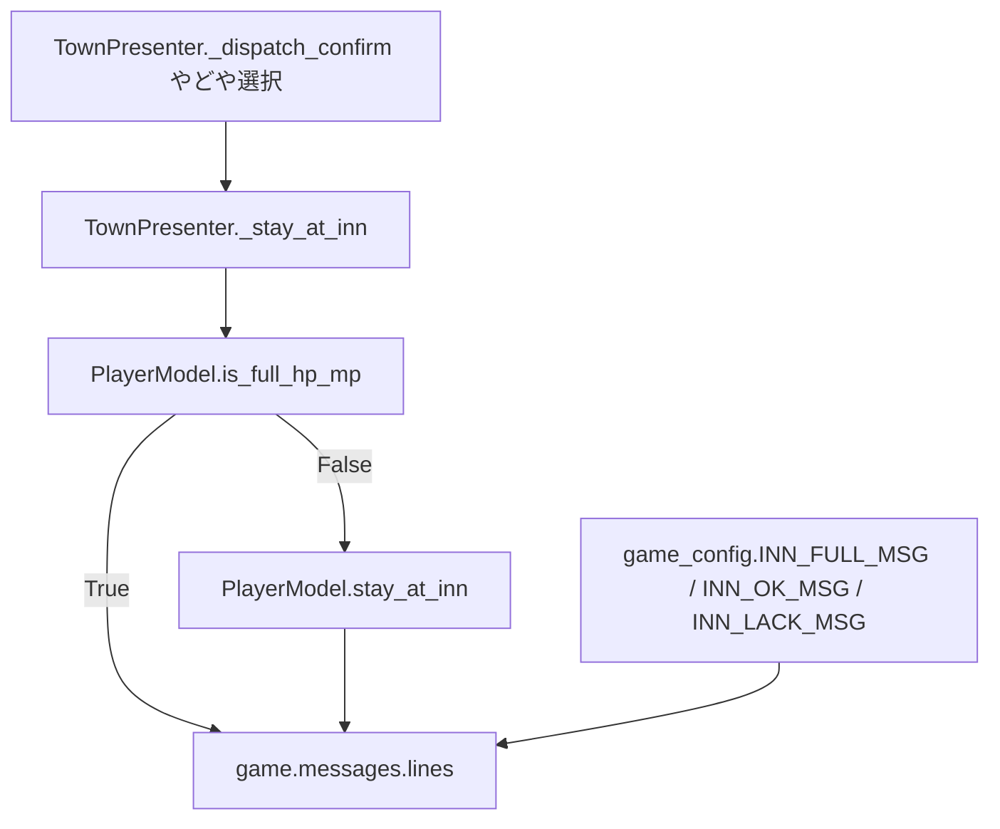
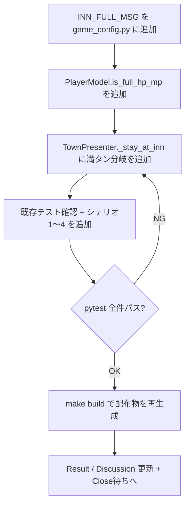

# 2026年5月17日 やどやでHP満タンなら泊まらずメッセージだけ出す

> 状態：⑨ Close待ち
> 次のゲート：（ユーザー）このノートを Close してよいか確認する

---

## 1) Journey（どこへ行くか）

> 補足：深層的目的 子どもが「いま泊まる必要が無い」ことを払う前に知り、無駄遣いで損した気持ちにならないで済む
> 補足：やらないこと 「げんきまんたん」以外の親切判定（コイン残量警告・自動でひとこと等）まで広げない
> 補足：責務分担厳格度 basic

1. 前提条件
   1. 💦 `PlayerModel.stay_at_inn(cost)` は所持金チェックだけ見て、満タン判定をせずに HP/MP 全回復＋gold減算をする（`src/shared/state/player_model.py:210-218`）
   2. 💦 `TownPresenter._stay_at_inn` は 2 値（成功＝INN_OK_MSG / 失敗＝INN_LACK_MSG）でしか分岐していない（`src/scenes/town/presenter.py:280-292`）
   3. 💦 やどやのメッセージ文言は `src/shared/constants/game_config.py` の `INN_OK_MSG` / `INN_LACK_MSG` に SSoT がある

2. Before
   1. 💦 HP/MP が満タンでもやどやを選ぶと、宿代だけ引かれてしまう
   2. 💦 子どもがあとから所持金を見て「あれ、減ってる」と気づき損した気分になる
   3. ❌ もどかしい

3. After
   1. 💦 満タンでやどやを選ぶと「すでに げんきまんたんだ！」と表示される
   2. ✅ 所持金は減らず、HP/MP もそのまま、まちメニューへ戻れる
   3. ❤️ 安心

4. 例外
   1. HP/MP は満タンだが毒状態が残っているケース：満タン判定には毒を含めないので **INN_FULL_MSG を出してスキップする**。毒解除したい場合はどくけしのきのみ等を使う別ルートに任せる（罠化のリスクは Discussion 参照）
   2. 所持金が宿代に足りない場合は、満タン判定より先に「げんきまんたん」を返す（払えなくても損しない）

5. 境界条件
   1. 「げんきまんたん」の判定は `hp == max_hp and mp == max_mp`（毒は対象外）
   2. メッセージ表示は既存の `_enter_message` 経路に乗せ、まちメニューへの戻り方は INN_OK_MSG と同じ
   3. 文言は日本語固定（既存 INN_OK_MSG / INN_LACK_MSG も日本語固定なので英語版は作らない）

6. 委任度
   1. 🟢 全体として CC 単独で進められる
   2. 🟢 CCのみで可：`INN_FULL_MSG = "すでに げんきまんたんだ！"` 追加・`PlayerModel` に判定 API 追加・`TownPresenter._stay_at_inn` 分岐追加・テスト追加
   3. 🔴 人の判断：なし（判定条件は HP+MP 両方満タンで確定、英語版は不要で確定）

---

## 2) ユーザーストーリーマップ

> Gherkin の前に、今回の仕事をどの順で進めるかをそろえる。
> 委任度：🟢 ユーザー指示で自走実装まで継続
> 残る曖昧さ：なし

1. 👀 tasknote確認済み：`steering/done/20260517-town-menu-show-inn-cost.md`、`steering/20260517-shop-owned-marker-clipping.md`
2. 👀 skill・tool・MCP確認済み：`manage-tasknotes` skill / `rg` / `pytest`
3. 👀 `PlayerModel.stay_at_inn` と `TownPresenter._stay_at_inn` の責務境界を確認する
4. 📝 `INN_FULL_MSG = "すでに げんきまんたんだ！"` を `game_config.py` に追加する
5. 📝 `PlayerModel` に `is_full_hp_mp()` のような判定プロパティ/メソッドを追加する
6. 📝 `TownPresenter._stay_at_inn` の冒頭で満タン判定し、満タンなら `INN_FULL_MSG` を出して return（gold を減らさず stay_at_inn を呼ばない）
7. 📝 既存テストに影響が無いことを確認しつつ、新シナリオ（満タン時スキップ／満タン×コイン不足／HPだけ満タンで MP 減／毒残りで満タン）を追加する
8. ✅ `pytest test/` 全件パスで CoVe する
9. 📝 Result / Discussion を更新し、Close待ちへ進む

---

---

## 3) Gherkin（完了条件）

> 委任度：🟢 自走で実装まで進められる
> 残る曖昧さ：なし

### シナリオ一覧

#### シナリオ1：正常系（HP/MP満タンでやどやを選ぶと払わずメッセージだけ出る）

1. 🧱 PlayerModel が `hp == max_hp`、`mp == max_mp`、`gold >= inn_cost`、`poisoned == False` の状態でやどやメニューを選択
2. 🎬 `TownPresenter._stay_at_inn()` を呼ぶ
3. ✅ `game.messages.lines == [INN_FULL_MSG]`（"すでに げんきまんたんだ！"）。`PlayerModel.gold` は変化しない。`PlayerModel.stay_at_inn` は呼ばれない

---

#### シナリオ2：再試行系（HPだけ満タンで MP が減っていれば通常泊まり）

1. 🧱 PlayerModel が `hp == max_hp`、`mp < max_mp`、`gold >= inn_cost` の状態でやどやメニューを選択
2. 🎬 `TownPresenter._stay_at_inn()` を呼ぶ
3. ✅ `game.messages.lines == [INN_OK_MSG]`。`gold` は inn_cost 分減る。`mp` は `max_mp` まで回復する

---

#### シナリオ3：境界条件（HP/MP満タン+毒残りでも INN_FULL_MSG を優先）

1. 🧱 PlayerModel が `hp == max_hp`、`mp == max_mp`、`poisoned == True`、`gold >= inn_cost` の状態でやどやメニューを選択
2. 🎬 `TownPresenter._stay_at_inn()` を呼ぶ
3. ✅ `game.messages.lines == [INN_FULL_MSG]`。`gold` は変化しない。`poisoned` は残る（毒解除は別ルートに任せる）

---

#### シナリオ4：異常系（HP/MP満タンでコイン不足でも INN_FULL_MSG を優先）

1. 🧱 PlayerModel が `hp == max_hp`、`mp == max_mp`、`gold < inn_cost` の状態でやどやメニューを選択
2. 🎬 `TownPresenter._stay_at_inn()` を呼ぶ
3. ✅ `game.messages.lines == [INN_FULL_MSG]`（INN_LACK_MSG ではなく）。`gold` は変化しない

---

#### シナリオ5：既存挙動の維持（HP/MP どちらも減＋コインあり）

1. 🧱 PlayerModel が `hp < max_hp`、`mp < max_mp`、`gold >= inn_cost` の状態でやどやメニューを選択
2. 🎬 `TownPresenter._stay_at_inn()` を呼ぶ
3. ✅ `game.messages.lines == [INN_OK_MSG]`。`gold` 減算、`hp/mp` 全回復、`poisoned` 解除という既存挙動を維持。既存 pytest 738 件が全て通る

---

## 4) Design（どうやるか）

### 責務分担概要

| 親ディレクトリ | 責務概要 |
|---|---|
| `src/scenes/town/` | やどやアクションの分岐判定（満タン時は払わず・回復させずメッセージのみ） |
| `src/shared/state/` | `PlayerModel` に「HP/MP 満タン」判定 API を追加（state は Model に集約） |
| `src/shared/constants/` | `INN_FULL_MSG` 文言定数の SSoT |
| `test/` | TownPresenter の `_stay_at_inn` 分岐と PlayerModel の判定 API を検証 |

### 責務分担概要図

### 責務分担詳細

#### 親ディレクトリ: `src/shared/constants`

- ファイル名: `game_config.py`
- 既存/新規: 既存
- 責務内容:
  - `INN_FULL_MSG` (新規定数, 値 `"すでに げんきまんたんだ！"`): HP/MP 満タン時のスキップメッセージ SSoT
- 置く理由: やどや系メッセージは `INN_OK_MSG` / `INN_LACK_MSG` と同じファイルに集約する原則

#### 親ディレクトリ: `src/shared/state`

- ファイル名: `player_model.py`
- 既存/新規: 既存
- 責務内容:
  - `is_full_hp_mp()` (新規 method, 戻り値 `bool`): `hp == max_hp and mp == max_mp` を返す（毒は対象外）
- 置く理由: 「満タンかどうか」は PlayerModel が持つ state からの導出。Presenter で生 attribute を読んで条件を組み立てるのは責務漏れになるため、Model に判定 API を置く（M4-1）

#### 親ディレクトリ: `src/scenes/town`

- ファイル名: `presenter.py`
- 既存/新規: 既存
- 責務内容:
  - `_stay_at_inn`: 冒頭で `game.player_model.is_full_hp_mp()` をチェック。True なら `INN_FULL_MSG` を `_enter_message` で出して return。False なら既存ロジック（`stay_at_inn(cost)` → 成功 INN_OK / 失敗 INN_LACK）に進む
  - docstring の Policy も「満タン時は INN_FULL_MSG / それ以外は既存」に更新
- 置く理由: 表示文字列の組み立てと分岐は Presenter の責務（M3-1）。Model（state 判定）と View（描画）に染み出させない

#### 親ディレクトリ: `test`

- ファイル名: `test_cjg_town_presenter_actions.py`
- 既存/新規: 既存
- 責務内容:
  - シナリオ1〜4 を `_stay_at_inn` に対する fake game で検証する 4 ケース追加
  - シナリオ5（既存挙動維持）は既存の `_stay_at_inn` テストでカバー済みかを確認し、不足あれば追加
- 置く理由: 既存の TownPresenter アクション系テスト群（`_talk` / `_stay_at_inn` / `_save` / `_exit`）と同じファイルに並べる

- **関連スキル・MCP**：`manage-tasknotes` のみ。他は不要

---

## 5) Tasklist

- [x] （CC）`INN_FULL_MSG` を `game_config.py` に追加
- [x] （CC）`PlayerModel.is_full_hp_mp()` を追加
- [x] （CC）`TownPresenter._stay_at_inn` に満タン分岐を追加し docstring 更新
- [x] （CC）シナリオ1〜4 のテストを `test_cjg_town_presenter_actions.py` に追加（`TownInnFullMessageTest` 4 ケース）
- [x] （CC）`pytest test/` で 742 passed, 2 skipped
- [x] （CC）`make build` で dist artifacts を再生成（exit 0）
- [x] （CC）Result / Discussion を更新し Close待ちへ進む

---

## 6) Result（成果物）

### 変更ファイル

- `src/shared/constants/game_config.py`
  - `INN_FULL_MSG = "すでに げんきまんたんだ！"` を追加（`INN_OK_MSG` / `INN_LACK_MSG` と同列の SSoT）
- `src/shared/state/player_model.py`
  - `is_full_hp_mp() -> bool` を `# ----- ルール：宿屋・ショップ -----` block に追加。判定は `hp >= max_hp and mp >= max_mp`、毒は対象外
- `src/scenes/town/presenter.py`
  - `_stay_at_inn` 冒頭で `is_full_hp_mp()` を見て True なら `INN_FULL_MSG` を出して return。docstring の Policy も更新
- `test/test_cjg_town_presenter_actions.py`
  - `TownInnFullMessageTest` を新規追加（4 ケース：シナリオ1〜4）

### 実行ログ

- `pytest test/test_cjg_town_presenter_actions.py`：`15 passed in 0.08s`（既存 11 + 新規 4）
- `pytest test/`：`742 passed, 2 skipped in 11.18s`（既存 738 + 新規 4）

### 動作確認

- HP/MP 満タン時にやどやを選ぶと「すでに げんきまんたんだ！」と表示され、gold は減らない
- HP だけ満タンで MP が減っていれば通常通り宿泊（INN_OK_MSG、gold 減、MP 回復）
- HP/MP 満タンでもコイン不足の場合は INN_LACK_MSG ではなく INN_FULL_MSG が出る（払えなくても損しない）
- 既存の `_stay_at_inn` テスト（`test_inn_heals_when_affordable` / `test_inn_rejects_when_gold_insufficient`）はそのまま通る

---

---

## 7) Discussion（残課題の起票）

### 残課題メモ

- **毒残り時の宿屋スキップは「罠」になり得る**：HP/MP 満タン+毒残りで宿屋を選ぶと、毒解除されずに `INN_FULL_MSG` が出る。プレイヤーが「やどやで毒も治す」と思い込んでいると、どくが残ったまま気付かないリスクがある。
  - 対応案A：判定を `is_full_hp_mp_and_not_poisoned()` に拡張して、毒残りなら通常泊まりにする（gold は減るが安全）
  - 対応案B：満タン時メッセージを「すでに げんきまんたんだ！（どくはどくけしのきのみで）」のような注意文に拡張
  - 対応案C：現状維持（毒解除はあくまで「どくけしのきのみ」の役割）
  - 現状は案C（ユーザー指示「HP+MP満タン」の厳密適用）。罠化の声があがれば別 tasknote で再考する。

### 判断の記録

- 判定 API は `PlayerModel.is_full_hp_mp()`（毒は含めず）として Model に集約した。「満タン判定」を Presenter で `p.hp == p.max_hp and p.mp == p.max_mp` のように書くと、状態判定が Presenter に染み出るため M4-1 違反になる。
- 満タン判定をコイン不足判定より **先** にしたのは「払えなくても損しない／満タンなら払う必要がない、というプレイヤーへの親切」を最優先するため。コイン不足で `INN_LACK_MSG` を出してから「実はそもそも満タンだから払う必要なかった」となると二重に残念になる。
- `INN_FULL_MSG` の文言「すでに げんきまんたんだ！」は子ども向けひらがな表記。`！` で前向きに閉じることで「損した」ではなく「親切に教えてくれた」と読めるようにした。
- 英語版（`ALREADY FULL HP & MP!` 等）は作らなかった。`INN_OK_MSG` / `INN_LACK_MSG` も日本語固定で運用されており、メッセージ系の英語切替は既存設計に無いため、ここだけ拡張しない。

---

### 反省とルール化

- 記入先：observe-situation / manage-tasknotes / CLAUDE.md
- 次にやること：なし（メモリ更新が必要な学びは出ていない）

---

## 8) 参考文献

- 関連 tasknote：`steering/done/20260517-town-menu-show-inn-cost.md`（やどや宿代併記、同テーマの直前タスク）
- 関連 tasknote：`steering/20260517-shop-owned-marker-clipping.md`（下部メッセージ枠の流用パターン参考）
- 関連コード：`src/scenes/town/presenter.py` `_stay_at_inn`（行 280-292）
- 関連コード：`src/shared/state/player_model.py` `stay_at_inn`（行 210-218）
- 関連コード：`src/shared/constants/game_config.py` `INN_OK_MSG` / `INN_LACK_MSG`（行 69-70）
