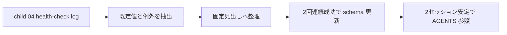

# 2026年5月23日 開発基盤：LLM Wiki運用をスキーマへ文書化する

> 状態：⑧ Closing
> 次のゲート：なし

---

## 1) Journey（どこへ行くか）

> 補足：深層的目的 initial loop の学びが揃ってから、future session 用の既定動作だけを固定する
> 補足：やらないこと 初回 health-check 前に schema を main route へ混ぜない
> 補足：責務分担厳格度 basic

1. 前提条件
   1. 💦 setup / ingest / query / health-check の学びが先に必要である
   2. 💦 schema は settled な既定値と例外条件だけを書く
   3. 💦 固定見出しは `Purpose` `Default Flow` `File Layout` を含む
   4. 💦 さらに `Ingest` `Query` `Health-Check` `Batch` `Exceptions` `Update Rule` を持つ
   5. 💦 この note は later note である

2. Before
   1. 💦 初回 1 周前に schema を固めると誤固定しやすい
   2. 💦 future session へ何を引き継ぐかは log を見てから決めたい
   3. ❌ 早い

3. After
   1. 💦 initial loop の学びが揃ってから schema に落とせる
   2. ✅ 固定見出しに沿って future session の短い憲法を作れる
   3. ✅ 更新条件と AGENTS 参照条件も決まる
   4. ❤️ 安心

4. 例外
   1. 1 周だけでは未確定が多ければ、schema 化をさらに先送りしてよい

5. 境界条件
   1. 初回 health-check 完了前には着手しない

6. 委任度
   1. 🟢 固定見出し、更新条件、AGENTS 参照条件まで固まっている
   2. 🟢 CCのみで可：後段で既定値と例外条件を整理する
   3. 🟢 route 優先順位も main route 先行で固定済み

---

## 2) ユーザーストーリーマップ

> schema は initial loop 完了後の定着レイヤーとして待機させる。
> 委任度：🟢 schema を later note へ下げるところまでは CC が固められる
> 残る曖昧さ：なし

### 事前確認

- [x] tasknote確認済み
- [x] skill・tool・MCP確認済み
  - [x] `manage-tasknotes`
- [x] 永続的ドキュメント確認済み
  - [x] `AGENTS.md`
  - [x] `manage-tasknotes/TEMPLATE.md`
  - [x] `manage-tasknotes/RULES.md`

### 本体

#### 話題1：schema の固定見出しを決める

##### ユーザー：Karpathy 型の知識キュレーター（standardize）

1. 当初計画
    1. 🧱 `Purpose` `Default Flow` `File Layout` を置く
    2. 📘 `Ingest Defaults` `Query Defaults` `Health-Check Defaults` `Batch Policy` を置く
    3. 📎 `Exceptions` `Update Rule` を置く

#### 話題2：何を書くかと何を書かないかを分ける

##### ユーザー：Karpathy 型の知識キュレーター（scope）

1. 当初計画
    1. ✅ 迷ったらどうするかだけを書く
    2. ✂️ 実験メモや一時的な迷いは tasknote に残す
    3. 🔗 future session が最初に読む短い憲法にする

#### 話題3：更新条件と AGENTS 参照条件を固定する

##### ユーザー：Karpathy 型の知識キュレーター（stability）

1. 当初計画
    1. 🔁 同じルールが 2 回連続で通ったら schema を更新する
    2. 📎 2 セッション連続で崩れなければ AGENTS から参照する
    3. ⏸️ それまでは note 側を正本に保つ

---

## 3) Gherkin（完了条件）

> 委任度：🟢 schema の見出し、文面対象、更新条件まで含めて CC が進められる
> 残る曖昧さ：なし

### シナリオ一覧

- [x] シナリオ1：schema の固定見出しが定まる

1. 🧱 future session が最初に読む短い運用文書が必要になる
2. 🎬 固定見出しを定義する
3. ✅ 後段で迷わず文面を埋められる

```gherkin
Given future session 用の schema doc を後段で作りたい
When `Purpose` `Default Flow` `File Layout` `Ingest Defaults` `Query Defaults` `Health-Check Defaults` `Batch Policy` `Exceptions` `Update Rule` を固定する
Then 後段で迷わず文面を埋められる
And schema が短い憲法として機能する
```

- [x] シナリオ2：schema に書く内容と書かない内容が分かれる

1. 🧱 tasknote には実験メモと一時判断も混ざっている
2. 🎬 schema には既定動作と例外条件だけを抜き出す
3. ✅ future session が短く読める文書になる

```gherkin
Given tasknote には一時的な迷いや実験メモも残る
When schema には既定動作と例外条件だけを書く
Then future session が最初に読む短い文書になる
And 実験メモは tasknote 側に残る
```

- [x] シナリオ3：更新条件と AGENTS 参照条件が固定される

1. 🧱 1 回うまくいっただけでは schema を固定したくない
2. 🎬 更新条件と AGENTS 参照条件を定める
3. ✅ 早すぎる固定を避けられる

```gherkin
Given initial loop の学びを future session 用ルールに変えたい
When 同じルールが 2 回連続で通ったら schema を更新する
And 2 セッション連続で崩れなければ AGENTS から参照する
Then 早すぎる固定を避けられる
And note 側を先に正本として保てる
```

---

## 4) Design（どうやるか）

### 責務分担概要

- この note は main route の外に置く
- health-check log ができたあとに `docs/llm-wiki-ops-schema.md` を検討する
- schema は固定見出しに沿って、既定動作と例外条件だけを書く
- 更新は同じルールが 2 回連続で通ったときだけ行う
- AGENTS 参照は 2 セッション連続安定後に行う

### 責務分担概要図



### 責務分担詳細

- `steering/2026年5月23日 開発基盤：Karpathy型LLM Wiki運用の親ノート.md` （➕：later note として参照する）
- `steering/2026年5月23日 開発基盤：Wikiの健全性チェックを試す.md` （➕：health-check log を入力にする）
- `steering/2026年5月23日 開発基盤：LLM Wiki運用をスキーマへ文書化する.md` （➕：固定見出し、更新条件、AGENTS 参照条件を持つ）

### 【参照】

- Steering: `steering/2026年5月23日 開発基盤：Karpathy型LLM Wiki運用の親ノート.md`
- Source: `https://gist.github.com/karpathy/442a6bf555914893e9891c11519de94f`

### 変更範囲

- やること:
  - schema の固定見出しと更新条件を固定する
- やらないこと:
  - AGENTS 参照の即時反映

### 検証

- 検証コマンド:
  - `node /home/exedev/dotfiles/shared/linter/coding-rules/tasknote/run_tasknote_lint.mjs --config ./tasknote-lint.config.json 'steering/2026年5月23日 開発基盤：LLM Wiki運用をスキーマへ文書化する.md'`
- 成功条件:
  - schema note に固定見出し、更新条件、AGENTS 参照条件が書かれている
- 未実施時の扱い:
  - lint 未実施なら schema policy draft 止まりとする

---

## 5) Tasklist

- [x] child `04` の log が揃ったら settled / exception を抽出する
- [x] 固定見出しへ既定動作を割り当てる
- [x] 2 回連続成功で更新する対象を決める
- [x] 2 セッション連続安定で AGENTS 参照へ上げるか判定する

---

## 6) 作業ログ

- [x] main route から外し、later note に下げた
- [x] 固定見出し、更新条件、AGENTS 参照条件を Karpathy 想定相談で固定した

---

## 7) 評価と成果物

> 評価：🟢 first-cycle で実証した defaults を schema draft として文書化できた

### 成果物

- `steering/2026年5月23日 開発基盤：LLM Wiki運用をスキーマへ文書化する.md`
- `docs/llm-wiki-ops-schema.md`

---

## 8) Discussion

- schema 化は initial loop の log を見てからの方が誤固定を避けやすい
- schema はメモ集ではなく、future session 用の短い憲法にする
- 1 回成功だけでは更新せず、2 回連続成功で schema、2 セッション安定で AGENTS 参照に進む
- 今回作った `docs/llm-wiki-ops-schema.md` は draft として保存し、固定条件は本文内に残した

---

## 9) Closing

- 状態: done
- 次のゲート: なし
- close 条件:
  - [x] health-check log を見て settled / exception が整理されている
  - [x] 固定見出しへ割り当てる内容が決まっている
  - [x] schema 更新条件と AGENTS 参照条件がその run に適用されている

---

## 10) 参考資料

- Karpathy, `LLM Wiki`: `https://gist.github.com/karpathy/442a6bf555914893e9891c11519de94f`
