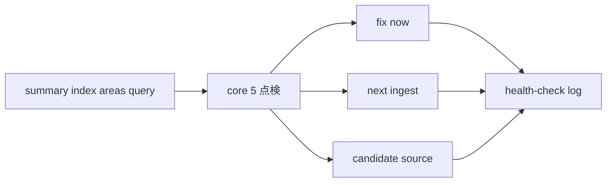

# 2026年5月23日 開発基盤：Wikiの健全性チェックを試す

> 状態：⑧ Closing
> 次のゲート：なし

---

## 1) Journey（どこへ行くか）

> 補足：深層的目的 小さい wiki でも最初の health-check を回し、問題を分類付き log に残せるようにする
> 補足：やらないこと 自動 health-check ツールや web 調査の自動化までは広げない
> 補足：責務分担厳格度 basic

1. 前提条件
   1. 💦 child `02` の source summary と child `03` の saved answer がある前提で進める
   2. 💦 health-check は core 5 を既定観点にする
   3. 💦 成功条件は「問題ゼロ」ではなく、分類付き log が残ることである
   4. 💦 この note は parent note 配下の child `04` である

2. Before
   1. 💦 小さい wiki でも点検してよいかが曖昧だった
   2. 💦 問題の残し方が定まらないと、次の ingest や query に返しにくい
   3. ❌ 不安

3. After
   1. 💦 core 5 の問題候補を見られる
   2. ✅ 結果を 3 区分へ分類できる
   3. ✅ 初回点検の log が次の route へ戻る
   4. ❤️ 安心

4. 例外
   1. 問題が 0 件でも、その結果を log に残してよい
   2. web が要る gap は candidate source に寄せてその場で止めてよい

5. 境界条件
   1. 今回は core 5 を主に見る
   2. 実修正や新 source 追加は別 child に戻す

6. 委任度
   1. 🟢 core 5 と分類方法は固まっている
   2. 🟢 CCのみで可：初回点検 1 回と health-check log の作成
   3. 🟡 大きな方針変更が必要な矛盾は人レビューが入る

---

## 2) ユーザーストーリーマップ

> health-check を、core 5 点検、分類付き記録、次 route への返却の 3 段でそろえる。
> 委任度：🟢 初回 health-check 1 回と log 化までは CC が固められる
> 残る曖昧さ：なし

### 事前確認

- [x] tasknote確認済み
- [x] skill・tool・MCP確認済み
  - [x] `manage-tasknotes`
  - [x] shared `tasknote-lint`
- [x] 永続的ドキュメント確認済み
  - [x] `AGENTS.md`
  - [x] `manage-tasknotes/TEMPLATE.md`
  - [x] `manage-tasknotes/RULES.md`

### 本体

#### 話題1：core 5 で small wiki を横断して読む

##### ユーザー：Karpathy 型の知識キュレーター（点検）

1. 当初計画
    1. 🔍 contradictions と stale claims を探す
    2. 🔍 orphan pages と missing concepts を探す
    3. 🔍 missing crossrefs を探す

#### 話題2：結果を 3 種に分けて log に残す

##### ユーザー：Karpathy 型の知識キュレーター（記録）

1. 当初計画
    1. 🛠️ すぐ直せるものは `fix now` にする
    2. 🔁 source をもう 1 本入れたいものは `next ingest` にする
    3. 📥 wiki 外の事実が要るものは `candidate source` にする

#### 話題3：次の route へ返す

##### ユーザー：Karpathy 型の知識キュレーター（handoff）

1. 当初計画
    1. 🔗 `fix now` は更新系 child へ戻す
    2. 🔗 `next ingest` は source 選定へ戻す
    3. 🔗 `candidate source` は raw collection 前の候補として残す

---

## 3) Gherkin（完了条件）

> 委任度：🟢 初回 health-check 1 回の log 化までは CC が進められる
> 残る曖昧さ：なし

### シナリオ一覧

- [x] シナリオ1：small wiki に core 5 の点検をかけられる

1. 🧱 source summary と related pages と saved answer が存在する
2. 🎬 core 5 の観点で横断的に読む
3. ✅ 初回点検に必要な候補を拾える

```gherkin
Given child `02` と child `03` の成果として source summary と related pages と saved answer がある
When core 5 の観点でページを横断して読む
Then contradictions と stale claims と orphan pages と missing concepts と missing crossrefs を洗い出せる
And small wiki でも初回点検を実行できる
```

- [x] シナリオ2：結果を 3 種に分類して残せる

1. 🧱 問題候補が見つかる
2. 🎬 `fix now / next ingest / candidate source` に分類する
3. ✅ 次の route に返しやすい log になる

```gherkin
Given health-check の結果として問題候補が見つかる
When `fix now` `next ingest` `candidate source` に分類して記録する
Then 次の update や ingest や source 追加に戻しやすい
And 成功条件は問題ゼロでなく、分類付き log が残ることになる
```

- [x] シナリオ3：web が要る gap は candidate source に止められる

1. 🧱 wiki の外を見ないと埋まらない gap がある
2. 🎬 その gap を candidate source として残す
3. ✅ health-check の場で外部事実を混ぜない

```gherkin
Given health-check の結果として wiki 外の事実が必要な gap がある
When その gap を candidate source として記録する
Then health-check の場で外部事実を直混ぜしない
And 後続の ingest route に安全に戻せる
```

---

## 4) Design（どうやるか）

### 責務分担概要

- `llm-wiki/wiki/summaries/knowledge/` `wiki/indexes/master-index.md` `wiki/areas/` `wiki/query/` が点検対象である
- `llm-wiki/wiki/logs/health-check-log.md` が分類付きの記録先である
- core 5 を主観点にし、結果は `fix now / next ingest / candidate source` へ振り分ける

### 責務分担概要図



### 責務分担詳細

- `steering/2026年5月23日 開発基盤：Karpathy型LLM Wiki運用の親ノート.md` （➕：child `04` の順序と境界を持つ）
- `steering/2026年5月23日 開発基盤：Wikiへの質問と回答保存を試す.md` （➕：child `03` の saved answer を入力にする）
- `steering/2026年5月23日 開発基盤：Wikiの健全性チェックを試す.md` （➕：health-check 実験の判断と結果を持つ）
- `llm-wiki/wiki/logs/health-check-log.md` （➕：初回点検の分類付き結果を残す）

### 【参照】

- Steering: `steering/2026年5月23日 開発基盤：Karpathy型LLM Wiki運用の親ノート.md`
- Architecture: `AGENTS.md`
- Source: `https://gist.github.com/karpathy/442a6bf555914893e9891c11519de94f`

### 変更範囲

- やること:
  - initial health-check child の観点を tasknote 化する
  - 分類付き log の残し方を明文化する
- やらないこと:
  - web 調査の実行
  - 実修正の同時実行

### 検証

- 検証コマンド:
  - `node /home/exedev/dotfiles/shared/linter/coding-rules/tasknote/run_tasknote_lint.mjs --config ./tasknote-lint.config.json 'steering/2026年5月23日 開発基盤：Wikiの健全性チェックを試す.md'`
- 成功条件:
  - health-check child note が tasknote 形式で存在する
  - parent note から child `04` として参照できる
- 未実施時の扱い:
  - lint 未実施なら health-check draft 止まりとする

---

## 5) Tasklist

- [x] 点検対象 page を summary / index / areas / query から選ぶ
- [x] core 5 の観点で 1 回読む
- [x] `fix now / next ingest / candidate source` に分類する
- [x] `health-check log` に残す
- [x] parent note と later note へ学びを戻す

---

## 6) 作業ログ

- [x] child `03` 完了後に current-child 化する
- [x] 初回点検の対象 page を固定する
- [x] health-check log の分類粒度を確認する

---

## 7) 評価と成果物

> 評価：🟢 core 5 の初回 health-check を実行し、分類付き log を残せた

### 成果物

- `steering/2026年5月23日 開発基盤：Wikiの健全性チェックを試す.md`
- `llm-wiki/wiki/logs/health-check-log.md`

---

## 8) Discussion

- 関連tasknote: `steering/2026年5月23日 開発基盤：Karpathy型LLM Wiki運用の親ノート.md`
- health-check の成功条件は「問題ゼロ」ではなく、「分類付き log が残ること」である
- core 5 を毎回見て、web が要る gap は candidate source に止める
- 初回結果は `contradictions: none` `stale_claims: none` `orphan_pages: none` で、optional tooling を `next_ingest` に送った

---

## 9) Closing

- 状態: done
- 次のゲート: なし
- close 条件:
  - [x] health-check を 1 回試している
  - [x] `fix now / next ingest / candidate source` の分類が残っている
  - [x] `health-check log` が 1 本残っている
  - [x] parent note に学びが戻っている

---

## 10) 参考資料

- Karpathy, `LLM Wiki`: `https://gist.github.com/karpathy/442a6bf555914893e9891c11519de94f`
