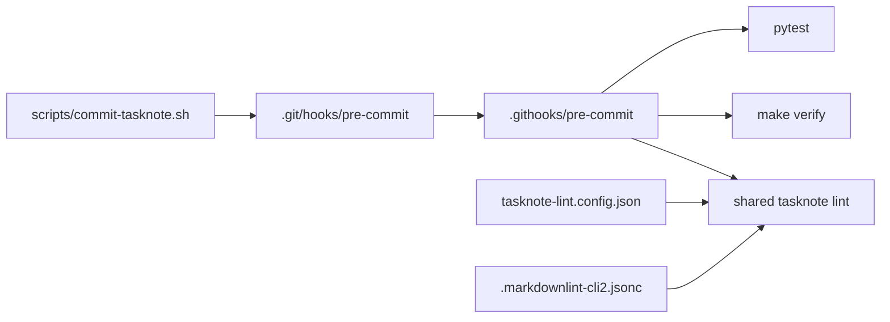

# 2026年5月23日 開発基盤：タスクノートlintをリポジトリへ配線する

> 状態：⑨ Closing
> 次のゲート：（利用者）なし。次回以降の tasknote commit で helper を使う

---

## 1) Journey（どこへ行くか）

> 補足：深層的目的 tasknote 起票時に lint を自然に通し、崩れた note を残さない
> 補足：やらないこと tasknote 以外の hook 体系や CI 設計まで広げない
> 補足：責務分担厳格度 basic

1. 前提条件
   1. 💦 shared tasknote lint は dotfiles 側にある
   2. 💦 repo の pre-commit には tasknote lint が無い
   3. 💦 tasknote commit helper も未整備である

2. Before
   1. 💦 tasknote lint は手動実行だけで常設されていない
   2. 💦 note 起票時の崩れを hook で止められない
   3. ❌ もどかしい

3. After
   1. 💦 tasknote lint が repo hook から呼ばれる
   2. ✅ tasknote 用 helper で lint 付き commit ができる
   3. ✅ verify と pytest の既存導線も保たれる
   4. ❤️ 安心

4. 例外
   1. tasknote 以外の commit では lint 分岐を必須化しない
   2. 緊急時は既存の `SKIP_TESTS=1` 逃がしを残す

5. 境界条件
   1. 対象は `steering/*.md` の tasknote に絞る
   2. `package.json` は増やさず `npm exec` を使う

6. 委任度
   1. 🟢 shared linter の呼び出し方は既知である
   2. 🟢 CCのみで可：hook 配線と helper 追加
   3. 🔴 将来の CI 常設化までは今回決めない

---

## 2) ユーザーストーリーマップ

> Gherkin の前に、今回の仕事をどの順番で進めるかだけをそろえる。
> 委任度：🟢 今回の配線と検証までは CC が閉じられる
> 残る曖昧さ：なし

### 事前確認

- [x] tasknote確認済み
- [x] skill・tool・MCP確認済み
  - [x] `manage-tasknotes`
  - [x] `verification-before-completion`
  - [x] shared `tasknote-lint`
- [x] 永続的ドキュメント確認済み
  - [x] `AGENTS.md`
  - [x] `manage-tasknotes/TEMPLATE.md`
  - [x] `manage-tasknotes/RULES.md`

### 本体

#### 話題1：現在の hook と lint 条件を把握する

##### ユーザー：調査担当

1. 当初計画
    1. 👀 既存の `.git/hooks/pre-commit` を読む
    2. 👀 shared tasknote lint の使い方を読む
    3. 📝 repo に足す最小ファイルを決める

#### 話題2：repo 正本の hook と config を追加する

##### ユーザー：配線担当

1. 当初計画
    1. ✂️ `tasknote-lint.config.json` を追加する
    2. ✂️ `.githooks/pre-commit` と helper を追加する
    3. ✂️ `tools/install_hooks.sh` を委譲型に直す

#### 話題3：配線後の導線を end-to-end で確かめる

##### ユーザー：検証担当

1. 当初計画
    1. 👀 shared tasknote lint 単体実行を通す
    2. 👀 `TASKNOTE_PRECOMMIT=1` の hook 実行を通す
    3. 📝 verify と pytest が壊れていないと確認する

---

## 3) Gherkin（完了条件）

> 委任度：🟢 実装済み内容を完了条件へ落とし直せる
> 残る曖昧さ：なし

### シナリオ一覧

- [x] シナリオ1：repo root に tasknote lint の設定が置かれる

1. 🧱 tasknote lint は shared 側にしか無い（配線前）
2. 🎬 repo root に config と markdownlint 設定を追加する（配線）
3. ✅ steering tasknote を repo から lint 対象化できる（設定後）

```gherkin
Given repo には tasknote lint 用の設定ファイルが無い
When `tasknote-lint.config.json` と `.markdownlint-cli2.jsonc` を追加する
Then `steering/*.md` を shared tasknote lint の対象にできる
And hand-run で tasknote lint を実行できる
```

- [x] シナリオ2：tasknote 用 commit で lint 分岐が pre-commit から呼ばれる

1. 🧱 既存の pre-commit は verify と pytest しか呼ばない（変更前）
2. 🎬 tracked hook と helper を追加し、local hook を委譲型にする（配線）
3. ✅ tasknote commit 時だけ lint 分岐を通し、通常導線も維持する（変更後）

```gherkin
Given repo の pre-commit は tasknote lint を呼ばない
When `.githooks/pre-commit` と `scripts/commit-tasknote.sh` を追加する
And `tools/install_hooks.sh` を tracked hook 委譲型へ更新する
Then `TASKNOTE_PRECOMMIT=1` の tasknote commit で lint 分岐が走る
And 既存の make verify と pytest の導線も残る
```

- [x] シナリオ3：配線後の lint と hook 実行が end-to-end で通る

1. 🧱 追加した config と hook がまだ未検証である（検証前）
2. 🎬 tasknote lint 単体実行と pre-commit 実行を行う（検証）
3. ✅ lint と verify と pytest がすべて通る（検証後）

```gherkin
Given tasknote lint 配線後の repo がある
When shared `run_tasknote_lint.mjs` を対象 tasknote へ実行する
And `TASKNOTE_PRECOMMIT=1 .git/hooks/pre-commit` を staged tasknote で実行する
Then tasknote lint は 0 error(s) で通る
And `make verify` と `python -m pytest test/ -q --tb=short` も通る
```

---

## 4) Design（どうやるか）

### 責務分担概要

- repo root config は tasknote lint の対象範囲と markdownlint 設定を持つ
- tracked hook は tasknote lint と既存 verify/pytest の統合入口を持つ
- helper と installer は local `.git/hooks/pre-commit` を正本 hook へ向ける

### 責務分担概要図



### 責務分担詳細

- `tasknote-lint.config.json`: `steering/*.md` を tasknote 対象へ固定する
- `.markdownlint-cli2.jsonc`: repo 側 markdownlint 例外を最小設定する
- `.githooks/pre-commit`: tasknote lint と verify/pytest の統合入口を持つ
- `scripts/commit-tasknote.sh`: tasknote commit だけ `TASKNOTE_PRECOMMIT=1` を付ける
- `tools/install_hooks.sh`: local hook を tracked hook 委譲型で再生成する

### 【参照】

- Steering: `steering/2026年5月23日 開発基盤：injestを手動でやってみる.md`
- Architecture: `AGENTS.md`
- Hook installer: `tools/install_hooks.sh`

### 変更範囲

- やること:
  - tasknote lint 用 config と tracked hook を追加する
  - tasknote 用 commit helper を追加する
  - installer を tracked hook 委譲型へ更新する
- やらないこと:
  - CI での tasknote lint 常設化
  - tasknote 以外の markdown まで対象を広げること

### 検証

- 検証コマンド:
  - `node /home/exedev/dotfiles/shared/linter/coding-rules/tasknote/run_tasknote_lint.mjs --config ./tasknote-lint.config.json 'steering/2026年5月23日 開発基盤：injestを手動でやってみる.md'`
  - `TASKNOTE_PRECOMMIT=1 .git/hooks/pre-commit`
- 成功条件:
  - tasknote lint が `Summary: 0 error(s)` で終わる
  - hook 経由でも `make verify` と `pytest` が通る
- 未実施時の扱い:
  - end-to-end 検証が無ければ配線完了扱いにしない

---

## 5) Tasklist

- [x] shared tasknote lint の config 形式と既存 hook を確認した
- [x] repo root に lint config と markdownlint config を追加した
- [x] tracked hook と tasknote commit helper を追加した
- [x] `tools/install_hooks.sh` を tracked hook 委譲型へ更新した
- [x] tasknote lint 単体実行と pre-commit 実行で配線を確認した

---

## 6) 作業ログ

- [x] `tasknote-lint.config.json` を追加し、`steering/*.md` を対象化した
- [x] `.markdownlint-cli2.jsonc` を追加し、`MD013` を無効化した
- [x] `.githooks/pre-commit` を追加し、lint 分岐と verify/pytest を統合した
- [x] `scripts/commit-tasknote.sh` を追加し、`TASKNOTE_PRECOMMIT=1` を付けた
- [x] `tools/install_hooks.sh` を local hook 委譲型へ更新した

---

## 7) 評価と成果物

> 評価：🟢 tasknote lint 配線と end-to-end 検証まで完了した

### 成果物

- `tasknote-lint.config.json` （tasknote lint 対象設定）
- `.markdownlint-cli2.jsonc` （repo 側 markdownlint 設定）
- `.githooks/pre-commit` （tracked pre-commit 本体）
- `scripts/commit-tasknote.sh` （tasknote commit helper）
- `tools/install_hooks.sh` （tracked hook 委譲型へ更新）

---

## 8) Discussion

- shared tasknote lint は repo 固有設定を薄く持つだけで再利用できた
- `package.json` を増やさず `npm exec` で済ませたのは、この repo では運用が軽い
- local `.git/hooks/pre-commit` を tracked hook へ委譲したので、今後の差分確認も楽になる

---

## 9) Closing

- 状態: done
- 次のゲート: なし
- close 条件:
  - [x] tasknote lint 用 config が repo root に置かれている
  - [x] tasknote 用 helper から lint 分岐付き commit ができる
  - [x] hook 経由の verify と pytest が通る

---

## 10) 参考資料

- `/home/exedev/dotfiles/shared/linter/coding-rules/tasknote/README.md`
- `/home/exedev/dotfiles/shared/linter/coding-rules/tasknote/run_tasknote_lint.mjs`
- `/home/exedev/dotfiles/shared/linter/specs/tasknote-core/tasknote_core_rules.yml`
