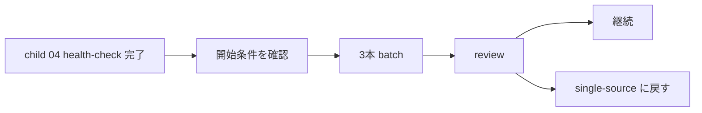

# 2026年5月23日 開発基盤：複数資料の一括取り込み方針を決める

> 状態：⑧ Closing
> 次のゲート：なし

---

## 1) Journey（どこへ行くか）

> 補足：深層的目的 初回 1 周の学びを壊さずに、必要になったときだけ batch ingest を増やす
> 補足：やらないこと 初回 health-check 前に batch を main route へ混ぜない
> 補足：責務分担厳格度 basic

1. 前提条件
   1. 💦 batch ingest は初回 1 周の後段に回した
   2. 💦 one-by-one が既定で、batch は例外である
   3. 💦 開始条件は `health-check logあり / inbox 3本以上` である
   4. 💦 source 群は同テーマで低リスクに限る
   5. 💦 この note は later note である

2. Before
   1. 💦 throughput を上げたい気持ちが先行すると quality を落としやすい
   2. 💦 初回点検前に batch を混ぜると route が曇る
   3. ❌ こわい

3. After
   1. 💦 batch を使う条件が初回点検後にだけ評価される
   2. ✅ 既定 3 本、2 回安定で 5 本までの昇格条件が決まる
   3. ✅ 停止条件と rollback 先も決まる
   4. ❤️ 安心

4. 例外
   1. throughput が不要なら、この note は開かなくてよい

5. 境界条件
   1. 初回 health-check 完了前には着手しない

6. 委任度
   1. 🟢 開始条件、review、停止条件、昇格条件まで固まっている
   2. 🟢 CCのみで可：必要になったときの batch 実行判断と記録
   3. 🟢 今回すぐ進めない判断も parent route で固定済み

---

## 2) ユーザーストーリーマップ

> batch は initial loop 完了後の throughput 拡張として待機させる。
> 委任度：🟢 既定値は残しつつ、main route から外すところまでは CC が固められる
> 残る曖昧さ：なし

### 事前確認

- [x] tasknote確認済み
- [x] skill・tool・MCP確認済み
  - [x] `manage-tasknotes`
- [x] 永続的ドキュメント確認済み
  - [x] `AGENTS.md`
  - [x] `manage-tasknotes/TEMPLATE.md`
  - [x] `manage-tasknotes/RULES.md`

### 本体

#### 話題1：batch を始めてよい条件を固定する

##### ユーザー：Karpathy 型の知識キュレーター（throughput）

1. 当初計画
    1. ⏸️ まず one-by-one で 1 周回す
    2. ✅ `health-check logあり / inbox 3本以上 / 同テーマ低リスク` のときだけ始める
    3. 🔢 既定は 3 本、2 回安定時だけ 5 本へ広げる

#### 話題2：review の既定深さを固定する

##### ユーザー：Karpathy 型の知識キュレーター（review）

1. 当初計画
    1. 👀 各 source で `title` `metadata` `summary 冒頭` を見る
    2. 🔗 batch 全体で `created pages` `updated pages` `index diff` を見る
    3. 🧪 source ごとに 1 箇所だけ spot-check する

#### 話題3：違和感が 1 つでも出たら止める

##### ユーザー：Karpathy 型の知識キュレーター（rollback）

1. 当初計画
    1. 🛑 `summary の質低下` `related page 理由不足` `index のつながり不自然` のどれか 1 つで止める
    2. ↩ remaining source は inbox に戻す
    3. 🔁 次の run は single-source に戻す

---

## 3) Gherkin（完了条件）

> 委任度：🟢 batch の開始条件と停止条件まで含めて CC が進められる
> 残る曖昧さ：なし

### シナリオ一覧

- [x] シナリオ1：batch ingest を開始してよい条件が固定される

1. 🧱 initial loop 完了後に throughput を上げたい
2. 🎬 開始条件を満たすか確認する
3. ✅ 条件を満たすときだけ batch を始める

```gherkin
Given child `04` の初回 health-check が終わっている
And inbox に未処理 source が 3 本以上ある
And source 群が同テーマで低リスクである
When batch ingest 開始可否を確認する
Then 条件を満たすときだけ 3 本 batch を始められる
And one-by-one default を崩さずに済む
```

- [x] シナリオ2：review の既定深さが固定される

1. 🧱 batch 後に何を見ればよいか迷いやすい
2. 🎬 source 単位と batch 単位の確認点を固定する
3. ✅ 重すぎず追跡可能な review になる

```gherkin
Given 3 本 batch ingest を終えた
When 各 source の `title` `metadata` `summary 冒頭` を確認する
And batch 全体の `created pages` `updated pages` `index diff` を確認する
And source ごとに 1 箇所だけ spot-check する
Then 重すぎない review で違和感を拾える
```

- [x] シナリオ3：違和感が 1 つでも出たら single-source へ戻せる

1. 🧱 batch で質の低下やつながりの不自然さが出ることがある
2. 🎬 停止条件に当てはまった時点で止める
3. ✅ remaining source を inbox へ戻し、次は single-source で進める

```gherkin
Given batch ingest の review 中に違和感が見つかる
When `summary の質低下` `related page 理由不足` `index のつながり不自然` のどれか 1 つが出る
Then その batch を止める
And remaining source は inbox に戻す
And 次の run は single-source に戻す
```

---

## 4) Design（どうやるか）

### 責務分担概要

- この note は main route の外に置く
- 開始条件を満たすときだけ 3 本 batch を始める
- review は source 単位 3 点確認と batch 単位 3 点確認と 1 spot-check で行う
- 2 回安定時だけ 5 本へ広げる
- 違和感が 1 つでも出たら single-source に戻す

### 責務分担概要図



### 責務分担詳細

- `steering/2026年5月23日 開発基盤：Karpathy型LLM Wiki運用の親ノート.md` （➕：later note として参照する）
- `steering/2026年5月23日 開発基盤：Wikiの健全性チェックを試す.md` （➕：health-check log 完了を開始条件に使う）
- `steering/2026年5月23日 開発基盤：複数資料の一括取り込み方針を決める.md` （➕：batch 開始条件、review、停止条件、昇格条件を持つ）

### 【参照】

- Steering: `steering/2026年5月23日 開発基盤：Karpathy型LLM Wiki運用の親ノート.md`
- Source: `https://gist.github.com/karpathy/442a6bf555914893e9891c11519de94f`

### 変更範囲

- やること:
  - batch note の開始条件、review、停止条件、昇格条件を固定する
- やらないこと:
  - batch ingest の実行そのもの

### 検証

- 検証コマンド:
  - `node /home/exedev/dotfiles/shared/linter/coding-rules/tasknote/run_tasknote_lint.mjs --config ./tasknote-lint.config.json 'steering/2026年5月23日 開発基盤：複数資料の一括取り込み方針を決める.md'`
- 成功条件:
  - batch note に開始条件、review、停止条件、昇格条件が書かれている
- 未実施時の扱い:
  - lint 未実施なら batch policy draft 止まりとする

---

## 5) Tasklist

- [x] child `04` 完了後の開始条件を方針として固定する
- [x] 3 本 batch の既定サイズを決める
- [x] source 単位 3 点と batch 単位 3 点の review を決める
- [x] 1 spot-check / source の既定を決める
- [x] 停止条件と昇格条件を判定基準として決める

---

## 6) 作業ログ

- [x] main route から外し、later note に下げた
- [x] 開始条件、review、停止条件、昇格条件を Karpathy 想定相談で固定した

---

## 7) 評価と成果物

> 評価：🟢 batch ingest policy を first-cycle 後の拡張方針として固定できた

### 成果物

- `steering/2026年5月23日 開発基盤：複数資料の一括取り込み方針を決める.md`
- `docs/llm-wiki-ops-schema.md`

---

## 8) Discussion

- batch ingest は便利さより、初回 1 周を曇らせないことを優先する
- 違和感 1 件で止める方が、弱い batch を引きずるより安全である
- `health-check logあり / inbox 3本以上 / 同テーマ低リスク` を開始条件にする
- policy 決定と actual batch run は別 task に分ける

---

## 9) Closing

- 状態: done
- 次のゲート: なし
- close 条件:
  - [x] batch の開始条件が確認されている
  - [x] review と停止条件と昇格条件が policy として定義されている

---

## 10) 参考資料

- Karpathy, `LLM Wiki`: `https://gist.github.com/karpathy/442a6bf555914893e9891c11519de94f`
