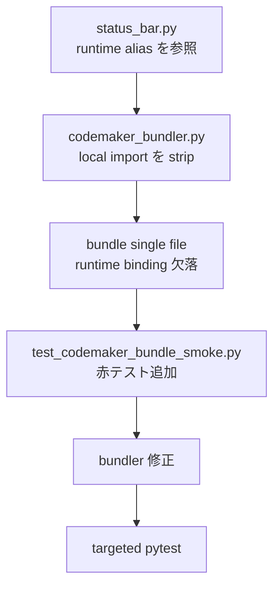

# 2026年5月24日 アプリ：Code Maker版ステータスバーのzone名描画で未定義エラー

> 状態：⑨ Closing（完了）
> 次のゲート：なし（done へ退避）

---

## 1) Journey（どこへ行くか）

> 補足：深層的目的 子どもが Code Maker 版を開いた直後の map で落ちず、zone 名を自然に読める
> 補足：やらないこと status bar の全面改修や `.pyxres` 編集
> 補足：責務分担厳格度 basic

1. 前提条件
   1. 💦 例外は Code Maker bundle の draw 中に出る
   2. 💦 `status_bar.py` は `runtime` alias で zone を引く
   3. 💦 bundler header は `M` だけを定義する

2. Before
   1. 💦 Code Maker 版 map 描画で `runtime` 未定義エラーになる
   2. 💦 通常実行では再現せず bundle smoke も未検知
   3. ❌ もどかしい

3. After
   1. ✅ Code Maker bundle でも zone 名を描ける
   2. ✅ bundle smoke が alias 欠落を検知できる
   3. ❤️ 安心

4. 例外
   1. `runtime` 以外も落ちるなら bundler 規則を広く見直す

5. 境界条件
   1. bundler と bundle smoke だけを直す
   2. status bar の表示仕様は変えない

6. 委任度
   1. 🟢 root cause は特定済み
   2. 🟢 test追加と修正は CC で可
   3. 🔴 人判断なし

---

## 2) ユーザーストーリーマップ

> 委任度：🟢 root cause まで掘れているので、そのまま TDD で進められる
> 残る曖昧さ：なし

### 事前確認

- [x] tasknote確認済み:
  - [x] `steering/done/20260517 アプリ：battle-stale-spell-message.md`
- [x] skill・tool・MCP確認済み:
  - [x] `manage-tasknotes`
  - [x] `superpowers:systematic-debugging`
  - [x] `superpowers:test-driven-development`
  - [x] `pytest`
- [x] 永続的ドキュメント確認済み:
  - [x] `AGENTS.md`
  - [x] `docs/framework-rule.md`

### 本体

1. 現状 bundle source の `_resolve_zone_name()` 出力を固定する
2. `test/test_codemaker_bundle_smoke.py` に赤テストを足す
3. `tools/codemaker_bundler.py` で module import alias を補強する
4. targeted pytest で smoke を緑に戻す
5. 必要なら全体 pytest を回して回帰を確認する

---

## 3) Gherkin（完了条件）

> 委任度：🟢 Design と実装まで CC が続けて進められる
> 残る曖昧さ：なし

### シナリオ一覧

- [x] シナリオ1：Code Maker bundle でも zone 名解決で落ちない

1. 🧱 bundle を exec した module に `StatusBar` と `get_zone` が載っている
2. 🎬 fake game と fake player で `_resolve_zone_name()` を呼ぶ
3. ✅ `NameError` にならず zone 名文字列を返す

```gherkin
Given Code Maker bundle を build_bundled_source() から生成できる
And bundle を exec した module に StatusBar と get_zone が載っている
When fake game と fake player で StatusBar._resolve_zone_name() を呼ぶ
Then runtime 未定義の NameError は起きない
And zone 名の文字列が返る
```

- [x] シナリオ2：既存の M alias 経路は壊さない

1. 🧱 既存 bundle smoke は `M` alias 前提で通っている
2. 🎬 `runtime` alias 対応を追加する
3. ✅ 既存の `M` 経路もそのまま通る

```gherkin
Given 既存 bundle smoke は M alias 前提で通っている
When runtime alias にも対応するよう bundler を修正する
Then import src.runtime.main_runtime as M の既存回帰は壊れない
And test/test_codemaker_bundle_smoke.py が green になる
```

---

## 4) Design（どうやるか）

### 責務分担概要

| 親ディレクトリ | 責務概要 |
| --- | --- |
| `tools/` | Code Maker bundle の import 除去と alias 変換を担う |
| `test/` | bundle exec と zone 名解決の回帰を固定する |
| `src/shared/ui/` | status bar 本体。今回は仕様変更しない |

### 責務分担概要図



### 責務分担詳細

- `test/test_codemaker_bundle_smoke.py` （➕：status bar の zone 名経路を回帰テストに加える）
- `tools/codemaker_bundler.py` （✏️：module import alias の rewrite を補強する）
- `src/shared/ui/status_bar.py` （❌：今回は表示仕様を変えない）

### 【参照】

- Steering: `steering/done/20260517 アプリ：battle-stale-spell-message.md`
- Architecture: `AGENTS.md`
- UXPolicy: `docs/framework-rule.md`

### 変更範囲

- やること:
  - bundle smoke に zone 名経路の赤テストを追加する
  - bundler の module import alias を直す
- やらないこと:
  - status bar の見た目変更
  - runtime scene の仕様変更
  - `.pyxres` の編集

### 検証

- 検証コマンド:
  - `python -m pytest test/test_codemaker_bundle_smoke.py -q`
  - `python -m pytest test/ -q`
- 成功条件:
  - 新規 smoke が通る
  - 全体 pytest でも回帰が出ない
- 未実施時の扱い:
  - 全体 pytest 未実施なら done にしない

---

## 5) Tasklist

- [x] bundle source の `_resolve_zone_name()` 現状出力を記録する
- [x] `test/test_codemaker_bundle_smoke.py` に赤テストを追加する
- [x] `tools/codemaker_bundler.py` を最小差分で修正する
- [x] targeted pytest を通す
- [x] 必要なら全体 pytest を通す

---

## 6) 作業ログ

- 2026-05-24 04:12: traceback と bundle source を照合し、`runtime` binding 欠落を root cause として記録した
- 2026-05-24 04:12: 本 tasknote を起票し、TDD 順で進める手順を固定した
- 2026-05-24 04:32: `test/test_codemaker_bundle_smoke.py` に status bar の zone 名回帰を追加し、`NameError: name 'runtime' is not defined` で赤になることを確認した
- 2026-05-24 04:35: `tools/codemaker_bundler.py` に local module import alias の rewrite を追加し、bundle 出力で `runtime = M` が入ることを確認した
- 2026-05-24 04:37: `python -m pytest test/test_codemaker_bundle_smoke.py -q` を再実行し、`13 passed` を確認した
- 2026-05-24 04:41: `python -m pytest test/ -q` を実行し、`744 passed, 2 skipped` を確認した

## 7) 評価と成果物

> 評価：🟢 期待通り。Code Maker bundle の zone 名解決クラッシュを最小差分で止め、bundle smoke と全体 pytest の両方で回帰を防げた。

### 成果物

- `test/test_codemaker_bundle_smoke.py`
  - `StatusBar._resolve_zone_name()` を bundle 内で直接叩く回帰テストを追加した
- `tools/codemaker_bundler.py`
  - `import src.X as alias` を `alias = M` に rewrite する補助経路を追加した
  - 既存の `import src.runtime.main_runtime as M` は追加出力しないまま維持した
- `build_bundled_source()` の確認結果
  - `_resolve_zone_name()` の先頭に `runtime = M` が入り、`runtime.get_zone(...)` が解決されるようになった

---

## 8) Discussion

### 懸念事項

- 今回の修正は `import src.<local module> as alias` 全般を `alias = M` に寄せるので、status bar 以外の同種 alias にも効く
- 既存の `M` alias は special-case のまま据え置き、`M = M` のような無意味な出力は避けた

### 残課題のルール化

#### 残課題1: module import alias 全般の横展開確認

- 背景: 今見えていた実害は `runtime` だったが、bundler 規則としては local module alias 全般の問題だった
- 判断: 破棄
- 理由: 全体 rewrite を入れ、full pytest でも回帰が出ていないため、別 note に切り出す残課題は残らない

---

## 9) Closing

- 状態: done
- 次のゲート: なし
- close 条件:
  - [x] new regression test が追加されている
  - [x] bundle smoke が green
  - [x] 全体 pytest の結果が note に反映されている

---

## 10) 参考資料

- 関連コード：`src/shared/ui/status_bar.py`
- 関連コード：`tools/codemaker_bundler.py`
- 関連テスト：`test/test_codemaker_bundle_smoke.py`
- 検証コマンド：`python -m pytest test/test_codemaker_bundle_smoke.py -q`
- 検証コマンド：`python -m pytest test/ -q`
