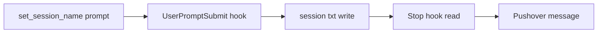

# 2026年5月24日 開発基盤：ClaudeのPushover通知文をセッションごとに固定できるようにする

> 状態：⑧ Closing
> 次のゲート：なし

---

## 1) Journey（どこへ行くか）

> 補足：深層的目的 Claude が止まるたびに、今の作業内容が分かる通知を同じ文面で受け取れるようにする
> 補足：やらないこと 通知サービスの全面刷新や Codex 側の通知仕様変更までは広げない
> 補足：責務分担厳格度 basic

1. 前提条件
   1. 💦 `stop-pushover.sh` には `session_id` ごとの文面ファイル読取口がある
   2. 💦 今はそのファイルを書き込む通常ルートがない
   3. 💦 ユーザーは `set_session_name "..."` のような最小入力を望んでいる

2. Before
   1. 💦 通知文面を変えるには手動テストのような一時操作が要る
   2. 💦 通常セッションでは `Claude Code 待機中 (...)` に戻る
   3. 💦 セッションごとに意図した通知名を固定できない
   4. ❌ もどかしい

3. After
   1. 💦 セッション中に一度 `set_session_name "..."` を送れば通知文面を固定できる
   2. ✅ 同じ `session_id` の Stop 通知は同じ1行目を使い続ける
   3. ✅ 文面ファイルが無いときだけ既存の待機中文面へ戻る
   4. ❤️ 安心

4. 例外
   1. `set_session_name` の構文が崩れているときは既存文面を上書きしない
   2. 文面ファイルが消えたときは既存の fallback 文面に戻ってよい

5. 境界条件
   1. 今回の対象は Claude の Stop hook と UserPromptSubmit hook に限る
   2. 保存先は `/tmp/claude-user-prompts/<session_id>.txt` の1行目だけを使う
   3. Notification hook や Codex の notify route は今回の変更対象に含めない

6. 委任度
   1. 🟢 file contract と hook 経路は見えており、CC だけで実装まで進められる
   2. 🟢 CCのみで可：保存 hook、Stop 再利用、テスト追加まで行える
   3. 🟡 人の判断: `set_session_name` の許容構文を広げるかは必要なら後で決める

---

## 2) ユーザーストーリーマップ

> 既存の Stop hook 読み取り口を生かし、書き込み口だけを最小追加する。
> 委任度：🟢 最小構成の flow と反映先は見えており、CC が draft を固められる
> 残る曖昧さ：`set_session_name "..."` 以外の構文を許すかは未確定

### 事前確認

- [x] tasknote確認済み
- [x] skill・tool・MCP確認済み
  - [x] `manage-tasknotes`
  - [x] `brainstorming`
- [x] 永続的ドキュメント確認済み
  - [x] `manage-tasknotes/TEMPLATE.md`
  - [x] `manage-tasknotes/RULES.md`
  - [x] `.claude/settings.json`
  - [x] `dotfiles/claude/.claude/hooks/stop-pushover.sh`

### 本体

#### 話題1：セッション文面を保存する入口を作る

##### ユーザー：Claude 利用者

1. 当初計画
    1. ✍️ `UserPromptSubmit` で `set_session_name "..."` を検出する
    2. 📝 `session_id` ごとの txt に1行目を書き込む
    3. 🚫 文面設定用の prompt は Claude 本体へ渡さない

#### 話題2：Stop 通知で保存済み文面を使い回す

##### ユーザー：Pushover 通知の受信者

1. 当初計画
    1. 👀 Stop hook は既存どおり `session_id` を受け取る
    2. 📄 対応する txt があれば1行目を通知文面に使う
    3. 🔁 txt が無ければ既存の fallback 文面に戻る

#### 話題3：最小の検証で壊れていないことを確かめる

##### ユーザー：dotfiles の運用者

1. 当初計画
    1. 🧪 文面保存 hook のテストを追加する
    2. 🧪 Stop hook の既存テストに session file の利用確認を入れる
    3. ✅ 実 hook で1回だけ通知確認を行う

---

## 3) Gherkin（完了条件）

> 委任度：🟢 実装前の完了条件までは CC が固められる
> 残る曖昧さ：`set_session_name "..."` の quote 仕様を最小に絞るかどうか

### シナリオ一覧

- [x] シナリオ1：セッション名コマンドで通知文面を保存できる

1. 🧱 Claude の `UserPromptSubmit` が `session_id` と prompt を受け取る
2. 🎬 `set_session_name "Pushover通知の修復"` を送る
3. ✅ 対応する txt の1行目に同じ文面が保存される

```gherkin
Given Claude の UserPromptSubmit hook が `session_id` と prompt を受け取れる
When ユーザーが `set_session_name "Pushover通知の修復"` を送る
Then `/tmp/claude-user-prompts/<session_id>.txt` の1行目に `Pushover通知の修復` が保存される
And 文面設定用の prompt は Claude 本体へ通常会話として渡らない
```

- [x] シナリオ2：同じセッションの Stop 通知で保存済み文面を使える

1. 🧱 `session_id` に対応する txt の1行目が保存済みである
2. 🎬 Claude が同じセッションで Stop する
3. ✅ Pushover 通知は保存済みの1行目を文面として送る

```gherkin
Given `session_id` に対応する txt の1行目へ保存済み文面がある
When Claude が同じセッションで Stop hook を実行する
Then Pushover 通知の `message` は保存済み文面になる
And 既存の fallback 文面は使われない
```

- [x] シナリオ3：保存済み文面が無いときは既存の fallback を保つ

1. 🧱 対応する txt が存在しない
2. 🎬 Claude が Stop する
3. ✅ 既存の `Claude Code 待機中 (...)` 文面が使われる

```gherkin
Given `session_id` に対応する txt が存在しない
When Claude が Stop hook を実行する
Then 通知文面は既存の `Claude Code 待機中 (...)` fallback になる
And 通知自体は従来どおり送信される
```

---

## 4) Design（どうやるか）

### 責務分担概要

- UserPromptSubmit で文面設定 prompt を横取りして session file を書く
- Stop hook は既存の session file 読み取りをそのまま使う
- 設定・hook・テストだけを最小変更する

### 責務分担概要図



### 責務分担詳細

- `/home/exedev/.claude/settings.json` （✏️：UserPromptSubmit hook を追加または差し替える）
- `/home/exedev/dotfiles/claude/.claude/hooks/stop-pushover.sh` （✏️：既存の session file 読み取り contract を維持する）
- `/home/exedev/dotfiles/claude/.claude/hooks/` （➕：session 名保存用 hook の追加先）
- `/home/exedev/dotfiles/tests/test_stop_pushover_hook.py` （✏️：保存済み文面の再利用確認を追加する）

### 【参照】

- Steering: `steering/2026年5月24日 開発基盤：ClaudeのPushover通知文をセッションごとに固定できるようにする.md`
- Architecture: `/home/exedev/.claude/settings.json`
- Architecture: `/home/exedev/dotfiles/claude/.claude/hooks/stop-pushover.sh`

### 変更範囲

- やること:
  - UserPromptSubmit で session 文面を書き込む最小 hook を追加する
  - Stop hook とテストを session file 前提でそろえる
- やらないこと:
  - Claude 全体の session 管理 UI を作ること
  - Codex 側通知や Notification hook まで変更すること

### 検証

- 検証コマンド:
  - `python3 -m pytest /home/exedev/dotfiles/tests/test_stop_pushover_hook.py -q`
  - `git -C /home/exedev/dotfiles diff --check`
- 成功条件:
  - `set_session_name` で保存した文面が同じ session_id の Stop 通知へ反映される
  - 文面ファイルが無いときは既存 fallback が残る
- 未実施時の扱い:
  - 実 hook 確認が無ければ draft 扱いで止める

---

## 5) Tasklist

- [x] `set_session_name "..."` を拾う UserPromptSubmit hook を追加する
- [x] session 文面保存のテストを追加する
- [x] Stop hook の再利用テストと実 hook 確認を通す

---

## 6) 作業ログ

- `save-session-name.sh` を追加し、`UserPromptSubmit` で `set_session_name "..."` だけを拾うようにした
- `~/.claude/settings.json` と dotfiles の template/settings に hook を配線した
- `test_save_session_name_hook.py` を追加し、設定テストも拡張した
- 手元で hook を 1 回流し、session file に `Pushover通知の修復` が保存されることを確認した

---

## 7) 評価と成果物

> 評価：🟢 最小の session-name route が入り、同じ session_id の Stop 通知で再利用できる

### 成果物

- `/home/exedev/dotfiles/claude/.claude/hooks/save-session-name.sh`
- `/home/exedev/dotfiles/claude/.claude/settings.json`
- `/home/exedev/dotfiles/claude/.claude/settings.json.template`
- `/home/exedev/dotfiles/tests/test_save_session_name_hook.py`
- `/home/exedev/dotfiles/tests/test_notification_configs.py`
- `/home/exedev/.claude/settings.json`

---

## 8) Discussion

- `set_session_name "..."` の許容構文は double quote 付き 1 形式に絞った
- Stop hook は既存の file contract を維持し、通知の責務を増やしていない
- prompt を通常会話へ流さないため、保存時は hook JSON で `continue: false` を返す

---

## 9) Closing

- 状態: done
- 次のゲート: なし
- close 条件:
  - [x] 文面保存 hook が追加されている
  - [x] 同じ session_id で通知文面が固定される
  - [x] fallback 文面が壊れていない

---

## 10) 参考資料

- `/home/exedev/.claude/settings.json`
- `/home/exedev/dotfiles/claude/.claude/hooks/stop-pushover.sh`
- `https://code.claude.com/docs/en/hooks`
