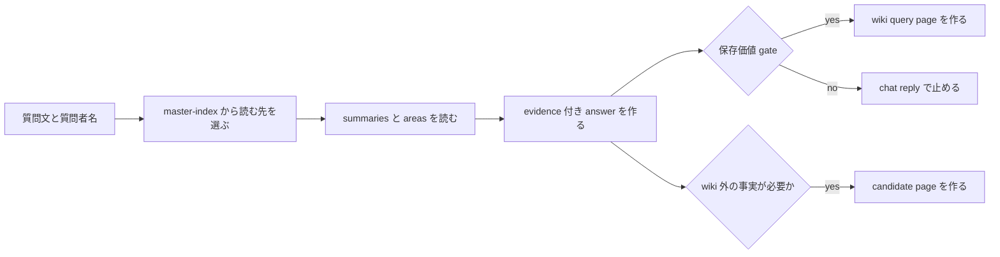

# 2026年5月24日 開発基盤：LLM Wikiへの質問回答保存スキルを作る

> 状態：⑧ Closing
> 次のゲート：なし

---

## 1) Journey（どこへ行くか）

> 補足：深層的目的 llm-wiki に質問した結果を chat で流さず、再利用できる answer page として残せるようにする
> 補足：やらないこと ingest、health-check、batch、web 検索の実行までは同じ skill に詰め込まない
> 補足：責務分担厳格度 basic

1. 前提条件
   1. 💦 対象は `query-wiki` `file-answer` `candidate-source` の 3 route である
   2. 💦 current repo の読む先は `summaries` `areas` `master-index` を使う
   3. 💦 query page 名は質問文ベースの日本語 file 名を使う
   4. 💦 保存価値の最終判断は user gate で行う

2. Before
   1. 💦 query はできても skill として 1 本にまとまっていない
   2. 💦 answer を chat だけで終えるか page 化するかが毎回ぶれやすい
   3. 💦 query file 名と candidate file 名の規則が固定されていない
   4. 💦 wiki 外の事実が必要なときの分岐が手順化されていない
   5. ❌ 迷う

3. After
   1. 💦 質問受け取りから evidence 付き answer 作成まで 1 本の skill で進められる
   2. ✅ 比較中心なら table、それ以外は markdown を既定にできる
   3. ✅ 保存価値が高い answer だけ user gate 後に `wiki/query/` へ保存できる
   4. ✅ wiki 外の事実が必要なら AI 判断で `wiki/candidates/` へ切り出せる
   5. ❤️ 安心

4. 例外
   1. 保存価値が低い答えなら chat reply だけで終えてよい
   2. wiki 内 evidence が足りないときは answer を確定保存せず candidate に回してよい

5. 境界条件
   1. current repo では `entities/` `concepts/` を新設せず `areas/` を読む
   2. `query-wiki` は wiki 内 page を主に読む
   3. web は検索実行でなく candidate source の必要判定までに留める
   4. save gate を通る前は official answer page にしない

6. 委任度
   1. 🟢 route の分解と tasknote 起票までは CC 単独で進められる
   2. 🟢 CCのみで可：filename rule と field rule を draft に落とせる
   3. 🟡 人の判断: 保存価値ありとして正式保存するかの最終 gate

---

## 2) ユーザーストーリーマップ

> query の入口、answer 生成、保存 gate、candidate 分岐の 4 かたまりで skill 化する。
> 委任度：🟢 tasknote draft と skill scope 固定までは CC が進められる
> 残る曖昧さ：なし

### 事前確認

- [x] tasknote確認済み
- [x] skill・tool・MCP確認済み
  - [x] `manage-tasknotes`
  - [x] `brainstorming`
  - [x] shared `tasknote-lint`
- [x] 永続的ドキュメント確認済み
  - [x] `AGENTS.md`
  - [x] `manage-tasknotes/TEMPLATE.md`
  - [x] `manage-tasknotes/RULES.md`
  - [x] `docs/llm-wiki-ops-schema.md`
  - [x] `steering/done/2026年5月23日 開発基盤：Wikiへの質問と回答保存を試す.md`

### 本体

#### 話題1：質問を受け取り current wiki から読む

##### ユーザー：佐藤さん（query intake）

1. 当初計画
    1. 👀 質問文と質問者名を受け取る
    2. 🧭 `master-index` から summary と area の読む候補を決める
    3. 📚 `summaries` `areas` `indexes` を読んで evidence 候補を集める

#### 話題2：answer を組み立てる

##### ユーザー：佐藤さん（answer compose）

1. 当初計画
    1. 📝 answer は通常 markdown で作る
    2. 📊 比較が主題なら table に切り替える
    3. 🔖 answer に引用と根拠 page を残す
    4. 🎯 `confidence` を明記する

#### 話題3：保存価値 gate を通して file-answer する

##### ユーザー：佐藤さん（save gate）

1. 当初計画
    1. ❓ AI が保存候補 answer を user に見せる
    2. 🚦 user が「残したいか」を答える
    3. 💾 `yes` のときだけ `wiki/query/` に official page を作る
    4. 🏷️ file 名は `YYYY年M月D日（質問者）質問内容.md` に寄せる

#### 話題4：wiki 外の事実が必要なら candidate に分ける

##### ユーザー：佐藤さん（external gap）

1. 当初計画
    1. 🧠 AI が wiki 内 evidence だけで足りるかを判定する
    2. ✂️ 足りないときは `candidate-source` route へ分岐する
    3. 📝 `missing_fact` `why_needed` `search_hint` `priority` を残す

---

## 3) Gherkin（完了条件）

> 委任度：🟢 skill 化の draft と file rule までは CC が固められる
> 残る曖昧さ：なし

### シナリオ一覧

- [x] シナリオ1：current wiki だけで evidence 付き answer を返せる

1. 🧱 質問文と質問者名が与えられている
2. 🎬 `master-index` から summaries と areas を読んで答えを組み立てる
3. ✅ answer に evidence と compared pages と confidence が入る

```gherkin
Given 質問者名と質問文が 1 つ与えられている
And current repo の `llm-wiki/wiki/indexes/master-index.md` と `summaries` と `areas` が存在する
When AI が related page を選んで読み込み、答えを組み立てる
Then answer は evidence 付きで返される
And `question` `answer` `evidence` `compared_pages` `confidence` を保持できる
And current repo では `entities` `concepts` でなく `areas` を読む
```

- [x] シナリオ2：比較中心の質問は table 形式で返せる

1. 🧱 質問が比較を主題にしている
2. 🎬 answer format を判定する
3. ✅ 既定 markdown から table へ切り替わる

```gherkin
Given 質問文が比較を主題にしている
When AI が answer format を選ぶ
Then 通常は markdown を選ぶ
And 比較が主題のときだけ table を選ぶ
And format 選択理由を短く説明できる
```

- [x] シナリオ3：保存価値ありの答えだけ日本語 file 名で保存できる

1. 🧱 AI が保存候補 answer を作っている
2. 🎬 user が保存可否を答える
3. ✅ `yes` のときだけ `wiki/query/` に official page が作られる

```gherkin
Given AI が保存候補の answer を作っている
When user が「残したい」と答える
Then `llm-wiki/wiki/query/` に official page が作られる
And file 名は `YYYY年M月D日（質問者）質問内容.md` 形式になる
And page には `question` `answer` `evidence` `compared_pages` `confidence` が入る
```

- [x] シナリオ4：保存価値なしなら official save を行わない

1. 🧱 AI が保存候補 answer を user に見せている
2. 🎬 user が保存不要と答える
3. ✅ chat 返答で止まり official file は作られない

```gherkin
Given AI が保存候補の answer を user に見せている
When user が「今回は残さない」と答える
Then official query page は作られない
And chat reply だけで結果を返してよい
```

- [x] シナリオ5：wiki 外の事実が必要なら candidate file を作れる

1. 🧱 AI が wiki 内 evidence だけでは不足と判断している
2. 🎬 `candidate-source` route に分岐する
3. ✅ `wiki/candidates/` に不足情報の page が作られる

```gherkin
Given AI が wiki 内 evidence だけでは質問へ答え切れないと判断している
When `candidate-source` route に分岐する
Then `llm-wiki/wiki/candidates/` に candidate page が作られる
And page には `missing_fact` `why_needed` `search_hint` `priority` が入る
And wiki 外の事実は official answer に直混ぜしない
```

---

## 4) Design（どうやるか）

### 責務分担概要

- `query-wiki` は質問文を受け取り、`master-index` を入口に `summaries` と `areas` を読む
- answer は `question` `answer` `evidence` `compared_pages` `confidence` を持つ
- 形式は markdown を既定とし、比較中心のときだけ table に切り替える
- `file-answer` は user gate が `yes` のときだけ official page を作る
- `candidate-source` は AI が wiki 外の事実不足を判断したときだけ `wiki/candidates/` を作る

### 責務分担概要図



### 責務分担詳細

- `steering/done/2026年5月24日 開発基盤：LLM Wikiへの質問回答保存スキルを作る.md` （➕：skill 化の draft と gate 条件を持つ）
- `docs/llm-wiki-ops-schema.md` （➕：query defaults と candidate defaults の正本として扱う）
- `steering/done/2026年5月23日 開発基盤：Wikiへの質問と回答保存を試す.md` （➕：trial 済み query route の前例として読む）
- `~/dotfiles/claude/.claude/skills/query-wiki/SKILL.md` （✏️：query route の skill 実体）
- `llm-wiki/wiki/indexes/master-index.md` （➕：query-wiki の入口として読む）
- `llm-wiki/wiki/summaries/knowledge/` （➕：source summary の読む先として扱う）
- `llm-wiki/wiki/areas/` （➕：related concept page の読む先として扱う）
- `llm-wiki/wiki/query/` （✏️：official answer page の保存先として扱う）
- `llm-wiki/wiki/candidates/` （✏️：external gap の切り出し先として扱う）

### 【参照】

- Steering: `steering/done/2026年5月23日 開発基盤：Wikiへの質問と回答保存を試す.md`
- Architecture: `docs/llm-wiki-ops-schema.md`
- Source: `llm-wiki/wiki/indexes/master-index.md`

### 変更範囲

- やること:
  - `query-wiki` `file-answer` `candidate-source` の skill scope を 1 本に固定する
  - current repo 向けの読む先を `summaries / areas / master-index` に寄せる
  - 日本語 query file 名 rule と save-value gate を明文化する
  - candidate page の field rule を明文化する
- やらないこと:
  - ingest や health-check を同じ skill に入れること
  - `entities/` `concepts/` ディレクトリを新設すること
  - web 検索そのものをこの tasknote で実行すること

### 検証

- 検証コマンド:
  - `node /home/exedev/dotfiles/shared/linter/coding-rules/tasknote/run_tasknote_lint.mjs --config ./tasknote-lint.config.json 'steering/done/2026年5月24日 開発基盤：LLM Wikiへの質問回答保存スキルを作る.md'`
- 成功条件:
  - tasknote が lint を通る
  - save gate、format rule、candidate rule が note 上で明示されている
  - current repo で読む先が `summaries / areas / master-index` に固定されている
- 未実施時の扱い:
  - lint 未実施なら draft 止まりとして扱う

---

## 5) Tasklist

- [x] skill 名と保存先を決める
- [x] `query-wiki` の入力と読む先を固定する
- [x] answer schema と format rule を決める
- [x] `file-answer` の user gate と filename rule を決める
- [x] `candidate-source` の分岐条件と field rule を決める
- [x] 佐藤さんの質問例で dry-run 観点を決める

---

## 6) 作業ログ

- [x] `~/dotfiles/claude/.claude/skills/query-wiki/SKILL.md` を作成した
- [x] `docs/llm-wiki-ops-schema.md` に query read order / save gate / filename rule / candidate defaults を追記した
- [x] existing query / candidate page が英語 slug の legacy 例であることを rule に明記した
- [x] tasknote を `done/` へ移し、完了条件を更新した

---

## 7) 評価と成果物

> 評価：🟢 query route の skill 実体、schema rule、legacy 取扱いを repo に固定できている

### 成果物

- `steering/done/2026年5月24日 開発基盤：LLM Wikiへの質問回答保存スキルを作る.md`
- `docs/llm-wiki-ops-schema.md`
- `~/dotfiles/claude/.claude/skills/query-wiki/SKILL.md`
- `steering/done/2026年5月23日 開発基盤：Wikiへの質問と回答保存を試す.md`

---

## 8) Discussion

- `query-wiki` を 1 本の skill 名とし、scope は `query-wiki / file-answer / candidate-source` の 3 route に固定した
- 保存価値の最終判断は AI でなく user gate に置き、request に save intent が明示されているときだけ `yes` 扱いを許す
- current repo の query read order は `master-index -> summaries/knowledge -> areas` に固定した
- 新規 query page は日本語質問文ベース file 名へ寄せ、既存の英語 slug page は legacy 例として自動 rename しない
- wiki 外の事実は official answer に直混ぜせず、candidate page の `missing_fact / why_needed / search_hint / priority` へ切り出す

---

## 9) Closing

- 状態: done
- 次のゲート: なし
- close 条件:
  - [x] scope が `query-wiki / file-answer / candidate-source` で固まる
  - [x] save gate の位置が user confirm で固まる
  - [x] 日本語 query file 名 rule が固まる

---

## 10) 参考資料

- `docs/llm-wiki-ops-schema.md`
- `steering/done/2026年5月23日 開発基盤：Wikiへの質問と回答保存を試す.md`
- `llm-wiki/wiki/indexes/master-index.md`
