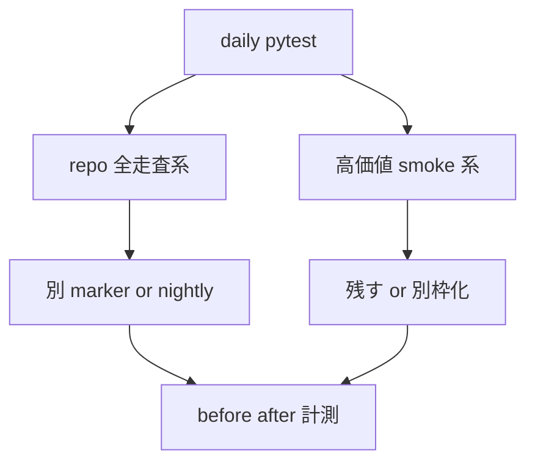

# 2026年5月24日 開発基盤：日常pytestをさらに軽くするため重い全走査テストを別枠化する

> 状態：⑧ Closing
> 次のゲート：なし

---

## 1) Journey（どこへ行くか）

> 補足：深層的目的 失敗検知を落とさず、日常の pytest をさらに軽くする
> 補足：やらないこと 本番価値の高い smoke を勢いで削ること
> 補足：責務分担厳格度 full

1. 前提条件
   1. 💦 daily suite は実測で約 12.6s だった
   2. 💦 上位 10 file で全体の約 81% を占める
   3. 💦 重い file 群の内訳は調査済みである

2. Before
   1. 💦 repo 全走査 test が日常 suite を押し上げている
   2. 💦 本番価値の高い smoke も同じ箱に入っている
   3. 💦 削る対象と残す対象が混ざって見えにくい
   4. ❌ もどかしい

3. After
   1. 💦 repo 全走査系を daily から切り分けられる
   2. ✅ 高価値 smoke は残すか別枠化で説明できる
   3. ✅ before と after の差分を数値で示せる
   4. ❤️ スッキリ

4. 例外
   1. `web_runtime_server` は遅くても削除しない
   2. `codemaker_bundle_smoke` は遅くても削除しない

5. 境界条件
   1. 今回は test suite の運用整理だけを扱う
   2. runtime や build の仕様変更は含めない
   3. 削減は file 単位の偏りから着手する

6. 委任度
   1. 🟢 repo 全走査系 2 本の調査と切り分け案は CC 単独で進められる
   2. 🟢 高価値 smoke 2 本の別枠案比較も CC 単独で進められる
   3. 🟡 default と smoke と nightly の命名は人判断でもよい

---

## 2) ユーザーストーリーマップ

> 上位数 file に集中している時間を、価値ごとに分けて削る。
> 委任度：🟢 方向性は固まっており、調査と素案作成はこのまま進められる
> 残る曖昧さ：daily / smoke / nightly の最終命名だけ未確定

### 事前確認

- [x] tasknote確認済み
- [x] skill・tool・MCP確認済み
  - [x] `manage-tasknotes`
- [x] 永続的ドキュメント確認済み
  - [x] `AGENTS.md`
  - [x] `docs/repository-structure.md`
  - [x] `docs/framework-rule.md`
  - [x] `steering/done/2026年5月24日 開発基盤：存在価値が薄いテストを整理して実行時間を削る.md`

### 本体

#### 話題1：repo 全走査系を daily から切り分ける

##### ユーザー：日常的に pytest を回す開発者

1. 当初計画
    1. 🔍 `test_architecture_rules_checker.py` の重い項目を確認する
    2. 🔍 `test_source_trace_coverage_report.py` の重い項目を確認する
    3. 📦 daily から外せる粒度を決める

#### 話題2：高価値 smoke は削除せず置き場を分ける

##### ユーザー：本番導線の guardrail を落としたくない開発者

1. 当初計画
    1. 🔍 `test_web_runtime_server.py` の本番価値を整理する
    2. 🔍 `test_codemaker_bundle_smoke.py` の本番価値を整理する
    3. 🧪 削除でなく別枠化の是非を比べる

#### 話題3：削減効果を before / after で記録する

##### ユーザー：時間短縮の投資対効果を見たい開発者

1. 当初計画
    1. ⏱️ 対象 file 群の実測時間を再確認する
    2. 🧪 分離後の daily と smoke の時間差を測る
    3. 📝 続けて削る候補を tasknote に残す

---

## 3) Gherkin（完了条件）

> 委任度：🟢 Design の素案と計測計画までは CC が進められる
> 残る曖昧さ：なし

### シナリオ一覧

- [ ] シナリオ1：repo 全走査系を daily から外しても guardrail が残る

1. 🧱 `architecture_rules_checker` と `source_trace_coverage_report` の重さが見えている
2. 🎬 別 marker または別 command に切り分ける
3. ✅ daily suite から外れても明示 entrypoint で回せる

```gherkin
Given repo 全体を走査する重い test file がある
And それらは日常の変更ごとに毎回回さなくても価値を保てる
When それらを daily suite から切り分ける
Then guardrail 自体は消えない
And 明示 command で再実行できる
```

- [ ] シナリオ2：高価値 smoke は削除せず扱いを分ける

1. 🧱 `web_runtime_server` と `codemaker_bundle_smoke` の本番価値が説明できる
2. 🎬 削除候補から外し、残すか別枠化かを決める
3. ✅ 本番導線の回帰面を落とさない

```gherkin
Given web 配信と Code Maker bundle を直接守る test file がある
When それらの扱いを daily / smoke / nightly のどこに置くか決める
Then 本番導線の guardrail は維持される
And 削除ではなく価値に応じた運用になる
```

- [ ] シナリオ3：before / after の秒数差を記録できる

1. 🧱 現在の daily suite の実測時間がある
2. 🎬 切り分け後に daily と smoke を再計測する
3. ✅ 短縮秒数と残した理由を note に書ける

```gherkin
Given current daily suite の実測時間が分かっている
When 別枠化後に daily suite と smoke suite を再実行する
Then before と after の差分が残る
And 残した重い test の理由も記録される
```

---

## 4) Design（どうやるか）

### 責務分担概要

| 親ディレクトリ | 責務概要 |
| --- | --- |
| `test/` | 重い file 群を repo 全走査系と高価値 smoke 系に分ける |
| `repo root` | daily / smoke / nightly の entrypoint を整理する |
| `steering/` | 実測値と別枠化判断を tasknote に残す |

### 責務分担概要図



### 責務分担詳細

#### 親ディレクトリ: `test/`

- ファイル名: `heavy suite candidates`
- 既存/新規: 既存
- 置く理由: 重い file の大半が `test/` 配下に集まり、価値ごとの切り分けもここで起きるため
- 責務内容:
  - `test/test_architecture_rules_checker.py`: repo 全走査 guardrail の切り分け候補
  - `test/test_source_trace_coverage_report.py`: repo 全走査 report の切り分け候補
  - `test/test_web_runtime_server.py`: 高価値 smoke。削除でなく別枠化検討
  - `test/test_codemaker_bundle_smoke.py`: 高価値 smoke。削除でなく別枠化検討

#### 親ディレクトリ: `repo root`

- ファイル名: `pytest.ini` / `Makefile` / `README.md`
- 既存/新規: 既存
- 置く理由: daily / smoke / nightly の entrypoint と説明は repo root の設定に集まるため
- 責務内容:
  - `pytest.ini`: marker と addopts の整理候補
  - `Makefile`: daily / smoke / nightly entrypoint の整理候補
  - `README.md`: 運用説明の更新候補

#### 親ディレクトリ: `steering/`

- ファイル名: `2026年5月24日 開発基盤：日常pytestをさらに軽くするため重い全走査テストを別枠化する.md`
- 既存/新規: 新規
- 新規理由: 次の時間短縮候補を前回 note から分け、別 task として進めるため
- 置く理由: 実測値と別枠化判断を後続作業へ handoff できる形で残すため
- 責務内容:
  - `steering/2026年5月24日 開発基盤：日常pytestをさらに軽くするため重い全走査テストを別枠化する.md`: 計測結果と判断を保持する tasknote 本体

### 【参照】

- Steering: `steering/done/2026年5月24日 開発基盤：存在価値が薄いテストを整理して実行時間を削る.md`
- Architecture: `docs/framework-rule.md`
- Repository: `docs/repository-structure.md`

### 変更範囲

- やること:
  - `architecture_rules_checker` と `source_trace_coverage_report` の切り分け案を作る
  - `web_runtime_server` と `codemaker_bundle_smoke` の扱いを削除以外で整理する
  - before / after の時間差を記録する
- やらないこと:
  - 本番価値の高い smoke を削除する
  - runtime や build の仕様を変える
  - 無関係な test style 改修を始める

### 検証

- 検証コマンド:
  - `python3 -m pytest test/ -q --durations=80`
  - `python3 -m pytest -q test/test_architecture_rules_checker.py test/test_source_trace_coverage_report.py`
  - `python3 -m pytest -q test/test_web_runtime_server.py test/test_codemaker_bundle_smoke.py`
  - `make test`
  - `make test-smoke`
- 成功条件:
  - repo 全走査系の別枠化案が書ける
  - 高価値 smoke を削除しない方針が検証込みで説明できる
  - before / after の差分が数値で残る
- 未実施時の扱い:
  - 計測が無ければ削減効果は未確定として扱う

---

## 5) Tasklist

- [x] plan を `docs/superpowers/plans/2026-05-24-repo-scan-suite-split-plan.md` に保存する
- [x] `test_architecture_rules_checker.py` の重い項目を抽出する
- [x] `test_source_trace_coverage_report.py` の重い項目を抽出する
- [x] repo 全走査系を daily から切り分ける案を作る
- [x] `web_runtime_server` と `codemaker_bundle_smoke` の別枠化可否を整理する
- [x] before / after の計測結果を note に戻す

---

## 6) 作業ログ

- [x] `python3 -m pytest test/ -q --durations=80` で daily baseline `12.59s` を確認した
- [x] `test_architecture_rules_checker.py` の重い項目が real-repo / CLI まわりに寄っていると確認した
- [x] `test_source_trace_coverage_report.py` の重い項目が real-repo report 群に集中していると確認した
- [x] `test_web_runtime_server.py` と `test_codemaker_bundle_smoke.py` は高価値 integration smoke と整理した
- [x] `repo_scan_nightly` と `high_value_smoke` marker を追加し、`pytest.ini` / `Makefile` / `README.md` を更新した
- [x] `test_architecture_rules_checker.py` と `test_source_trace_coverage_report.py` の nightly focused 実行が `19 passed, 9 deselected in 3.48s` だった
- [x] `test_web_runtime_server.py` と `test_codemaker_bundle_smoke.py` の smoke focused 実行が `13 passed, 6 deselected in 4.70s` だった
- [x] heavy 4 file の daily 側残留分が `14 passed, 33 deselected in 0.38s` だった
- [x] standalone の `make test-nightly` が `19 passed, 707 deselected in 3.90s` だった
- [x] standalone の `make test-smoke` が `19 passed, 707 deselected in 6.89s` だった
- [x] standalone の daily suite が `686 passed, 2 skipped, 38 deselected, 14233 subtests passed in 4.42s` だった
- [x] `steering/done/...` へ退避後の tasknote lint が `0 error(s)` だった

---

## 7) 評価と成果物

> 評価：🟢 repo 全走査系の nightly 分離と高価値 smoke の別枠化まで完了

### 成果物

- `steering/done/2026年5月24日 開発基盤：日常pytestをさらに軽くするため重い全走査テストを別枠化する.md` （✅：完了 tasknote）
- `docs/superpowers/plans/2026-05-24-repo-scan-suite-split-plan.md` （✅：実行 plan）
- `pytest.ini` （✅：daily から `real_repo_smoke` / `high_value_smoke` / `repo_scan_nightly` を除外）
- `Makefile` / `README.md` （✅：`make test-smoke` と `make test-nightly` を整備）
- `test/test_architecture_rules_checker.py` （✅：repo 全走査系を `repo_scan_nightly` へ分離）
- `test/test_source_trace_coverage_report.py` （✅：real repo report 群を `repo_scan_nightly` へ分離）
- `test/test_web_runtime_server.py` （✅：高価値 integration smoke を `high_value_smoke` へ分離）
- `test/test_codemaker_bundle_smoke.py` （✅：bundle exec 群だけを `high_value_smoke` へ分離）

---

## 8) Discussion

- 現時点の仮説では、まず repo 全走査系から切るのが最も効率がよい
- 高価値 smoke は削るより、daily から分ける設計の方が筋がよい
- 実装後の standalone daily suite は `12.59s -> 4.42s` で `8.17s`、約 `64.9%` 短縮だった。まず repo 全走査系から切るという仮説は妥当だった。
- `web_runtime_server` と bundle exec 群を smoke 側へ寄せても、alias unit test のような軽い部分は daily に残せた。file 単位でなく class / test 単位の分離が効いている。
- 次の重い daily は `tile_data_shape`、`sprite_data_shape`、`world_generation`、一部 guardrail test に移った。次の改善は大きいデータ全走査系の扱いを検討すると効く。

---

## 9) Closing

- 状態: done
- 次のゲート: なし
- close 条件:
  - [x] repo 全走査系 2 本の扱いが決まっている
  - [x] 高価値 smoke 2 本の扱いが決まっている
  - [x] before / after の秒数差が記録されている

---

## 10) 参考資料

- `steering/done/2026年5月24日 開発基盤：存在価値が薄いテストを整理して実行時間を削る.md`
- `test/test_architecture_rules_checker.py`
- `test/test_source_trace_coverage_report.py`
- `test/test_web_runtime_server.py`
- `test/test_codemaker_bundle_smoke.py`
