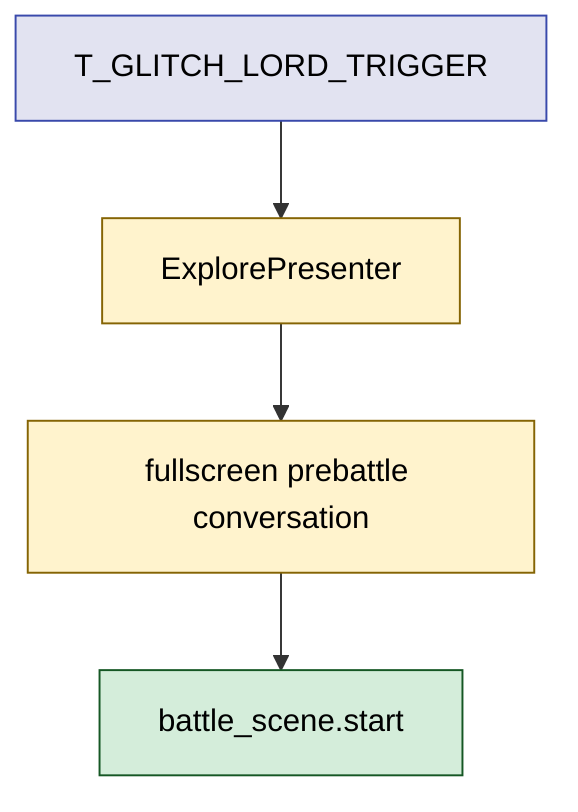

# 2026年5月26日 アプリ：魔王グリッチ会話導線の完了確認と仕上げ

> 状態：⑧ Closing
> 次のゲート：（ユーザー）main worktree の未整理 steering 変更を整理して merge 可否を決める

---

## 1) Journey

> 補足：深層的目的 魔王到達時に即戦闘へ飛ばず、子どもが最後の対決へ気持ちよく入れる会話導線を完成させる
> 補足：やらないこと ending 改稿、能力値調整、分岐追加、`.pyxres` 編集
> 補足：責務分担厳格度 strict

1. 前提条件
   1. 💦 正本は `steering/20260418 アプリ：cj09-glitch-lord-conversation-mode.md`
   2. 💦 会話データは `assets/dialogue.yaml` 由来、runtime は `src/game_data.py` 経由で読む
   3. 💦 実装は `src/scenes/explore/presenter.py` と既存 dialogue / battle 導線の最小変更で収める

2. Before
   1. 💦 steering は `open` のままで、完了か未完了かが曖昧
   2. 💦 dialogue asset はあるが、魔王トリガーが即戦闘のまま残っている可能性がある
   3. 💦 既存の教授会話導線を壊さずに仕上げる確認がまだ必要
   4. ❌ 不安

3. After
   1. 💦 steering の未完了点がコードと test で説明できる
   2. ✅ 未完了なら failing test から埋めて完了条件まで到達している
   3. ✅ tasknote と steering の両方で close 判定ができる
   4. ❤️ 安心

4. 例外
   1. 💦 既存ベースラインが壊れていれば今回差分と分けて記録する
   2. 💦 steering tasklist にあるが実装方針変更で不要な項目は理由付きで明示する

5. 境界条件
   1. 💦 子どもの編集面である Code Maker は触らない
   2. 💦 `assets/dialogue.yaml` を触る場合は `python tools/gen_data.py` を必ず通す
   3. 💦 done 判定には `python -m pytest test/ -q` と実物確認を含める

6. 委任度
   1. 🟢 全体としては既存 steering の仕上げ作業で、CC が完了まで自律実行できる
   2. 🟢 CCのみで可: worktree 起票、差分確認、TDD 実装、検証まで進めてよい
   3. 🔴 人の判断: merge 先で競合や既存未整理変更が衝突する場合だけ相談する

---

## 2) ユーザーストーリーマップ

> 委任度：🟢 進め方と検証順は固まっている
> 残る曖昧さ：なし

### 事前確認

- [x] tasknote確認済み
- [x] skill・tool・MCP確認済み
  - [x] `using-git-worktrees`
  - [x] `manage-tasknotes`
  - [x] `test-driven-development`
  - [x] `verification-before-completion`
- [x] 永続的ドキュメント確認済み
  - [x] `AGENTS.md`
  - [x] `docs/architecture.md`
  - [x] `docs/framework-rule.md`
  - [x] `docs/ux-policy.md`
  - [x] `docs/development-checklist.md`

### 本体

#### 話題1：未完了点を事実で固定する

##### ユーザー：この repo を進める保守者

1. 当初計画
    1. 👀 steering の Tasklist と現実装を照合する
    2. 🧪 既存 test が何を担保し、何が抜けているかを切り出す
    3. 📝 未完了点を tasknote に記録する

#### 話題2：最小変更で完了条件まで埋める

##### ユーザー：最後まで遊ぶ子ども

1. 当初計画
    1. 🧪 先に failing test を書いて trigger 導線を固定する
    2. ✏️ presenter 側の即戦闘導線を prebattle conversation 開始へつなぎ直す
    3. 🔁 professor 系の既存導線が壊れていないことを回帰確認する

---

## 3) Gherkin

> 委任度：🟢 完了条件は steering から転記して実装に落とせる
> 残る曖昧さ：なし

### シナリオ一覧

- [ ] シナリオ1：魔王トリガーは即戦闘でなく会話開始になる

1. 🧱 未撃破の状態でダンジョン最奥のトリガーを踏む
2. 🎬 ExplorePresenter がタイルイベントを処理する
3. ✅ battle はまだ始まらず、全画面会話が始まる

```gherkin
Given プレイヤーが未撃破の状態でダンジョン内にいる
When T_GLITCH_LORD_TRIGGER を踏む
Then boss.glitch.prebattle_01 から全画面会話が始まる
And battle_scene.start はその時点では呼ばれない
```

- [ ] シナリオ2：最終ページを閉じると一度だけ戦闘へ入る

1. 🧱 魔王戦前会話の最終ページを表示している
2. 🎬 決定入力で会話を閉じる
3. ✅ 魔王戦が 1 回だけ始まる

```gherkin
Given boss.glitch.prebattle_01 の chain を最後まで表示している
When 最終ページで決定入力する
Then 会話が閉じる
And _start_battle 相当の battle_scene.start が 1 回だけ呼ばれる
```

- [ ] シナリオ3：教授会話の既存導線は壊れない

1. 🧱 教授 intro / accepted / epilogue の chain が存在する
2. 🎬 共通会話導線のまま読み進める
3. ✅ choice と ending のふるまいが維持される

```gherkin
Given 既存の castle.professor 系 dialogue がある
When 共通のページ送り会話を使って intro と ending を進める
Then 既存の choice と ending callback は変わらない
And 既存の dialogue integration test は通る
```

---

## 4) Design

### 責務分担概要

- root cause は `src/scenes/explore/presenter.py` の魔王トリガーが依然として即戦闘を開始している可能性を先に確定すること
- 正本の narrative は `assets/dialogue.yaml`、導線制御は presenter / scene / message service の既存責務に乗せる
- まず test で `trigger -> prebattle conversation -> battle` を固定し、その最小実装だけを足す

### 責務分担概要図



### 責務分担詳細

- `steering/20260418 アプリ：cj09-glitch-lord-conversation-mode.md` （✏️：完了判定と必要なら closing を更新する）
- `src/scenes/explore/presenter.py` （✏️：魔王トリガーから prebattle conversation を開始する）
- `src/scenes/battle/` （❌：戦闘ロジック自体は変えない）
- `assets/dialogue.yaml` （❌：現状 asset が揃っていれば追加しない。必要時のみ更新する）
- `test/test_dungeon_boss_trigger.py` （✏️：trigger 時点で battle を遅延させる failing test を足す）
- `test/test_dialogue_integration.py` （✏️：chain / regression の期待値を固定する）

### 【参照】

- Steering: `steering/20260418 アプリ：cj09-glitch-lord-conversation-mode.md`
- Architecture: `docs/architecture.md`
- UXPolicy: `docs/ux-policy.md`

### 変更範囲

- やること:
  - 未完了点の確認
  - failing test 追加
  - 最小実装
  - steering / tasknote 更新
- やらないこと:
  - battle balance 調整
  - ending 全面改稿
  - `.pyxres` や Code Maker 資産の変更

### 検証

- 検証コマンド:
  - `python -m pytest test/test_dungeon_boss_trigger.py -q`
  - `python -m pytest test/test_dialogue_integration.py -q`
  - `python -m pytest test/ -q`
- 成功条件:
  - 魔王トリガーが即戦闘でなく会話開始になる test が通る
  - dialogue integration の回帰が通る
  - full pytest が green
- 未実施時の扱い:
  - いずれか未実施なら close しない

---

## 5) Tasklist

- [x] steering の Tasklist と現実装を照合して未完了点を確定する
- [x] 魔王トリガーが会話開始になる failing test を追加する
- [x] 最終ページ後に battle が 1 回だけ始まる test を追加する
- [x] 最小実装で prebattle conversation 導線をつなぐ
- [x] targeted pytest と full pytest を実行する
- [x] development checklist を `/tmp` にコピーしてレビューする
- [x] steering と tasknote を close 可能な状態に更新する

### レビュー

- 原本 checklist: `docs/development-checklist.md`
- /tmp コピー: `/tmp/development-checklist-20260526-1537.md`
- レビュー結果: `page_dialog` 追加に伴う manifest / `__init__.py` / module docstring drift を修正し、architecture/layout と docstring verify を green にした
- 未通過時の扱い: fail があれば修正して再レビューし、全部通るまで Close しない

---

## 6) Result

> 評価：🟢 期待どおりに完了した

### 成果物

- `src/scenes/page_dialog/` の共通 full-screen dialog scene
- `src/shared/services/page_dialog_flow.py`
- `src/scenes/explore/presenter.py` の魔王 prebattle 接続
- `src/scenes/professor/presenter.py` の shared helper 化
- `test/test_page_dialog_scene.py`
- `steering/20260418 アプリ：cj09-glitch-lord-conversation-mode.md` の close 更新

---

## 7) Discussion

- 未完了点は asset 追加でなく trigger 接続と full-screen 共通 state 不足だった
- `MessageDisplay` overlay では人間の期待する「教授に近い全画面会話」を満たしにくいため、generic `page_dialog` scene を追加した
- merge 自体は可能だが、元の `main` worktree に unrelated な steering 移動差分が残っているため、今回は feature branch 上で close までに留める

---

## 8) Closing

- 状態: done
- 次のゲート: （ユーザー）main worktree の未整理 steering 変更を整理して merge 可否を決める
- close 条件:
  - [x] tasknote の Tasklist が完了している
  - [x] steering の完了判定を更新している
  - [x] fresh verification が残っていない
