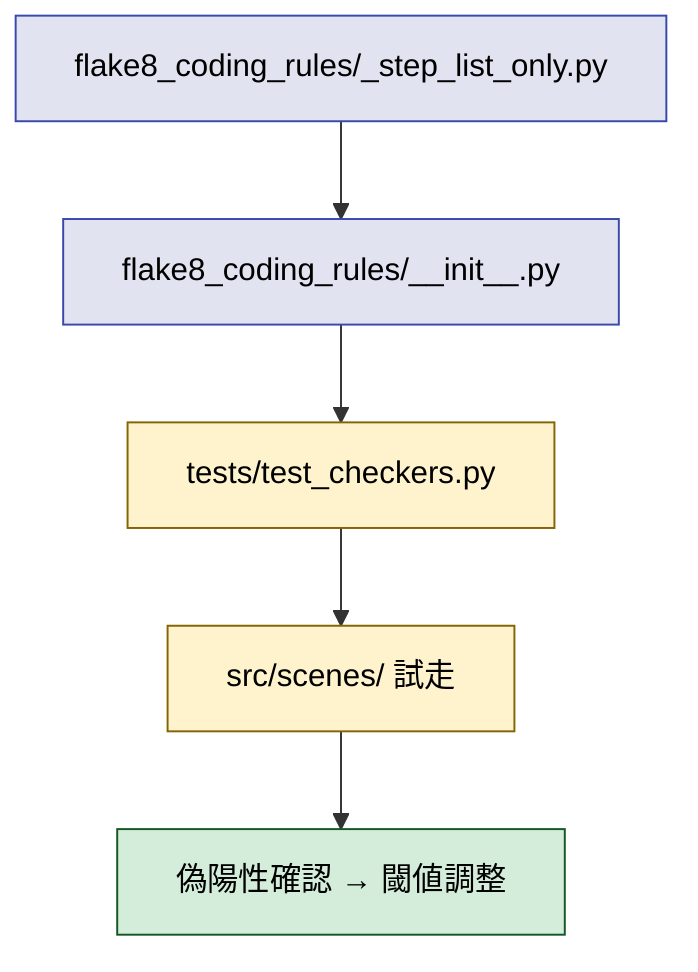
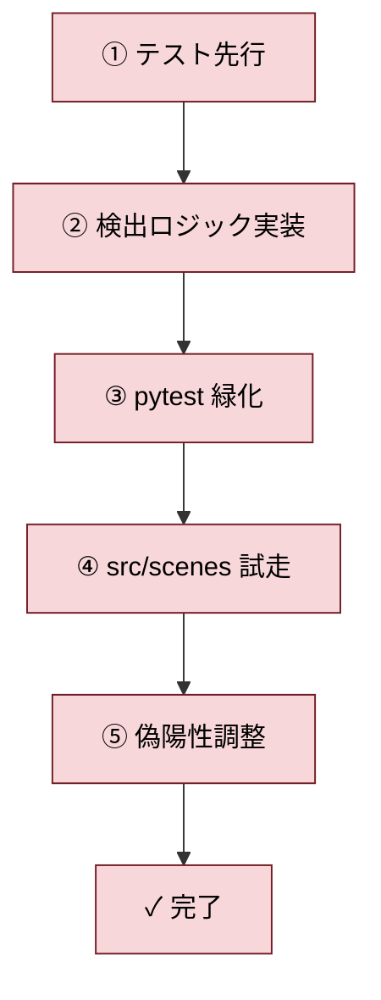

# 2026年5月18日 flake8-cr に構造化リファクタ誘導ルールを追加（タスク B）

> 状態：⑨ Closing
> 次のゲート：（ユーザー）dotfiles への commit / push を承認するか、本ノートを Close するか判断する

---

## 1) Journey（どこへ行くか）

> 補足：深層的目的 制御構造のリファクタ方針を flake8-cr に機械化し、CC が判断で迷わない状態を作る
> 補足：やらないこと SKILL.md（check-python-coding-guide）の改訂、コード本体の修正
> 補足：責務分担厳格度 basic

1. 前提条件
   1. 💦 タスク A（`steering/20260517-flake8-cr-scenes-cr202.md`）が完了済みであること
   2. 💦 A の 3 件で得た「望ましい構造」を機械検出するルールに落とし込む素材があること
   3. 💦 既存 flake8-cr（`~/dotfiles/shared/flake8-coding-rules`）には構造化リファクタを誘導する検出が無い

2. Before
   1. 💦 SKILL.md の述語切り出し指示は AI の解釈でブレる
   2. ❌ 不安

3. After
   1. ✅ flake8-cr が「ステップ列のみの public 関数」「述語切り出し済み」を機械検出できる
   2. ✅ ルール改訂が dotfiles に commit / push 済み
   3. ❤️ 安心

4. 例外
   1. 既存コードに大量の偽陽性が出る場合は閾値で緩和、または段階導入

5. 境界条件
   1. 対象は `~/dotfiles/shared/flake8-coding-rules` のみ
   2. 新ルールは CR204 以降の番号を割り当て
   3. テストケースは `tests/` に追加してから本実装へ進む（TDD）

6. 委任度
   1. 🟡 ルール仕様の決定は CC が原案、ユーザー承認
   2. 🟢 AST 検出ロジックの実装・ユニットテストは CC のみで可
   3. 🔴 dotfiles への commit / push は人の最終承認後

---

## 2) ユーザーストーリーマップ

> 委任度：🟢 ルール原案を CC が書き、実装・テストまで CC で進める。dotfiles の commit/push 直前で人へ戻す
> 残る曖昧さ：CR204 の閾値（許容するステップ数の上限）と偽陽性が出たときの緩和方針

### 事前確認

- [x] tasknote確認済み:
  - [x] `steering/done/20260517-flake8-cr-scenes-cr202.md`（タスク A：CR202 大物 3 件の構造化）
  - [x] `steering/done/20260517-flake8-cr-scenes.md`（親ノート：508 → 30 違反まで削減）
  - [x] `steering/20260518-flake8-cr-scenes-rest27.md`（後続タスク C：本ルール完成後に 27 件へ適用）
- [x] skill・tool・MCP確認済み:
  - [x] `manage-tasknotes` Skill
  - [x] `flake8-cr`（`~/dotfiles/shared/flake8-coding-rules`）
  - [x] `pytest`, `uv`, `ast`, `make verify`
- [x] 永続的ドキュメント確認済み:
  - [x] `~/dotfiles/shared/flake8-coding-rules/flake8_coding_rules/_control_flow.py`（CR203 既存実装）
  - [x] `~/dotfiles/shared/flake8-coding-rules/flake8_coding_rules/_function_length.py`（CR202 既存実装）
  - [x] `~/dotfiles/shared/flake8-coding-rules/tests/test_checkers.py`（既存テストパターン）

### 本体

1. 👀 CC が `~/dotfiles/shared/flake8-coding-rules/flake8_coding_rules/` 配下と既存テストを読み、CR200 番台の追加余地を確認する
2. 💦 CR204 の検出仕様（許可：定数代入・述語呼び出し・private 呼び出し・return・raise／不許可：複雑な式・属性更新・複数行ロジック）を素案で固める
3. 🎬 `tests/test_checkers.py` に CR204 の合格／不合格ケースを TDD で先に書く
4. 🎬 `_control_flow.py` 同じ階層に `_step_list_only.py` を新規追加、`__init__.py` から登録する
5. 👀 `pytest` で新テストが先に落ち、実装後に緑になることを確認する
6. 🎬 `code-quest-pyxel` 側で `uv run flake8-cr src/scenes/` を流し、偽陽性が出る場合は閾値や除外条件を調整する
7. ✅ flake8-cr に CR204 が追加され、`make verify` が緑、`src/scenes/` の新規違反件数が確定する。dotfiles の commit はユーザーへ確認してから push

---

## 3) Gherkin（完了条件）

> 委任度：🟢 シナリオに沿って TDD で進める
> 残る曖昧さ：なし

### シナリオ一覧

- [ ] シナリオ1：ステップ列だけの public 関数は CR204 を出さない

1. 🧱 開発者が `_check_landmark_events` のような「述語 + private 呼び出し + return」だけの関数を書いている（flake8-cr）
2. 🎬 `flake8-cr` をその関数に適用する（flake8-cr）
3. ✅ CR204 違反は報告されない（flake8-cr）

```gherkin
Given 開発者が次のステップ列だけを持つ関数を書いた
"""
def foo():
    if _is_x():
        return
    _do_y()
    return
"""
When flake8-cr を実行する
Then CR204 違反は報告されない
```

- [ ] シナリオ2：本体に直接ロジックを書いた関数は CR204 を出す

1. 🧱 開発者が、述語化されていない複雑な条件と式を public 関数に直書きしている（flake8-cr）
2. 🎬 `flake8-cr` をその関数に適用する（flake8-cr）
3. ✅ CR204 違反として「ステップ列化されていない」と報告される（flake8-cr）

```gherkin
Given 開発者が次の式直書きの関数を書いた
"""
def foo(x):
    a = x * 2 + 1
    if a > 100 and a < 200:
        return a + 5
    return a
"""
When flake8-cr を実行する
Then CR204 違反が報告される
And メッセージにはステップ列化を促す指示が含まれる
```

- [ ] シナリオ3：private 関数は CR204 の対象外

1. 🧱 開発者が `_helper` のような private 関数で複雑な式を書いている（flake8-cr）
2. 🎬 `flake8-cr` を適用する（flake8-cr）
3. ✅ private 関数には CR204 を出さない（flake8-cr）

```gherkin
Given private な `_helper` が複雑な式を含む
When flake8-cr を実行する
Then CR204 違反は報告されない
```

- [ ] シナリオ4：既存の `src/scenes/` 配下で偽陽性が現実的な件数に収まる

1. 🧱 開発者が `src/scenes/` 配下に CR204 を適用する（flake8-cr）
2. 🎬 `uv run flake8-cr src/scenes/` を実行する（flake8-cr）
3. ✅ CR204 違反は public 関数に絞られ、件数は記録され、後続タスク C で扱える規模になる（flake8-cr）

```gherkin
Given タスク A 完了後の `src/scenes/` 配下
When `uv run flake8-cr src/scenes/` を実行する
Then CR204 違反は public 関数のみに対して報告される
And 違反件数は記録され、後続タスク C のスコープに含められる規模である
```

- [ ] シナリオ5：CR204 の単体テストが緑

1. 🧱 開発者が `tests/test_checkers.py` に CR204 用テストを追加する（flake8-cr）
2. 🎬 `pytest` を流す（flake8-cr）
3. ✅ 全ケース緑（flake8-cr）

```gherkin
Given `tests/test_checkers.py` に CR204 合格／不合格ケースを追加
When `pytest` を実行する
Then すべて pass する
```

---

## 4) Design（どうやるか）

### 責務分担概要

| 親ディレクトリ | 責務概要 |
|---|---|
| `~/dotfiles/shared/flake8-coding-rules/flake8_coding_rules` | CR204 検出ロジック本体と、既存 checker への登録 |
| `~/dotfiles/shared/flake8-coding-rules/tests` | CR204 の合格／不合格ユニットテスト |
| `code-quest-pyxel/src/scenes` | CR204 を試走する検証対象（書き換えはタスク C） |

### 責務分担概要図



### 責務分担詳細

#### 親ディレクトリ: `~/dotfiles/shared/flake8-coding-rules/flake8_coding_rules`

- ファイル名: `_step_list_only.py`
- 既存/新規: 新規
- 責務内容:
  - `check_step_list_only(tree)`: public 関数のみを対象に CR204 検出を行うエントリ
  - `_is_public_function(node)`: `FunctionDef` で名前が `_` で始まらないかを判定
  - `_is_step_statement(stmt)`: ステップとして許可する文（述語呼び出し・private 呼び出し・return・raise・pass・docstring 単体）を判定
  - `_yield_non_step_list_violations(tree)`: 関数本体のうち非ステップ文を含む public 関数に対し CR204 を返す
- 置く理由: CR200 番台は制御構造系のルールなので、`_control_flow.py` と同じ階層に並べる
- 新規理由: 既存ファイルはどれも単一目的で粒度が揃っており、別目的のロジックを混ぜると逆に CR モジュールの責務が崩れるため

- ファイル名: `__init__.py`
- 既存/新規: 既存
- 責務内容:
  - `from ._step_list_only import check_step_list_only` を追加
  - `CodingRulesChecker.run` から `yield from check_step_list_only(self.tree)` を呼ぶ
- 置く理由: 既存パターンに沿って 1 行追加で増やせる構造を維持する

#### 親ディレクトリ: `~/dotfiles/shared/flake8-coding-rules/tests`

- ファイル名: `test_checkers.py`
- 既存/新規: 既存
- 責務内容:
  - `test_cr204_step_list_only_passes`: ステップ列だけの public 関数で違反が出ないこと
  - `test_cr204_complex_expression_detected`: 式直書きの public 関数で CR204 を返すこと
  - `test_cr204_private_function_skipped`: private 関数を対象外にすること
  - `test_cr204_message_includes_guidance`: メッセージにステップ列化の指示が含まれること
- 置く理由: 既存テストパターン（`_error_codes` ヘルパ）に乗る

#### 親ディレクトリ: `code-quest-pyxel/src/scenes`

- ファイル名: なし（試走対象）
- 既存/新規: 既存
- 責務内容:
  - `uv run flake8-cr src/scenes/` でルール適用結果を記録
  - 偽陽性が出る場合は CR204 側の検出条件を調整
- 置く理由: 実コードでの偽陽性確認は本ルールの完成度を測る唯一の現実的指標

### 関連スキル・MCP

- `manage-tasknotes` Skill（タスクノート更新）

---

## 5) Tasklist



- [x] **Step 1: テスト先行**
  - `tests/test_checkers.py` に CR204 用ケース 10 件を追加（合格・式直書き・private・メッセージ・dunder・docstring・raise・setter・for・else）
- [x] **Step 2: 検出ロジック実装**
  - `flake8_coding_rules/_step_list_only.py` を新規作成
  - `__init__.py` の `run` に `yield from check_step_list_only(self.tree)` を追加
- [x] **Step 3: pytest 緑化**
  - `cd ~/dotfiles/shared/flake8-coding-rules && uv run pytest` で 56 件全緑
- [x] **Step 4: src/scenes 試走**
  - `uv run flake8-cr src/scenes/` を実行し、CR204 違反件数は 0 件と確認
- [x] **Step 5: 偽陽性調整**
  - 初版で simple setter が 16 件擬陽性扱いになったため、`_is_assign_step` を追加し代入文をステップに昇格

---

## 6) 作業ログ

### 変更したファイル

- `~/dotfiles/shared/flake8-coding-rules/flake8_coding_rules/_step_list_only.py`（新規 196 行）
  - `check_step_list_only(tree)` を公開エントリにし、`_yield_non_step_list_violations` で違反を返す
  - ステップ判定 helper: `_is_docstring_stmt` / `_is_call_step`（呼び出し + yield from）/ `_is_assign_step`（代入）/ `_is_simple_return` / `_is_raise_or_pass` / `_is_predicate_guard_if`
- `~/dotfiles/shared/flake8-coding-rules/flake8_coding_rules/__init__.py`
  - import 1 行と `run` 内 `yield from check_step_list_only(self.tree)` 1 行を追加
- `~/dotfiles/shared/flake8-coding-rules/tests/test_checkers.py`
  - CR204 ケース 10 件を追加（`test_cr204_step_list_only_passes`, `test_cr204_complex_expression_detected`, `test_cr204_private_function_skipped`, `test_cr204_message_includes_guidance`, `test_cr204_dunder_skipped`, `test_cr204_docstring_only_passes`, `test_cr204_raise_step_passes`, `test_cr204_simple_setter_passes`, `test_cr204_for_loop_detected`, `test_cr204_else_branch_detected`）

### 確認コマンドと結果

- `cd ~/dotfiles/shared/flake8-coding-rules && uv run pytest` → 56 件全緑
  - 既存テスト 43 件 + CR204 10 件 + 自己検査の `_step_list_only.py` を含む全 checker モジュール
- `uv run flake8-cr src/scenes/` → CR204 違反 0 件、CR202 違反 27 件（Task C のスコープ）
- `make verify` → 全 OK（モジュール docstring・CJ リンク・CJob カテゴリ・scene_to_cj マップ）
- `python3 -m pytest` → 742 passed, 2 skipped

### 偽陽性調整の経緯

- 初版: `_is_call_step` のみで呼び出しと yield from だけを step に許容
  - 結果: simple setter（`self.attr = value` 形）の public 関数 16 件が違反扱い
- 修正: `_is_assign_step`（`Assign` / `AnnAssign` / `AugAssign`）を追加し step 列に含めた
  - 結果: CR204 違反 0 件、複雑な分岐を含む public 関数のみを検出する形に収束
- USM の「定数代入を許容」は単純代入（右辺の式は別ルール対象）に拡張する形で実装

---

## 7) 評価と成果物

> 評価：🟢 期待通り

### 成果物

- 新ルール CR204（step-list-only public function）が flake8-cr に追加され、56 件のテストで挙動を縛った
- `src/scenes/` 配下では CR204 違反 0 件＝既存 public 関数は規律に適合済み
- 今後の public 関数で「分岐ロジックを式直書き」した場合は機械的に検出できる状態

---

## 8) Discussion

### 懸念事項

- `_is_assign_step` を導入したことで「複雑な右辺を持つ代入文」も step として通る。これは CR302 / CR303 で別途検出する想定だが、setter にも複雑な式を書ける抜け道は残る
- public 関数が 1 件も違反しなかったため、後続タスク C のスコープは CR204 とは独立（CR202 27 件のみ）

### 残課題のルール化

- dotfiles への commit / push はユーザー判断（🔴）のため未実施
  - ユーザーが本ルールを受け入れる場合、`cd ~/dotfiles/shared/flake8-coding-rules && git add -A && git commit && git push` で反映する
- CR204 の閾値は現時点で「ステップ列違反は 1 件でも検出」。将来、誤検出が増えれば「許容違反数 N まで」の閾値導入を検討

---

## 9) Closing

- 状態：⑨ Closing
- 残課題のハンドオフ：dotfiles への commit / push がユーザー判断のため、Close 判定時に確認

---

## 10) 参考資料

- 先行タスク A: `steering/done/20260517-flake8-cr-scenes-cr202.md`
- 後続タスク C: `steering/20260518-flake8-cr-scenes-rest27.md`
- flake8-cr 本体: `~/dotfiles/shared/flake8-coding-rules`
- 参考ガイド: `~/.claude/skills/check-python-coding-guide/SKILL.md`
