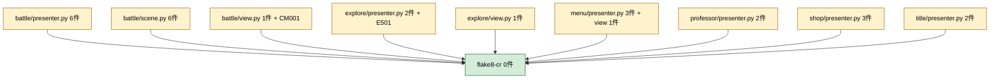
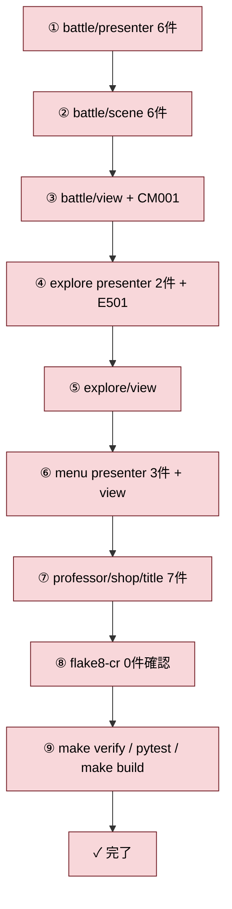

# 2026年5月18日 src/scenes 残 27 件に flake8-cr 新ルールを適用（タスク C）

> 状態：⑤ Tasklist
> 次のゲート：（CC）Step 1 から順次実行（ユーザー確認なし）

---

## 1) Journey（どこへ行くか）

> 補足：深層的目的 タスク B で機械化したルールに沿って残り 27 件を片付け、flake8-cr 0 件を達成する
> 補足：やらないこと ルール仕様の議論（B で完了）、大物 3 件（A で完了）
> 補足：責務分担厳格度 basic

1. 前提条件
   1. 💦 タスク B（`steering/20260518-flake8-cr-rule-extension.md`）が完了済みで、新ルールが有効化されていること
   2. 💦 タスク A の 3 件と合わせ、CR202 違反は残り 27 件のみであること

2. Before
   1. 💦 残 27 件の関数が CR202 違反のまま、新ルールにも該当する状態
   2. ❌ もどかしい

3. After
   1. ✅ `flake8-cr src/scenes/` が 0 件
   2. ✅ pytest / make verify / make build がすべて緑
   3. ❤️ スッキリ

4. 例外
   1. 線形な計算（D 該当：`_run_do_player_attack`, `_run_do_enemy_attack`）で乱数順を変える分割は行わない
   2. 偽陽性は flake8-cr の閾値・例外設定で対処し、コード側を歪めない

5. 境界条件
   1. 対象は残り 27 件（A 3 件・D 2 件以外）
   2. 新ルールの自動修正・誘導を最大限活用、手作業は最小化する
   3. 挙動は変えない（テスト緑を維持）

6. 委任度
   1. 🟢 機械的に直せる範囲は CC のみで可
   2. 🟡 偽陽性・手作業残しの判断は人と相談
   3. 🔴 例外（D 該当）の扱いは人の判断が要る

---

## 2) ユーザーストーリーマップ

> 委任度：🟢 機械的な分割なので CC のみで完走可能。挙動を変えないテスト緑が判定材料
> 残る曖昧さ：D 該当（`_run_do_player_attack`, `_run_do_enemy_attack`）の扱いは「乱数順を変えない」前提で進める

### 事前確認

- [x] tasknote確認済み:
  - [x] `steering/done/20260517-flake8-cr-scenes.md`（親ノート）
  - [x] `steering/done/20260517-flake8-cr-scenes-cr202.md`（タスク A）
  - [x] `steering/done/20260518-flake8-cr-rule-extension.md`（タスク B）
- [x] skill・tool・MCP確認済み:
  - [x] `manage-tasknotes` Skill
  - [x] `flake8-cr`
  - [x] `pytest`, `make verify`, `make build`
- [x] 永続的ドキュメント確認済み:
  - [x] `~/.claude/skills/check-python-coding-guide/SKILL.md`（CR202/CR203/CR204 の方針）

### 本体

1. 👀 CC が `uv run flake8-cr src/scenes/` で現状の CR202 違反 27 件と CM001 / E501 を確認する
2. 💦 違反関数をカテゴリ別（battle/scene 6・battle/presenter 6・menu/presenter 3・presenter 群 7・view 群 3・explore 2）に分類し優先順を決める
3. 🎬 CC が presenter / scene の長関数を「述語 → 早期 return → private 委譲」の 3 形に分割する
4. 🎬 view の `_run_draw` を領域単位の `_draw_xxx` に切り出す
5. 🎬 D 該当 2 件（`_run_do_player_attack`, `_run_do_enemy_attack`）は乱数順を保つ最小分割に留める
6. 👀 各分割ごとに `python3 -m pytest` で挙動が変わらないことを確認する
7. 🎬 CM001（冗長コメント）と E501（行長超）を機械的に直す
8. ✅ `flake8-cr src/scenes/` の出力が CR202 含めて 0 件、`make verify` / pytest / `make build` がすべて緑
9. 📝 作業ログに件数推移と分割パターンを記録し、Closing へ進める

---

## 3) Gherkin（完了条件）

> 委任度：🟢 CC が一気通貫で完走可能
> 残る曖昧さ：なし

### シナリオ一覧

- [ ] シナリオ1：CR202 違反が 0 件

1. 🧱 開発者が `uv run flake8-cr src/scenes/` を実行する（flake8-cr）
2. 🎬 全 27 件を分割した後で再度実行する（flake8-cr）
3. ✅ CR202 違反は 0 件、CR204 違反も 0 件のまま（flake8-cr）

```gherkin
Given タスク B 完了後の src/scenes/ に CR202 違反が 27 件残っている
When 述語切り出し + 早期 return + private 切り出しで分割を完了する
Then `uv run flake8-cr src/scenes/` が CR202/CR204 を 0 件で報告する
```

- [ ] シナリオ2：CM001 / E501 も解消

1. 🧱 開発者が flake8-cr 出力に残る CM001 / E501 を見る（flake8-cr）
2. 🎬 冗長コメント削除と行折り返しを施す（flake8-cr）
3. ✅ CM001 と E501 も解消（flake8-cr）

```gherkin
Given battle/view.py:51 に CM001 が、explore/presenter.py:369 に E501 が残っている
When 冗長コメントの削除と行折り返しを実施する
Then `uv run flake8-cr src/scenes/` から CM001 / E501 が消える
```

- [ ] シナリオ3：D 該当の乱数順を保つ

1. 🧱 開発者が `_run_do_player_attack` と `_run_do_enemy_attack` を分割する（pytest）
2. 🎬 乱数を使う処理（命中・ダメージ計算）を helper に切り出すが、乱数を呼ぶ順序を変えない（pytest）
3. ✅ 既存テストの乱数順依存ケースが緑のまま（pytest）

```gherkin
Given `_run_do_player_attack` / `_run_do_enemy_attack` は乱数を順番に呼ぶ
When ロジックを helper に切り出す
Then 乱数を呼ぶ順序は変わらない
And 既存テストはすべて緑のまま
```

- [ ] シナリオ4：挙動を変えない（pytest / make verify / make build 緑）

1. 🧱 開発者が全関数を分割した後（pytest）
2. 🎬 `python3 -m pytest`, `make verify`, `make build` を実行する（pytest）
3. ✅ すべて緑（pytest）

```gherkin
Given 27 件 + CM001 / E501 を解消した
When `python3 -m pytest`, `make verify`, `make build` を順に流す
Then すべて成功する
```

---

## 4) Design（どうやるか）

### 責務分担概要

| 親ディレクトリ | 責務概要 |
|---|---|
| `src/scenes/battle` | scene 6 件・presenter 6 件・view 1 件のリファクタ |
| `src/scenes/explore` | presenter 2 件・view 1 件・行長修正 1 件 |
| `src/scenes/menu` | presenter 3 件・view 1 件 |
| `src/scenes/professor` | presenter 2 件 |
| `src/scenes/shop` | presenter 3 件 |
| `src/scenes/title` | presenter 2 件 |

### 責務分担概要図



### 責務分担詳細

#### 親ディレクトリ: `src/scenes/battle`

- ファイル名: `presenter.py`
- 既存/新規: 既存
- 責務内容:
  - `_build_full_view_model`: `_build_main_panel` + `_build_status_panel` + `_build_log_panel` 等に分解
  - `_handle_phase_menu` / `_handle_phase_spell_select` / `_handle_phase_item_select`: 述語化 + 早期 return + private 委譲
  - `_build_spell_panel` / `_build_item_panel`: 行生成を helper に切り出し
- 置く理由: presenter は MVP の中で「入力分岐 + ViewModel 組み立て」が集中するため最も件数が多い

- ファイル名: `scene.py`
- 既存/新規: 既存
- 責務内容:
  - `_run_check_noise_guardian_phase` / `_run_check_glitch_lord_phase_transition` / `_run_check_level_up`: フェーズ判定述語と適用を別 helper に分解
  - `_run_apply_victory`: 報酬計算と表示メッセージ生成を分離
  - `_run_do_player_attack` / `_run_do_enemy_attack`（D 該当）: 乱数順を変えずに helper 切り出し
- 置く理由: 戦闘ルールの中核。乱数順を保つ責務がここに集中

- ファイル名: `view.py`
- 既存/新規: 既存
- 責務内容:
  - `_run_draw`: 領域単位の `_draw_status` / `_draw_log` / `_draw_panel` 等に切り出し
  - 51 行目の CM001（冗長コメント）削除
- 置く理由: 描画は領域単位の責務分割が最も自然

#### 親ディレクトリ: `src/scenes/explore`

- ファイル名: `presenter.py`
- 既存/新規: 既存
- 責務内容:
  - `_check_landmark_events`: ランドマーク種別ごとの dispatch を述語切り出し
  - `_resolve_landmark_scene`: scene 解決を helper に分解
  - 369 行目の E501 修正
- 置く理由: 既に大物分割済み。残るは中物 2 件

- ファイル名: `view.py`
- 既存/新規: 既存
- 責務内容:
  - `_run_draw`: 領域別 `_draw_xxx` に切り出し
- 置く理由: battle/view.py と同じ責務分割パターン

#### 親ディレクトリ: `src/scenes/menu`

- ファイル名: `presenter.py`
- 既存/新規: 既存
- 責務内容:
  - `_handle_sub_items` / `_use_selected_item`: 述語切り出し + 早期 return
  - `_build_items_panel`: 行生成を helper に分解
- 置く理由: メニュー系も入力分岐と ViewModel 組み立てが混在

- ファイル名: `view.py`
- 既存/新規: 既存
- 責務内容:
  - `_run_draw`: 領域別 `_draw_xxx` に切り出し
- 置く理由: 描画責務分割

#### 親ディレクトリ: `src/scenes/professor`

- ファイル名: `presenter.py`
- 既存/新規: 既存
- 責務内容:
  - `_run_update_intro`: 入力処理と状態遷移を helper に分解
  - `_run_build_intro_view_model`: パネル組み立てを helper に分解
- 置く理由: 親タスクで一部は分割済み。残るは intro 系 2 件

#### 親ディレクトリ: `src/scenes/shop`

- ファイル名: `presenter.py`
- 既存/新規: 既存
- 責務内容:
  - `_run_update`: 入力分岐を helper に分解
  - `_run_try_purchase`: 金額・所持判定・購入処理を helper に分解
  - `_run_build_view_model`: 行生成を helper に分解
- 置く理由: 購入処理は判定と適用を分けるのが自然

#### 親ディレクトリ: `src/scenes/title`

- ファイル名: `presenter.py`
- 既存/新規: 既存
- 責務内容:
  - `_run_update`: 入力分岐を helper に分解
  - `_run_build_view_model`: タイトル ViewModel 組み立てを helper に分解
- 置く理由: 他 presenter と同じパターン

### 関連スキル・MCP

- `manage-tasknotes` Skill（タスクノート更新）

---

## 5) Tasklist



- [ ] **Step 1: battle/presenter.py 6 件**
  - `_build_full_view_model`, `_handle_phase_menu`, `_handle_phase_spell_select`, `_handle_phase_item_select`, `_build_spell_panel`, `_build_item_panel`
- [ ] **Step 2: battle/scene.py 6 件**
  - `_run_check_noise_guardian_phase`, `_run_do_player_attack`(D), `_run_check_glitch_lord_phase_transition`, `_run_do_enemy_attack`(D), `_run_apply_victory`, `_run_check_level_up`
- [ ] **Step 3: battle/view.py 1 件 + CM001**
  - `_run_draw` を領域単位に切り出し、51 行目の冗長コメント削除
- [ ] **Step 4: explore/presenter.py 2 件 + E501**
  - `_check_landmark_events`, `_resolve_landmark_scene`, 369 行目の行折り返し
- [ ] **Step 5: explore/view.py 1 件**
  - `_run_draw` を領域単位に切り出し
- [ ] **Step 6: menu/presenter.py 3 件 + view.py 1 件**
  - `_handle_sub_items`, `_use_selected_item`, `_build_items_panel`, `_run_draw`
- [ ] **Step 7: professor/shop/title 7 件**
  - professor 2, shop 3, title 2
- [ ] **Step 8: flake8-cr 0 件確認**
  - `uv run flake8-cr src/scenes/` で 0 件を確認
- [ ] **Step 9: 最終検証**
  - `make verify`, `python3 -m pytest`, `make build` 全緑確認

---

## 6) Result（成果物）

### 残対象（27 件想定 — A の 3 件を除く 27 件）

カテゴリ分け（A の 3 件は除外済）：

| カテゴリ | 件数 | パターン |
|---|---|---|
| A'. 分岐 → 個別処理（タイル・フェーズ判定型） | 約 16 | 述語切り出し + 早期 return + private 切り出し |
| B'. ViewModel 組み立て（純粋関数化） | 約 5 | 行・パネルを `_build_xxx_panel` に分解 |
| C'. 描画関数 | 3 | 領域単位で `_draw_xxx` に切り出し |
| D'. 線形ロジック（例外候補） | 2 | 乱数順を実テストで検証 |

合計 26 件目安（実数はタスク B 完了時の flake8-cr 出力で再確定）。

---

## 7) Discussion（残課題の起票）

（適用完了後に記入）

---

## 8) 参考文献

- 先行タスク A: `steering/20260517-flake8-cr-scenes-cr202.md`
- 先行タスク B: `steering/20260518-flake8-cr-rule-extension.md`
- 親タスクノート（完了済）: `steering/done/20260517-flake8-cr-scenes.md`
