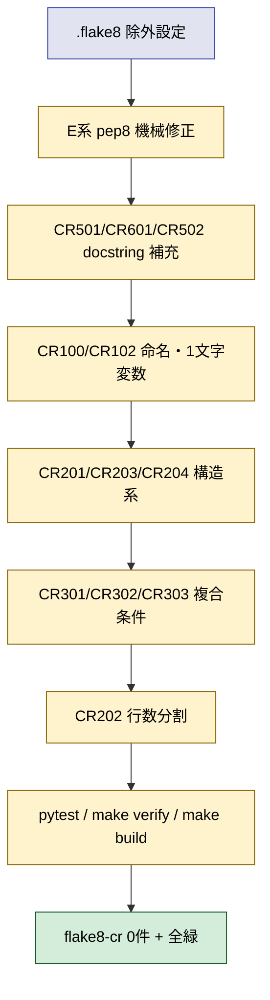
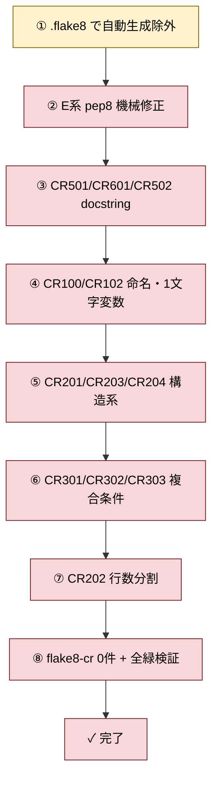

# 2026年5月18日 src/（scenes 除く）と tools/ に flake8-cr を適用

> 状態：⑤ Tasklist（autonomous 完走中）
> 次のゲート：CC が flake8-cr 0 件 + pytest/make verify/make build 緑まで進める

---

## 1) Journey（どこへ行くか）

> 補足：深層的目的 src/scenes/ で達成した flake8-cr 0 件を、リポジトリ全体（手書きコード）に広げて、AIコーディングの好循環をプロジェクト全体で享受する
> 補足：やらないこと 自動生成ファイル（`src/shared/constants/tile_data.py`, `src/shared/constants/sprite_data.py`, `src/generated/*`）への直接修正、`tools/architecture_rules/` 等の lint 機械化拡張、scenes/ 再走査
> 補足：責務分担厳格度 basic

1. 前提条件
   1. 💦 Task C 完了で `flake8-cr src/scenes/` は 0 件
   2. 💦 `uv run flake8-cr src/ tools/ --exclude src/scenes` で 10642 件、うち 80% は自動生成ファイル由来
   3. 💦 SSoT ポリシー上、`generated/` と `constants/tile_data.py` / `sprite_data.py` は YAML 由来の自動生成で手書き対象外

2. Before
   1. 💦 src/scenes/ 以外は flake8-cr 未適用で、命名・docstring・契約・関数行数のばらつきが残っている
   2. 💦 tools/ も同様で、手書きスクリプトに CR502（契約欠落）/ CR204（ステップ列違反）/ E501 が散在
   3. ❌ もどかしい

3. After
   1. ✅ `uv run flake8-cr src/ tools/ --exclude <自動生成>` が 0 件
   2. ✅ pytest / make verify / make build がすべて緑
   3. ✅ Task C と同じ「述語 + 早期 return + private 委譲 + docstring 契約」のパターンで全体が揃う
   4. ❤️ スッキリ

4. 例外
   1. 自動生成ファイル（`src/shared/constants/tile_data.py`, `src/shared/constants/sprite_data.py`, `src/generated/*`）は対象外。flake8-cr の除外指定で外す
   2. 偽陽性は flake8-cr の閾値・例外設定で対処し、コード側を歪めない
   3. `tools/test_*.py` の検証スクリプトは「ステップ列」要件を緩める可能性あり（テスト性質上）

5. 境界条件
   1. 対象は src/（scenes/ と generated/ と constants/{tile,sprite}_data.py を除く）+ tools/
   2. 機械修正可能なもの（E系・自動分割）から優先、CR系は Task C の分割パターンを再利用
   3. 挙動を変えない（pytest 緑を維持）
   4. SSoT 由来の自動生成ファイルは YAML 側 or `gen_data.py` 側を直す対象だが、今回はそこまで踏み込まない

6. 委任度
   1. 🟢 機械修正と Task C のパターン適用は CC のみで可
   2. 🟡 自動生成ファイルの扱い（除外 or `gen_data.py` 修正）の最終決定は人と相談
   3. 🟡 `tools/test_*.py` の検証スクリプトを規約対象に含めるかは人と相談

---

## 2) ユーザーストーリーマップ

> 委任度：🟢 機械修正と Task C のパターン適用が主軸。autonomous で完走可能
> 残る曖昧さ：なし（自動生成ファイルは `.flake8` 除外、その他は Task C と同じ判断基準で進める）

### 事前確認

- [x] tasknote確認済み:
  - [x] `steering/done/20260518-flake8-cr-scenes-rest27.md`（Task C：分割パターンの正本）
  - [x] `steering/done/20260518-flake8-cr-rule-extension.md`（Task B：CR204 ルール）
  - [x] `steering/done/20260517-flake8-cr-scenes-cr202.md`（Task A：大物分割）
- [x] skill・tool・MCP確認済み:
  - [x] `flake8-cr`（`uv run flake8-cr`）
  - [x] `pytest`, `make verify`, `make build`
  - [x] `manage-tasknotes` Skill
- [x] 永続的ドキュメント確認済み:
  - [x] `~/.claude/skills/check-python-coding-guide/SKILL.md`
  - [x] memory: `project_ssot_policy.md`（generated 一方通行）
  - [x] memory: `project_module_docstring_policy.md`（モジュール docstring 規約）

### 本体

1. 👀 CC が `uv run flake8-cr src/ tools/ --exclude src/scenes` で 10642 件、ルール別に E231:8022 / E501:491 / CR502:449 / E201:388 / CR501:189 等を確認
2. 💦 8000+件は `tile_data.py` `sprite_data.py` `generated/dialogue.py` の自動生成。手書きで直すべき対象ではないと判断
3. 🎬 `.flake8` をプロジェクトルートに作成して自動生成ファイルを除外し、対象を実質 2000 件オーダーに絞り込む
4. 🎬 E系（pep8）→ docstring系（CR501/CR601/CR502）→ 命名系（CR100/CR102）→ 構造系（CR201/CR203/CR204）→ 複合条件（CR301/CR302/CR303）→ 行数（CR202）の順で消す
5. 👀 各フェーズで件数推移を確認し、副産物の違反（リファクタで新規発生）も次フェーズで吸収する
6. 🎬 `pytest` を都度回して挙動が変わっていないことを確認する
7. ✅ `uv run flake8-cr src/ tools/ --exclude src/scenes` が 0 件 + `make verify` + `python3 -m pytest` + `make build` 全緑
8. 📝 件数推移・分割パターン・副産物を作業ログに記録し、Closing へ進める

---

## 3) Gherkin（完了条件）

> 委任度：🟢 CC が一気通貫で完走可能
> 残る曖昧さ：なし

### シナリオ一覧

- [ ] シナリオ1：自動生成ファイルは flake8-cr 対象外

1. 🧱 開発者が `.flake8` の除外設定を確認する（flake8-cr）
2. 🎬 `uv run flake8-cr src/ tools/ --exclude src/scenes` を実行する（flake8-cr）
3. ✅ 自動生成ファイル（`tile_data.py` `sprite_data.py` `generated/*`）の違反は報告されない（flake8-cr）

```gherkin
Given プロジェクトルートに .flake8 があり、generated/ と constants/{tile,sprite}_data.py が exclude に含まれる
When `uv run flake8-cr src/ tools/ --exclude src/scenes` を実行する
Then 自動生成ファイルの違反は0件として扱われる
And 残り対象ファイルだけが検査される
```

- [ ] シナリオ2：E系 pep8 違反が 0 件

1. 🧱 開発者が現状の E系違反（E231:8022/E501:491/E201:388/E702:53/E701:26/E402:15/E302:9/E306:2/E305:2/E741:3/E124:1）を見る（flake8-cr）
2. 🎬 自動修正と手作業で E系を解消する（flake8-cr）
3. ✅ E系の違反は 0 件（flake8-cr）

```gherkin
Given 除外設定後の対象ファイルに E系違反が残っている
When 機械修正 + 手作業で対応する
Then `uv run flake8-cr src/ tools/ --exclude src/scenes` から E系（E2xx/E5xx/E7xx/E3xx）が消える
```

- [ ] シナリオ3：CR系（命名・構造・docstring・複合条件・行数）が 0 件

1. 🧱 開発者が CR系違反（CR502:449/CR501:189/CR204:179/CR203:162/CR100:102/CR303:91/CR601:86/CR202:85/CR201:68/CR101:65/CR102:34/CR301:28/CR302:16）を見る（flake8-cr）
2. 🎬 Task C のパターン（述語 + 早期 return + private 委譲 + docstring 契約）で対応する（flake8-cr）
3. ✅ CR系違反は 0 件（flake8-cr）

```gherkin
Given E系解消後に CR系違反が残っている
When docstring 補充 → 命名修正 → 構造分割 → 複合条件述語化 → 行数分割 の順に進める
Then `uv run flake8-cr src/ tools/ --exclude src/scenes` から CR系がすべて消える
```

- [ ] シナリオ4：挙動を変えない（pytest / make verify / make build 緑）

1. 🧱 開発者が全違反を解消した後（pytest）
2. 🎬 `python3 -m pytest`, `make verify`, `make build` を順に実行する（pytest）
3. ✅ すべて緑（pytest）

```gherkin
Given src/ tools/（scenes 除く）の flake8-cr が 0 件
When `python3 -m pytest`, `make verify`, `make build` を順に流す
Then すべて成功する
And 既存テスト 742 件は緑のまま
```

- [ ] シナリオ5：実装不能な箇所は Discussion に残し、別 tasknote に派生

1. 🧱 CC が直そうとした関数・モジュールに、挙動を変えずに直せない論点がある（flake8-cr）
2. 🎬 該当箇所は flake8-cr の noqa か、ファイル単位で `.flake8` の per-file-ignores へ退避する（flake8-cr）
3. ✅ 該当箇所の判断根拠と派生 tasknote を Discussion に記録する（flake8-cr）

```gherkin
Given 機械的に直すと既存テストや挙動が壊れるリスクがある関数がある
When 該当行に `# noqa: <ルール>` を付けて理由コメントを残す
Then その違反は 0 件扱いとなり、Discussion に派生課題として記録される
```

---

## 4) Design（どうやるか）

### 責務分担概要

| 親ディレクトリ | 責務概要 |
|---|---|
| プロジェクトルート | `.flake8` で対象範囲と除外を宣言 |
| `src/runtime` | エントリポイント系（`app.py` `main_runtime.py`）のリファクタ |
| `src/shared/services` | サービス層（`world_generation.py` `dialog_runner.py` 等）のリファクタ |
| `src/shared/state` | 状態モデル（`player_model.py`）のリファクタ |
| `src/shared/ui` | UI 層（`message_window.py` 等）のリファクタ |
| `src/shared/constants` | 自動生成（`tile_data.py` `sprite_data.py`）は除外、手書き定数のみ対象 |
| `src/generated` | 自動生成。除外 |
| `tools/architecture_rules` | lint 機械化スクリプト（`check_architecture_rules.py` 等）のリファクタ |
| `tools/stakeholder_voices` | 利害関係者監査スクリプトのリファクタ |
| `tools/` 直下 | build/gen/check 系ユーティリティのリファクタ |

### 責務分担概要図



### 責務分担詳細

#### 親ディレクトリ: プロジェクトルート

- ファイル名: `.flake8`
- 既存/新規: 新規
- 責務内容:
  - `[flake8]` セクションで `max-line-length = 79`（既存挙動と一致）
  - `exclude`: `.venv`, `__pycache__`, `src/generated`, `src/shared/constants/tile_data.py`, `src/shared/constants/sprite_data.py`, `src/scenes`（既に Task C 完了済みなので除外）
  - `per-file-ignores`: 必要に応じて `tools/test_*.py` 等の検証スクリプトに緩和ルール
- 置く理由: flake8-cr は flake8 のプラグインで `.flake8` を読む。CLI 引数より宣言的で再現性が高い
- 新規理由: プロジェクトに既存設定が無い

#### 親ディレクトリ: `src/runtime`

- ファイル名: `app.py` / `main_runtime.py`
- 既存/新規: 既存
- 責務内容:
  - module docstring の Problems: セクション補充（CR601）
  - public 関数の docstring 契約補充（CR502）
  - 制御フロー直接含む public 関数を private 委譲へ（CR203/CR204）
  - 関数行数 20 行超を helper 分割（CR202）
- 置く理由: アプリのエントリポイント

#### 親ディレクトリ: `src/shared/services`

- ファイル名: `world_generation.py` `dialog_runner.py` `image_banks.py` 他（合計 14 ファイル）
- 既存/新規: 既存
- 責務内容:
  - module docstring 補充（CR601）
  - docstring 契約補充（CR502）
  - 命名修正（CR100 動詞接頭辞、CR102 1文字変数）
  - 述語切り出し + 早期 return（CR303）
  - public 関数のステップ列化（CR204）
  - 行数オーバー分割（CR202）
- 置く理由: 件数が最も多い。Task C のパターンをそのまま適用できる

#### 親ディレクトリ: `src/shared/state`

- ファイル名: `player_model.py`
- 既存/新規: 既存
- 責務内容:
  - dataclass ベースの状態保持。docstring 補充と制御フロー最小化
- 置く理由: 状態モデルは責務が明確だが docstring 欠落が多い

#### 親ディレクトリ: `src/shared/ui`

- ファイル名: `message_window.py` 他
- 既存/新規: 既存
- 責務内容:
  - 描画とウィンドウ管理。Task C と同じ「領域単位 helper 切り出し」を再利用
- 置く理由: scenes/view と同じ責務分割パターン

#### 親ディレクトリ: `tools/architecture_rules`

- ファイル名: `check_architecture_rules.py` `fix_architecture_rules.py` `repair_architecture_rules.py`
- 既存/新規: 既存
- 責務内容:
  - 大物（219 / 139 件）はファイル分割可能性も検討
  - lint 機械化スクリプト本体のため、行数・複合条件・docstring が集中
- 置く理由: 件数が tools/ の中で最も多く、AST 操作系の責務分割は慎重に進める

#### 親ディレクトリ: `tools/stakeholder_voices`

- ファイル名: `check_stakeholder_voices.py` `source_trace_coverage.py` `fix_stakeholder_voices.py`
- 既存/新規: 既存
- 責務内容:
  - 利害関係者監査スクリプト。docstring と命名修正中心
- 置く理由: architecture_rules と同じパターン

#### 親ディレクトリ: `tools/` 直下

- ファイル名: `build_*.py` `gen_*.py` `check_*.py` `report_*.py` `verify_*.py` 等
- 既存/新規: 既存
- 責務内容:
  - 各ユーティリティの docstring・命名・構造を統一
- 置く理由: 単体スクリプト多数だが、件数は中小規模で機械的に直せる

### 関連スキル・MCP

- `manage-tasknotes` Skill（タスクノート更新）
- `flake8-cr`（違反検出）

> 注意: Design に「手順フロー」「実装時の手順フロー」見出しは置かない。手順は Tasklist 側で扱う。

---

## 5) Tasklist



- [ ] **Step 1: `.flake8` を作成し、自動生成ファイルを除外**
  - `exclude` に `src/generated`, `src/shared/constants/tile_data.py`, `src/shared/constants/sprite_data.py`, `src/scenes` を追加
  - `uv run flake8-cr src/ tools/` で除外が効くことを確認
- [ ] **Step 2: E系 pep8 違反を機械修正**
  - E231（カンマ後スペース）、E201（括弧内余分スペース）、E501（行長）、E702/E701（複文セミコロン）、E402（import 順）、E302/E305/E306（空行）、E741（曖昧な変数名）、E124 を解消
- [ ] **Step 3: CR501/CR601/CR502 docstring 系を埋める**
  - CR501: 関数 docstring 欠落
  - CR601: module docstring の Problems: セクション欠落
  - CR502: 引数・戻り値・契約情報の欠落
- [ ] **Step 4: CR100/CR102 命名・1文字変数を直す**
  - CR100: 関数名の先頭語を動詞接頭辞に
  - CR102: 1文字ループ変数（`p`, `m`, `e`）を意味ある名前に
  - CR101: 述語関数の `is_`/`has_`/`can_` 接頭辞
- [ ] **Step 5: CR201/CR203/CR204 構造系を直す**
  - CR201: class にセクション区切り `# === Public API ===` 等
  - CR203: public 関数の制御フローを private に切り出し
  - CR204: public 関数を「述語呼び出し + private 委譲 + return」のステップ列に
- [ ] **Step 6: CR301/CR302/CR303 複合条件を述語化**
  - 複合 if / and / or を `is_xxx` 述語関数に切り出し
- [ ] **Step 7: CR202 行数オーバーを helper 分割**
  - 20 行超過の関数を Task C パターンで分割
- [ ] **Step 8: 最終検証**
  - `uv run flake8-cr src/ tools/ --exclude src/scenes` が 0 件
  - `python3 -m pytest` が 742 passed
  - `make verify` 全 OK
  - `make build` が dist/ 生成成功

### 記録の分け方

> 実行のたびに、事実は `作業ログ`、判断は `Discussion` に分けて残す。

---

## 6) 作業ログ

（Tasklist 実行時に記入）

---

## 7) 評価と成果物

（完了時に記入）

---

## 8) Discussion

### 懸念事項

- （実装後に記入）

### 残課題のルール化

- （実装後に記入）

---

## 9) Closing

（Discussion 完了後に記入）

---

## 10) 参考資料

- 親系譜:
  - `steering/done/20260517-flake8-cr-scenes.md`（src/scenes 全体）
  - `steering/done/20260517-flake8-cr-scenes-cr202.md`（Task A: 大物 3 件）
  - `steering/done/20260518-flake8-cr-rule-extension.md`（Task B: CR204 ルール追加）
  - `steering/done/20260518-flake8-cr-scenes-rest27.md`（Task C: 残 27 件）
- 永続的ドキュメント:
  - `~/.claude/skills/check-python-coding-guide/SKILL.md`
- 関連メモリ:
  - `project_ssot_policy.md`（generated 一方通行）
  - `project_module_docstring_policy.md`（モジュール docstring 規約）
