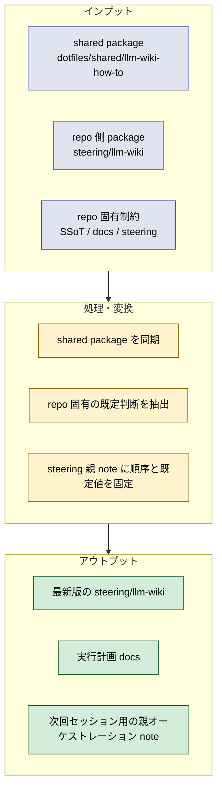
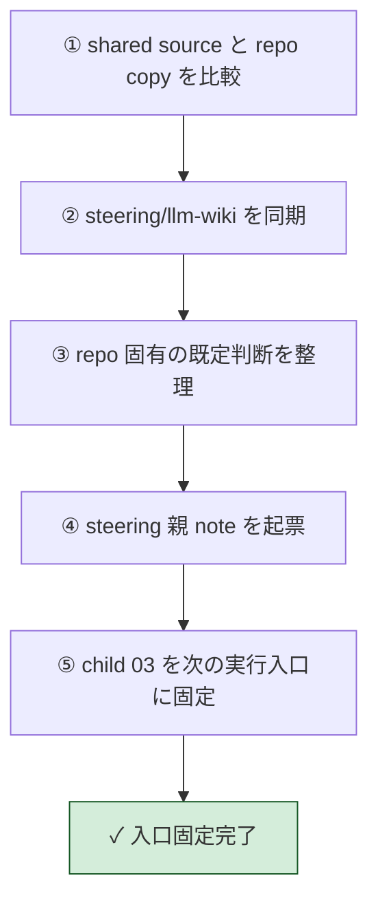

# 2026年5月22日 開発基盤：LLM Wiki shared packageを導入して自律実行ルートを固定する

> 状態：⑤ Tasklist
> 次のゲート：（CC）`steering/2026年5月22日 開発基盤：Karpathy方針でindexとlogの最小形を通す.md` を開き、次の実作業を `index.md` / `log.md` 実生成へ進める

---

## 1) Journey（どこへ行くか）

> 補足：深層的目的 LLM Wiki 導入の入口を 1 本に固定し、次回セッションが探索から始まらないようにする
> 補足：やらないこと 今回の note で wiki 本体生成・summary 生成・checklist 変換・試運転までは完走しない

1. 前提条件
   1. 💦 `steering/llm-wiki/` は shared package の置き場所であり、実行中 tasknote そのものではない
   2. 💦 `code-quest-pyxel` には `YAML -> gen_data.py -> generated` の SSoT 方針があり、`raw を正本にする` 原則をそのまま持ち込めない
   3. 💦 ユーザーは離席予定で、今後の進行は tasknote だけ読めば再開できる必要がある

2. Before
   1. 💦 repo 側の `steering/llm-wiki` には shared package の古い版が混ざっており、どこから進めるべきかが揺れていた
   2. 💦 `01` から始めるべきか、SSoT が強いので `03` を先に読むべきかが tasknote 入口で固定されていなかった
   3. ❌ 迷う

3. After
   1. 💦 `steering/llm-wiki` は dotfiles 側 shared package の最新版と同期している
   2. ✅ `steering/` 直下のこの親 note だけを見れば、次に切るべき tasknote と repo 固有の既定判断が分かる
   3. ❤️ 安心

4. 例外
   1. 後でユーザーが `wiki/` の置き場所や raw 方針を上書きしたくなった場合は、この note の既定判断よりユーザー判断を優先する
   2. `scripts/commit-tasknote.sh` のような tasknote 専用補助が repo に無いので、起票直後自動 commit ルールはそのまま適用できない

5. 境界条件
   1. 今回の変更範囲は `steering/llm-wiki/` の同期、`docs/superpowers/plans/` の計画書、`steering/` の親オーケストレーション note に限定する
   2. コード実装・wiki ディレクトリ新設・docs 正本の変換は後続 tasknote で扱う

6. 委任度
   1. 🟢 全体として CC 単独で進められる：shared package 同期と入口固定は repo 調査だけで完結する
   2. 🟢 CCのみで可：`03 -> 01 -> 02 -> 04` の順序固定、既定判断の明文化、親 note の起票
   3. 🟡 後で人の判断が要る：`wiki/` の最終置き場所、UX 正本の語り口、試運転に使う実タスク選定

---

## 2) ユーザーストーリーマップ

> Gherkin の前に、今回の仕事をどの順番で進めるかだけをそろえる。
> 委任度：🟢 入口固定までは CC が進められる
> 残る曖昧さ：wiki 実体の置き場所そのものは後続 note で最終確定する

### 話題一覧

#### 話題1：shared package を repo 側の正しい入口として置き直す

##### ユーザー：私

1. 当初計画
    1. 👀 `dotfiles/shared/llm-wiki-how-to` と `steering/llm-wiki` を見比べる
    2. 🔄 repo 側 package を最新版へ同期する
    3. 📝 共有 package は「参照用」、実行は `steering/` 直下の親 note から始めると固定する

#### 話題2：repo 固有の既定判断を先に置く

##### ユーザー：私

1. 当初計画
    1. 🧭 SSoT が強い repo なので `03` を `01` より先に実行する
    2. 🏗️ raw 二重化はコピーではなく generator 寄りで進める前提を書く
    3. 📚 `architecture_rules.yml` と既存 docs 直接調査による UX checklist 化を既定入口として固定する

#### 話題3：ユーザー不在でも次に切る tasknote が分かる状態にする

##### ユーザー：私

1. 当初計画
    1. ✂️ 最初の実行 note は child `03` を現在日付 tasknote に切り直すと明記する
    2. 🔗 その次に `01`, `02`, `04`, `05`, `06`, `07`, `08`, `09`, `10`, `11`, `12` を辿る順番を固定する
    3. 📌 `scripts/commit-tasknote.sh` 不在という process gap を先に記録する

---

## 3) Gherkin（完了条件）

> 委任度：🟢 この note の作成と package 同期までは CC が完走できる
> 残る曖昧さ：なし

### シナリオ一覧

- [x] シナリオ1：shared package が repo 側で最新版に揃う

1. 🧱 repo には `steering/llm-wiki` があるが shared package と差分がある
2. 🎬 shared source から repo 側 package を同期する
3. ✅ `README.md` と child tasknotes が shared source と一致し、古い説明が残らない

- [x] シナリオ2：次の実行入口が 1 本に固定される

1. 🧱 次にどの tasknote を current-date 化するかが揺れている
2. 🎬 `steering/` 直下に親オーケストレーション note を作る
3. ✅ 後続セッションはその note を開けば `03 -> 01 -> 02 -> ...` の順で進められる

- [x] シナリオ3：ユーザー不在でも既定判断で前進できる

1. 🧱 ユーザーは離席し、細かな質問に即答できない
2. 🎬 置き場所・raw 方針・query 方針・checklist 入力の既定値を note に記録する
3. ✅ 未来のセッションは探索のやり直しなしに、child `03` の実 tasknote 化から着手できる

---

## 4) Design（どうやるか）

- **関連スキル・MCP**：`manage-tasknotes`, `writing-plans`

### 【参照】

- Steering: `steering/llm-wiki/README.md`
- Steering: `steering/llm-wiki/フィール流LLM Wikiの作り方（途中まで）.md`
- Steering: `steering/llm-wiki/child-tasknotes/03-練習用プロジェクト向けLLM Wiki skeletonと命名ルールを置く.md`
- Steering: `steering/llm-wiki/child-tasknotes/09-architecture.mdをchecklist正本へ変換する.md`
- Steering: `steering/llm-wiki/child-tasknotes/10-ux-policy.mdをchecklist正本へ変換する.md`

### 変更範囲

- やること:
  - `steering/llm-wiki` を最新版 shared package に同期する
  - 自律実行用の親 note を `steering/` に 1 本起票する
  - repo 固有の既定判断を明文化する
- やらないこと:
  - wiki 実体ディレクトリの新設
  - summary 生成
  - checklist の実変換
  - 実コード変更

### 検証

- 検証コマンド:
  - `diff -ru /home/exedev/dotfiles/shared/llm-wiki-how-to /home/exedev/code-quest-pyxel/steering/llm-wiki`
  - `find steering/llm-wiki -maxdepth 3 -type f | sort`
  - `git status --short steering/llm-wiki 'steering/2026年5月22日 開発基盤：LLM Wiki shared packageを導入して自律実行ルートを固定する.md'`
- 成功条件:
  - shared source と repo copy に差分が無い
  - shared package の README / 親note / child 12 本が揃う
  - 親オーケストレーション note が 1 本見える
- 未実施時の扱い:
  - 未検証のまま完了扱いにしない

---

## 5) Tasklist

- [x] `steering/llm-wiki` と `dotfiles/shared/llm-wiki-how-to` の差分を確認した
- [x] repo 側 shared package を最新版へ同期した
- [x] `docs/superpowers/plans/2026-05-22-llm-wiki-tasknote-bootstrap.md` を追加した
- [x] この親オーケストレーション note を起票した
- [x] 次の実行順を `03 -> 01 -> 02 -> 04 -> 05 -> 06 -> 07 -> 08 -> 09 -> 10 -> 11 -> 12` に固定した
- [x] child `03` を現在日付 tasknote に切り直した
- [x] `wiki/` を既定候補として、raw 生成方針と query read-only 運用を child `03` の実 note と `wiki/README.md` に落とした
- [x] child `01` で latest docs と Git snapshot 候補の棚卸しを完了した
- [x] child `02` で closed tasknotes の shortlist と投入順を固定した
- [x] child `04` を現在日付 tasknote に切り直し、spot ingest の source / output / UX 根拠 docs を固定した
- [x] child `04` で `test/test_gen_wiki.py` red-green、`tools/gen_wiki.py`、実 raw/summaries 生成まで完了した

---

## 6) Result（成果物）

- `steering/llm-wiki` を shared source から同期し、repo 側 package の古い説明を置き換えた
- `steering/` 直下にこの親オーケストレーション note を追加し、次回の入口を 1 本に固定した
- repo 固有の既定判断を次の通り明文化した
  - 最初の実行 note は child `03`
  - wiki 実体の既定候補は `wiki/`
  - raw はコピーではなく generator ベースを既定候補にする
  - architecture checklist の入力既定は `docs/architecture_rules.yml`
  - UX 側は既存 docs をよく調査して直接 checklist 化する
  - query 方針は `wiki/query/*.md` の蓄積と agent 直問のハイブリッド
  - closed tasknotes の上限は 30 件程度で先に絞る
- child `03` の現在日付 tasknote と `wiki/README.md` を追加し、skeleton 実体と運用ルールまで初期化した
- child `01` の現在日付 tasknoteで `latest_docs / supporting_docs / deprecated / history_snapshots` を固定した
- child `02` の現在日付 tasknoteで `steering/done` 113 件から 25 件の closed tasknotes shortlist を固定した
- child `04` の現在日付 tasknoteで `test/test_gen_wiki.py` と `tools/gen_wiki.py` を追加し、`docs/customer-jobs.md` + `steering/done/20260509-stakeholder-voices-bootstrap.md` の spot ingest を `wiki/raw` / `wiki/wiki/summaries` に流した

---

## 7) Discussion（残課題の起票）

### child tasknote 一覧

- [x] child `03`：`steering/done/2026年5月22日 練習用プロジェクト向けLLM Wiki skeletonと命名ルールを置く.md`
- [x] child `01`：`steering/done/2026年5月22日 練習用プロジェクトの正本docsとGit snapshot候補を棚卸しする.md`
- [x] child `02`：`steering/done/2026年5月22日 練習用プロジェクトのclosed tasknotes投入候補と順番を固定する.md`
- [x] child `04`：`steering/done/2026年5月22日 練習用プロジェクトでminimal ingestとsummariesを通す.md`
- [ ] child `05`（repo-local 置換）：`steering/2026年5月22日 開発基盤：Karpathy方針でindexとlogの最小形を通す.md`
- [ ] child `06`：`steering/llm-wiki/child-tasknotes/06-練習用プロジェクトでread-only queryを通す.md`
- [ ] child `07`：`steering/llm-wiki/child-tasknotes/07-練習用プロジェクトでraw knowledgeをrebuild summaries対象に含める.md`
- [ ] child `08`：`steering/llm-wiki/child-tasknotes/08-練習用プロジェクトでconcept entity candidatesを出す.md`
- [ ] child `09`：`steering/llm-wiki/child-tasknotes/09-architecture.mdをchecklist正本へ変換する.md`
- [ ] child `10`：`steering/llm-wiki/child-tasknotes/10-ux-policy.mdをchecklist正本へ変換する.md`
- [ ] child `11`：`steering/llm-wiki/child-tasknotes/11-checklist docsをwiki raw knowledgeとsummariesに反映する.md`
- [ ] child `12`：`steering/llm-wiki/child-tasknotes/12-小さな開発task1本でLLM Wikiとchecklistを試運転する.md`

### 残課題メモ

- `scripts/commit-tasknote.sh` が repo に存在しないため、manage-tasknotes の「起票直後 commit」ルールをこの repo ではそのまま実行できない
- shared package の一般論は `generated/wiki/` 案を残しているが、この repo の current-date notes はユーザー判断に従って `wiki/` 直下を採用した
- 次の実作業は Karpathy 寄りの `index.md` / `log.md` 最小実装
- 別tasknoteにした場合のタイトル or パス：`steering/2026年5月22日 開発基盤：Karpathy方針でindexとlogの最小形を通す.md`

### 反省とルール化

- 記入先：`steering/llm-wiki/README.md`, `AGENTS.md`
- 次にやること：`index.md` / `log.md` の current-date note を開き、最小実装を進める
- session close 2026-05-23:
  - 現在の状態：child `04` まで完了、Karpathy 方針への切り替えと skill 作成まで保存対象に含める
  - 次に再開すること：`steering/2026年5月22日 開発基盤：Karpathy方針でindexとlogの最小形を通す.md` を開き、`wiki/wiki/index.md` と `wiki/wiki/log.md` の実生成に着手する

---

## 8) Closing

- 状態: open
- 次のゲート: `steering/2026年5月22日 開発基盤：Karpathy方針でindexとlogの最小形を通す.md` を開いて、repo 側 next 作業を進める
- close 条件:
    - [x] child `03` current-date 化と skeleton 初期化が終わっている
    - [x] child `01` latest docs / snapshot 固定が終わっている
    - [x] child `02` closed tasknotes shortlist 固定が終わっている
    - [x] child `04` minimal ingest と summaries spot が終わっている
    - [ ] child `05`（repo-local 置換）以降の index / query / checklist / 試運転が終わっている

---

## 9) 参考文献

- `steering/llm-wiki/README.md`
- `steering/llm-wiki/フィール流LLM Wikiの作り方（途中まで）.md`
- `steering/llm-wiki/child-tasknotes/01-練習用プロジェクトの正本docsとGit snapshot候補を棚卸しする.md`
- `steering/llm-wiki/child-tasknotes/03-練習用プロジェクト向けLLM Wiki skeletonと命名ルールを置く.md`
- `steering/llm-wiki/child-tasknotes/06-練習用プロジェクトでread-only queryを通す.md`
- `steering/llm-wiki/child-tasknotes/09-architecture.mdをchecklist正本へ変換する.md`
- `steering/llm-wiki/child-tasknotes/10-ux-policy.mdをchecklist正本へ変換する.md`
- `docs/superpowers/plans/2026-05-22-llm-wiki-tasknote-bootstrap.md`
