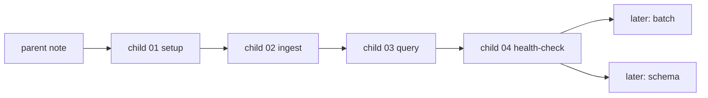

# 2026年5月23日 開発基盤：Karpathy型LLM Wiki運用の親ノート

> 状態：⑤ Tasklist
> 次のゲート：（CC）child `01` の土台フォルダと基準ページ作成に入る

---

## 1) Journey（どこへ行くか）

> 補足：深層的目的 Karpathy 流の llm wiki を、最初の health-check まで 1 周回せる実行順へ落とす
> 補足：やらないこと batch 最適化や schema 固定を main route に混ぜて、初回 1 周を遅らせない
> 補足：責務分担厳格度 basic

1. 前提条件
   1. 💦 最初の source は Karpathy gist を使う
   2. 💦 goal は theory ではなく、最初の health-check を 1 回回すこと
   3. 💦 query の良い答えは wiki page として保存しうる
   4. 💦 health-check は core 5 を見て結果を分類できればよい
   5. 💦 batch と schema は初回 1 周の後段に回してよい

2. Before
   1. 💦 note 群はあるが、setup から health-check までの直線ルートが弱い
   2. 💦 batch と schema が main route に近く、初回 1 周の焦点がぶれやすい
   3. 💦 次回セッションで最初に進める child が setup か ingest か曖昧だった
   4. ❌ 迷う

3. After
   1. 💦 親 note が `setup -> ingest -> query -> health-check` の入口になる
   2. ✅ child `01-04` で初回 1 周の main route が固定される
   3. ✅ batch と schema は later note として main route から分離される
   4. ✅ 次回セッションは child `01` から迷わず再開できる
   5. ❤️ 安心

4. 例外
   1. first health-check 前に関連 page が 2 件しか増えなくてもよい
   2. saved answer が 1 本だけでも health-check は回してよい

5. 境界条件
   1. 自動 ingest script や RAG 導入は作らない
   2. 親 note は route と done 条件を持ち、実作業は child に寄せる
   3. taxonomy の細分化は急がず、`areas` を最低限の関連ページ置き場にする

6. 委任度
   1. 🟢 初回 1 周の child 順序は確定済み
   2. 🟢 CCのみで可：main route と later note の分離
   3. 🟢 Karpathy 想定相談で setup と health-check の done 条件も固まった

---

## 2) ユーザーストーリーマップ

> 親 note として、初回 health-check までの直線ルートと後段の拡張ルートを分ける。
> 委任度：🟢 child `01-04` の main route と later note の切り分けまでは CC が固められる
> 残る曖昧さ：なし

### 事前確認

- [x] tasknote確認済み
- [x] skill・tool・MCP確認済み
  - [x] `manage-tasknotes`
  - [x] `steer-development`
  - [x] shared `tasknote-lint`
- [x] 永続的ドキュメント確認済み
  - [x] `AGENTS.md`
  - [x] `manage-tasknotes/TEMPLATE.md`
  - [x] `manage-tasknotes/RULES.md`

### 本体（初回点検までの実行順）

1. 私は最初に `llm-wiki/` の最低限の置き場と基準ページを作りたい。そうすれば 1 本目の source を迷わず置ける。
2. 私は Karpathy gist 1 本を raw へ保存し、summary と index と related page を手で更新したい。そうすれば ingest の最小ループが実物で分かる。
3. 私は ingest 後の wiki に代表質問を 1 本投げたい。そうすれば query が本当に page を横断して答えられるか見える。
4. 私は良い回答を 1 本だけでも page として保存したい。そうすれば wiki は source だけでなく探索結果も蓄積できる。
5. 私はその状態の wiki に core 5 の health-check をかけたい。そうすれば fix now と next ingest と candidate source を切り分けられる。
6. 私は batch と schema を、初回 1 周のあとに扱いたい。そうすれば throughput や標準化が早すぎて main route を曇らせない。

### 本体

1. 私は新しいソースを raw collection に 1 本置き、LLM と対話しながら安全に取り込みたい。そうすれば知識ベースを壊さず育てられる。
2. 私は取り込んだソースから summary page を作りたい。そうすれば毎回原文を読み直さずに要点へ戻れる。
3. 私は index と関連ページを更新したい。1 本のソースから 10〜15 ページへ波及させることができる。
4. 私は wiki に質問を投げ、関連ページを読んだ LLM から引用付きで答えを得たい。そうすれば調査が chat の一発回答で終わらない。
5. 私は良い回答だけを markdown page として保存したい。そうすれば比較や分析が次回以降の資産になる。
6. 私は wiki の矛盾、古い主張、孤立ページ、欠けた概念、欠けた相互参照を定期点検したい。そうすれば成長しても健全さを保てる。
7. 私は data gap を見つけたら、その場で雑に混ぜず candidate source として切り出したい。そうすれば知識の出所を汚さずに拡張できる。
8. 私は普段は 1 本ずつ丁寧に ingest したい。そうすれば重要なソースで自分の理解を保てる。
9. 私は低リスクで同質なソース群だけを小さな batch で取り込みたい。そうすれば速度を上げつつ、問題があればすぐ single-source に戻せる。
10. 私はこの運用ルールを schema に残したい。そうすれば future session の LLM も、私の流儀でそのまま wiki を育て続けられる。

### 本体（高校生向け）

1. 私は新しい記事や動画を 1 本ずつ AI に読ませたい。そうすれば自分の勉強ノートを安全に増やせる。
2. 私は AI に大事なところを短くまとめてほしい。そうすれば毎回ぜんぶ読み直さなくてよい。
3. 私は 1 本の資料から、関係するページもいっしょに直したい。そうすればノート全体が少しずつ賢くなる。
4. 私は wiki に質問して、AI に関係ページを読ませたい。そうすればただの一発回答で終わらない。
5. 私は良い答えだけを新しいページとして残したい。そうすれば比較や発見があとでまた使える。
6. 私は wiki の変なところを AI に点検してほしい。そうすれば古い情報や矛盾に早く気づける。
7. 私は wiki にない情報が出たら、すぐ混ぜずに別の資料候補として分けたい。そうすれば情報の出どころがぐちゃぐちゃにならない。
8. 私はふだんは 1 本ずつ丁寧に進めたい。そうすれば大事な資料を雑に扱わずにすむ。
9. 私は似た資料だけを小さくまとめて入れたい。そうすれば速く進めつつ、おかしければすぐ元のやり方に戻せる。
10. 私はこの進め方をルールとして残したい。そうすれば次の AI も同じやり方で勉強ノートを育てられる。

### 本体（佐藤さんの運用タイムライン下書き）

1. 佐藤さんは、ボカロやサブカルの新しい話題を見つける。
2. 佐藤さんは、「これはあとで見返したい」と思う。
3. 佐藤さんは、記事や動画の URL を raw collection に入れる。
4. 佐藤さんは、短い感想や気になった点もメモして残す。
5. 佐藤さんは、AI に「この資料を取り込んで」と頼む。
6. AI は資料を読み、大事そうなポイントを先に並べる。
7. 佐藤さんは、その要約を読み、強調したい点を伝える。
8. AI は要約を直し、summary page を作る。
9. AI は、その話題に近い曲名、P 名、用語ページを探す。
10. AI は、関係するページにも必要な追記を入れる。
11. AI は、index とリンクを更新して、あとでたどりやすくする。
12. AI は、「いつ何を入れたか」を log に残す。
13. 数日後、佐藤さんは「この曲とあの曲はどうつながるの」と聞く。
14. AI は wiki の関連ページを読み、引用付きで答える。
15. 佐藤さんは、「この答えは残したい」と判断する。
16. AI は、その答えを新しい wiki page として保存する。
17. AI は、足りない情報があれば資料候補として別に残す。
18. 佐藤さんは、その候補から次に集める資料を選ぶ。
19. AI は、ときどき wiki 全体を点検し、古い情報や矛盾を探す。
20. 佐藤さんの wiki は、好きな話題を育てる相談相手になっていく。

### 本体（佐藤さんの詳細運用タイムライン下書き）

#### Block 1: 集める

- [1] 佐藤さんは、ボカロやサブカルの話題を見つける。
- [2] 佐藤さんは、「これはあとで効きそう」と感じる。
- [3] 佐藤さんは AI に「保存候補にして」と頼む。
- [4] AI は `capture-source` を使う。
- [5] AI は source が記事か動画か投稿かを見分ける。
- [6] AI は `source_id` を決める。
- [7] AI は `llm-wiki/raw/knowledge/2026-05-23-miku-article.md` を作る。
- [8] file に `title` `url` `date` `source_type` を書く。
- [9] file に `why_saved` `first_impression` を書く。
- [10] file に `raw_text` または `raw_notes` を入れる。
- [11] AI は `llm-wiki/wiki/logs/source-inbox.md` に記録する。
- [12] そこに `source_id` `status=inbox` `owner=sato` を書く。

#### Block 2: 取り込む

- [13] 佐藤さんは AI に「この source を ingest して」と頼む。
- [14] AI は `ingest-source` を使う。
- [15] AI は raw file を読んで要点を抜く。
- [16] AI は `key_points` を 3〜7 個に絞る。
- [17] AI は `important_quotes` を選ぶ。
- [18] AI は `open_questions` も分けて書く。
- [19] AI は `llm-wiki/wiki/summaries/knowledge/2026-05-23-miku-article-summary.md` を作る。
- [20] summary file に `summary` `key_points` `important_quotes` `open_questions` を書く。
- [21] AI は `update-related-pages` を使う。
- [22] AI は関係する entity page を探す。
- [23] AI は関係する concept page を探す。
- [24] AI は `llm-wiki/wiki/entities/...` や `llm-wiki/wiki/concepts/...` に追記する。
- [25] そこに `new_fact` `why_it_matters` `source_ref` を書く。
- [26] AI は `llm-wiki/wiki/indexes/vocaloid-index.md` を更新する。
- [27] index に `new_page_link` `related_topics` `see_also` を足す。
- [28] AI は `llm-wiki/wiki/logs/ingest-log.md` に `date` `source_id` `created_pages` `updated_pages` `risks` を書く。

#### Block 3: 質問して育てる

- [29] 後日、佐藤さんは AI に「この曲とあの曲はどうつながるの」と聞く。
- [30] AI は `query-wiki` を使う。
- [31] AI は summaries、entities、concepts、indexes を読む。
- [32] AI は引用付きで答えを組み立てる。
- [33] AI は通常は markdown 形式で返す。
- [34] 比較が主なら表にする。
- [35] AI は `llm-wiki/wiki/query/2026-05-23-sato-song-connection.md` を作る。
- [36] その file に `question` `answer` `evidence` `compared_pages` `confidence` を書く。
- [37] 保存価値が高ければ、AI は `file-answer` を使って wiki の正式 page にする。
- [38] wiki 外の事実が必要なら、AI は `candidate-source` を使う。
- [39] AI は `llm-wiki/wiki/candidates/...` に `missing_fact` `why_needed` `search_hint` `priority` を書く。

#### Block 4: 点検してルール化する

- [40] 佐藤さんが「点検して、必要ならルールも更新して」と頼むと、AI は `health-check-wiki` と `update-schema` を使い、`contradictions` `stale_claims` `orphan_pages` `missing_concepts` `missing_crossrefs` `data_gaps` を log に残し、安定した運用だけを `docs/llm-wiki-ops-schema.md` の `defaults` `exceptions` `timing` `query_policy` `batch_policy` に反映する。

---

## 3) Gherkin（完了条件）

> 委任度：🟢 初回 health-check までの route 固定までは CC が進められる
> 残る曖昧さ：なし

### シナリオ一覧

- [ ] シナリオ1：親 note が setup から health-check までの入口になる

1. 🧱 route はあるが、最初に何から進めるかが曖昧である（整理前）
2. 🎬 setup / ingest / query / health-check の順へ child を並べ直す（整理）
3. ✅ 次回セッションは child `01` から初回点検まで一直線で進める（整理後）

```gherkin
Given llm wiki の note 群はあるが、最初の health-check までの実行順が薄い
When parent note を setup / ingest / query / health-check の順へ整理する
Then parent note は初回点検までの入口になる
And 次のゲートは child `01` を指す
And batch と schema は later note として分離される
```

- [ ] シナリオ2：child `01` が最小の置き場と基準ページを定義する

1. 🧱 raw はあるが、master index や logs の器が足りない（setup 前）
2. 🎬 setup child で folders と starter pages を揃える（setup）
3. ✅ 1 本目の ingest に必要な最低限の置き場が先に固まる（setup 後）

```gherkin
Given initial health-check までに必要な wiki の器がまだ揃っていない
When child `01` で `raw/knowledge` `wiki/summaries/knowledge` `wiki/indexes` `wiki/logs` `wiki/areas` の使い方を決める
Then 1 本目の ingest に必要な置き場が揃う
And 早すぎる entity / concept 分離を避けられる
```

- [ ] シナリオ3：child `02` が 1 本目の ingest の done 条件を固定する

1. 🧱 1 本目の source をどこまで更新したら done かが曖昧である（ingest 前）
2. 🎬 raw / summary / master index / related pages 2 件以上 / ingest log を done 条件にする（ingest）
3. ✅ ページ数ではなく再現可能な最小ループで完了判定できる（ingest 後）

```gherkin
Given Karpathy gist 1 本を使って最初の ingest を試したい
When child `02` で raw 保存と summary 作成と index 更新と related page 更新と log 追記を行う
Then 1 本目の ingest を done 判定できる
And 10 から 15 ページ更新は将来の波及であって初回の必須条件ではない
```

- [ ] シナリオ4：child `03` が代表質問 1 本で answer filing を試せる

1. 🧱 ingest した wiki に質問できても、保存条件が曖昧だと再利用しにくい（query 前）
2. 🎬 markdown 既定で evidence 付き回答を 1 本作り、良ければ保存する（query）
3. ✅ source だけでなく探索の成果も wiki に残せる（query 後）

```gherkin
Given child `02` までで summary と index と related pages が作られている
When child `03` で代表質問を 1 本選び、wiki を横断して markdown 回答を作る
Then evidence 付き回答を 1 本保存できる
And 外部事実が必要なら candidate source に切り分けられる
```

- [ ] シナリオ5：child `04` が初回 health-check を core 5 で回せる

1. 🧱 small wiki でも summary / related pages / answer page が揃うと矛盾しうる（点検前）
2. 🎬 contradictions / stale claims / orphan pages / missing concepts / missing crossrefs を見る（点検）
3. ✅ 結果を fix now / next ingest / candidate source に分類できる（点検後）

```gherkin
Given child `03` までで初回の source page と saved answer が存在する
When child `04` で core 5 の health-check を 1 回回す
Then 小さい wiki でも初回点検を実行できる
And 問題ゼロでなくても分類付きの log が残れば成功とみなせる
```

---

## 4) Design（どうやるか）

### 責務分担概要

- parent note は `setup -> ingest -> query -> health-check` の順序と done 条件だけを持つ
- child `01` は最小の folders / index / logs / starter page 作法を揃える
- child `02` は Karpathy gist 1 本で raw から related pages まで更新する
- child `03` は代表質問 1 本で saved answer を作る
- child `04` は core 5 の初回点検を回して log を残す
- batch と schema は later note として main route の外へ置く

### 責務分担概要図



### 責務分担詳細

- `steering/2026年5月23日 開発基盤：Karpathy型LLM Wiki運用の親ノート.md` （➕：初回点検までの route と later note を持つ）
- `steering/2026年5月23日 開発基盤：LLM Wikiの土台フォルダと基準ページを作る.md` （➕：child `01` として最小の置き場を定義する）
- `steering/2026年5月23日 開発基盤：カルパシー資料1本で手動取り込みを試す.md` （➕：child `02` として 1 本目の ingest を持つ）
- `steering/2026年5月23日 開発基盤：Wikiへの質問と回答保存を試す.md` （➕：child `03` として 1 本目の query と answer filing を持つ）
- `steering/2026年5月23日 開発基盤：Wikiの健全性チェックを試す.md` （➕：child `04` として初回 health-check を持つ）
- `steering/2026年5月23日 開発基盤：複数資料の一括取り込み方針を決める.md` （➕：later note として throughput 拡張を持つ）
- `steering/2026年5月23日 開発基盤：LLM Wiki運用をスキーマへ文書化する.md` （➕：later note として既定動作の固定を持つ）
- `llm-wiki/raw/knowledge/` （✏️：source 原文の置き場）
- `llm-wiki/wiki/summaries/knowledge/` （✏️：source summary の置き場）
- `llm-wiki/wiki/indexes/` （✏️：master index の置き場）
- `llm-wiki/wiki/logs/` （➕：source inbox / ingest / health-check log の置き場として追加予定）
- `llm-wiki/wiki/areas/` （✏️：関連ページの最小置き場。早すぎる entity / concept 分離はしない）
- `llm-wiki/wiki/query/` （✏️：saved answer の置き場）
- `llm-wiki/wiki/candidates/` （✏️：external gap を candidate source として切り出す置き場）

### 【参照】

- Steering: `steering/2026年5月23日 開発基盤：LLM Wikiの土台フォルダと基準ページを作る.md`
- Architecture: `AGENTS.md`
- Source: `https://gist.github.com/karpathy/442a6bf555914893e9891c11519de94f`

### 変更範囲

- やること:
  - 親 note を初回 health-check までの route に寄せる
  - setup child を追加する
  - ingest / query / health-check child の next gate を CC 連鎖に変える
  - batch / schema を later note として切り分ける
- やらないこと:
  - llm-wiki の実ファイル作成そのもの
  - raw source の実投入
  - query / health-check の実行
  - batch や schema の実装着手

### 検証

- 検証コマンド:
  - `node /home/exedev/dotfiles/shared/linter/coding-rules/tasknote/run_tasknote_lint.mjs --config ./tasknote-lint.config.json 'steering/2026年5月23日 開発基盤：Karpathy型LLM Wiki運用の親ノート.md' 'steering/2026年5月23日 開発基盤：LLM Wikiの土台フォルダと基準ページを作る.md' 'steering/2026年5月23日 開発基盤：カルパシー資料1本で手動取り込みを試す.md' 'steering/2026年5月23日 開発基盤：Wikiへの質問と回答保存を試す.md' 'steering/2026年5月23日 開発基盤：Wikiの健全性チェックを試す.md' 'steering/2026年5月23日 開発基盤：複数資料の一括取り込み方針を決める.md' 'steering/2026年5月23日 開発基盤：LLM Wiki運用をスキーマへ文書化する.md'`
  - `python -m pytest test/ -q`
- 成功条件:
  - parent note が child `01-04` の main route を持つ
  - batch と schema が later note として分離される
  - 新しい setup child が repo 上に存在する
  - tasknote lint と pytest が通る
- 未実施時の扱い:
  - 検証未実施なら route 改良 draft 止まりとする

---

## 5) Tasklist

- [x] Karpathy 想定相談で初回点検までの route を固める
- [x] setup child を追加する
- [x] parent note を child `01-04` の main route へ書き換える
- [x] ingest / query / health-check child の next gate を CC 連鎖に寄せる
- [x] batch / schema を later note 扱いへ下げる
- [ ] child `01` の土台フォルダと基準ページ作成に入る
- [ ] child `02` の 1 本目 ingest を進める
- [ ] child `03` の代表質問と saved answer を進める
- [ ] child `04` の初回 health-check を進める

---

## 6) 作業ログ

- [x] Karpathy 想定相談で「まず 1 周回す」を親方針に固定した
- [x] setup child を新設する方針に変えた
- [x] batch と schema を main route から外した
- [x] parent note の次のゲートを child `01` に変えた
- [ ] llm-wiki の実物作成と health-check 実行はこれから進める

---

## 7) 評価と成果物

> 評価：🟢 初回 health-check までの route が child 単位で明確になった

### 成果物

- `steering/2026年5月23日 開発基盤：Karpathy型LLM Wiki運用の親ノート.md` （main route の親 note）
- `steering/2026年5月23日 開発基盤：LLM Wikiの土台フォルダと基準ページを作る.md` （child `01`）
- `steering/2026年5月23日 開発基盤：カルパシー資料1本で手動取り込みを試す.md` （child `02`）
- `steering/2026年5月23日 開発基盤：Wikiへの質問と回答保存を試す.md` （child `03`）
- `steering/2026年5月23日 開発基盤：Wikiの健全性チェックを試す.md` （child `04`）

---

## 8) Discussion

### child tasknote 一覧

- [ ] child `01`：`steering/2026年5月23日 開発基盤：LLM Wikiの土台フォルダと基準ページを作る.md`
- [ ] child `02`：`steering/2026年5月23日 開発基盤：カルパシー資料1本で手動取り込みを試す.md`
- [ ] child `03`：`steering/2026年5月23日 開発基盤：Wikiへの質問と回答保存を試す.md`
- [ ] child `04`：`steering/2026年5月23日 開発基盤：Wikiの健全性チェックを試す.md`

### 残課題のルール化

### 残課題1

- 委任度: 🟢 child `01` の土台作成までは CC が進められる
- 関連tasknote: `steering/2026年5月23日 開発基盤：LLM Wikiの土台フォルダと基準ページを作る.md`

### 残課題2

- 委任度: 🟢 child `02` の single-source ingest までは CC が進められる
- 関連tasknote: `steering/2026年5月23日 開発基盤：カルパシー資料1本で手動取り込みを試す.md`

### 残課題3

- 委任度: 🟢 child `03` の代表質問と answer filing までは CC が進められる
- 関連tasknote: `steering/2026年5月23日 開発基盤：Wikiへの質問と回答保存を試す.md`

### 残課題4

- 委任度: 🟢 child `04` の core 5 点検までは CC が進められる
- 関連tasknote: `steering/2026年5月23日 開発基盤：Wikiの健全性チェックを試す.md`

### 残課題5

- 委任度: 🟡 throughput と schema 固定は初回 1 周のあとに回す
- 関連tasknote: `steering/2026年5月23日 開発基盤：複数資料の一括取り込み方針を決める.md`
- 関連tasknote: `steering/2026年5月23日 開発基盤：LLM Wiki運用をスキーマへ文書化する.md`

---

## 9) Closing

- 状態: open
- 次のゲート: （CC）child `01` の土台フォルダと基準ページ作成に入る
- close 条件:
  - [ ] child `01` が完了している
  - [ ] child `02` が raw / summary / index / related pages / ingest log まで終わっている
  - [ ] child `03` が representative query と saved answer を 1 本終えている
  - [ ] child `04` が core 5 の health-check log を 1 本残している

---

## 10) 参考資料

- Karpathy, `LLM Wiki`: `https://gist.github.com/karpathy/442a6bf555914893e9891c11519de94f`

### Karpathy 想定Q&A

- 質問: 「保存している指示書を少しずつ ingest すれば、`architecture.md` や `ux-policy.md` に育つか」
- 回答要旨: 指示書は授業プリントの山のようなもので、1 枚ずつ読み、要点を抜き、重複や矛盾を整理すれば、やがて教科書のような方針文書に育つ
- 質問: 「新機能を作る前に、AI が llm wiki へ相談し、過去の判断を踏まえて助言できるか」
- 回答要旨: できる。ただし wiki に「何をしたか」だけでなく、「なぜそうしたか」「何が成功し、何が失敗したか」まで残す必要がある
- まとめ: `保存した指示書 -> 整理された知識 -> 方針書 -> 設計相談相手` の順で育てられる

### Karpathy 想定相談（初回点検まで）

- まず `setup -> ingest -> query -> health-check` の 1 周を回してから、batch や schema を固定する
- 最初は `entity / concept` を急いで分けず、`areas` を関連ページの最低限の置き場にする
- 初回 ingest の done 条件は `raw / summary / index / related pages 2 件以上 / ingest log` にする
- query は `迷ったら markdown` と `外部事実は candidate source に戻す` を既定にする
- health-check の成功条件は「問題ゼロ」ではなく、「fix now / next ingest / candidate source の分類付き log が残ること」にする
