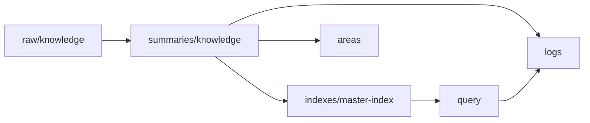

# 2026年5月23日 開発基盤：LLM Wikiの土台フォルダと基準ページを作る

> 状態：⑤ Tasklist
> 次のゲート：（CC）`llm-wiki/` の基準ページ名と最小項目を確定する

---

## 1) Journey（どこへ行くか）

> 補足：深層的目的 1 本目の source を置く前に、迷わず回せる最小の器を揃える
> 補足：やらないこと 最初から taxonomy を細かく切り、entity / concept 分離を決め打ちしない
> 補足：責務分担厳格度 basic

1. 前提条件
   1. 💦 `llm-wiki/raw/knowledge/` と `llm-wiki/wiki/` はあるが、logs の器が足りない
   2. 💦 最初の source は Karpathy gist を使う
   3. 💦 初回 health-check までに必要な page の種類を先に揃えたい
   4. 💦 この note は parent note 配下の child `01` である

2. Before
   1. 💦 source を置いたあとに、summary や log の記入先で迷う
   2. 💦 `entity / concept` を最初から分けるかが余計な迷いになっている
   3. ❌ もたつく

3. After
   1. 💦 raw / summary / index / logs / areas / query / candidates の最低限の置き場が決まる
   2. ✅ `master index` と 3 種類の log の基準ページが決まる
   3. ✅ child `02` 以降がファイル名と記入項目で迷わず進める
   4. ❤️ 安心

4. 例外
   1. 初回は `areas` だけで足りるなら、entity / concept へ分けなくてよい
   2. starter page は空でなく、最低限の見出しだけあればよい

5. 境界条件
   1. この child ではまだ source を ingest しない
   2. 実ページ作成の前に tasknote 上の基準を固める

6. 委任度
   1. 🟢 最小構成と done 条件は固まっている
   2. 🟢 CCのみで可：folders と starter pages の基準決め
   3. 🟢 taxonomy の細分化は後回しにする方針も決まっている

---

## 2) ユーザーストーリーマップ

> 土台作成を、置き場、基準ページ、後続 child への handoff の 3 段でそろえる。
> 委任度：🟢 starter pages の命名と最小項目までは CC が固められる
> 残る曖昧さ：なし

### 事前確認

- [x] tasknote確認済み
- [x] skill・tool・MCP確認済み
  - [x] `manage-tasknotes`
  - [x] shared `tasknote-lint`
- [x] 永続的ドキュメント確認済み
  - [x] `AGENTS.md`
  - [x] `manage-tasknotes/TEMPLATE.md`
  - [x] `manage-tasknotes/RULES.md`

### 本体

#### 話題1：最初の ingest に必要な置き場だけを揃える

##### ユーザー：Karpathy 型の知識キュレーター（setup）

1. 当初計画
    1. 📁 `raw/knowledge` を source 置き場にする
    2. 📁 `wiki/summaries/knowledge` を summary 置き場にする
    3. 📁 `wiki/indexes` `wiki/logs` `wiki/areas` `wiki/query` `wiki/candidates` を使う

#### 話題2：基準ページを先に決める

##### ユーザー：Karpathy 型の知識キュレーター（starter page）

1. 当初計画
    1. 🗂️ `wiki/indexes/master-index.md` を作る
    2. 📝 `wiki/logs/source-inbox.md` `wiki/logs/ingest-log.md` `wiki/logs/health-check-log.md` を作る
    3. 📌 各 page の最低限の見出しと記入項目を決める

#### 話題3：後続 child が迷わないように handoff する

##### ユーザー：Karpathy 型の知識キュレーター（handoff）

1. 当初計画
    1. 🔗 child `02` が raw / summary / index / areas / ingest log を更新できるようにする
    2. 🔗 child `03` が query page と candidate page を使えるようにする
    3. 🔗 child `04` が health-check log を使えるようにする

---

## 3) Gherkin（完了条件）

> 委任度：🟢 setup child の done 条件までは CC が進められる
> 残る曖昧さ：なし

### シナリオ一覧

- [ ] シナリオ1：最初の ingest に必要な最低限の folders が決まる

1. 🧱 `llm-wiki/` はあるが、初回 1 周に要る置き場が散っている
2. 🎬 raw / summary / indexes / logs / areas / query / candidates の使い分けを決める
3. ✅ child `02-04` が置き場で迷わない

```gherkin
Given llm wiki の初回 1 周に必要な page の種類が見えている
When 最低限の folders と用途を決める
Then source と summary と index と logs と related pages と saved answer の置き場が分かる
And 早すぎる taxonomy 細分化を避けられる
```

- [ ] シナリオ2：starter page の名前と最小項目が決まる

1. 🧱 log や index の file 名と記入欄が曖昧である
2. 🎬 master index と 3 つの log の雛形を決める
3. ✅ 1 本目の source と 1 回目の点検で同じ器を使える

```gherkin
Given first ingest と first health-check で記録先が必要である
When `master-index` `source-inbox` `ingest-log` `health-check-log` の雛形を決める
Then child `02-04` が同じ page 群を更新できる
And 記録先を毎回作り直さずに済む
```

- [ ] シナリオ3：後続 child への handoff が明文化される

1. 🧱 setup 後に次の child が何を更新するか見えていない
2. 🎬 child `02-04` ごとの更新対象を明文化する
3. ✅ 次のゲートを CC がそのまま進められる

```gherkin
Given setup のあとに ingest / query / health-check が続く
When 各 child の更新対象と依存先を tasknote に残す
Then next gate を CC がそのまま辿れる
And 初回 1 周の route が中断しにくくなる
```

---

## 4) Design（どうやるか）

### 責務分担概要

- `llm-wiki/raw/knowledge/` は source 原文だけを置く
- `llm-wiki/wiki/summaries/knowledge/` は source summary を置く
- `llm-wiki/wiki/indexes/master-index.md` は source と answer の入口にする
- `llm-wiki/wiki/logs/` は inbox / ingest / health-check の履歴を置く
- `llm-wiki/wiki/areas/` は related pages の最低限の置き場にする
- `llm-wiki/wiki/query/` と `llm-wiki/wiki/candidates/` は child `03` 以降で使う

### 責務分担概要図



### 責務分担詳細

- `steering/2026年5月23日 開発基盤：Karpathy型LLM Wiki運用の親ノート.md` （➕：child `01` の順序を持つ）
- `steering/2026年5月23日 開発基盤：LLM Wikiの土台フォルダと基準ページを作る.md` （➕：setup 判断を持つ）
- `llm-wiki/wiki/indexes/master-index.md` （➕：source と answer の入口として追加予定）
- `llm-wiki/wiki/logs/source-inbox.md` （➕：source 受付 log として追加予定）
- `llm-wiki/wiki/logs/ingest-log.md` （➕：ingest 履歴 log として追加予定）
- `llm-wiki/wiki/logs/health-check-log.md` （➕：health-check 履歴 log として追加予定）

### 【参照】

- Steering: `steering/2026年5月23日 開発基盤：Karpathy型LLM Wiki運用の親ノート.md`
- Architecture: `AGENTS.md`
- Source: `https://gist.github.com/karpathy/442a6bf555914893e9891c11519de94f`

### 変更範囲

- やること:
  - 初回 1 周に必要な folders と starter pages を決める
  - page 名と最小項目を決める
- やらないこと:
  - source ingest の実行
  - taxonomy の細分化

### 検証

- 検証コマンド:
  - `node /home/exedev/dotfiles/shared/linter/coding-rules/tasknote/run_tasknote_lint.mjs --config ./tasknote-lint.config.json 'steering/2026年5月23日 開発基盤：LLM Wikiの土台フォルダと基準ページを作る.md'`
- 成功条件:
  - setup child note が tasknote 形式で存在する
  - parent note から child `01` として参照できる
- 未実施時の扱い:
  - lint 未実施なら setup draft 止まりとする

---

## 5) Tasklist

- [ ] `wiki/indexes/master-index.md` の見出しと最小項目を決める
- [ ] `wiki/logs/source-inbox.md` の見出しと最小項目を決める
- [ ] `wiki/logs/ingest-log.md` の見出しと最小項目を決める
- [ ] `wiki/logs/health-check-log.md` の見出しと最小項目を決める
- [ ] child `02-04` への handoff を parent note と整合させる

---

## 6) 作業ログ

- [ ] starter page の命名を確定する
- [ ] log 3 種の項目を確定する
- [ ] `areas` と `query` と `candidates` の役割を確定する

---

## 7) 評価と成果物

> 評価：🟢 初回 1 周の器をそろえる child を追加できた

### 成果物

- `steering/2026年5月23日 開発基盤：LLM Wikiの土台フォルダと基準ページを作る.md`

---

## 8) Discussion

- 関連tasknote: `steering/2026年5月23日 開発基盤：Karpathy型LLM Wiki運用の親ノート.md`
- 初回は `entity / concept` ではなく `areas` を related page の最低限の置き場にする
- setup child の done は「運用器が決まること」であり、「ingest 完了」ではない

---

## 9) Closing

- 状態: open
- 次のゲート: （CC）`llm-wiki/` の基準ページ名と最小項目を確定する
- close 条件:
  - [ ] `master-index` の雛形が決まっている
  - [ ] `source-inbox` `ingest-log` `health-check-log` の雛形が決まっている
  - [ ] child `02-04` が更新先で迷わない

---

## 10) 参考資料

- Karpathy, `LLM Wiki`: `https://gist.github.com/karpathy/442a6bf555914893e9891c11519de94f`
