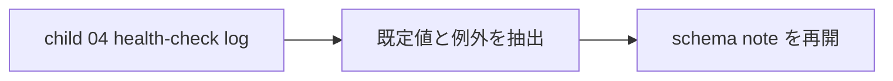

# 2026年5月23日 開発基盤：LLM Wiki運用をスキーマへ文書化する

> 状態：⑤ Tasklist
> 次のゲート：（CC）child `04` の初回点検ログができたら既定値と例外条件を抽出する

---

## 1) Journey（どこへ行くか）

> 補足：深層的目的 initial loop の学びが揃ってから、future session 用の既定動作だけを固定する
> 補足：やらないこと 初回 health-check 前に schema を main route へ混ぜない
> 補足：責務分担厳格度 basic

1. 前提条件
   1. 💦 setup / ingest / query / health-check の学びが先に必要である
   2. 💦 schema は settled な既定値と例外条件だけを書く
   3. 💦 この note は later note である

2. Before
   1. 💦 初回 1 周前に schema を固めると誤固定しやすい
   2. 💦 future session へ何を引き継ぐかは log を見てから決めたい
   3. ❌ 早い

3. After
   1. 💦 initial loop の学びが揃ってから schema に落とせる
   2. ✅ main route の速度を落とさずに標準化できる
   3. ❤️ 安心

4. 例外
   1. 1 周だけでは未確定が多ければ、schema 化をさらに先送りしてよい

5. 境界条件
   1. 初回 health-check 完了前には着手しない

6. 委任度
   1. 🟡 timing は固まっているが、文面は log を見て決める
   2. 🟢 CCのみで可：後段で既定値と例外条件を整理する
   3. 🔴 route 優先順位は main route を先にする

---

## 2) ユーザーストーリーマップ

> schema は initial loop 完了後の定着レイヤーとして待機させる。
> 委任度：🟢 schema を later note へ下げるところまでは CC が固められる
> 残る曖昧さ：なし

### 事前確認

- [x] tasknote確認済み
- [x] skill・tool・MCP確認済み
  - [x] `manage-tasknotes`
- [x] 永続的ドキュメント確認済み
  - [x] `AGENTS.md`
  - [x] `manage-tasknotes/TEMPLATE.md`
  - [x] `manage-tasknotes/RULES.md`

### 本体

#### 話題1：initial loop のあとにだけ固定する

##### ユーザー：Karpathy 型の知識キュレーター（standardize）

1. 当初計画
    1. ⏸️ まず child `01-04` を回す
    2. 📘 health-check log を見て settled な既定値だけ拾う
    3. 📎 例外条件を分けて future session に渡す

---

## 3) Gherkin（完了条件）

> 委任度：🟢 later note として退避するところまでは CC が進められる
> 残る曖昧さ：なし

### シナリオ一覧

- [ ] シナリオ1：schema 化を initial loop の後段へ退避できる

1. 🧱 route を setup / ingest / query / health-check に絞りたい
2. 🎬 schema 化を later note に下げる
3. ✅ 初回 1 周の速度を落とさずに済む

```gherkin
Given initial health-check までの main route を短く保ちたい
When schema note を later note として扱う
Then 初回 1 周の速度を落とさずに済む
And settled な学びだけを後から固定できる
```

---

## 4) Design（どうやるか）

### 責務分担概要

- この note は main route の外に置く
- health-check log ができたあとに `docs/llm-wiki-ops-schema.md` を検討する

### 責務分担概要図



### 責務分担詳細

- `steering/2026年5月23日 開発基盤：Karpathy型LLM Wiki運用の親ノート.md` （➕：later note として参照する）
- `steering/2026年5月23日 開発基盤：LLM Wiki運用をスキーマへ文書化する.md` （➕：後段の標準化条件を持つ）

### 【参照】

- Steering: `steering/2026年5月23日 開発基盤：Karpathy型LLM Wiki運用の親ノート.md`
- Source: `https://gist.github.com/karpathy/442a6bf555914893e9891c11519de94f`

### 変更範囲

- やること:
  - schema note を later 扱いへ切り分ける
- やらないこと:
  - schema の実文面作成

### 検証

- 検証コマンド:
  - `node /home/exedev/dotfiles/shared/linter/coding-rules/tasknote/run_tasknote_lint.mjs --config ./tasknote-lint.config.json 'steering/2026年5月23日 開発基盤：LLM Wiki運用をスキーマへ文書化する.md'`
- 成功条件:
  - schema note が later note として残る
- 未実施時の扱い:
  - lint 未実施なら later 化 draft 止まりとする

---

## 5) Tasklist

- [ ] child `04` の log が揃ったら settled / exception を抽出する

---

## 6) 作業ログ

- [x] main route から外し、later note に下げた

---

## 7) 評価と成果物

> 評価：🟢 schema を main route から外し、後段の定着レイヤーに下げられた

### 成果物

- `steering/2026年5月23日 開発基盤：LLM Wiki運用をスキーマへ文書化する.md`

---

## 8) Discussion

- schema 化は initial loop の log を見てからの方が誤固定を避けやすい

---

## 9) Closing

- 状態: later
- 次のゲート: （CC）child `04` の初回点検ログができたら既定値と例外条件を抽出する
- close 条件:
  - [ ] health-check log を見て settled / exception が整理されている

---

## 10) 参考資料

- Karpathy, `LLM Wiki`: `https://gist.github.com/karpathy/442a6bf555914893e9891c11519de94f`
