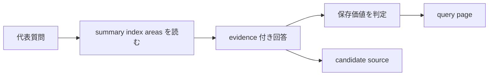

# 2026年5月23日 開発基盤：Wikiへの質問と回答保存を試す

> 状態：⑤ Tasklist
> 次のゲート：（CC）child `02` 完了後に代表質問を 1 本選ぶ

---

## 1) Journey（どこへ行くか）

> 補足：深層的目的 1 本目 ingest のあとに、wiki が本当に代表質問へ答えられるかを確かめる
> 補足：やらないこと web 検索や埋め込みRAGの導入までは広げない
> 補足：責務分担厳格度 basic

1. 前提条件
   1. 💦 child `02` で summary / master index / areas が更新されている前提で進める
   2. 💦 回答には evidence を含める
   3. 💦 良い回答は `wiki/query/` の page として保存しうる
   4. 💦 この note は parent note 配下の child `03` である

2. Before
   1. 💦 representative query をどの page 群から読むか決めていない
   2. 💦 saved answer の done 条件が曖昧だと chat だけで終わりやすい
   3. ❌ もったいない

3. After
   1. 💦 summary / index / areas を横断して evidence 付きで答える流れが決まる
   2. ✅ 既定は markdown で 1 本目の答えを保存できる
   3. ✅ wiki 外の事実は candidate source に戻す境界も守れる
   4. ❤️ 安心

4. 例外
   1. 保存に値しない答えなら chat だけで終えてよい
   2. wiki だけで足りない gap は candidate source として切り出す

5. 境界条件
   1. 今回は wiki 内検索を主にする
   2. web は candidate source 発見時だけ別 route で扱う

6. 委任度
   1. 🟢 representative query と saved answer の基本導線は固まっている
   2. 🟢 CCのみで可：markdown 既定で 1 本目の answer filing を進める
   3. 🟡 人の判断: 比較表など特殊形式へ切り替える特例の採否

---

## 2) ユーザーストーリーマップ

> query を representative question、answer filing、candidate source 分岐の 3 段に分けてそろえる。
> 委任度：🟢 representative query 1 本と markdown 保存までは CC が固められる
> 残る曖昧さ：なし

### 事前確認

- [x] tasknote確認済み
- [x] skill・tool・MCP確認済み
  - [x] `manage-tasknotes`
  - [x] shared `tasknote-lint`
- [x] 永続的ドキュメント確認済み
  - [x] `AGENTS.md`
  - [x] `manage-tasknotes/TEMPLATE.md`
  - [x] `manage-tasknotes/RULES.md`

### 本体

#### 話題1：representative query を 1 本選ぶ

##### ユーザー：Karpathy 型の知識キュレーター（query 実行）

1. 当初計画
    1. ❓ ingest した source を横断できる質問を 1 本選ぶ
    2. 🔎 summary / master index / areas を読む
    3. 🧾 evidence 付きで答えをまとめる

#### 話題2：1 本目は markdown 既定で保存する

##### ユーザー：Karpathy 型の知識キュレーター（answer filing）

1. 当初計画
    1. 📝 迷ったら markdown を選ぶ
    2. 📌 answer page に `question` `answer` `evidence` `confidence` を書く
    3. 📊 比較が主目的のときだけ表を検討する

#### 話題3：wiki 外の事実は source 側へ戻す

##### ユーザー：Karpathy 型の知識キュレーター（境界条件）

1. 当初計画
    1. 🌐 外部事実が必要なら candidate source として切り出す
    2. 📥 raw collection に入れて ingest してから wiki へ反映する
    3. ✂️ query answer と source ingest を同時に混ぜない

---

## 3) Gherkin（完了条件）

> 委任度：🟢 representative query 1 本の answer filing までは CC が進められる
> 残る曖昧さ：なし

### シナリオ一覧

- [ ] シナリオ1：wiki page 群を読んで representative answer を返せる

1. 🧱 child `02` の summary / index / areas が存在する
2. 🎬 representative question に対して関連 page を読む
3. ✅ 回答が markdown 既定で再利用しやすくまとまる

```gherkin
Given child `02` で作られた summary と master index と related pages がある
When representative question に対して関連する wiki page を読み込む
Then evidence 付きの回答を返せる
And 既定形式は markdown として扱える
And 回答に使った page 群を後から追える
```

- [ ] シナリオ2：保存価値の高い答えを saved answer page にできる

1. 🧱 query の答えに比較や分析の価値がある
2. 🎬 markdown page として保存する
3. ✅ 以後の query や health-check で再利用できる

```gherkin
Given query の回答が比較や分析として再利用価値を持つ
When その回答を `wiki/query/` の新しい page として保存する
Then 後続の query や health-check でその page を読める
And chat 履歴だけに閉じない
```

- [ ] シナリオ3：wiki 外の事実は candidate source に戻せる

1. 🧱 answer の根拠に外部事実が必要になる
2. 🎬 その gap を candidate source として切り出す
3. ✅ query answer と ingest を混ぜない

```gherkin
Given representative query を解くのに wiki 外の事実が必要になる
When その gap を `wiki/candidates/` に切り出す
Then query answer に外部事実を直混ぜしない
And 後続の ingest route へ戻せる
```

---

## 4) Design（どうやるか）

### 責務分担概要

- `llm-wiki/wiki/summaries/knowledge/` と `wiki/indexes/master-index.md` と `wiki/areas/` は query の読み取り対象である
- `llm-wiki/wiki/query/` は saved answer の保存先である
- `llm-wiki/wiki/candidates/` は external gap の切り出し先である
- 形式選択は markdown 既定、特殊形式は質問特性で分ける

### 責務分担概要図



### 責務分担詳細

- `steering/2026年5月23日 開発基盤：Karpathy型LLM Wiki運用の親ノート.md` （➕：child `03` の順序と境界を持つ）
- `steering/2026年5月23日 開発基盤：カルパシー資料1本で手動取り込みを試す.md` （➕：child `02` の成果を入力にする）
- `steering/2026年5月23日 開発基盤：Wikiへの質問と回答保存を試す.md` （➕：query 実験の判断と結果を持つ）
- `llm-wiki/wiki/query/` （✏️：saved answer の保存先として扱う）
- `llm-wiki/wiki/candidates/` （✏️：external gap の切り出し先として扱う）

### 【参照】

- Steering: `steering/2026年5月23日 開発基盤：Karpathy型LLM Wiki運用の親ノート.md`
- Architecture: `AGENTS.md`
- Source: `https://gist.github.com/karpathy/442a6bf555914893e9891c11519de94f`

### 変更範囲

- やること:
  - representative query 1 本を保存可能な answer にする
  - answer filing の条件と candidate source 境界を言語化する
- やらないこと:
  - web 検索の実施
  - 特殊形式の先回り実装

### 検証

- 検証コマンド:
  - `node /home/exedev/dotfiles/shared/linter/coding-rules/tasknote/run_tasknote_lint.mjs --config ./tasknote-lint.config.json 'steering/2026年5月23日 開発基盤：Wikiへの質問と回答保存を試す.md'`
- 成功条件:
  - query child note が tasknote 形式で存在する
  - parent note から child `03` として参照できる
- 未実施時の扱い:
  - lint 未実施なら query draft 止まりとする

---

## 5) Tasklist

- [ ] representative query を 1 本選ぶ
- [ ] summary / index / areas の読む page を列挙する
- [ ] markdown 既定で evidence 付き answer を作る
- [ ] 保存価値を判定して `wiki/query/` へ落とす
- [ ] 外部 gap を candidate source として切り出す
- [ ] query の学びを parent note と health-check child へ戻す

---

## 6) 作業ログ

- [ ] child `02` 完了後に current-child 化する
- [ ] representative query を固定する
- [ ] saved answer の source ref を確認する

---

## 7) 評価と成果物

> 評価：🟢 representative query と candidate source 境界まで含めて child 骨格を固めた

### 成果物

- `steering/2026年5月23日 開発基盤：Wikiへの質問と回答保存を試す.md`

---

## 8) Discussion

- 関連tasknote: `steering/2026年5月23日 開発基盤：Karpathy型LLM Wiki運用の親ノート.md`
- query は child `02` の summary / index / areas を読んで進める
- 迷ったら markdown、再利用価値がある答えだけ page 化する
- wiki 外の事実は answer に直混ぜせず、candidate source に戻す

---

## 9) Closing

- 状態: open
- 次のゲート: （CC）child `02` 完了後に代表質問を 1 本選ぶ
- close 条件:
  - [ ] representative query を 1 本試している
  - [ ] saved answer を 1 本残している
  - [ ] external gap があれば candidate source に切れている
  - [ ] parent note と health-check child に学びが戻っている

---

## 10) 参考資料

- Karpathy, `LLM Wiki`: `https://gist.github.com/karpathy/442a6bf555914893e9891c11519de94f`
