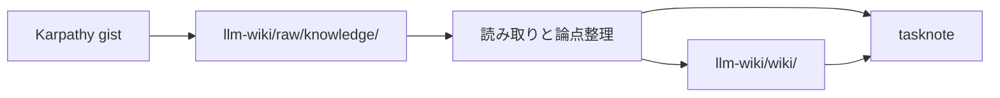

# 2026年5月23日 開発基盤：injestを手動でやってみる

> 状態：⑤ Tasklist
> 次のゲート：（CC）Karpathy gist を raw source として保存し、作業ログを埋め始める

---

## 1) Journey（どこへ行くか）

> 補足：深層的目的 script なしで Karpathy 流の ingest ループが回る最小形を自分たちの repo で掴む
> 補足：やらないこと 最初から自動 ingest tool や大きな schema 設計まで広げない
> 補足：責務分担厳格度 basic

1. 前提条件
   1. 💦 `llm-wiki/` は raw-only 状態である
   2. 💦 最初の source は Karpathy gist を使う
   3. 💦 ingest は raw 追加だけで終わらない
   4. 💦 wiki と index と log も更新対象である

2. Before
   1. 💦 raw 追加後の手動フローが repo に無い
   2. 💦 1 source の波及先をまだ試せていない
   3. ❌ 迷う

3. After
   1. 💦 raw 追加後の手動 ingest 導線が通る
   2. ✅ summary と index と log の更新手順が残る
   3. ✅ entity / concept への波及先が見える
   4. ❤️ 安心

4. 例外
   1. entity / concept 更新が 10件未満でもよい
   2. gist だけで足りなければ source を再読する

5. 境界条件
   1. 自動 ingest script は作らない
   2. `llm-wiki/wiki/` は最小ページだけ戻す

6. 委任度
   1. 🟢 source と trial の筋は確定済み
   2. 🟢 CCのみで可：raw 追加と note 整備
   3. 🔴 trial 後の恒久構造化は人が決める

---

## 2) ユーザーストーリーマップ

> Gherkin の前に、今回の仕事をどの順番で進めるかだけをそろえる。
> 委任度：🟢 最初の手動 ingest trial の流れまでは CC が固められる
> 残る曖昧さ：なし

### 事前確認

- [x] tasknote確認済み
- [x] skill・tool・MCP確認済み
  - [x] `manage-tasknotes`
  - [x] `verification-before-completion`
  - [x] shared `tasknote-lint`
- [x] 永続的ドキュメント確認済み
  - [x] `AGENTS.md`
  - [x] `manage-tasknotes/TEMPLATE.md`
  - [x] `manage-tasknotes/RULES.md`

### 本体

#### 話題1：新しい source を raw へ追加する

##### ユーザー：source 追加担当

1. 当初計画
    1. 👀 ingest 対象 source を 1 本に固定する
    2. ✂️ source を `llm-wiki/raw/knowledge/` に置く
    3. 📝 source の出典と取得日を記録する

#### 話題2：LLM と source を読み、重要点を固める

##### ユーザー：読解担当

1. 当初計画
    1. 👀 source 本文を読み、重要点の候補を抜く
    2. 💬 重要点が何かを LLM と話し合う
    3. 📝 wiki に残す粒度を決める

#### 話題3：wiki の関連ページを手で更新する

##### ユーザー：wiki 更新担当

1. 当初計画
    1. ✂️ source summary page を作る
    2. ✂️ index と log を更新する
    3. ✂️ entity / concept / related page を必要数だけ更新する

---

## 3) Gherkin（完了条件）

> 委任度：🟢 Design の素案までは CC が進められる
> 残る曖昧さ：なし

### シナリオ一覧

- [ ] シナリオ1：新しい source が raw collection に追加される

1. 🧱 手動 ingest の対象 source が 1 本決まっている（raw 追加前）
2. 🎬 source を `llm-wiki/raw/knowledge/` 配下へ保存する（raw collection）
3. ✅ source の実体を repo 内の raw collection から読める（raw collection）

```gherkin
Given repo の `llm-wiki/` は raw-only 状態である
And 今回の ingest 対象 source として Karpathy の LLM Wiki gist を使う
When source 本文を raw collection に保存する
Then `llm-wiki/raw/knowledge/` 配下から source を読める
And source の出典を tasknote に残せる
```

- [ ] シナリオ2：LLM が source を読み、重要点を相談しながら固められる

1. 🧱 raw collection に source が置かれている（読書段階）
2. 🎬 source を読み、重要なポイントを LLM と話し合う（相談）
3. ✅ wiki に残す論点、要約、関連概念が具体化される（相談結果）

```gherkin
Given raw collection に ingest 対象 source が置かれている
When LLM が source を読み、重要なポイントを私と話し合う
Then source summary に入れる要点が決まる
And index と log に何を書くか決まる
And 更新が必要な entity / concept page の候補が見える
```

- [ ] シナリオ3：1本の source から wiki の複数ページが手で更新される

1. 🧱 summary、index、entity/concept、log の更新先が見えている（更新前）
2. 🎬 source に基づいて wiki ページ群を更新する（手動 ingest）
3. ✅ source summary、index、log、関連ページがそろって更新される（更新後）

```gherkin
Given source から作る summary と更新対象 page の候補が見えている
When source summary page を作成する
And index を更新する
And wiki 全体の関連 entity / concept page を更新する
And log に entry を追加する
Then source 1本が複数の wiki page に波及する手動 ingest の流れが tasknote に残る
And 必要なら 10 から 15 ページ程度へ影響が広がりうることを確認できる
```

---

## 4) Design（どうやるか）

### 責務分担概要

- `llm-wiki/raw/knowledge/` は source 原文の置き場にする
- `llm-wiki/wiki/` は summary / index / log / entity-concept page の置き場にする
- tasknote は ingest 判断と更新範囲の記録を持つ

### 責務分担概要図



### 責務分担詳細

- `steering/2026年5月23日 開発基盤：injestを手動でやってみる.md`: ingest trial の判断と結果を残す
- `llm-wiki/raw/knowledge/`: source 実体を保存する
- `llm-wiki/wiki/`: summary / index / log / entity-concept page を更新する

### 【参照】

- Steering: `steering/2026年5月23日 開発基盤：injestを手動でやってみる.md`
- Architecture: `AGENTS.md`
- Source: `https://gist.github.com/karpathy/442a6bf555914893e9891c11519de94f`

### 変更範囲

- やること:
  - raw collection に新しい source を追加する
  - source を読みながら wiki page を手動で更新する
  - index、log、entity/concept 更新まで含めて記録する
- やらないこと:
  - ingest 自動化 script の追加
  - 最初から完全な schema 設計を決め切ること

### 検証

- 検証コマンド:
  - `find llm-wiki -maxdepth 4 -type f | sort`
  - `git diff --stat`
- 成功条件:
  - raw source と手動更新した wiki page 群が repo 上で確認できる
  - どの page を更新したか tasknote に残る
- 未実施時の扱い:
  - source 追加や wiki 更新が未実施なら ingest trial 完了扱いにしない

---

## 5) Tasklist

- [ ] Karpathy gist を raw source として保存する
- [ ] source を読み、重要点を LLM と話し合う
- [ ] summary / index / entity / concept / log の更新先を決める
- [ ] 手動 ingest を実行して結果を記録する

---

## 6) 作業ログ

- [ ] Karpathy gist を raw source として保存する
- [ ] gist を読み、要点候補を抜く
- [ ] wiki 更新先を確定する
- [ ] summary / index / log / entity-concept page を更新する

---

## 7) 評価と成果物

> 評価：🟡 lint 準拠の tasknote にはなったが ingest 本体は未着手

### 成果物

- `steering/2026年5月23日 開発基盤：injestを手動でやってみる.md` （lint 準拠化）

---

## 8) Discussion

- 旧 8 フェーズ tasknote と新 shared linter の期待値に差がある
- この note は新 linter に合わせつつ、manual ingest trial の起点にする

---

## 9) Closing

- 状態: open
- 次のゲート: （CC）raw source を追加し、手動 ingest の trial に入る
- close 条件:
  - [ ] source が raw collection に入っている
  - [ ] source summary と関連 page の更新が終わっている
  - [ ] 手動 ingest の学びが 作業ログ / 評価と成果物 / Discussion に残っている

---

## 10) 参考資料

- Karpathy, `LLM Wiki`: `https://gist.github.com/karpathy/442a6bf555914893e9891c11519de94f`
