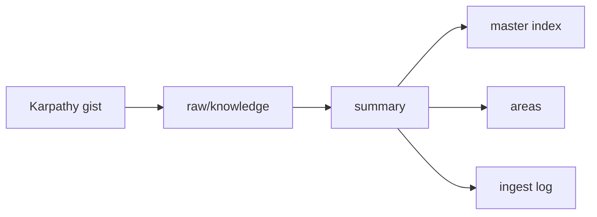

# 2026年5月23日 開発基盤：カルパシー資料1本で手動取り込みを試す

> 状態：⑤ Tasklist
> 次のゲート：（CC）child `01` 完了後に Karpathy gist を raw source として保存する

---

## 1) Journey（どこへ行くか）

> 補足：深層的目的 1 本目の source で、raw から related pages と ingest log まで回る最小 ingest を実物で掴む
> 補足：やらないこと 初回から 10〜15 ページ波及や taxonomy 整備を必須化しない
> 補足：責務分担厳格度 basic

1. 前提条件
   1. 💦 child `01` で folders と starter pages の器が揃っている前提で進める
   2. 💦 最初の source は Karpathy gist を使う
   3. 💦 done 条件は raw / summary / index / ingest log を含む
   4. 💦 related page は 2 件以上か、保留理由を残す
   5. 💦 この note は parent note 配下の child `02` である

2. Before
   1. 💦 1 本目の source をどこまで更新したら完了かが曖昧だった
   2. 💦 page 数を目標にすると初回の再現性が落ちやすい
   3. ❌ 迷う

3. After
   1. 💦 raw source から summary と related pages までの導線が通る
   2. ✅ master index と ingest log まで同じ route で埋まる
   3. ✅ page 数ではなく更新した器で done 判定できる
   4. ❤️ 安心

4. 例外
   1. related page が 2 件に届かないときは、保留理由を log に残せばよい
   2. gist だけで足りない gap は candidate source に回してよい

5. 境界条件
   1. 自動 ingest script は作らない
   2. 最初は `areas` を関連ページの置き場に使い、entity / concept 分離は急がない

6. 委任度
   1. 🟢 初回 ingest の done 条件は固まっている
   2. 🟢 CCのみで可：raw 保存から ingest log 追記までの route 実行
   3. 🟡 gap の source 候補化は内容次第で人レビューが入る

---

## 2) ユーザーストーリーマップ

> Karpathy 型の wiki 運用者が、1 本の source を最小の器へ流し込む順をそろえる。
> 委任度：🟢 最初の single-source ingest trial までは CC が固められる
> 残る曖昧さ：なし

### 事前確認

- [x] tasknote確認済み
- [x] skill・tool・MCP確認済み
  - [x] `manage-tasknotes`
  - [x] `verification-before-completion`
  - [x] shared `tasknote-lint`
- [x] 永続的ドキュメント確認済み
  - [x] `AGENTS.md`
  - [x] `manage-tasknotes/TEMPLATE.md`
  - [x] `manage-tasknotes/RULES.md`

### 本体

#### 話題1：新しい source を raw collection に追加し、ingest を始める

##### ユーザー：Karpathy 型の知識キュレーター（source 追加）

1. 当初計画
    1. 👀 ingest 対象 source を 1 本に固定する
    2. ✂️ source を `llm-wiki/raw/knowledge/` に保存する
    3. 🗣️ LLM に「この source を ingest して」と指示する
    4. 📝 source の出典と取得日を記録する

#### 話題2：LLM と source を読み、重要点を対話しながら固める

##### ユーザー：Karpathy 型の知識キュレーター（読解と対話）

1. 当初計画
    1. 👀 LLM が source 全文を読む
    2. 💬 重要なポイントと強調点を私と話し合う
    3. 📝 wiki に残す要約の粒度と観点を決める

#### 話題3：1 本の source から最小の器を埋める

##### ユーザー：Karpathy 型の知識キュレーター（wiki 更新）

1. 当初計画
    1. ✂️ source summary page を作る
    2. 🔗 `master index` を更新する
    3. 🧠 `areas` の related page を最低 2 件更新する
    4. 🕒 `ingest log` に entry を追加する
    5. 📌 2 件に届かないときは保留理由を残す

#### 話題4：初回 trial の学びを次の child へ渡す

##### ユーザー：Karpathy 型の知識キュレーター（運用設計）

1. 当初計画
    1. 👀 今回は 1 source ずつ ingest し、summary と related page を読みながら関与し続ける
    2. 🔗 child `03` が質問しやすいよう、index と source ref を残す
    3. 📝 health-check 前に見えた gap を次の child へ渡す

---

## 3) Gherkin（完了条件）

> 委任度：🟢 初回 ingest の done 条件までは CC が進められる
> 残る曖昧さ：なし

### シナリオ一覧

- [ ] シナリオ1：新しい source が raw collection に追加される

1. 🧱 手動 ingest の対象 source が 1 本決まっている（raw 追加前）
2. 🎬 source を `llm-wiki/raw/knowledge/` 配下へ保存する（raw collection）
3. ✅ source の実体を repo 内の raw collection から読める（raw collection）

```gherkin
Given repo の `llm-wiki/` は raw-only 状態である
And 今回の ingest 対象 source として Karpathy の LLM Wiki gist を使う
When source 本文を raw collection に保存する
Then `llm-wiki/raw/knowledge/` 配下から source を読める
And source の出典と source id を tasknote や log に残せる
```

- [ ] シナリオ2：LLM が source を読み、重要点を相談しながら固められる

1. 🧱 raw collection に source が置かれている（読書段階）
2. 🎬 source を読み、重要なポイントを LLM と話し合う（相談）
3. ✅ wiki に残す論点、要約、関連概念が具体化される（相談結果）

```gherkin
Given raw collection に ingest 対象 source が置かれている
When LLM が source を読み、重要なポイントを私と話し合う
Then source summary に入れる要点が決まる
And index と log に何を書くか決まる
And 更新が必要な entity / concept page の候補が見える
```

- [ ] シナリオ3：1本の source から最小の器が手で更新される

1. 🧱 summary、master index、areas、ingest log の更新先が見えている（更新前）
2. 🎬 source に基づいて wiki ページ群を更新する（手動 ingest）
3. ✅ source summary、index、log、related pages がそろって更新される（更新後）

```gherkin
Given source から作る summary と更新対象 page の候補が見えている
When source summary page を作成する
And `master index` を更新する
And `areas` の related page を最低 2 件更新する
And `ingest log` に entry を追加する
Then source 1本が最小の器へ流れ込む手動 ingest の流れが tasknote に残る
And page 数ではなく更新した器で完了判定できる
```

- [ ] シナリオ4：single-source ingest の学びを query child へ渡せる

1. 🧱 次の child は index と source ref を読みながら query を行う
2. 🎬 今回の trial で summary と related page の source ref を残す
3. ✅ query child が代表質問を投げる入口ができる

```gherkin
Given child `03` は child `02` の成果を読んで representative query を行う
When 今回の trial で summary と related page と index の source ref を残す
Then query child が読む入口が揃う
And 次の health-check に向けた gap も見え始める
```

---

## 4) Design（どうやるか）

### 責務分担概要

- `llm-wiki/raw/knowledge/` は source 原文の置き場にする
- `llm-wiki/wiki/summaries/knowledge/` は summary の置き場にする
- `llm-wiki/wiki/indexes/master-index.md` は source と answer の入口にする
- `llm-wiki/wiki/logs/ingest-log.md` は 1 本目 ingest の履歴を残す
- `llm-wiki/wiki/areas/` は related pages の最低限の置き場にする

### 責務分担概要図



### 責務分担詳細

- `steering/2026年5月23日 開発基盤：Karpathy型LLM Wiki運用の親ノート.md`: parent note として overall 方針と child 順序を持つ
- `steering/2026年5月23日 開発基盤：LLM Wikiの土台フォルダと基準ページを作る.md`: child `01` として starter pages を先に揃える
- `steering/2026年5月23日 開発基盤：カルパシー資料1本で手動取り込みを試す.md`: child `02` として ingest trial の判断と結果を残す
- `llm-wiki/raw/knowledge/`: source 実体を保存する
- `llm-wiki/wiki/summaries/knowledge/`: summary を保存する
- `llm-wiki/wiki/indexes/master-index.md`: index を更新する
- `llm-wiki/wiki/areas/`: related pages を更新する
- `llm-wiki/wiki/logs/ingest-log.md`: ingest の記録を残す

### 【参照】

- Steering: `steering/2026年5月23日 開発基盤：LLM Wikiの土台フォルダと基準ページを作る.md`
- Architecture: `AGENTS.md`
- Source: `https://gist.github.com/karpathy/442a6bf555914893e9891c11519de94f`

### 変更範囲

- やること:
  - raw collection に新しい source を追加する
  - source を読みながら summary / master index / areas / ingest log を更新する
  - child `03` が読める source ref を残す
- やらないこと:
  - ingest 自動化 script の追加
  - 最初から page 数を目標にすること

### 検証

- 検証コマンド:
  - `find llm-wiki -maxdepth 4 -type f | sort`
  - `git diff --stat`
- 成功条件:
  - raw source と summary と master index と ingest log が repo 上で確認できる
  - related pages を 2 件以上更新したか、保留理由が tasknote に残る
- 未実施時の扱い:
  - source 追加や wiki 更新が未実施なら ingest trial 完了扱いにしない

---

## 5) Tasklist

- [ ] Karpathy gist を raw source として保存する
- [ ] source を読み、summary を作る
- [ ] `master index` を更新する
- [ ] `areas` の related page を 2 件以上更新する
- [ ] `ingest log` に更新結果と gap を残す

---

## 6) 作業ログ

- [ ] Karpathy gist を raw source として保存する
- [ ] gist から要点候補を抜く
- [ ] summary / master index / related page / ingest log を更新する
- [ ] representative query に使う source ref を残す
- [ ] health-check 前に見えた gap を残す

---

## 7) 評価と成果物

> 評価：🟢 初回 ingest の done 条件を page 数でなく器ベースへ寄せられた

### 成果物

- `steering/2026年5月23日 開発基盤：カルパシー資料1本で手動取り込みを試す.md` （child `02` の ingest note）

---

## 8) Discussion

- この note は child `02` として、1 本目 ingest の done 条件を器ベースで持つ
- 10〜15 ページ更新は将来の波及であり、初回完了条件ではない
- 関連tasknote: `steering/2026年5月23日 開発基盤：Karpathy型LLM Wiki運用の親ノート.md`

---

## 9) Closing

- 状態: open
- 次のゲート: （CC）child `01` 完了後に Karpathy gist を raw source として保存する
- close 条件:
  - [ ] source が raw collection に入っている
  - [ ] source summary と `master index` の更新が終わっている
  - [ ] related page が 2 件以上更新されているか、保留理由が残っている
  - [ ] `ingest log` と next child 向けメモが残っている

---

## 10) 参考資料

- Karpathy, `LLM Wiki`: `https://gist.github.com/karpathy/442a6bf555914893e9891c11519de94f`
