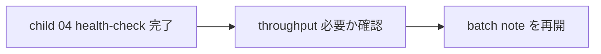

# 2026年5月23日 開発基盤：複数資料の一括取り込み方針を決める

> 状態：⑤ Tasklist
> 次のゲート：（CC）child `04` の初回点検後に throughput を上げる必要があるか確認する

---

## 1) Journey（どこへ行くか）

> 補足：深層的目的 初回 1 周の学びを壊さずに、必要になったときだけ batch ingest を増やす
> 補足：やらないこと 初回 health-check 前に batch を main route へ混ぜない
> 補足：責務分担厳格度 basic

1. 前提条件
   1. 💦 batch ingest は初回 1 周の後段に回した
   2. 💦 one-by-one が既定で、batch は例外である
   3. 💦 この note は later note である

2. Before
   1. 💦 throughput を上げたい気持ちが先行すると quality を落としやすい
   2. 💦 初回点検前に batch を混ぜると route が曇る
   3. ❌ こわい

3. After
   1. 💦 batch を使う条件が初回点検後にだけ評価される
   2. ✅ one-by-one default を守ったまま拡張できる
   3. ❤️ 安心

4. 例外
   1. throughput が不要なら、この note は開かなくてよい

5. 境界条件
   1. 初回 health-check 完了前には着手しない

6. 委任度
   1. 🟡 条件は固まっているが、必要性判断は後段でよい
   2. 🟢 CCのみで可：必要になったときの既定値整理
   3. 🔴 今回すぐ進めるかは人判断不要だが、route 優先順位は固定済み

---

## 2) ユーザーストーリーマップ

> batch は initial loop 完了後の throughput 拡張として待機させる。
> 委任度：🟢 既定値は残しつつ、main route から外すところまでは CC が固められる
> 残る曖昧さ：なし

### 事前確認

- [x] tasknote確認済み
- [x] skill・tool・MCP確認済み
  - [x] `manage-tasknotes`
- [x] 永続的ドキュメント確認済み
  - [x] `AGENTS.md`
  - [x] `manage-tasknotes/TEMPLATE.md`
  - [x] `manage-tasknotes/RULES.md`

### 本体

#### 話題1：初回点検のあとに必要性を判断する

##### ユーザー：Karpathy 型の知識キュレーター（throughput）

1. 当初計画
    1. ⏸️ まず one-by-one で 1 周回す
    2. 🔢 必要になったら 3 本 batch を検討する
    3. 🔁 2 回安定時だけ 5 本へ広げる

---

## 3) Gherkin（完了条件）

> 委任度：🟢 later note として退避するところまでは CC が進められる
> 残る曖昧さ：なし

### シナリオ一覧

- [ ] シナリオ1：batch ingest を initial loop 後段へ退避できる

1. 🧱 main route を setup / ingest / query / health-check に絞りたい
2. 🎬 batch ingest を later note に下げる
3. ✅ throughput 議論が初回点検を邪魔しない

```gherkin
Given initial health-check までの main route を短く保ちたい
When batch ingest note を later note として扱う
Then one-by-one default を崩さずに済む
And throughput 議論を後段へ回せる
```

---

## 4) Design（どうやるか）

### 責務分担概要

- この note は main route の外に置く
- 必要になったときだけ 3 本 batch、安定時 5 本までの既定値を再利用する

### 責務分担概要図



### 責務分担詳細

- `steering/2026年5月23日 開発基盤：Karpathy型LLM Wiki運用の親ノート.md` （➕：later note として参照する）
- `steering/2026年5月23日 開発基盤：複数資料の一括取り込み方針を決める.md` （➕：batch 拡張条件を持つ）

### 【参照】

- Steering: `steering/2026年5月23日 開発基盤：Karpathy型LLM Wiki運用の親ノート.md`
- Source: `https://gist.github.com/karpathy/442a6bf555914893e9891c11519de94f`

### 変更範囲

- やること:
  - batch note を later 扱いへ切り分ける
- やらないこと:
  - batch ingest 実行

### 検証

- 検証コマンド:
  - `node /home/exedev/dotfiles/shared/linter/coding-rules/tasknote/run_tasknote_lint.mjs --config ./tasknote-lint.config.json 'steering/2026年5月23日 開発基盤：複数資料の一括取り込み方針を決める.md'`
- 成功条件:
  - batch note が later note として残る
- 未実施時の扱い:
  - lint 未実施なら later 化 draft 止まりとする

---

## 5) Tasklist

- [ ] child `04` 完了後に throughput 必要性を見直す

---

## 6) 作業ログ

- [x] main route から外し、later note に下げた

---

## 7) 評価と成果物

> 評価：🟢 batch を main route から外し、後段拡張に下げられた

### 成果物

- `steering/2026年5月23日 開発基盤：複数資料の一括取り込み方針を決める.md`

---

## 8) Discussion

- batch ingest は便利さより、初回 1 周を曇らせないことを優先する

---

## 9) Closing

- 状態: later
- 次のゲート: （CC）child `04` の初回点検後に throughput を上げる必要があるか確認する
- close 条件:
  - [ ] throughput が必要なときに再開条件が見直されている

---

## 10) 参考資料

- Karpathy, `LLM Wiki`: `https://gist.github.com/karpathy/442a6bf555914893e9891c11519de94f`
