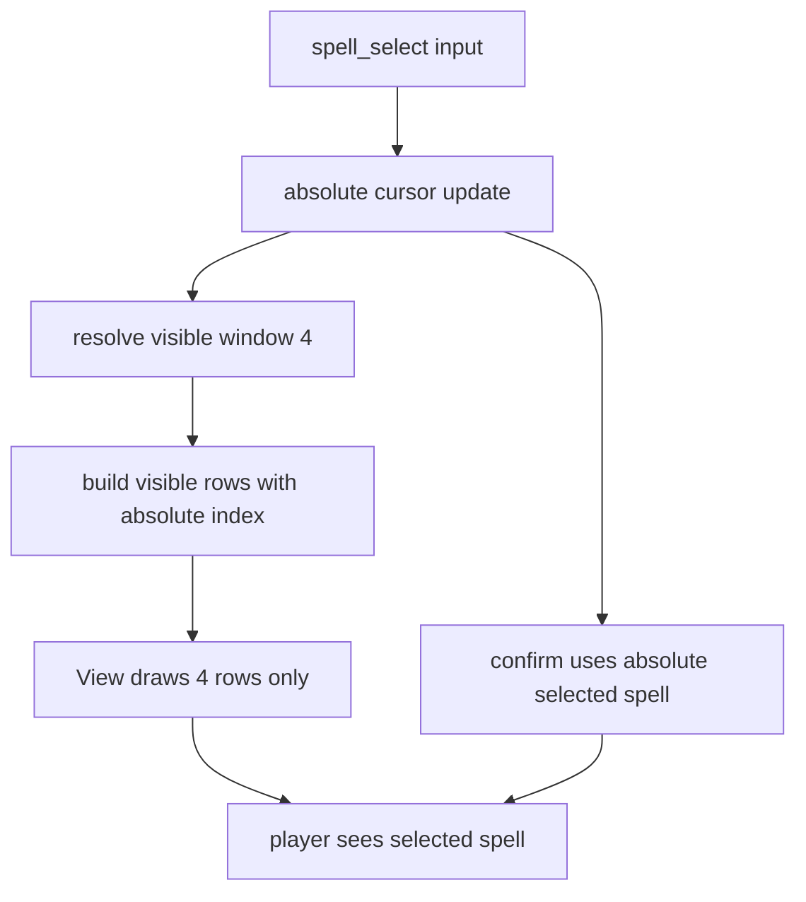
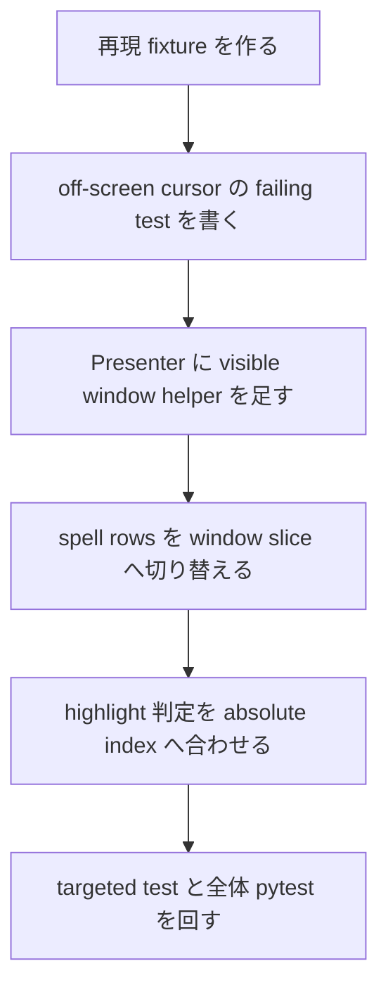

# 2026年5月24日 戦闘：魔法選択でカーソルが画面外へ出る不具合を直す

> 状態：⑨ Closing
> 次のゲート：（ユーザー）差分確認後、このまま commit するか判断

---

## 1) Journey（どこへ行くか）

> 補足：深層的目的 子どもが画面に見えている魔法だけを自然に選べるようにする
> 補足：やらないこと アイテム一覧や戦闘コマンド全体の UI 改修までは広げない
> 補足：責務分担厳格度 basic

1. 前提条件
   1. 💦 battle の魔法一覧は現在 4 行だけ描画される
   2. 💦 プレイヤーは 5 個以上の魔法を覚えられる
   3. 💦 `spell_select` は所持魔法数ぶん進める実装になっている
   4. 💦 画面外の index にいても決定処理は走る

2. Before
   1. 💦 4 件しか見えていないのに 5 件目以降へカーソルが進む
   2. 💦 見えていない魔法が選ばれるので何を選んだか分かりにくい
   3. 💦 子ども目線では「魔法が選べない」ように見える
   4. ❌ もどかしい

3. After
   1. 💦 カーソル位置と描画範囲の対応が常に一致する
   2. ✅ 見えている魔法だけで上下移動と決定が自然にできる
   3. ✅ 5 件以上覚えているセーブでも画面外カーソルにならない
   4. ❤️ 安心

4. 例外
   1. 魔法未習得のときは既存どおり未習得メッセージを出してよい
   2. 5 件以上の魔法を持つ古い save でも crash しないことを優先する
   3. 同型の item 一覧は同時改修せず、必要なら別論点として切り出す

5. 境界条件
   1. 今回の主語は battle の `spell_select` と表示 rows の整合だけに絞る
   2. 4 行 panel は維持し、5 件目以降は scroll で見せる
   3. battle 以外の menu や shop の cursor 仕様までは広げない

6. 委任度
   1. 🟢 battle presenter と view の現物確認までは CC 単独で進められる
   2. 🟢 CCのみで可: root cause を presenter の index 不整合として固定できる
   3. 🟡 人の判断: scroll 方式の design で実装へ進めてよいか最終確認が残る

---

## 2) ユーザーストーリーマップ

> Gherkin の前に、今回の仕事をどの順番で進めるかだけをそろえる。
> 委任度：🟢 battle の spell_select を scroll 方式で整理する流れまでは固められた
> 残る曖昧さ：なし

### 事前確認

- [x] tasknote確認済み
- [x] skill・tool・MCP確認済み
  - [x] `manage-tasknotes`
  - [x] `brainstorming`
  - [x] `systematic-debugging`
- [x] 永続的ドキュメント確認済み
  - [x] `AGENTS.md`
  - [x] `docs/framework-rule.md`
  - [x] `~/dotfiles/claude/.claude/skills/manage-tasknotes/TEMPLATE.md`
  - [x] `~/dotfiles/claude/.claude/skills/manage-tasknotes/RULES.md`

### 本体

#### 話題1：再現条件と主語を battle の魔法一覧へ固定する

##### ユーザー：Block Quest のプレイヤー

1. 当初計画
    1. 👀 4 件表示と実際の所持数のずれを確認する
    2. 🧪 5 件以上の魔法で再現する条件を固定する
    3. ✂️ battle の魔法一覧だけに修正範囲を絞る

#### 話題2：root cause を Presenter の index 不整合として固定する

##### ユーザー：この repo の保守者（root cause 固定）

1. 当初計画
    1. 👀 `spell_select` は所持魔法数ぶん進むことを確認する
    2. 👀 rows は `spells[:4]` だけ描画することを確認する
    3. 👀 決定時は `spells[model.spell_select]` を使うことを確認する
    4. 🧭 画面外 cursor の根因を Presenter 内の index 不整合に固定する

#### 話題3：全魔法を使えるまま 4 行窓を scroll させる

##### ユーザー：5 個以上の魔法を覚えたプレイヤー

1. 当初計画
    1. ✏️ `spell_select` は全魔法に対する絶対 index のまま保つ
    2. 🪟 表示側だけ 4 行窓の start/end を Presenter で導出する
    3. 👀 選択中の魔法が常に見えている 4 行の中に入るようにする
    4. ✅ 5 件目以降も見えて選べる状態を保つ

#### 話題4：回帰 test と scope を固定する

##### ユーザー：この repo の保守者（回帰 test 固定）

1. 当初計画
    1. ✅ 4 件以下では表示が変わらない test を置く
    2. ✅ 5 件以上で 5 件目が画面内へ scroll-in する test を置く
    3. ✅ scroll 後の決定が見えている魔法と一致する test を置く
2. 追加分
    1. 📝 item_select も同型だが今回は別論点として Discussion に残す

---

## 3) Gherkin（完了条件）

> 委任度：🟢 scroll 方式の完了条件まではこのまま固められる
> 残る曖昧さ：なし

### シナリオ一覧

- [ ] シナリオ1：4 件以下の魔法一覧は今までどおり使える

1. 🧱 プレイヤーが 4 件以下の魔法を覚えている（battle）
2. 🎬 戦闘中に「じゅもん」を開いて上下入力する（battle）
3. ✅ 表示件数も選択挙動も従来どおり保たれる（battle）

```gherkin
Given プレイヤーが 4 件以下の魔法を覚えた状態で battle に入っている
When プレイヤーが spell_select で上下入力して魔法を選ぶ
Then 表示される魔法一覧は従来どおり 4 行以内である
And 強調表示は見えている選択行と一致する
And 決定時の挙動は従来どおり変わらない
```

- [ ] シナリオ2：5 件目以降へ進むと 4 行窓が scroll して追従する

1. 🧱 プレイヤーが 5 個以上の魔法を覚えている（battle）
2. 🎬 4 件目からさらに下へ入力する（battle）
3. ✅ 選択中の魔法が常に画面内へ残るように一覧が scroll する（battle）

```gherkin
Given プレイヤーが 6 件の魔法を覚えた状態で battle に入っている
And spell_select を開いた直後は 1 件目から 4 件目までが見えている
When プレイヤーが 4 件目まで下入力したあと、さらに 1 回下入力する
Then cursor の絶対 index は 5 件目を指す
And 画面には 2 件目から 5 件目までが見えている
And 5 件目の魔法が強調表示される
```

- [ ] シナリオ3：scroll 後の決定は見えている強調行と同じ魔法に作用する

1. 🧱 5 件目以降の魔法が画面内へ scroll して見えている（battle）
2. 🎬 強調中の魔法で決定する（battle）
3. ✅ MP 消費と効果対象が見えている魔法と一致する（battle）

```gherkin
Given プレイヤーが 6 件の魔法を覚えた状態で 5 件目が見える位置まで scroll している
And 5 件目の魔法が強調表示されている
When プレイヤーがその状態で決定する
Then `spells[model.spell_select]` で参照される魔法は見えている 5 件目と一致する
And MP 消費と battle 効果はその魔法の定義で処理される
```

---

## 4) Design（どうやるか）

### 責務分担概要

- root cause は `Presenter._move_spell_cursor` が全 spell 数で cursor を進め、`_build_spell_rows` が `spells[:4]` に切って描画している不整合である
- 推奨案は `spell_select` を全 spell に対する絶対 index として維持し、見える 4 行窓だけを Presenter で導出すること
- `src/scenes/battle/view.py` は渡された rows を描画するだけに留め、scroll 判断は Presenter へ閉じる
- clamp 案は 5 件目以降の魔法を見えないまま使えなくするため採らない
- 回帰は battle の test で固定し、item_select の同型問題は別 task として残す

### 責務分担概要図



### 責務分担詳細

- `src/scenes/battle/presenter.py` （✏️：spell の visible window helper を持ち、absolute cursor と visible rows を整合させる）
- `src/scenes/battle/model.py` （❌：`spell_select` は絶対 index のまま使い、scroll 用 state は増やさない）
- `src/scenes/battle/view.py` （❌：4 行 list を描くだけに留め、scroll ロジックは持たせない）
- `src/scenes/battle/view_model.py` （❌：rows 表現は現状のままで足りる）
- `test/test_cjg_battle_spell_select_window.py` （➕：4 件以下の非回帰、5 件目 scroll、scroll 後決定の 3 観点を固定する）

### 関連スキル・MCP

- `manage-tasknotes`
- `systematic-debugging`
- `pytest`

### 【参照】

- Steering: `steering/2026年5月24日 戦闘：魔法選択でカーソルが画面外へ出る不具合を直す.md`
- Architecture: `docs/framework-rule.md`
- UXPolicy: `AGENTS.md`
- Runtime: `src/scenes/battle/presenter.py`

### 変更範囲

- やること: battle の spell_select で 5 件目以降が画面内へ scroll して見えるようにする
- やること: absolute cursor と visible rows の整合を test で固定する
- やらないこと: item 一覧の scroll UI 追加、battle 以外の menu 改修
- やらないこと: 4 行 panel の高さ変更や新しい UI 部品追加

### 検証

- review checklist: `llm-wiki/wiki/query/2026年5月24日 最新のPRレビュー（技術面のみ）チェックリスト（100項目）.md`
- 検証コマンド: `python -m pytest test/test_cjg_battle_spell_select_window.py -q`
- 検証コマンド: `python -m pytest test/ -q`
- 成功条件: PRレビュー100項目で今回の変更に該当する open 項目が 0 になる
- 成功条件: 5 件目以降で cursor が常に画面内へ残り、決定時の spell が見えている強調行と一致する
- 成功条件: 4 件以下の battle spell UI に回帰がない
- 未実施時の扱い: 未実施なら Closing に残して close しない

---

## 5) Tasklist



- [x] 5 件目の魔法で再現する最小 fixture を作る
- [x] 画面外 cursor を止める回帰 test を追加する
- [x] battle presenter に visible window helper を追加する
- [x] `python -m pytest test/test_cjg_battle_spell_select_window.py -q` を通す
- [x] `python -m pytest test/ -q` と `make verify` を通す

---

## 6) 作業ログ

- battle の魔法一覧は 4 行表示、`spell_select` は所持数ぶん進む前提で起票した
- `src/scenes/battle/presenter.py` と `src/scenes/battle/view.py` を主語に固定した
- Journey 初稿を作成し、修正範囲を spell_select に絞った
- root cause 候補を `spell_select` の absolute index と `spells[:4]` の不整合に固定した
- clamp ではなく 4 行窓 scroll を推奨 design として更新した
- PRレビュー100項目チェックリストを current note と battle 実装へ適用した
- `test/test_cjg_battle_spell_select_window.py` を追加し、初回実行で 2 fail / 1 pass を確認した
- `src/scenes/battle/presenter.py` に `_compute_visible_window_start` を追加し、spell rows を window slice へ切り替えた
- `python -m pytest test/test_cjg_battle_spell_select_window.py -q` は 3 passed になった
- `python -m pytest test/ -q` は 696 passed, 2 skipped, 38 deselected, 14233 subtests passed だった
- `make verify` は `81 files OK` / `CJ link OK` / `scene_to_cj map OK` で通過した

---

## 7) 評価と成果物

> 評価：🟢 spell_select の画面外 cursor を scroll 方式で解消し、回帰 test と全体検証まで通せた

### 成果物

- `steering/2026年5月24日 戦闘：魔法選択でカーソルが画面外へ出る不具合を直す.md`
- `src/scenes/battle/presenter.py`
- `test/test_cjg_battle_spell_select_window.py`

---

## 8) Discussion

### PRレビューチェックリスト実施結果

- 判定: 今回該当分は pass
- pass 済み観点: SSoT、責務境界、root cause 固定、scope 制御、guardrail 整合
- pass 済み観点: checklist 51 / 57 は `test/test_cjg_battle_spell_select_window.py` 追加で充足した
- pass 済み観点: checklist 52 / 60 は targeted pytest と full pytest 実行で充足した
- pass 済み観点: checklist 99 / 100 は battle の user-facing lane を回帰 test で固定したことで今回該当分を充足した
- 非該当: checklist 61 を含む build / artifact lane 項目は、今回の diff が runtime presenter と test のみのため対象外
- follow-up: item_select も `items[:4]` の同型構造を持つが、今回は bug 再現が spell_select のみだったので別 task 候補として残す

- `src/scenes/battle/presenter.py:396` は cursor を `len(spells) - 1` まで進める
- `src/scenes/battle/presenter.py:839` 以降で表示 rows を visible window へ切り替えた
- `src/scenes/battle/presenter.py:423` は決定時に full list の absolute index を使う
- 以上より、現症状は View ではなく Presenter の index 不整合が根因とみなせる
- item_select も `items[:4]` を使っているので似た形だが、今回は spell_select のみを直す

---

## 9) Closing

- 状態: done
- 次のゲート: （ユーザー）差分確認後、このまま commit するか判断
- close 条件:
  - [x] Design が承認されている
  - [x] 5 件目以降の scroll 挙動を固定する failing test がある
  - [x] PRレビュー100項目の今回該当分で open 項目が 0 になっている
  - [x] 修正と検証が完了している

---

## 10) 参考資料

- `AGENTS.md`
- `docs/framework-rule.md`
- `src/scenes/battle/presenter.py`
- `src/scenes/battle/view.py`
- `test/test_cjg_battle_spell_select_window.py`
