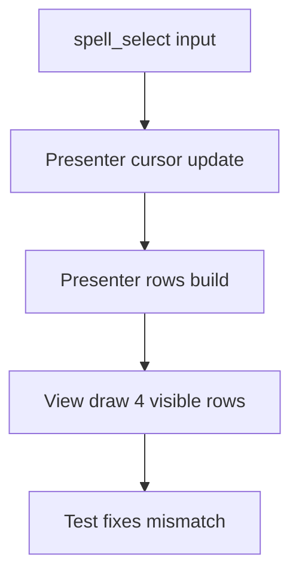

# 2026年5月24日 戦闘：魔法選択でカーソルが画面外へ出る不具合を直す

> 状態：① Journey
> 次のゲート：（ユーザー）Journey の範囲を battle の魔法一覧だけに固定してよいか確認

---

## 1) Journey（どこへ行くか）

> 補足：深層的目的 子どもが画面に見えている魔法だけを自然に選べるようにする
> 補足：やらないこと アイテム一覧や戦闘コマンド全体の UI 改修までは広げない
> 補足：責務分担厳格度 basic

1. 前提条件
   1. 💦 battle の魔法一覧は現在 4 行だけ描画される
   2. 💦 プレイヤーは 5 個以上の魔法を覚えられる
   3. 💦 `spell_select` は所持魔法数ぶん進める実装になっている
   4. 💦 画面外の index にいても決定処理は走る

2. Before
   1. 💦 4 件しか見えていないのに 5 件目以降へカーソルが進む
   2. 💦 見えていない魔法が選ばれるので何を選んだか分かりにくい
   3. 💦 子ども目線では「魔法が選べない」ように見える
   4. ❌ もどかしい

3. After
   1. 💦 カーソル位置と描画範囲の対応が常に一致する
   2. ✅ 見えている魔法だけで上下移動と決定が自然にできる
   3. ✅ 5 件以上覚えているセーブでも画面外カーソルにならない
   4. ❤️ 安心

4. 例外
   1. 魔法未習得のときは既存どおり未習得メッセージを出してよい
   2. 5 件以上の魔法を持つ古い save でも crash しないことを優先する
   3. 同型の item 一覧は同時改修せず、必要なら別論点として切り出す

5. 境界条件
   1. 今回の主語は battle の `spell_select` と表示 rows の整合だけに絞る
   2. 4 件表示のまま直すか、スクロール対応するかは後続で決める
   3. battle 以外の menu や shop の cursor 仕様までは広げない

6. 委任度
   1. 🟢 battle presenter と view の現物確認までは CC 単独で進められる
   2. 🟢 CCのみで可: 再現条件を test に固定し、最小修正案を並べる
   3. 🟡 人の判断: 5 件目以降を clamp するか scroll するかは UX 判断が残る

---

## 2) ユーザーストーリーマップ

> Gherkin の前に、今回の仕事をどの順番で進めるかだけをそろえる。
> 委任度：🟡 Journey 承認後の具体化までは CC が進められる
> 残る曖昧さ：5 件目以降を表示拡張するか、4 件固定で止めるか

### 事前確認

- [x] tasknote確認済み
- [x] skill・tool・MCP確認済み
  - [x] `manage-tasknotes`
  - [x] `brainstorming`
- [x] 永続的ドキュメント確認済み
  - [x] `AGENTS.md`
  - [x] `docs/framework-rule.md`
  - [x] `~/dotfiles/claude/.claude/skills/manage-tasknotes/TEMPLATE.md`
  - [x] `~/dotfiles/claude/.claude/skills/manage-tasknotes/RULES.md`

### 本体

#### 話題1：再現条件と主語を battle の魔法一覧へ固定する

##### ユーザー：Block Quest のプレイヤー

1. 当初計画
    1. 👀 4 件表示と実際の所持数のずれを確認する
    2. 🧪 5 件以上の魔法で再現する条件を固定する
    3. ✂️ battle の魔法一覧だけに修正範囲を絞る

#### 話題2：最小修正と回帰テストを決める

##### ユーザー：この repo の保守者

1. 当初計画
    1. 👀 `spell_select` の移動と rows 生成の責務を見比べる
    2. ✏️ 最小修正で cursor と表示件数を一致させる
    3. ✅ 同じ再発を止める test を追加する

---

## 3) Gherkin（完了条件）

> 委任度：🟡 Journey 承認後の詳細化までは CC が進められる
> 残る曖昧さ：5 件目以降の UX を clamp と scroll のどちらに寄せるか

### シナリオ一覧

- [ ] シナリオ1：見えている魔法だけを違和感なく選べる

1. 🧱 プレイヤーが 5 個以上の魔法を覚えている（battle）
2. 🎬 戦闘中に「じゅもん」を開いて上下入力する（battle）
3. ✅ 画面外の行へカーソルが出ず、見えている対象だけを選べる（battle）

```gherkin
Given プレイヤーが 5 個以上の魔法を覚えた状態で battle に入っている
When プレイヤーが spell_select で上下入力して魔法を選ぶ
Then 画面外の index にカーソルが進まない
And 見えている魔法だけが強調表示される
And 決定時に見えていない魔法が発火しない
```

---

## 4) Design（どうやるか）

### 責務分担概要

- `src/scenes/battle/presenter.py` の `spell_select` 入力と rows 生成の整合を主語にする
- `src/scenes/battle/view.py` は描画だけに留め、判断は Presenter 側で閉じる
- 回帰は battle の test で固定する

### 責務分担概要図



### 責務分担詳細

- `src/scenes/battle/presenter.py` （✏️：spell cursor 移動と spell rows 生成の整合を直す）
- `src/scenes/battle/view.py` （❌：表示件数 4 件の描画方式は今回の起票段階では変えない）
- `test/` （➕：5 件以上の魔法で画面外 cursor にならない回帰 test を足す）

### 【参照】

- Steering: `steering/2026年5月24日 戦闘：魔法選択でカーソルが画面外へ出る不具合を直す.md`
- Architecture: `docs/framework-rule.md`
- UXPolicy: `AGENTS.md`

### 変更範囲

- やること: battle の魔法一覧で表示件数と選択可能範囲のずれをなくす
- やらないこと: item 一覧の scroll UI 追加、battle 以外の menu 改修

### 検証

- 検証コマンド: `python -m pytest test/ -q`
- 成功条件: 5 件以上の魔法でも画面外 cursor にならず、既存 battle 挙動を壊さない
- 未実施時の扱い: 未実施なら Closing に残して close しない

---

## 5) Tasklist

- [ ] 5 件以上の魔法で再現する最小 fixture を作る
- [ ] 画面外 cursor を止める回帰 test を追加する
- [ ] battle presenter の最小修正を入れる
- [ ] `python -m pytest test/ -q` で確認する

---

## 6) 作業ログ

- battle の魔法一覧は 4 行表示、`spell_select` は所持数ぶん進む前提で起票した
- `src/scenes/battle/presenter.py` と `src/scenes/battle/view.py` を主語に固定した
- Journey 初稿を作成し、修正範囲を spell_select に絞った

---

## 7) 評価と成果物

> 評価：🟢 再現条件と修正の主語を battle の魔法一覧へ絞った起票ができた

### 成果物

- `steering/2026年5月24日 戦闘：魔法選択でカーソルが画面外へ出る不具合を直す.md`

---

## 8) Discussion

- いまの主論点は「4 件固定で clamp する」か「4 件窓を scroll させる」か。
- 起票時点では item 一覧や他 scene へ広げず、battle の魔法一覧だけを主語にした。
- `spells[:4]` で rows を作りつつ cursor は所持数ぶん進む不整合が現物候補として見えている。

---

## 9) Closing

- 状態: open
- 次のゲート: （ユーザー）Journey の範囲を battle の魔法一覧だけに固定してよいか確認
- close 条件:
  - [ ] Journey が承認されている
  - [ ] Gherkin が実装方針として矛盾なく固まっている
  - [ ] 修正と検証が完了している

---

## 10) 参考資料

- `AGENTS.md`
- `docs/framework-rule.md`
- `src/scenes/battle/presenter.py`
- `src/scenes/battle/view.py`
