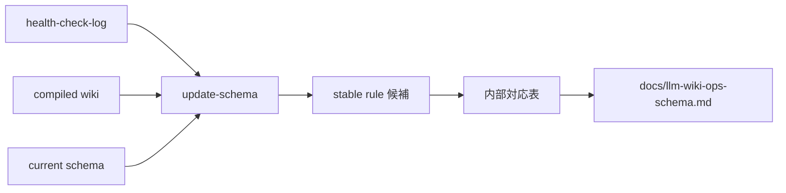

# 2026年5月24日 開発基盤：LLM Wikiのupdate-schemaスキルを作る

> 状態：① Journey
> 次のゲート：（ユーザー）stable rule だけ昇格し現行見出しを維持する draft でよいか確認

---

## 1) Journey（どこへ行くか）

> 補足：深層的目的 tasknote や incident をそのまま schema に混ぜず、繰り返し効いた運用だけを future defaults に昇格できるようにする
> 補足：やらないこと page 修正、health-check 実行、schema の大規模見出し再編まで同じ skill に混ぜない
> 補足：責務分担厳格度 basic

1. 前提条件
   1. 💦 `update-schema` は `health-check-log` と compiled wiki を主に読む
   2. 💦 incident ではなく stable rule だけを schema に昇格する
   3. 💦 現行見出しを維持し、内部対応で 5 バケットを扱う
   4. 💦 `no schema change` で止まれる

2. Before
   1. 💦 [42] では schema 更新の条件が 1 行に圧縮されていて、昇格条件が薄い
   2. 💦 tasknote が多い repo では、局所事故をそのまま rule 化しやすい
   3. 💦 5 分割へ寄せるか、現行見出しを活かすかが曖昧だった
   4. ❌ 難しい

3. After
   1. 💦 `update-schema` が stable rule の昇格 route を持つ
   2. ✅ 一回限りの事故と recurring pattern を切り分けられる
   3. ✅ `defaults` `exceptions` `timing` `query_policy` `batch_policy` を内部対応で扱える
   4. ✅ 昇格対象が無いときは `no schema change` で止められる
   5. ❤️ スッキリ

4. 例外
   1. current log に recurring pattern が無ければ schema を更新しなくてよい
   2. stable rule が見えても wording が荒ければ tasknote に戻してよい

5. 境界条件
   1. `update-schema` は tasknote 原文を主たる正本にしない
   2. `update-schema` は現行 schema の見出し再編を強制しない
   3. `update-schema` は page 修正や log 追記そのものを担当しない

6. 委任度
   1. 🟢 stable rule 昇格の draft と対応表までは CC 単独で進められる
   2. 🟢 CCのみで可：current schema 見出しを維持した内部対応表を作れる
   3. 🟡 人の判断: 全プロジェクト共通 skill としての wording の最終温度感

---

## 2) ユーザーストーリーマップ

> schema 更新を「全部書く」のでなく「何度も効くやり方だけ昇格する」route に絞る。
> 委任度：🟢 昇格条件、対応表、no-op 条件の draft までは CC が固められる
> 残る曖昧さ：なし

### 事前確認

- [x] tasknote確認済み
- [x] skill・tool・MCP確認済み
  - [x] `manage-tasknotes`
  - [x] `brainstorming`
  - [x] `skill-creator`
  - [x] shared `tasknote-lint`
- [x] 永続的ドキュメント確認済み
  - [x] `AGENTS.md`
  - [x] `manage-tasknotes/TEMPLATE.md`
  - [x] `manage-tasknotes/RULES.md`
  - [x] `docs/llm-wiki-ops-schema.md`
  - [x] `llm-wiki/wiki/logs/health-check-log.md`
  - [x] `llm-wiki/wiki/summaries/knowledge/2026-04-04-karpathy-llm-wiki-summary.md`

### 本体

#### 話題1：何を入力にして rule 候補を作るかを固定する

##### ユーザー：佐藤さん（schema maintainer）

1. 当初計画
    1. 👀 `health-check-log` を主入力にする
    2. 📚 既存 schema と related area / summary を補助入力にする
    3. 🚫 tasknote 原文や一回限りの会話メモを主入力にしない

#### 話題2：何を schema に昇格してよいかを固定する

##### ユーザー：佐藤さん（rule promoter）

1. 当初計画
    1. 🔁 recurring pattern だけを候補にする
    2. ✂️ incident、局所修正、暫定メモは昇格させない
    3. 🛑 昇格価値が無ければ `no schema change` で止まる

#### 話題3：現行見出しを維持しながら内部対応で扱う

##### ユーザー：佐藤さん（repo operator）

1. 当初計画
    1. 🧱 `defaults` は `Ingest Defaults` と `Health-Check Defaults` に対応させる
    2. 🧱 `exceptions` は `Exceptions` に対応させる
    3. 🧱 `timing` は `Default Flow` と `Update Rule` に対応させる
    4. 🧱 `query_policy` は `Query Defaults` に対応させる
    5. 🧱 `batch_policy` は `Batch Policy` に対応させる

---

## 3) Gherkin（完了条件）

> 委任度：🟢 stable rule 昇格条件と対応表の draft までは CC が進められる
> 残る曖昧さ：なし

### シナリオ一覧

- [ ] シナリオ1：stable rule だけを schema に昇格できる

1. 🧱 health-check log に recurring pattern が残っている
2. 🎬 rule 候補を切り出す
3. ✅ schema に昇格するものだけを選べる

```gherkin
Given `health-check-log` に recurring pattern と incident が混在している
When `update-schema` が rule 候補を整理する
Then stable rule だけを schema 更新候補にできる
And incident や一回限りのメモは昇格させない
```

- [ ] シナリオ2：昇格対象が無いときは no-op で止まれる

1. 🧱 current log に昇格価値のある recurring pattern が無い
2. 🎬 schema 更新要否を判定する
3. ✅ `no schema change` で止まる

```gherkin
Given current `health-check-log` に stable rule 候補が見つからない
When `update-schema` が更新要否を判定する
Then schema は変更しない
And `no schema change` と理由を返せる
```

- [ ] シナリオ3：現行 schema 見出しを維持したまま対応づけられる

1. 🧱 親ノートでは 5 バケット表現がある
2. 🎬 現行 schema の見出しへ内部対応表を作る
3. ✅ 文書大改造なしで運用昇格できる

```gherkin
Given 親ノートでは `defaults` `exceptions` `timing` `query_policy` `batch_policy` の表現が使われている
When `update-schema` が current schema の見出しへ内部対応づけを行う
Then 現行の `Default Flow` `Ingest Defaults` `Query Defaults` `Health-Check Defaults` `Batch Policy` `Exceptions` `Update Rule` を維持できる
And schema の大規模見出し再編を強制しない
```

---

## 4) Design（どうやるか）

### 責務分担概要

- `update-schema` は health-check log から recurring pattern を拾う
- stable rule だけを schema 候補にする
- 現行 schema 見出しへ内部対応表で流し込む
- 候補が無ければ `no schema change` で止まる

### 責務分担概要図



### 責務分担詳細

- `llm-wiki/wiki/logs/health-check-log.md` （➕：昇格候補の主入力）
- `docs/llm-wiki-ops-schema.md` （✏️：更新先の schema 正本）
- `llm-wiki/wiki/areas/` （➕：rule 候補の意味と crossref 状態を補助確認する）
- `llm-wiki/wiki/summaries/knowledge/2026-04-04-karpathy-llm-wiki-summary.md` （➕：Karpathy 方針の補助参照）
- `steering/done/2026年5月23日 開発基盤：Karpathy型LLM Wiki運用の親ノート.md` （➕：5 バケット表現の元要求）

### 【参照】

- Steering: `steering/done/2026年5月23日 開発基盤：Karpathy型LLM Wiki運用の親ノート.md`
- Architecture: `docs/llm-wiki-ops-schema.md`
- Source: `llm-wiki/wiki/logs/health-check-log.md`

### 変更範囲

- やること:
  - `update-schema` の入力を `health-check-log` 中心に固定する
  - stable rule 昇格条件を明文化する
  - 現行見出しを維持する内部対応表を定義する
- やらないこと:
  - health-check 実行を同じ skill に入れること
  - schema の全面リライトを前提にすること
  - page 修正や crossref 追加をこの skill に入れること

### 検証

- 検証コマンド:
  - `node /home/exedev/dotfiles/shared/linter/coding-rules/tasknote/run_tasknote_lint.mjs --config ./tasknote-lint.config.json 'steering/2026年5月24日 開発基盤：LLM Wikiのupdate-schemaスキルを作る.md'`
- 成功条件:
  - tasknote が lint を通る
  - stable rule 昇格条件が note 上で読める
  - 現行見出しを維持する対応表が note 上で読める
- 未実施時の扱い:
  - lint 未実施なら draft 止まりとして扱う

---

## 5) Tasklist

- [ ] skill 名と保存先を決める
- [ ] `health-check-log` 中心の入力を固定する
- [ ] stable rule 昇格条件を決める
- [ ] 現行 schema 見出しを維持する対応表を決める
- [ ] `no schema change` 条件と dry-run 観点を決める

---

## 6) 作業ログ

- [ ] 未着手

---

## 7) 評価と成果物

> 評価：🟢 stable rule 昇格と現行見出し維持の draft を tasknote に固定できている

### 成果物

- `steering/2026年5月24日 開発基盤：LLM Wikiのupdate-schemaスキルを作る.md`
- `docs/llm-wiki-ops-schema.md`
- `llm-wiki/wiki/logs/health-check-log.md`

---

## 8) Discussion

- 関連tasknote: `steering/2026年5月24日 開発基盤：LLM Wikiの点検スキルとルール更新スキルを分ける.md`
- `update-schema` は tasknote 原文をそのまま rule 化せず、log と compiled wiki を主入力にする
- stable rule の無い回は schema を更新しない
- 親ノートの 5 バケット表現は、現行 schema 見出しへの内部対応で吸収する

---

## 9) Closing

- 状態: open
- 次のゲート: （ユーザー）stable rule だけ昇格し現行見出しを維持する draft でよいか確認
- close 条件:
  - [ ] `update-schema` の主入力が `health-check-log` に固定される
  - [ ] stable rule 昇格条件が固まる
  - [ ] 現行 schema 見出しを維持する対応表が固まる

---

## 10) 参考資料

- `steering/done/2026年5月23日 開発基盤：Karpathy型LLM Wiki運用の親ノート.md`
- `llm-wiki/wiki/logs/health-check-log.md`
- `docs/llm-wiki-ops-schema.md`
- `llm-wiki/wiki/summaries/knowledge/2026-04-04-karpathy-llm-wiki-summary.md`
