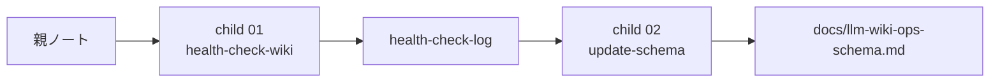

# 2026年5月24日 開発基盤：LLM Wikiの点検スキルとルール更新スキルを分ける

> 状態：⑧ Closing
> 次のゲート：（CC）child `01` の skill contract と dry-run 観点を固める

---

## 1) Journey（どこへ行くか）

> 補足：深層的目的 tasknote の山をそのまま schema に混ぜず、点検結果から安定した運用だけを昇格できる route にする
> 補足：やらないこと health-check と schema 更新を 1 本に混ぜて、自動修正や誤更新まで一緒に走らせない
> 補足：責務分担厳格度 basic

1. 前提条件
   1. 💦 親ノートの [42] を `health-check-wiki` と `update-schema` の 2 skill に分ける
   2. 💦 この repo の llm-wiki は開発 tasknote 由来の知見が多い
   3. 💦 `health-check-wiki` は log を残す read-only route に寄せる
   4. 💦 `update-schema` は安定した運用だけを schema に昇格する

2. Before
   1. 💦 [42] は点検と schema 更新が 1 行に詰まり、止まる位置が見えにくい
   2. 💦 tasknote 由来の局所事故と recurring rule が混ざりやすい
   3. 💦 見出し再編と運用昇格が一緒に見え、誤更新の境界が弱い
   4. ❌ もやもや

3. After
   1. 💦 親ノートが `health-check-wiki -> update-schema` の route を持つ
   2. ✅ child `01` は点検と log 記録だけに責務を絞れる
   3. ✅ child `02` は stable rule の昇格だけに責務を絞れる
   4. ✅ tasknote の山をそのまま schema に流し込まない境界を持てる
   5. ❤️ 安心

4. 例外
   1. 点検結果が `no issue` でも health-check log は残してよい
   2. schema へ昇格できる stable rule が無ければ `no schema change` で止めてよい

5. 境界条件
   1. `health-check-wiki` は page 修正や schema 更新を自動で行わない
   2. `update-schema` は tasknote 本文ではなく log と compiled wiki を主に読む
   3. schema は現行見出しを維持し、内部対応で 5 バケットを扱う

6. 委任度
   1. 🟢 親子への分割は完了し、このまま child 実装準備へ進められる
   2. 🟢 CCのみで可：点検と昇格の境界を子ノートへ反映できる
   3. 🟢 CCのみで可：`no schema change` の前提を子ノートへ引き継げる

---

## 2) ユーザーストーリーマップ

> 点検してから昇格する route を、親子ノートで止まれる形に分ける。
> 委任度：🟢 child 2 本は確認待ちを外し、実装準備まで CC が進められる
> 残る曖昧さ：なし

### 事前確認

- [x] tasknote確認済み
- [x] skill・tool・MCP確認済み
  - [x] `manage-tasknotes`
  - [x] `brainstorming`
  - [x] `skill-creator`
  - [x] shared `tasknote-lint`
- [x] 永続的ドキュメント確認済み
  - [x] `AGENTS.md`
  - [x] `manage-tasknotes/TEMPLATE.md`
  - [x] `manage-tasknotes/RULES.md`
  - [x] `docs/llm-wiki-ops-schema.md`
  - [x] `llm-wiki/wiki/logs/health-check-log.md`
  - [x] `steering/done/2026年5月23日 開発基盤：Karpathy型LLM Wiki運用の親ノート.md`

### 本体

#### 話題1：点検 route を read-only に固定する

##### ユーザー：佐藤さん（health-check owner）

1. 当初計画
    1. 👀 `health-check-wiki` は current wiki と logs を読む
    2. 🧭 `contradictions` `stale_claims` `orphan_pages` `missing_concepts` `missing_crossrefs` `data_gaps` を分類する
    3. 📝 結果を `health-check-log` に残し、fix は別 route に渡す

#### 話題2：昇格 route を stable rule だけに絞る

##### ユーザー：佐藤さん（schema maintainer）

1. 当初計画
    1. 🔎 `update-schema` は health-check log と compiled wiki を読む
    2. ✂️ 一回限りの事故と、繰り返し効く運用ルールを切り分ける
    3. 📘 stable rule だけを `docs/llm-wiki-ops-schema.md` に昇格する
    4. 🛑 候補が無ければ `no schema change` で止まる

#### 話題3：schema は見出し再編せず内部対応で扱う

##### ユーザー：佐藤さん（repo operator）

1. 当初計画
    1. 🧱 現行 schema の見出しは維持する
    2. 🔁 `defaults / exceptions / timing / query_policy / batch_policy` は内部対応表で扱う
    3. 🚫 skill 起点で大きな文書再編を強制しない

---

## 3) Gherkin（完了条件）

> 委任度：🟢 child 2 本の contract 固定と dry-run 観点までは CC が進められる
> 残る曖昧さ：なし

### シナリオ一覧

- [ ] シナリオ1：親 note が点検から昇格までの入口になる

1. 🧱 [42] はあるが、止まる位置が 1 行に詰まっている
2. 🎬 parent note で child `01` と child `02` に分ける
3. ✅ 点検と昇格の route を別々に再開できる

```gherkin
Given 親ノートの [42] では点検と schema 更新が 1 つに見えている
When parent note を `health-check-wiki` と `update-schema` の 2 child に分ける
Then 点検で止まる位置と昇格で止まる位置が別々に見える
And 次のゲートは child `01` を指す
```

- [ ] シナリオ2：child `01` が read-only health-check を定義する

1. 🧱 tasknote 由来の知見が多く、事故とルールが混ざりやすい
2. 🎬 `health-check-wiki` を log 記録だけの route に固定する
3. ✅ 誤修正や誤昇格なしで点検結果を残せる

```gherkin
Given llm-wiki には tasknote 由来の compiled knowledge が多い
When child `01` で `health-check-wiki` を read-only route として定義する
Then page 修正や schema 更新なしで分類付き log を残せる
And `data_gaps` も含めて点検できる
```

- [ ] シナリオ3：child `02` が stable rule だけを schema に昇格する

1. 🧱 health-check log には局所事故と recurring rule が混ざる
2. 🎬 `update-schema` で stable pattern だけを選ぶ
3. ✅ 一回限りのメモを schema に混ぜずに済む

```gherkin
Given health-check log には incident と recurring pattern の両方が残る
When child `02` で `update-schema` の昇格条件を定義する
Then stable rule だけを schema に反映できる
And 現行 schema の見出しは維持できる
And stable rule が無ければ `no schema change` で止まれる
```

---

## 4) Design（どうやるか）

### 責務分担概要

- parent note は `health-check-wiki -> update-schema` の route と child handoff を持つ
- child `01` は current wiki を点検して log を残す
- child `02` は log から stable pattern を選び schema に昇格する
- point inspection と rule promotion を分けて、誤更新を止めやすくする

### 責務分担概要図



### 責務分担詳細

- `steering/2026年5月24日 開発基盤：LLM Wikiの点検スキルとルール更新スキルを分ける.md` （➕：parent route と child handoff を持つ）
- `steering/2026年5月24日 開発基盤：LLM Wikiのhealth-check-wikiスキルを作る.md` （➕：read-only 点検 route を定義する）
- `steering/2026年5月24日 開発基盤：LLM Wikiのupdate-schemaスキルを作る.md` （➕：stable rule 昇格 route を定義する）
- `llm-wiki/wiki/logs/health-check-log.md` （➕：点検結果の時系列 log を持つ）
- `docs/llm-wiki-ops-schema.md` （✏️：昇格先の schema 正本）

### 【参照】

- Steering: `steering/done/2026年5月23日 開発基盤：Karpathy型LLM Wiki運用の親ノート.md`
- Architecture: `docs/llm-wiki-ops-schema.md`
- Source: `llm-wiki/wiki/logs/health-check-log.md`

### 変更範囲

- やること:
  - 親ノートを 1 本起票する
  - child `01` と child `02` を起票する
  - point inspection と schema promotion の境界を note 上に固定する
- やらないこと:
  - この turn で skill 実装そのものを作ること
  - health-check の fix 実行や schema 書き換え実装を先に始めること
  - 既存の llm-wiki page を更新すること

### 検証

- 検証コマンド:
  - `node /home/exedev/dotfiles/shared/linter/coding-rules/tasknote/run_tasknote_lint.mjs --config ./tasknote-lint.config.json 'steering/2026年5月24日 開発基盤：LLM Wikiの点検スキルとルール更新スキルを分ける.md'`
- 成功条件:
  - parent note が lint を通る
  - child 一覧と route が note 上で読める
  - 点検と昇格の責務が別々に見える
- 未実施時の扱い:
  - lint 未実施なら draft 止まりとして扱う

---

## 5) Tasklist

- [x] parent note の route と child 一覧を固める
- [x] child `01` の read-only 点検 route を起票する
- [x] child `02` の stable rule 昇格 route を起票する

---

## 6) 作業ログ

- [x] parent と child 2 本を起票し、tasknote commit まで完了
- [x] Karpathy 想定問答で read-only / stable rule / no-op を明文化

---

## 7) 評価と成果物

> 評価：🟢 親 1 本と child 2 本の route を tasknote として起票できている

### 成果物

- `steering/2026年5月24日 開発基盤：LLM Wikiの点検スキルとルール更新スキルを分ける.md`
- `steering/2026年5月24日 開発基盤：LLM Wikiのhealth-check-wikiスキルを作る.md`
- `steering/2026年5月24日 開発基盤：LLM Wikiのupdate-schemaスキルを作る.md`

---

## 8) Discussion

### child tasknote 一覧

- [x] child `01`：`steering/2026年5月24日 開発基盤：LLM Wikiのhealth-check-wikiスキルを作る.md`
- [x] child `02`：`steering/2026年5月24日 開発基盤：LLM Wikiのupdate-schemaスキルを作る.md`

### 残課題のルール化

### 残課題1

- 委任度: 🟢 child `01` の read-only 点検 route までは CC が進められる
- 関連tasknote: `steering/2026年5月24日 開発基盤：LLM Wikiのhealth-check-wikiスキルを作る.md`

### 残課題2

- 委任度: 🟢 child `02` の stable rule 昇格 route までは CC が進められる
- 関連tasknote: `steering/2026年5月24日 開発基盤：LLM Wikiのupdate-schemaスキルを作る.md`

---

## 9) Closing

- 状態: done
- 次のゲート: なし
- close 条件:
  - [x] parent note が child `01-02` の入口になる
  - [x] child `01` が read-only 点検 route を持つ
  - [x] child `02` が stable rule 昇格 route を持つ

---

## 10) 参考資料

- `steering/done/2026年5月23日 開発基盤：Karpathy型LLM Wiki運用の親ノート.md`
- `llm-wiki/wiki/logs/health-check-log.md`
- `docs/llm-wiki-ops-schema.md`
