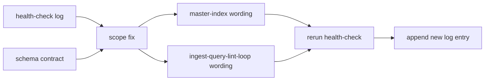

# 2026年5月24日 開発基盤：llm-wikiのhealth-check表記を現行契約へそろえる

> 状態：② ユーザーストーリーマップ
> 次のゲート：（ユーザー）委任度を🟢で進めてよいか

---

## 1) Journey（どこへ行くか）

> 補足：深層的目的 compiled wiki だけ読んでも現行の health-check 契約が分かる状態へ戻す
> 補足：やらないこと schema 更新や新規 source ingest まで広げない
> 補足：責務分担厳格度 basic

1. 前提条件
   1. 💦 正本は `docs/llm-wiki-ops-schema.md` と current compiled wiki である
   2. 💦 今回の直接対象は `master-index` と `Ingest Query Lint Loop` である
   3. 💦 根拠は `health-check-log` に残した stale claim で足りている
   4. 💦 修正後は read-only の health-check をもう一度回して確かめる

2. Before
   1. 💦 `master-index` の `Health Check Log` 説明がまだ `core 5 点検` のままである
   2. 💦 `Ingest Query Lint Loop` の `lint` 節に `data_gaps` が入っていない
   3. 💦 current wiki の運用説明が schema と少しずれて読める
   4. ❌ もやもや

3. After
   1. ✅ current wiki だけ読んでも `core 6 + data_gaps` の lint 契約が伝わる
   2. ✅ health-check の stale claim を小さく確実に潰せる
   3. ✅ 次に page 追加が必要かどうかを、表記ずれなしで判断できる
   4. ❤️ スッキリ

4. 例外
   1. 表記修正だけで足りなければ別 note へ切る
   2. 別の stale が出ても今回は記録だけ残す

5. 境界条件
   1. 今回は compiled wiki の既存 page 修正に限る
   2. `health-check-log` には再点検 entry を足してよい
   3. schema doc の文面変更は今回やらない
   4. 新規 area page や candidate source は今回作らない

6. 委任度
   1. 🟢 今回は 2 page 修正と再点検だけなので CC 単独で進められる
   2. 🟢 CCのみで可: 根拠が log と schema にそろっている
   3. 🟡 人の判断: 専用 page を増やす話は別判断にする

---

## 2) ユーザーストーリーマップ

> Gherkin の前に、今回の仕事をどの順番で進めるかだけをそろえる。
> 委任度：🟢 fix_now の範囲は明確で、そのまま CC が進められる
> 残る曖昧さ：なし

### 事前確認

- [x] tasknote確認済み
- [x] skill・tool・MCP確認済み
  - [x] `manage-tasknotes`
  - [x] `llm-wiki-health-check`
- [x] 永続的ドキュメント確認済み
  - [x] `AGENTS.md`
  - [x] `~/dotfiles/claude/.claude/skills/manage-tasknotes/TEMPLATE.md`
  - [x] `~/dotfiles/claude/.claude/skills/manage-tasknotes/RULES.md`
  - [x] `docs/llm-wiki-ops-schema.md`
  - [x] `llm-wiki/wiki/indexes/master-index.md`
  - [x] `llm-wiki/wiki/areas/ingest-query-lint-loop.md`
  - [x] `llm-wiki/wiki/logs/health-check-log.md`

#### 話題1：stale wording の対象を固定する

##### ユーザー：この repo の llm-wiki 運用者（scope fix）

1. 当初計画
    1. 👀 stale claim として出た文言を 2 箇所に絞る
    2. 🧭 schema と log を根拠に正しい表現を決める
    3. ✂️ page 追加が要る話と、単純表記修正を分ける

#### 話題2：compiled wiki の説明を現行契約へそろえる

##### ユーザー：この repo の llm-wiki 運用者（wording update）

1. 当初計画
    1. ✏️ `master-index` の log 説明を現行の lint 契約へ合わせる
    2. ✏️ `Ingest Query Lint Loop` の `lint` 節へ `data_gaps` を足す
    3. 🔗 必要なら関連説明の言い回しも最小限そろえる

#### 話題3：再点検して記録だけ残す

##### ユーザー：この repo の llm-wiki 運用者（recheck）

1. 当初計画
    1. 🔍 helper と compiled page 読みで health-check を 1 回やり直す
    2. 📝 `health-check-log` に結果を 1 件追記する
    3. 🚫 page 修正や schema 更新はその先へ持ち込まない

---

## 3) Gherkin（完了条件）

> 委任度：🟢 表記修正と再点検まで CC が完走できる
> 残る曖昧さ：なし

### シナリオ一覧

- [ ] シナリオ1：`master-index` の log 説明が現行契約を表す

1. 🧱 current wiki の入口として `master-index` が使われている
2. 🎬 `Health Check Log` の説明文を確認する
3. ✅ `core 6 + data_gaps` を含む現行契約として読める

```gherkin
Given current wiki の入口が `llm-wiki/wiki/indexes/master-index.md` である
When `Health Check Log` の説明文を読む
Then 説明は `core 5 点検` ではなく現行の `core 6 + data_gaps` 契約として読める
And health-check route が現行 schema と矛盾しない
```

- [ ] シナリオ2：`Ingest Query Lint Loop` の lint 項目が現行契約を表す

1. 🧱 `Ingest Query Lint Loop` が lint の役割説明 page である
2. 🎬 `lint` 節の項目を確認する
3. ✅ `data_gaps` を含む現行の点検観点として読める

```gherkin
Given `llm-wiki/wiki/areas/ingest-query-lint-loop.md` が lint の役割を説明している
When `lint` 節の箇条書きを読む
Then `contradictions` `stale claims` `orphan pages` `missing concepts` `missing crossrefs` `data_gaps` が読める
And current schema の health-check defaults と矛盾しない
```

- [ ] シナリオ3：再点検で今回の stale wording が解消したと分かる

1. 🧱 compiled wiki の表記修正が終わっている
2. 🎬 health-check をもう一度回す
3. ✅ 今回の 2 件が stale claim として残らず、結果が log に残る

```gherkin
Given `master-index` と `Ingest Query Lint Loop` の表記修正が終わっている
When current wiki に対して health-check をもう一度回す
Then 今回の 2 件は stale claim として再発しない
And 結果は `health-check-log` に 1 entry として残る
And page 修正や schema 更新は同じ turn に混ぜない
```

---

## 4) Design（どうやるか）

### 責務分担概要

- stale wording の根拠は既存の `health-check-log` と schema から取る
- 実際の修正対象は compiled wiki の 2 page に限定する
- 修正後は health-check を再実行して、結果だけを log に残す
- 今回は `fix_now` だけを扱い、`next_ingest` は別判断に切る

### 責務分担概要図



### 責務分担詳細

- **関連スキル・MCP**：`manage-tasknotes`, `llm-wiki-health-check`, `verification-before-completion`
- `llm-wiki/wiki/indexes/master-index.md` （✏️：`Health Check Log` の説明を現行契約へそろえる）
- `llm-wiki/wiki/areas/ingest-query-lint-loop.md` （✏️：`lint` 節へ `data_gaps` を含める）
- `llm-wiki/wiki/logs/health-check-log.md` （✏️：再点検の結果を 1 entry 追記する）
- `docs/llm-wiki-ops-schema.md` （➕：現行契約の正本として参照する）

### 【参照】

- Steering: `steering/2026年5月24日 開発基盤：llm-wiki-health-checkの下ごしらえをPythonに寄せる.md`
- Architecture: `AGENTS.md`, `docs/llm-wiki-ops-schema.md`
- UXPolicy: なし（UI変更なし）

### 変更範囲

- やること:
  - `master-index` の `Health Check Log` 説明を更新する
  - `Ingest Query Lint Loop` の `lint` 節を現行契約へそろえる
  - 再点検して `health-check-log` に記録する
- やらないこと:
  - schema 更新
  - 新規 area page の追加
  - raw source / summary ingest

### 検証

- 検証コマンド:
  - `python tools/llm_wiki_health_check_helper.py --repo-root . --current-date 2026-05-24`
  - `npx -y markdownlint-cli2 llm-wiki/wiki/indexes/master-index.md llm-wiki/wiki/areas/ingest-query-lint-loop.md llm-wiki/wiki/logs/health-check-log.md`
- 成功条件:
  - 2 page の stale wording が解消する
  - 再点検結果を log に記録できる
  - markdown lint が 0 error で通る
- 未実施時の扱い:
  - 再点検か lint のどちらかが未実施なら done にしない

---

## 5) Tasklist

- [ ] stale wording の正しい表現を schema と log から確定する
- [ ] `master-index` と `Ingest Query Lint Loop` を更新する
- [ ] health-check をやり直して `health-check-log` へ結果を追記する
- [ ] markdown lint で 0 error を確認する

---

## 6) 作業ログ

- [x] health-check 所見から tasknote の scope を fix_now に絞った
- [x] stale wording の対象を `master-index` と `Ingest Query Lint Loop` に固定した
- [x] 新規 tasknote を起票した

---

## 7) 評価と成果物

> 評価：🟡 起票と scope 固定は完了、実修正と再点検はこれから

### 成果物

- `steering/2026年5月24日 開発基盤：llm-wikiのhealth-check表記を現行契約へそろえる.md`

---

## 8) Discussion

- `health-check` と `update-schema` の route 分離を compiled page に昇格するかは、今回の fix 完了後に別判断でよい

---

## 9) Closing

- 状態: open
- 次のゲート: （ユーザー）委任度を🟢で進めてよいか
- close 条件:
  - [ ] `master-index` の stale wording が解消している
  - [ ] `Ingest Query Lint Loop` の stale wording が解消している
  - [ ] 再点検結果が `health-check-log` に残っている

---

## 10) 参考資料

- `docs/llm-wiki-ops-schema.md`
- `llm-wiki/wiki/indexes/master-index.md`
- `llm-wiki/wiki/areas/ingest-query-lint-loop.md`
- `llm-wiki/wiki/logs/health-check-log.md`
