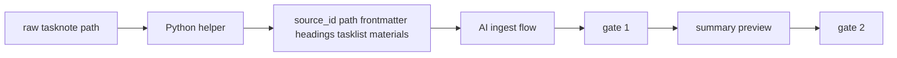

# 2026年5月24日 開発基盤：raw tasknote ingestの単純作業をPythonに寄せる

> 状態：① Journey
> 次のゲート：（ユーザー）Python が返す材料の最小セットを確定

---

## 1) Journey（どこへ行くか）

> 補足：深層的目的 raw tasknote ingest の遅い下ごしらえを減らし、AI が要約判断に集中できるようにする
> 補足：やらないこと article や video への横展開、summary preview の文章生成、gate 1 と gate 2 の会話自動化までは広げない
> 補足：責務分担厳格度 basic

1. 前提条件
   1. 💦 対象は `llm-wiki-capture-and-ingest-source` の raw tasknote flow だけに絞る
   2. 💦 最初の Python 化は `読む` `抜き出す` `並べる` の単純作業に限る
   3. 💦 要約の良し悪しを決める役目はまだ AI が持つ
   4. 💦 dry-run source は既存 raw tasknote を再利用する

2. Before
   1. 💦 raw tasknote を読むたびに同じ下ごしらえを手でやっている
   2. 💦 path 決定や見出し抽出のような単純作業でも会話コストがかかる
   3. 💦 要約前の材料整理が毎回少しずつぶれやすい
   4. ❌ だるい

3. After
   1. 💦 Python が raw tasknote から必要な材料を先にそろえる
   2. ✅ AI は材料を見て要約と gate 会話に集中できる
   3. ✅ raw tasknote ingest の速い入口を 1 本にそろえられる
   4. ❤️ ラク

4. 例外
   1. tasknote の構造が崩れているときは Python が無理に埋めず不足として返す
   2. 引用候補が弱いときは材料不足として止まってよい

5. 境界条件
   1. 今回は raw tasknote だけを対象にする
   2. Python は `source_id` と path 決定まで担当する
   3. Python は frontmatter と見出し抽出まで担当する
   4. Python は Tasklist と材料整理まで担当する
   5. preview 文面と gate 会話は AI に残す

6. 委任度
   1. 🟢 起票と scope 固定は CC 単独で進められる
   2. 🟢 CCのみで可：初期 tasknote の作成と commit
   3. 🟢 CCのみで可：Python は材料整理までに固定する

---

## 2) ユーザーストーリーマップ

> Python に渡す部分を、入力固定、材料抽出、AI への受け渡しの順にそろえる。
> 委任度：🟢 起票直後の provisional map までは CC が進められる
> 残る曖昧さ：Python が返す材料の最小セットをどこまでにするか

### 事前確認

- [x] tasknote確認済み
- [x] skill・tool・MCP確認済み
  - [x] `manage-tasknotes`
  - [x] `brainstorming`
  - [x] `think-decide`
  - [x] `explain-simply`
- [x] 永続的ドキュメント確認済み
  - [x] `AGENTS.md`
  - [x] `~/dotfiles/claude/.claude/skills/manage-tasknotes/TEMPLATE.md`
  - [x] `~/dotfiles/claude/.claude/skills/manage-tasknotes/RULES.md`
  - [x] `~/dotfiles/claude/.claude/skills/llm-wiki-capture-and-ingest-source/SKILL.md`
  - [x] `steering/2026年5月24日 開発基盤：capture-and-ingest-sourceでraw tasknoteからsummary draftを作る.md`

#### 話題1：raw tasknote の入口を 1 つに固定する

##### ユーザー：この repo の llm-wiki 運用者（input fix）

1. 当初計画
    1. 👀 入力 source を raw tasknote path に限定する
    2. 🏷️ `source_id` と summary draft path を決める
    3. 📝 article や video の分岐は持ち込まない

#### 話題2：Python が材料を先に並べる

##### ユーザー：この repo の llm-wiki 運用者（material prep）

1. 当初計画
    1. 👀 frontmatter と見出しを読む
    2. ✂️ Tasklist や Discussion から evidence 候補を抜く
    3. 🧾 AI が要約判断しやすい順に材料を返す

#### 話題3：AI は判断と会話を担当する

##### ユーザー：この repo の llm-wiki 運用者（summary judgment）

1. 当初計画
    1. 🤖 AI は Python の返した材料を読む
    2. 💬 gate 1 と gate 2 の会話は AI が行う
    3. 📝 summary preview の最終文面は AI が作る

---

## 3) Gherkin（完了条件）

> 委任度：🟢 起票時点の完了条件のたたき台までは CC が進められる
> 残る曖昧さ：Python が返す材料セットの最終定義

### シナリオ一覧

- [ ] シナリオ1：raw tasknote path から決定的な材料を返せる

1. 🧱 既存 raw tasknote file がある
2. 🎬 Python helper に path を渡す
3. ✅ `source_id` と path と構造化材料が返る

```gherkin
Given `llm-wiki/raw/tasknotes/` 配下に raw tasknote file が存在する
When Python helper に raw tasknote path を渡す
Then helper は `source_id` と summary draft path を決められる
And frontmatter と主要見出しと Tasklist 由来の材料を返せる
```

- [ ] シナリオ2：tasknote 構造が足りなくても捏造せず不足を返せる

1. 🧱 raw tasknote の一部 section が弱い
2. 🎬 Python helper が file を読む
3. ✅ 埋めずに不足として返る

```gherkin
Given raw tasknote の section や引用候補が不足している
When Python helper が file を読む
Then helper は足りない情報を不足として返す
And 存在しない quote や見出しを捏造しない
```

- [ ] シナリオ3：要約文と gate 会話は AI 側に残る

1. 🧱 Python が材料を返している
2. 🎬 ingest 後半へ進む
3. ✅ AI が要約判断と会話を担当する

```gherkin
Given Python helper が raw tasknote の材料を返している
When ingest 後半の summary preview 作成へ進む
Then summary preview の最終文面は AI が作る
And gate 1 と gate 2 の会話も AI が担当する
```

---

## 4) Design（どうやるか）

### 責務分担概要

- 新しい Python helper は raw tasknote から決定的な材料だけを返す
- `llm-wiki-capture-and-ingest-source` はその材料を使って会話と要約判断を続ける
- 最初の対象は raw tasknote のみで、他 source type は扱わない
- 文章生成を Python に渡さないことで speed と安全の折り合いを取る

### 責務分担概要図



### 責務分担詳細

- `steering/2026年5月24日 開発基盤：raw tasknote ingestの単純作業をPythonに寄せる.md` （➕：今回の scope と境界を固定する）
- `~/dotfiles/claude/.claude/skills/llm-wiki-capture-and-ingest-source/SKILL.md` （✏️：Python helper を呼ぶ前提の flow に将来合わせる）
- `llm-wiki/raw/tasknotes/done/20260412-g12-rebuild-codemaker-zip.md` （➕：dry-run source 1）
- `llm-wiki/raw/tasknotes/done/20260412-g15-test-pinning.md` （➕：dry-run source 2）
- `llm-wiki/raw/tasknotes/done/20260412-guardrails-1-ssot-codegen.md` （➕：dry-run source 3）
- `tools/` （➕：raw tasknote helper の置き場候補）

### 【参照】

- Steering: `steering/2026年5月24日 開発基盤：capture-and-ingest-sourceでraw tasknoteからsummary draftを作る.md`
- Architecture: `docs/llm-wiki-ops-schema.md`
- Skill: `~/dotfiles/claude/.claude/skills/llm-wiki-capture-and-ingest-source/SKILL.md`

### 変更範囲

- やること:
  - raw tasknote だけを対象に Python 化の対象範囲を固定する
  - Python が返す材料セットの最小形を決める
  - AI に残す責務を明文化する
- やらないこと:
  - article や video や post まで広げること
  - summary preview の文章生成を Python に渡すこと
  - gate 1 と gate 2 を自動で飛ばすこと

### 検証

- 検証コマンド:
  - `node /home/exedev/dotfiles/shared/linter/coding-rules/tasknote/run_tasknote_lint.mjs --config ./tasknote-lint.config.json 'steering/2026年5月24日 開発基盤：raw tasknote ingestの単純作業をPythonに寄せる.md'`
- 成功条件:
  - tasknote が lint を通る
  - raw tasknote 限定の scope が note から読める
  - Python と AI の責務境界が note から読める
- 未実施時の扱い:
  - lint 未実施なら仮起票止まりとする

---

## 5) Tasklist

- [ ] Python が返す材料の最小セットを確定する
- [ ] raw tasknote helper の I/O contract を言語化する
- [ ] dry-run source 3 本で必要な材料差分を洗い出す
- [ ] `llm-wiki-capture-and-ingest-source` 側の呼び出し位置を決める

---

## 6) 作業ログ

- raw tasknote だけを最初の対象にする方針を固定した
- Python は材料整理まで、文章生成は AI のままにする方針を固定した
- `steering/` 配下に tasknote を起票することを選んだ

---

## 7) 評価と成果物

> 評価：🟢 Python に寄せる範囲を「単純作業だけ」に絞った起票ができている

### 成果物

- `steering/2026年5月24日 開発基盤：raw tasknote ingestの単純作業をPythonに寄せる.md`

---

## 8) Discussion

- 関連tasknote: `steering/2026年5月24日 開発基盤：capture-and-ingest-sourceでraw tasknoteからsummary draftを作る.md`
- 今回は speed のために Python 化するが、要約の言い過ぎを防ぐため文章生成はまだ AI に残す
- 次の相談点は「Python が返す材料の最小セット」をどこまでにするかである

---

## 9) Closing

- 状態: open
- 次のゲート: （ユーザー）Python が返す材料の最小セットを確定
- close 条件:
  - [ ] raw tasknote 限定の scope が確定している
  - [ ] Python が返す材料の最小セットが決まっている
  - [ ] AI に残す責務が note から読める

---

## 10) 参考資料

- `~/dotfiles/claude/.claude/skills/llm-wiki-capture-and-ingest-source/SKILL.md`
- `steering/2026年5月24日 開発基盤：capture-and-ingest-sourceでraw tasknoteからsummary draftを作る.md`
- `llm-wiki/raw/tasknotes/done/20260412-g12-rebuild-codemaker-zip.md`
- `llm-wiki/raw/tasknotes/done/20260412-g15-test-pinning.md`
- `llm-wiki/raw/tasknotes/done/20260412-guardrails-1-ssot-codegen.md`
