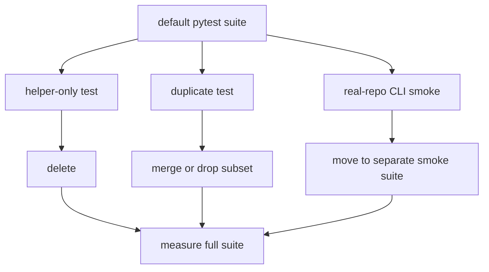

# 2026年5月24日 開発基盤：存在価値が薄いテストを整理して実行時間を削る

> 状態：⑤ Tasklist
> 次のゲート：（ユーザー）CLI の real-repo smoke 6 本を default suite から外してよいか確認

---

## 1) Journey（どこへ行くか）

> 補足：深層的目的 失敗検知を落とさずに、普段回す pytest を軽くする
> 補足：やらないこと 本番導線を守る smoke test まで勢いで削ること
> 補足：責務分担厳格度 full

1. 前提条件
   1. 💦 `pytest test/ -q --durations=40` は 12.78s、748 pass、2 skip だった
   2. 💦 削除候補と重複候補は調査済みである
   3. 💦 削る対象は current code を守らない test に限る

2. Before
   1. 💦 default suite に helper-only test と duplicate test が混ざっている
   2. 💦 real-repo clean を見る CLI smoke が毎回走っている
   3. 💦 遅い test と不要な test が同じ箱に入って判断しづらい
   4. ❌ もどかしい

3. After
   1. 💦 helper-only test が消え、current-path test に寄る
   2. ✅ duplicate test が減り、守る失敗面が説明できる
   3. ✅ real-repo smoke は default か別枠かを意図して運用できる
   4. ✅ before/after の実行時間差が残る
   5. ❤️ スッキリ

4. 例外
   1. 本番導線を直接守る smoke は遅くても残してよい
   2. duplicate に見えても failure surface が違うなら残してよい

5. 境界条件
   1. 今回は test suite 整理だけを扱う
   2. runtime や build の挙動変更は含めない
   3. 削除判断は file 名でなく守っている経路で行う

6. 委任度
   1. 🟢 helper-only と duplicate の候補整理までは CC 単独で進められる
   2. 🟢 CCのみで可：削除後の focused/full pytest で差分を測れる
   3. 🟡 人の判断: real-repo smoke を default から外す運用判断

---

## 2) ユーザーストーリーマップ

> 普段回す suite から、守る価値の薄い test だけを切り分ける。
> 委任度：🟡 削除候補は固まったが、CLI smoke の置き場は確認が要る
> 残る曖昧さ：real-repo clean smoke を default suite に残すか別 command に分けるか

### 事前確認

- [x] tasknote確認済み
- [x] skill・tool・MCP確認済み
  - [x] `manage-tasknotes`
  - [x] `brainstorming`
- [x] 永続的ドキュメント確認済み
  - [x] `AGENTS.md`
  - [x] `docs/repository-structure.md`
  - [x] `docs/framework-rule.md`
  - [x] `tasknote-lint.config.json`

### 本体

#### 話題1：helper-only test を消す

##### ユーザー：日常的に pytest を回す開発者

1. 当初計画
    1. 🔍 `test_shop_logic.py` を確認する
    2. ❌ test 内 helper しか見ていないなら削除する
    3. ✅ 現行 code path を見る CJG test を残す

#### 話題2：duplicate test を current-path 側へ寄せる

##### ユーザー：回帰面を見失いたくない開発者

1. 当初計画
    1. 🔍 town、landmark、save_store の重複を比較する
    2. ✂️ 部分集合になっている古い test を落とす
    3. ✏️ 必要なら 1 本だけ残して CJG 側へ寄せる

#### 話題3：real-repo smoke の置き場を分ける

##### ユーザー：日常 suite と guardrail suite を分けたい開発者

1. 当初計画
    1. 🔍 thin shim CLI の smoke を列挙する
    2. 📦 default suite から外す候補を決める
    3. 🧪 別 command でも回せる形を残す

#### 話題4：時間差を測って成果を残す

##### ユーザー：削減効果を数値で見たい開発者

1. 当初計画
    1. ⏱️ before を保存する
    2. 🧪 変更後に focused と full を回す
    3. 📝 秒数差と残した理由を note に戻す

---

## 3) Gherkin（完了条件）

> 委任度：🟡 実装着手は進められるが、CLI smoke の運用だけ確認が要る
> 残る曖昧さ：CLI smoke を default suite から外す閾値

### シナリオ一覧

- [ ] シナリオ1：helper-only test を消しても本番経路の検知が残る

1. 🧱 helper-only test と current-path test の対応関係が見えている
2. 🎬 helper-only test を削除する
3. ✅ current-path test が同じ回帰面を守り続ける

```gherkin
Given test 内 helper 関数だけを検証している古い test がある
And 同じ失敗面を本番の code path で見る newer test がある
When helper-only test を削除する
Then 守る回帰面は newer test 側に残る
And full suite は green のままである
```

- [ ] シナリオ2：duplicate test を減らしても failure surface が欠けない

1. 🧱 duplicate 候補の 2 本を本文比較できている
2. 🎬 部分集合の古い test を落とすか 1 本に寄せる
3. ✅ 残す test だけで current code path を説明できる

```gherkin
Given town と landmark と save_store に duplicate 候補がある
When 古い test と current-path test の守る failure surface を比較する
Then 部分集合の test は削除または統合される
And 残る test で current code path の回帰面を説明できる
```

- [ ] シナリオ3：real-repo CLI smoke を daily suite から分けられる

1. 🧱 thin shim CLI を叩くだけの smoke が列挙されている
2. 🎬 default suite から別 command または別枠へ移す
3. ✅ guardrail は残しつつ daily suite が軽くなる

```gherkin
Given thin shim CLI を real repo に対して実行する smoke がある
When それらを default suite から別 command または別枠へ移す
Then guardrail 自体は残る
And daily に回す pytest の実行時間は短くなる
```

- [ ] シナリオ4：before/after の秒数差が記録される

1. 🧱 before の実行時間が残っている
2. 🎬 変更後に focused と full pytest を回す
3. ✅ 削減秒数と残した test の理由を記録できる

```gherkin
Given current suite の before duration が残っている
When test 削減後に focused suite と full suite を実行する
Then before と after の秒数差を比較できる
And 残した遅い test の理由も tasknote に記録される
```

---

## 4) Design（どうやるか）

### 責務分担概要

| 親ディレクトリ | 責務概要 |
| --- | --- |
| `test/` | helper-only、duplicate、real-repo smoke を分け、daily suite から何を外すかを明確化する |
| `docs/` | 層規約と repo 構造を参照し、本番導線 smoke を削らない境界を固定する |
| `steering/` | before/after の秒数と削減判断を tasknote に残す |

### 責務分担概要図



### 責務分担詳細

#### 親ディレクトリ: `test/`

- ファイル名: `test suite candidate set`
- 既存/新規: 既存
- 置く理由: helper-only、duplicate、real-repo smoke の候補が `test/` 配下に集まっているため
- 責務内容:
  - `test_shop_logic.py`: test 内 `_purchase()` だけを検証し、本番 `ShopScene._try_purchase()` を通らない
  - `test_spell_logic.py`: test 内 spell helper だけを検証し、本番 `BattleScene` の経路を通らない
  - `test_cjg_town_entry_sets_current_town.py`: `test_cjg_town_entry_populates_current_town.py` の部分集合になっている
  - `test_landmark_events.py`: `test_cjg_landmark_events.py` の部分集合で、半径境界や data contract を持たない
  - `test_save_store.py`: CJG contract/file test と重複するため、factory 検証だけ残す余地がある
  - `test_architecture_rules_checker.py`: thin shim CLI を real repo に対して叩く smoke を含む
  - `test_fix_architecture_rules.py`: thin shim CLI の clean repo 実行を毎回見ている
  - `test_repair_architecture_rules.py`: repair shim の clean repo 実行を毎回見ている
  - `test_stakeholder_voices_checker.py`: stakeholder checker shim の clean repo 実行を毎回見ている
  - `test_fix_stakeholder_voices.py`: stakeholder fix shim の clean repo 実行を毎回見ている
  - `test_repair_stakeholder_voices.py`: stakeholder repair shim の clean repo 実行を毎回見ている
  - `test_web_runtime_server.py`: web 配信と internal API の本番導線を直接守るため保持対象
  - `test_codemaker_bundle_smoke.py`: Code Maker bundle の実行可能性を本番に近い形で守るため保持対象

#### 親ディレクトリ: `docs/`

- ファイル名: `framework-rule.md` / `repository-structure.md`
- 既存/新規: 既存
- 置く理由: 削ってよい test と残すべき本番導線 smoke の境界を docs で固定するため
- 責務内容:
  - `framework-rule.md`: Golden Path Test と Migration Safety の線引きを固定する
  - `repository-structure.md`: test と tools の責務境界を確認する

### 【参照】

- Steering: `steering/done/20260425-tests-that-prevent-runtime-crashes.md`
- Architecture: `docs/framework-rule.md`
- Repository: `docs/repository-structure.md`
- Candidate tests:
  - `test/test_shop_logic.py`
  - `test/test_spell_logic.py`
  - `test/test_cjg_town_entry_sets_current_town.py`
  - `test/test_landmark_events.py`
  - `test/test_save_store.py`

### 変更範囲

- やること:
  - helper-only test を削除する
  - duplicate test を current-path 側へ寄せる
  - thin shim CLI の real-repo smoke を default suite 外へ出す
  - before/after の duration を記録する
- やらないこと:
  - `web_runtime_server` と `codemaker_bundle_smoke` を削る
  - runtime や build の仕様を変える
  - 無関係な test style 全面改修を始める

### 検証

- 検証コマンド:
  - `pytest test/ -q --durations=40`
  - `pytest -q test/test_shop_logic.py test/test_spell_logic.py test/test_cjg_town_entry_sets_current_town.py test/test_landmark_events.py test/test_save_store.py`
  - `pytest -q test/test_architecture_rules_checker.py::ArchitectureRulesCheckerTest::test_cli_stdout_is_valid_json_for_default_repo test/test_fix_architecture_rules.py::FixArchitectureRulesTest::test_fix_cli_runs_clean_on_real_repo test/test_repair_architecture_rules.py::RepairArchitectureRulesTest::test_repair_cli_runs_clean_on_real_repo test/test_stakeholder_voices_checker.py::StakeholderVoicesCheckerTest::test_cli_stdout_is_valid_json_for_default_repo test/test_fix_stakeholder_voices.py::FixStakeholderVoicesTest::test_fix_cli_runs_clean_on_real_repo test/test_repair_stakeholder_voices.py::RepairStakeholderVoicesTest::test_repair_cli_runs_clean_on_real_repo`
  - `node /home/exedev/dotfiles/shared/linter/coding-rules/tasknote/run_tasknote_lint.mjs --config ./tasknote-lint.config.json 'steering/2026年5月24日 開発基盤：存在価値が薄いテストを整理して実行時間を削る.md'`
- 成功条件:
  - 削除対象が current code path を守っていないと説明できる
  - full suite が green を維持する
  - before/after の duration 差が記録される
- 未実施時の扱い:
  - duration 未計測なら削減効果は未確定として扱う

---

## 5) Tasklist

- [ ] `test/test_shop_logic.py` と `test/test_spell_logic.py` を削除する
- [ ] `test/test_cjg_town_entry_sets_current_town.py` と `test/test_landmark_events.py` の整理を実施する
- [ ] `test/test_save_store.py` を factory だけ残す形に寄せるか削除する
- [ ] real-repo CLI smoke 6 本を default suite 外へ移す
- [ ] focused/full pytest を回し、before/after の duration を記録する

---

## 6) 作業ログ

- [x] `pytest test/ -q --durations=40` で `748 passed, 2 skipped in 12.78s` を確認した
- [x] `test/test_shop_logic.py` が test 内 `_purchase()` だけを検証していると確認した
- [x] `test/test_spell_logic.py` が test 内 helper だけを検証していると確認した
- [x] `test/test_cjg_town_entry_sets_current_town.py` が強い重複候補だと確認した
- [x] `test/test_landmark_events.py` が `test/test_cjg_landmark_events.py` の部分集合だと確認した
- [x] `test/test_save_store.py` が CJG contract/file test と大半重複すると確認した
- [x] helper-only と duplicate 候補 5 ファイルの focused 実行が `30 passed in 0.21s` だった
- [x] real-repo CLI smoke 6 本の focused 実行が `6 passed in 1.66s` だった

---

## 7) 評価と成果物

> 評価：🟡 候補整理と削減見込みの数値化までは完了、実際の削減実装は未着手

### 成果物

- `steering/2026年5月24日 開発基盤：存在価値が薄いテストを整理して実行時間を削る.md` （✏️：今回の tasknote 本体）
- `test/test_shop_logic.py` （❌：helper-only 削除候補）
- `test/test_spell_logic.py` （❌：helper-only 削除候補）
- `test/test_cjg_town_entry_sets_current_town.py` （❌：duplicate 整理候補）
- `test/test_landmark_events.py` （❌：duplicate 整理候補）
- `test/test_save_store.py` （✏️：factory 以外を整理する候補）
- `test/test_architecture_rules_checker.py` （✏️：real-repo smoke 別枠化候補）
- `test/test_fix_architecture_rules.py` （✏️：real-repo smoke 別枠化候補）
- `test/test_repair_architecture_rules.py` （✏️：real-repo smoke 別枠化候補）
- `test/test_stakeholder_voices_checker.py` （✏️：real-repo smoke 別枠化候補）
- `test/test_fix_stakeholder_voices.py` （✏️：real-repo smoke 別枠化候補）
- `test/test_repair_stakeholder_voices.py` （✏️：real-repo smoke 別枠化候補）

---

## 8) Discussion

- 先に削るべきは helper-only test 2 本である。これは存在価値が薄いではなく、現在の production path を守っていない。
- duplicate 候補は town、landmark、save_store の順で整理価値が高い。town と landmark は古い方がほぼ部分集合である。
- default suite の時間に効くのは real-repo CLI smoke 6 本である。ただし削除ではなく、daily から smoke/guardrail へ移す判断になる。
- `test/test_web_runtime_server.py` と `test/test_codemaker_bundle_smoke.py` は遅くても残す。どちらも本番導線を直接守っている。

---

## 9) Closing

- 状態: open
- 次のゲート: （ユーザー）CLI の real-repo smoke 6 本を default suite から外してよいか確認
- close 条件:
  - [ ] helper-only test 2 本が削除されている
  - [ ] duplicate test の整理が済んでいる
  - [ ] real-repo CLI smoke の置き場が決まっている
  - [ ] before/after の duration が記録されている

---

## 10) 参考資料

- `docs/framework-rule.md`
- `docs/repository-structure.md`
- `steering/done/20260425-tests-that-prevent-runtime-crashes.md`
- `test/test_cjg_shop_purchase_logic.py`
- `test/test_cjg_battle_spell_effects.py`
- `test/test_cjg_player_model_spell_learn.py`
- `test/test_cjg_town_entry_populates_current_town.py`
- `test/test_cjg_landmark_events.py`
- `test/test_cjg_save_store_contract.py`
- `test/test_cjg_save_store_file.py`
