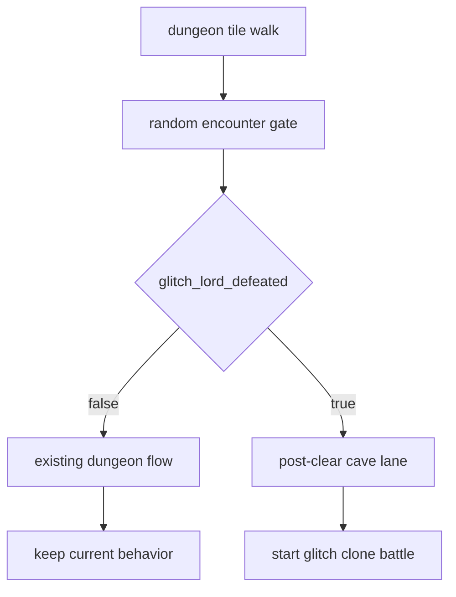
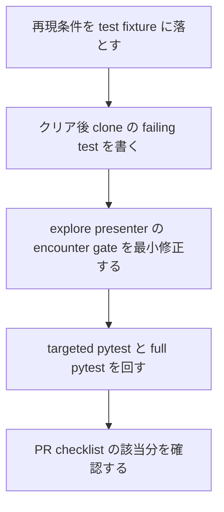

# 2026年5月25日 探索：魔王グリッチ撃破後の洞窟にグリッチクローンが出現しない不具合を直す

> 状態：⑨ Closing
> 次のゲート：なし

---

## 1) Journey（どこへ行くか）

> 補足：深層的目的 子どもが魔王グリッチ撃破後も洞窟に次の脅威が現れる流れを自然に体験できるようにする
> 補足：やらないこと 洞窟全体の作り直しやボス戦演出の改修までは広げない
> 補足：責務分担厳格度 basic

1. 前提条件
   1. 💦 `assets/enemies.yaml` に `まおうグリッチのクローン` が定義されている
   2. 💦 その敵は `post_clear_only: true` で通常 zone encounter から除外されている
   3. 💦 プレイヤーは魔王グリッチ撃破後も洞窟へ再訪できる
   4. 💦 洞窟内エンカウントは `src/scenes/explore/presenter.py` から起動される

2. Before
   1. 💦 魔王グリッチを倒したあと洞窟を歩いてもグリッチクローンが出ない
   2. 💦 `post_clear_only` データがあるのに子どもが実物として確認できない
   3. 💦 撃破後の洞窟が空振りになり物語の続きが切れる
   4. ❌ もどかしい

3. After
   1. 💦 魔王グリッチ撃破後の洞窟でグリッチクローンが出現する
   2. ✅ 撃破前の洞窟では従来どおりボス前導線だけが動く
   3. ✅ 通常 zone encounter と他エリアの敵構成は崩さない
   4. ❤️ 安心

4. 例外
   1. 撃破前 save ではグリッチクローンを出さない
   2. 旧 save でも `glitch_lord_defeated` の互換を壊さない
   3. 洞窟外の通常エンカウントへ `post_clear_only` を混ぜない

5. 境界条件
   1. 今回の主語は洞窟クリア後の encounter gate に絞る
   2. `.pyxres` や Code Maker 編集物は触らない
   3. 魔王グリッチ本戦の trigger や defeat 演出は変えない

6. 委任度
   1. 🟢 CC は save flag と encounter path の root cause 調査を単独で進められる
   2. 🟢 CCのみで可: failing test と最小修正で今回の不具合を固定できる
   3. 🟢 PRレビュー checklist の今回該当分まで CC が確認して進めてよい

---

## 2) ユーザーストーリーマップ

> まずは「どこで止まっているか」を洞窟クリア後の encounter lane に固定する。
> 委任度：🟢 主語・root cause 候補・検証順まで CC が固められる
> 残る曖昧さ：なし

### 事前確認

- [x] tasknote確認済み
- [x] skill・tool・MCP確認済み
  - [x] `manage-tasknotes`
  - [x] `systematic-debugging`
  - [x] `test-driven-development`
  - [x] `pyxel`
- [x] 永続的ドキュメント確認済み
  - [x] `AGENTS.md`
  - [x] `docs/framework-rule.md`
  - [x] `docs/product-requirements-battle.md`
  - [x] `docs/product-requirements-map.md`
  - [x] `llm-wiki/wiki/query/2026年5月24日 最新のPRレビュー（技術面のみ）チェックリスト（100項目）.md`
  - [x] `~/dotfiles/claude/.claude/skills/manage-tasknotes/TEMPLATE.md`
  - [x] `~/dotfiles/claude/.claude/skills/manage-tasknotes/RULES.md`

### 本体

#### 話題1：再現条件を洞窟クリア後に固定する

##### ユーザー：Block Quest のプレイヤー

1. 当初計画
   1. 👀 グリッチクローンのデータが `post_clear_only` であることを確認する
   2. 👀 魔王グリッチ撃破後に洞窟へ戻る lane だけを主語にする
   3. ✂️ 洞窟外の encounter や別イベントは今回の対象から外す

#### 話題2：root cause を encounter 早期 return に固定する

##### ユーザー：この repo の保守者（root cause 固定）

1. 当初計画
   1. 👀 `ZONE_ENEMIES` が `post_clear_only` を除外していることを確認する
   2. 👀 `src/scenes/explore/presenter.py::_check_random_encounter` を確認する
   3. 👀 `player.in_dungeon and player.glitch_lord_defeated` で早期 return している事実を固定する
   4. 🧭 現症状を「洞窟クリア後 lane が戦闘開始前に閉じている」と定義する

#### 話題3：TDD でクリア後の clone 出現を固定する

##### ユーザー：この repo の保守者（回帰防止）

1. 当初計画
   1. ✅ クリア後洞窟で clone 戦が開始される failing test を追加する
   2. ✅ 撃破前は clone が出ない非回帰を同じ test で固定する
   3. ✅ 他 zone の通常エンカウントを壊さない確認を残す

#### 話題4：PRレビュー checklist の該当項目を閉じる

##### ユーザー：差分レビュー担当

1. 当初計画
   1. 👀 SSoT と generated / `.pyxres` 非改変を守る
   2. 👀 no silent failure と migration safety の観点を確認する
   3. 👀 test / user-facing lane の項目を今回の修正で満たす

---

## 3) Gherkin（完了条件）

> 委任度：🟢 このまま failing test と最小修正まで進められる
> 残る曖昧さ：なし

### シナリオ一覧

- [ ] シナリオ1：魔王グリッチ撃破後の洞窟でグリッチクローンに遭遇できる

1. 🧱 プレイヤーが魔王グリッチを撃破済みで洞窟内を歩いている（explore）
2. 🎬 洞窟タイル上でエンカウント判定が通る（explore）
3. ✅ `まおうグリッチのクローン` との戦闘が開始される（battle）

```gherkin
Given プレイヤーが `glitch_lord_defeated = true` で洞窟内にいる
And グリッチクローンの敵データが `post_clear_only = true` で存在する
When 洞窟内でエンカウント判定が成功する
Then battle は `まおうグリッチのクローン` で開始される
And クリア後 lane は early return で捨てられない
```

- [ ] シナリオ2：魔王グリッチ撃破前の洞窟ではクローン戦に切り替わらない

1. 🧱 プレイヤーが未撃破で洞窟内にいる（explore）
2. 🎬 洞窟内イベントと通常導線が進む（explore）
3. ✅ クリア後専用のクローン戦は始まらない（explore）

```gherkin
Given プレイヤーが `glitch_lord_defeated = false` で洞窟内にいる
When 洞窟内の encounter / boss 導線を進める
Then クリア後専用のグリッチクローン戦は開始されない
And 魔王グリッチ本戦の既存導線は壊れない
```

- [ ] シナリオ3：洞窟外の通常 zone encounter は従来どおり動く

1. 🧱 プレイヤーが洞窟外の通常フィールドを歩いている（explore）
2. 🎬 通常エンカウント判定が通る（explore）
3. ✅ `post_clear_only` ではない zone 敵で戦闘が始まる（battle）

```gherkin
Given プレイヤーが洞窟外の通常 zone にいる
When 通常エンカウント判定が成功する
Then battle は `ZONE_ENEMIES` の通常敵で開始される
And `post_clear_only` の敵は通常 zone へ混ざらない
```

---

## 4) Design（どうやるか）

### 責務分担概要

- root cause は `src/scenes/explore/presenter.py::_check_random_encounter` が `player.in_dungeon and player.glitch_lord_defeated` で早期 return し、クリア後洞窟 lane を丸ごと捨てている点にある
- `post_clear_only` データは `src/game_data.py` に既にあるので、正本は追加せず encounter 選択だけを直す
- 修正は explore presenter の encounter gate に閉じ、View / save schema / `.pyxres` は触らない
- クリア後洞窟だけは clone 戦へ進み、通常 zone encounter は現状維持にする
- 先に failing test で root cause を固定し、その後最小修正で通す

### 責務分担概要図



### 責務分担詳細

- `src/scenes/explore/presenter.py` （✏️：クリア後洞窟 lane を early return で捨てず、clone 戦へ接続する）
- `src/game_data.py` （❌：`GLITCH_CLONE_DATA` と `ZONE_ENEMIES` の責務は現状維持）
- `src/shared/state/player_model.py` （❌：`glitch_lord_defeated` の state shape は変えない）
- `test/test_cjg_dungeon_post_boss_clone_spawn.py` （➕：クリア後 clone 出現、未撃破非回帰、通常 zone 非回帰を固定する）

### 関連スキル・MCP

- `manage-tasknotes`
- `systematic-debugging`
- `test-driven-development`
- `pytest`

### 【参照】

- Steering: `steering/2026年5月25日 探索：魔王グリッチ撃破後の洞窟にグリッチクローンが出現しない不具合を直す.md`
- Architecture: `docs/framework-rule.md`
- UXPolicy: `AGENTS.md`
- Runtime: `src/scenes/explore/presenter.py`

### 変更範囲

- やること: 洞窟クリア後の encounter gate を直してグリッチクローン戦を開始できるようにする
- やること: failing test と回帰 test でクリア後 lane を固定する
- やらないこと: 敵データ追加、`.pyxres` 編集、洞窟マップや会話演出の改修
- やらないこと: save schema 変更、通常 zone enemy balance の再調整

### 検証

- review checklist: `llm-wiki/wiki/query/2026年5月24日 最新のPRレビュー（技術面のみ）チェックリスト（100項目）.md`
- 検証コマンド: `python -m pytest test/test_cjg_dungeon_post_boss_clone_spawn.py -q`
- 検証コマンド: `python -m pytest test/ -q`
- 成功条件: クリア後洞窟で clone 戦が始まり、未撃破洞窟と通常 zone の挙動に回帰がない
- 成功条件: PRレビュー100項目の今回該当分で open 項目が 0 になる
- 未実施時の扱い: 未実施なら Closing に残し close しない

---

## 5) Tasklist



- [x] クリア後洞窟の最小 fixture を作る
- [x] clone 出現の failing test を追加する
- [x] `src/scenes/explore/presenter.py` の encounter gate を最小修正する
- [x] `python -m pytest test/test_cjg_dungeon_post_boss_clone_spawn.py -q` を通す
- [x] `python -m pytest test/ -q` を通す

---

## 6) 作業ログ

- `GLITCH_CLONE_DATA` は既に存在し、`post_clear_only` 敵として定義されている
- `ZONE_ENEMIES` は `post_clear_only` を通常 encounter から除外している
- `src/scenes/explore/presenter.py::_check_random_encounter` は `player.in_dungeon and player.glitch_lord_defeated` で早期 return している
- tasknote を起票し、主語を「洞窟クリア後 encounter lane の欠落」に固定した
- `test/test_cjg_dungeon_post_boss_clone_spawn.py` を追加し、初回実行で 1 fail / 2 pass を確認した
- `src/scenes/explore/presenter.py` を修正し、クリア後洞窟では `GLITCH_CLONE_DATA` を直接 battle へ渡すようにした
- `python -m pytest test/test_cjg_dungeon_post_boss_clone_spawn.py -q` は 3 passed になった
- `python -m pytest test/ -q` は 699 passed, 2 skipped, 38 deselected, 14233 subtests passed だった
- `make verify` は `81 files OK` / `CJ link OK` / `scene_to_cj map OK` で通過した

---

## 7) 評価と成果物

> 評価：🟢 クリア後洞窟の clone 出現を修正し、回帰 test と verify lane まで通せた

### 成果物

- `steering/2026年5月25日 探索：魔王グリッチ撃破後の洞窟にグリッチクローンが出現しない不具合を直す.md`
- `src/scenes/explore/presenter.py`
- `test/test_cjg_dungeon_post_boss_clone_spawn.py`
- `llm-wiki/wiki/query/2026年5月24日 最新のPRレビュー（技術面のみ）チェックリスト（100項目）.md` を今回の review checklist として固定

---

## 8) Discussion

- 今回の不具合は敵データ不足ではなく、runtime の encounter gate がクリア後洞窟 lane を閉じ、`GLITCH_CLONE_DATA` の呼び出し元が存在しなかったことが根因だった
- `post_clear_only` を `ZONE_ENEMIES` に混ぜる方向は SSoT を崩すので採らない
- PR checklist では主に 1, 5, 6, 9, 10 章の該当項目を確認対象にした
- checklist 51 / 57 は `test/test_cjg_dungeon_post_boss_clone_spawn.py` の追加で充足した
- checklist 52 / 60 は targeted pytest と full pytest 実行で充足した
- checklist 87 / 88 は `make verify` 実行で充足した
- checklist 99 / 100 は洞窟クリア後の user-facing lane を test で固定したことで今回該当分を充足した
- `.pyxres` 非改変、save schema 非変更、Presenter 局所修正の方針で scope を保つ

---

## 9) Closing

- 状態: done
- 次のゲート: なし
- close 条件:
  - [x] tasknote が起票されている
  - [x] review checklist の参照先が固定されている
  - [x] クリア後 clone 出現の failing test が追加されている
  - [x] 修正後の targeted pytest と full pytest が通っている
  - [x] PRレビュー100項目の今回該当分で open 項目が 0 になっている

---

## 10) 参考資料

- `AGENTS.md`
- `docs/framework-rule.md`
- `docs/product-requirements-battle.md`
- `docs/product-requirements-map.md`
- `src/game_data.py`
- `src/scenes/explore/presenter.py`
- `test/test_cjg_dungeon_post_boss_clone_spawn.py`
- `test/test_cjg_game_data_derived.py`
- `test/test_game_data.py`
- `llm-wiki/wiki/query/2026年5月24日 最新のPRレビュー（技術面のみ）チェックリスト（100項目）.md`
