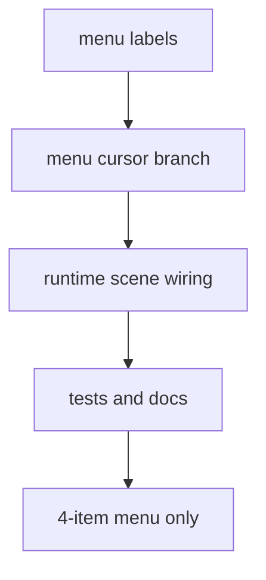
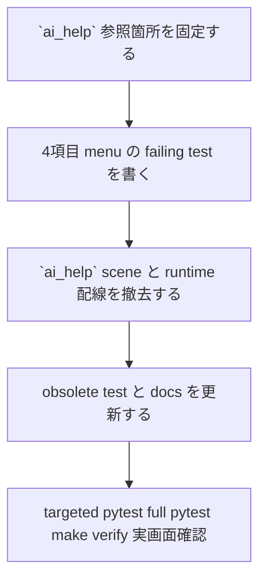

# 2026年5月26日 アプリ：main.pyダウンロード前提のAIでしゅうせいメニューを撤去する

> 状態：⑤ Tasklist
> 次のゲート：（CC）`AIでしゅうせい` 導線の削除テストと runtime 配線整理に着手する

---

## 1) Journey（どこへ行くか）

> 補足：深層的目的 子どもに今は使えない導線を見せず、古い案内で迷わせない
> 補足：やらないこと main.py ダウンロード導線の復旧や新しい AI 修正 UI の設計までは広げない
> 補足：責務分担厳格度 basic

1. 前提条件
   1. 💦 `menu/presenter.py` が `AIでしゅうせい` を表示する
   2. 💦 カーソル 3 で `game.ai_help_scene.enter()` を呼ぶ
   3. 💦 `ai_help/presenter.py` が `main.py` ダウンロード案内を出す
   4. 💦 `index.html` の import は code を取り込まない

2. Before
   1. 💦 `AIでしゅうせい` が今の配布物では完走できない
   2. 💦 `ai_help` scene が古い `main.py` 案内を出してしまう
   3. 💦 使えない入口が子ども向け menu を 1 枠使っている
   4. ❌ まぎらわしい

3. After
   1. 💦 メニューには今も有効な操作だけが残る
   2. ✅ `ai_help` scene / runtime 配線 / bootstrap 再エクスポートが一貫して整理される
   3. ✅ 関連テストと構造ドキュメントが `ai_help` 前提を引きずらない
   4. ❤️ すっきりする

4. 例外
   1. AI コーディング自体の価値は否定しない
   2. 今回撤去するのは古いゲーム内導線だけに絞る
   3. Code Maker の resource 編集 / zip 取り込み導線は維持する
   4. 将来の新しい AI 導線は別 tasknote で扱う

5. 境界条件
   1. 主語は menu 項目と `ai_help` scene の撤去に限る
   2. `.pyxres` や Code Maker resource の中身は触らない
   3. `main.py` ダウンロードを再び使えるように直す作業は今回やらない

6. 委任度
   1. 🟢 全体として削除対象は絞れており CC が自走できる
   2. 🟢 menu / runtime / test / docs の整合まで進めてよい
   3. 🟢 単純撤去に留める範囲は user 指示で確定している

---

## 2) ユーザーストーリーマップ

> まずは「古い導線を子どもに見せない」を主語に、削除単位を 1 本にそろえる。
> 委任度：🟢 参照箇所と削除順まで CC が固められる
> 残る曖昧さ：なし

### 事前確認

- [x] tasknote確認済み
- [x] skill・tool・MCP確認済み
  - [x] `using-superpowers`
  - [x] `manage-tasknotes`
  - [x] `manage-tasknotes-create`
  - [x] `manage-tasknotes-rules-core`
  - [x] `manage-tasknotes-rules-format`
  - [x] `pyxel`
  - [x] `mcp__pyxel__.pyxel_info`
- [x] 永続的ドキュメント確認済み
  - [x] `AGENTS.md`
  - [x] `docs/architecture.md`
  - [x] `docs/framework-rule.md`
  - [x] `docs/repository-structure.md`
  - [x] `docs/ux-policy.md`
  - [x] `docs/customer-journeys.md`

### 本体

#### 話題1：古い `AIでしゅうせい` 導線を runtime 主語で固定する

##### ユーザー：Block Quest の保守者

1. 当初計画
   1. 👀 `menu/presenter.py` のラベルとカーソル分岐を確認する
   2. 👀 `ai_help/presenter.py` の文言が `main.py` ダウンロード前提であることを固定する
   3. ✂️ 使えない導線を「直す」のではなく「見せない」に範囲を絞る

#### 話題2：scene 配線と bootstrap から `ai_help` を外す

##### ユーザー：この repo の保守者（回帰防止）

1. 当初計画
   1. 👀 `src/runtime/app.py` の scene 初期化と update/draw dispatcher を確認する
   2. 👀 `src/runtime/main_runtime.py` の再エクスポートを確認する
   3. ✅ `ai_help_scene` が無くても初期化 smoke が通る形へ縮める

#### 話題3：tests / docs を新しい構造へそろえる

##### ユーザー：差分レビュー担当

1. 当初計画
   1. ✅ メニュー項目数と close カーソル位置の回帰 test を固定する
   2. ✅ obsolete になった `ai_help` scene test と scene 一覧 docs を更新する
   3. ✅ full pytest と `make verify` で構造の取り残しを検出する

---

## 3) Gherkin（完了条件）

> 委任度：🟢 このまま削除テストと最小撤去まで進められる
> 残る曖昧さ：なし

### シナリオ一覧

- [ ] シナリオ1：メニューから `AIでしゅうせい` が消えている

1. 🧱 プレイヤーが冒険中にメニューを開いている（menu）
2. 🎬 メニュー項目を上から下まで見る（menu）
3. ✅ `ステータス / アイテム / そうび / とじる` だけが表示される（menu）

```gherkin
Given プレイヤーが通常のゲーム内メニューを開いている
When メニュー項目一覧を描画する
Then 表示項目に `AIでしゅうせい` は含まれない
And 最後の項目は `とじる` である
```

- [ ] シナリオ2：最後の項目を決定すると従来どおり map に戻る

1. 🧱 プレイヤーがメニューの最後の項目にカーソルを合わせている（menu）
2. 🎬 決定ボタンを押す（menu）
3. ✅ `ai_help` に入らず map へ戻る（map）

```gherkin
Given プレイヤーがメニューの最後の項目にカーソルを合わせている
When 決定ボタンを押す
Then game.state は `map` になる
And `ai_help` state への遷移は発生しない
```

- [ ] シナリオ3：runtime 初期化と構造ドキュメントに `ai_help` が残らない

1. 🧱 開発者が runtime と scene 一覧を確認している（コードベース）
2. 🎬 Game 初期化・docs・architecture tree を確認する（コードベース）
3. ✅ `ai_help_scene` 依存が残っていない（コードベース）

```gherkin
Given `ai_help` scene を撤去した差分がある
When Game 初期化 smoke と docs 検証を実行する
Then `ai_help_scene` を要求する test は残らない
And scene 一覧の正本 docs も `ai_help` を active scene として扱わない
```

---

## 4) Design（どうやるか）

### 責務分担概要

- root cause は `src/scenes/menu/presenter.py` が古い `ai_help` 導線をメニューに残し、`src/scenes/ai_help/presenter.py` が `main.py` ダウンロード前提の文言を出し続けている点にある
- runtime の正本は `src/scenes/menu/presenter.py` と `src/runtime/app.py` なので、修正はメニュー項目削除と scene 配線整理に閉じる
- `index.html` は現在の Code Maker import が code を取り込まない事実確認として参照し、今回は resource 導線を変更しない
- 先に menu 項目数と `ai_help` 非遷移の test を固定し、その後 scene / docs の取り残しを消す

### 責務分担概要図



### 責務分担詳細

- `src/scenes/menu/presenter.py` （✏️：4 項目メニューへ縮め、`ai_help` 分岐を撤去する）
- `src/runtime/app.py` （✏️：`AiHelpScene` 生成と `ai_help` update/draw dispatcher を外す）
- `src/runtime/main_runtime.py` （✏️：`AiHelpScene` の再エクスポートを外す）
- `src/scenes/ai_help/` （✏️：obsolete になった scene package を削除対象として整理する）
- `test/test_cjg_menu_navigation.py` （✏️：4 項目化と close 導線の回帰を固定する）
- `test/test_cjg_game_init_smoke.py` （✏️：`ai_help_scene` を期待しない初期化 smoke へ更新する）
- `test/test_cjg_ai_help_scene_behavior.py` （✏️：obsolete test を削除対象にする）
- `docs/repository-structure.md` （✏️：scene 数と `ai_help/` の説明を現行構造へそろえる）
- `docs/architecture_rules.yml` （✏️：active tree から `src/scenes/ai_help` を外す）

### 関連スキル・MCP

- `manage-tasknotes`
- `test-driven-development`
- `verification-before-completion`
- `pyxel`
- `mcp__pyxel__.validate_script`
- `mcp__pyxel__.run_and_capture`

### 【参照】

- Steering: `steering/2026年5月26日 アプリ：main.pyダウンロード前提のAIでしゅうせいメニューを撤去する.md`
- Architecture: `docs/architecture.md`
- FrameworkRule: `docs/framework-rule.md`
- RepositoryStructure: `docs/repository-structure.md`
- UXPolicy: `docs/ux-policy.md`
- CustomerJourneys: `docs/customer-journeys.md`
- Screenshot: `steering/2026年5月26日（ブロクエ）AIで修正は古い.png`
- Runtime facts: `src/scenes/menu/presenter.py`, `src/scenes/ai_help/presenter.py`, `src/runtime/app.py`, `index.html`

### 変更範囲

- やること: `AIでしゅうせい` メニュー項目と `ai_help` scene 配線を repo から撤去する
- やること: 4 項目メニューに合わせて menu test / init smoke / 構造 docs を更新する
- やらないこと: `main.py` ダウンロード導線を復旧する
- やらないこと: Code Maker resource import/export や `.pyxres` を変更する
- やらないこと: 新しい AI 修正 UI や外部リンク導線を追加する

### 検証

- 検証コマンド: `python -m pytest test/test_cjg_menu_navigation.py test/test_cjg_game_init_smoke.py -q`
- 検証コマンド: `python -m pytest test/ -q`
- 検証コマンド: `make verify`
- 検証コマンド: `python main.py`
- 検証コマンド: `mcp__pyxel__.validate_script` と `mcp__pyxel__.run_and_capture` で menu 画面差分を補助確認する
- 成功条件: メニューが 4 項目になり、`AIでしゅうせい` が表示も遷移もしない
- 成功条件: full pytest と `make verify` が通り、docs / runtime の `ai_help` 取り残しがない
- 成功条件: 実画面確認で `とじる` の導線が崩れていない
- 未実施時の扱い: どれか未実施なら `Closing` に残し close しない

---

## 5) Tasklist



- [ ] `menu/presenter.py` と `ai_help/presenter.py` の現症状を test 前提へ落とす
- [ ] 4 項目 menu と `ai_help` 非遷移の failing test を追加または更新する
- [ ] `src/runtime/app.py` / `src/runtime/main_runtime.py` / `src/scenes/ai_help/` を最小差分で整理する
- [ ] obsolete test と構造 docs を `ai_help` 非依存へ更新する
- [ ] `python -m pytest test/test_cjg_menu_navigation.py test/test_cjg_game_init_smoke.py -q` を通す
- [ ] `python -m pytest test/ -q` と `make verify` を通す
- [ ] `python main.py` で実画面のメニュー確認をする

### レビュー

- 原本 checklist: `docs/development-checklist.md`
- /tmp コピー: `/tmp/development-checklist-20260526-1307.md`
- レビュー結果: 未実施
- 未通過時の扱い: fail があれば修正して再レビューし、全部通るまで Close しない

---

## 6) 作業ログ

- user 依頼に基づき、新規開発 tasknote として本 note を起票した
- `mcp__pyxel__.pyxel_info` で pyxel MCP の stubs / examples / tool 利用前提を確認した
- `src/scenes/menu/presenter.py` に `AIでしゅうせい` ラベルと `game.ai_help_scene.enter()` 分岐が残っていることを確認した
- `src/scenes/ai_help/presenter.py` に `main.py` ダウンロードと Claude / ChatGPT への貼り付け案内が残っていることを確認した
- `index.html` の Code Maker import は `プログラムは とりこみません` を明示しており、旧導線との不整合を確認した

---

## 7) 評価と成果物

> 評価：🟡 tasknote 起票まで完了。実装は未着手

### 成果物

- `steering/2026年5月26日 アプリ：main.pyダウンロード前提のAIでしゅうせいメニューを撤去する.md`

---

## 8) Discussion

- 今回の主語は「AI コーディングをやめる」ではなく「今は成立しないゲーム内導線を見せない」に置く
- `ux-policy.md` の「いま選んでいる操作だけを見せる」と「古い card を見せるより card 自体を出さないほうが正直」を、runtime menu にも当てはめる
- `ai_help` を残したまま文言だけ弱める案もあるが、使えない導線が menu を 1 枠消費する問題は残るため今回は採らない
- 将来に有効な AI 修正導線を戻す場合は、Code Maker / build / import と整合した別 golden path を先に設計する

---

## 9) Closing

- 状態: open
- 次のゲート: （CC）`AIでしゅうせい` 導線の削除テストと runtime 配線整理に着手する
- close 条件:
  - [x] tasknote が起票されている
  - [ ] 4 項目 menu の回帰 test が固定されている
  - [ ] `ai_help` scene と runtime 配線が撤去されている
  - [ ] obsolete test と構造 docs が更新されている
  - [ ] targeted pytest / full pytest / `make verify` / 実画面確認が完了している

---

## 10) 参考資料

- `AGENTS.md`
- `docs/architecture.md`
- `docs/framework-rule.md`
- `docs/repository-structure.md`
- `docs/ux-policy.md`
- `docs/customer-journeys.md`
- `index.html`
- `src/scenes/menu/presenter.py`
- `src/scenes/ai_help/presenter.py`
- `src/runtime/app.py`
- `src/runtime/main_runtime.py`
- `test/test_cjg_menu_navigation.py`
- `test/test_cjg_game_init_smoke.py`
- `test/test_cjg_ai_help_scene_behavior.py`
- `steering/2026年5月26日（ブロクエ）AIで修正は古い.png`
