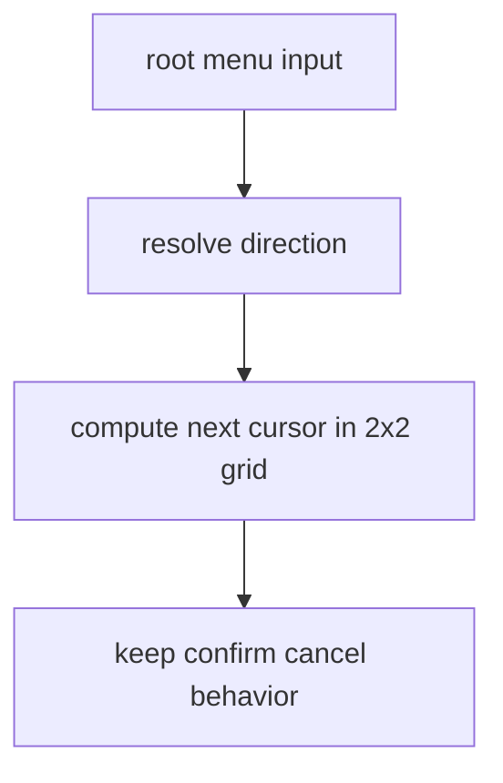
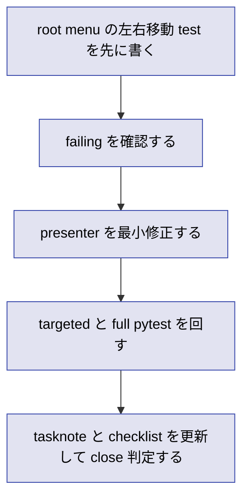

# 2026年5月26日 メニュー：先頭メニューを上下左右で選べるようにする

> 状態：⑤ Tasklist
> 次のゲート：（CC）root menu の左右移動を failing test で固定する

---

## 1) Journey（どこへ行くか）

> 補足：深層的目的 子どもが見た目どおり 2x2 の先頭メニューを直感的に動かせるようにする
> 補足：やらないこと items/equip/status sub の導線変更やレイアウト全面改修までは広げない
> 補足：責務分担厳格度 basic

1. 前提条件
   1. 💦 `menu` root には 4 項目がある
   2. 💦 項目は `ステータス / アイテム / そうび / とじる` である
   3. 💦 実画面では 4 項目が 2 列 2 行に見える
   4. 💦 現状の cursor 更新は上下だけで直列循環している
   5. 💦 添付 screenshot が要求の現物である

2. Before
   1. 💦 左右に並んで見える選択肢でも左右入力が効かない
   2. 💦 子どもは見た目の配置と入力結果が一致せず迷いやすい
   3. ❌ ちぐはぐ

3. After
   1. 💦 root menu で上下左右のどちらでも隣接項目へ移動できる
   2. ✅ 既存の決定とキャンセル挙動は壊れない
   3. ✅ sub menu の入力仕様は従来どおり保たれる
   4. ❤️ 直感的

4. 例外
   1. 英字 fallback でも 4 方向移動の規則は同じでよい
   2. root menu 以外の縦一覧 UI は今回変えない

5. 境界条件
   1. 主語は `src/scenes/menu/presenter.py` の root menu cursor 移動に限る
   2. View の見た目は現状維持を基本とする
   3. `map` へ戻る `cancel` と `confirm` 遷移先は変更しない

6. 委任度
   1. 🟢 全体として局所的な入力仕様修正である
   2. 🟢 CCのみで可: CC 単独で完了まで進められる
   3. 🟢 CCのみで可: 起票 実装 close merge 候補まで進めてよい
   4. 🔴 人の判断: 実画面レイアウト変更は別 task に分ける

---

## 2) ユーザーストーリーマップ

> 委任度：🟢 対象 scene と完了条件は固定できている
> 残る曖昧さ：なし

### 事前確認

- [x] tasknote確認済み
- [x] skill・tool・MCP確認済み
  - [x] `manage-tasknotes`
  - [x] `using-git-worktrees`
  - [x] `test-driven-development`
  - [x] `verification-before-completion`
  - [x] `pyxel`
- [x] 永続的ドキュメント確認済み
  - [x] `AGENTS.md`
  - [x] `docs/architecture.md`
  - [x] `docs/framework-rule.md`
  - [x] `docs/ux-policy.md`

### 本体

#### 話題1：見た目が 2x2 の root menu に合わせて入力規則を揃える

##### ユーザー：Block Quest のプレイヤー

1. 当初計画
    1. 👀 現在の root cursor 更新が縦直列である事実を test で再現する
    2. ✏️ 左右入力を root menu 専用の隣接移動として追加する
    3. ✅ confirm/cancel と sub menu 挙動が壊れていないことを regression test で残す

---

## 3) Gherkin（完了条件）

> 委任度：🟢 このまま最後まで CC が進められる
> 残る曖昧さ：なし

### シナリオ一覧

- [ ] シナリオ1：root menu の左右入力が見た目どおり隣の列へ移動する

1. 🧱 プレイヤーが menu root を開いている（menu）
2. 🎬 右または左を押す（menu）
3. ✅ 同じ行の隣接項目へ cursor が移動する（menu）

```gherkin
Given プレイヤーが menu root を開いている
And 選択肢は 2 列 2 行で表示されている
When プレイヤーが右または左を 1 回押す
Then cursor は同じ行の隣接項目へ移動する
And cursor 移動時の SFX は従来どおり鳴る
```

- [ ] シナリオ2：上下入力と confirm/cancel の既存挙動は維持される

1. 🧱 プレイヤーが menu root を開いている（menu）
2. 🎬 上下または confirm/cancel を使う（menu）
3. ✅ 既存どおり循環移動または map/sub 遷移が行われる（menu）

```gherkin
Given プレイヤーが menu root を開いている
When プレイヤーが上下または confirm/cancel を使う
Then 既存の root menu 挙動は保たれる
And items equip status sub の入力仕様は変わらない
```

---

## 4) Design（どうやるか）

### 責務分担概要

- root cause は `menu` root の cursor 更新が 4 項目を 1 列リストとして扱っていること
- 正本は `src/scenes/menu/presenter.py` の root menu 入力解釈で、View は既存 2x2 表示を変えない
- 修正入口は `_handle_sub_main()` の cursor 更新と、その計算 helper に閉じる
- 先に `test/test_cjg_menu_navigation.py` で左右移動の regression を failing test として固定する

### 責務分担概要図



### 責務分担詳細

- `src/scenes/menu/presenter.py` （✏️：root menu 専用の 2x2 cursor 移動規則を追加する）
- `src/scenes/menu/view.py` （❌：描画レイアウトは現状維持にする）
- `test/test_cjg_menu_navigation.py` （➕：left/right の failing test と既存 regressions を保持する）

### 関連スキル・MCP

- `manage-tasknotes`
- `using-git-worktrees`
- `test-driven-development`
- `verification-before-completion`
- `pyxel`

### 【参照】

- Steering: `steering/2026年5月26日（ブロクエ）メニューを上下左右で選びたい.png`
- Architecture: `docs/architecture.md`
- UXPolicy: `docs/ux-policy.md`
- Runtime: `src/scenes/menu/presenter.py`
- Test: `test/test_cjg_menu_navigation.py`

### 変更範囲

- やること: root menu で上下左右入力に応じて 2x2 隣接移動を実装する
- やらないこと: sub menu 導線変更 レイアウト再描画 他 scene の menu 操作変更

### 検証

- 検証コマンド: `python -m pytest test/test_cjg_menu_navigation.py -q` と `python -m pytest test/ -q`
- 成功条件: menu 専用 test と full suite が green で、左右移動の新規 test が通る
- 未実施時の扱い: どちらか未実施なら close しない

---

## 5) Tasklist



- [ ] （CC）root menu の左右移動 test を追加する
- [ ] （CC）新規 test が失敗することを確認する
- [ ] （CC）`menu/presenter.py` を最小修正する
- [ ] （CC）targeted pytest と full pytest を回す
- [ ] （CC）Development Checklist を `/tmp` へコピーしてレビューする

### レビュー

- 原本 checklist: `docs/development-checklist.md`
- /tmp コピー: `/tmp/development-checklist-20260526-1458.md`
- レビュー結果:
- 未通過時の扱い: fail があれば修正して再レビューし、全部通るまで Close しない

---

## 6) 作業ログ

- `main` checkout は別件 `steering/` 差分で dirty だったため、新規 worktree へ隔離して着手した
- `.worktrees/20260526-menu-4way-nav` を `feat/20260526-menu-4way-nav` で作成した
- baseline として `python -m pytest test/ -q` を実行し、`711 passed, 2 skipped, 38 deselected` を確認した

---

## 7) 評価と成果物

> 評価：🟡 実装前

### 成果物

- 新規 tasknote

---

## 8) Discussion

- 左右移動の期待値は screenshot の 2x2 配置から直接導く
- root menu だけを対象に留め、sub menu の縦一覧規則へ影響を広げない

---

## 9) Closing

- 状態: 未完了
- 次のゲート: （CC）root menu の左右移動を failing test で固定する
- close 条件:
  - [ ] 左右移動の test が追加されている
  - [ ] targeted pytest と full pytest が通っている
  - [ ] checklist レビュー結果が埋まっている

---

## 10) 参考資料

- `steering/2026年5月26日（ブロクエ）メニューを上下左右で選びたい.png`
