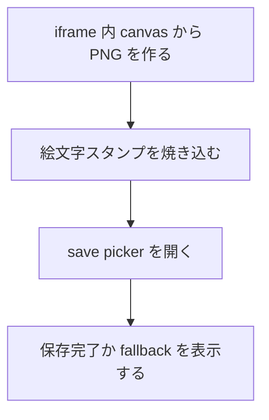
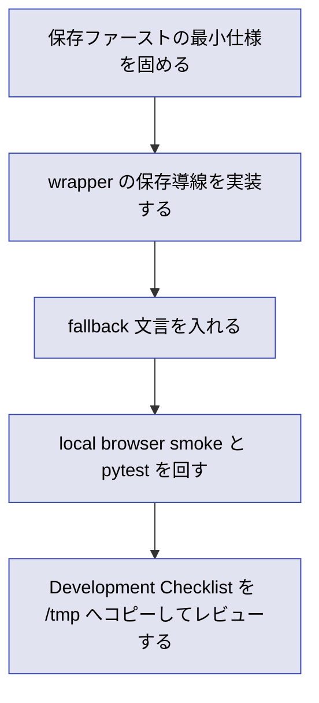

# 2026年5月26日 共有：Chromebook向けつっこみスクショを保存ファーストで始める

> 状態：① Journey
> 次のゲート：（CC）Chromebook 前提の保存ダイアログ導線を wrapper の最小仕様へ落とす

---

## 1) Journey（どこへ行くか）

> 補足：深層的目的 子どもが `撮る -> 保存する -> あとで見せる` を自分で把握できる導線をつくる
> 補足：やらないこと 今回は HP へのアップロードやコメント返却までは進めない
> 補足：責務分担厳格度 basic

1. 前提条件
   1. 💦 主な利用端末は Chromebook である
   2. 💦 つっこみスクショは絵文字スタンプ最大 50 個で始める
   3. 💦 `play.html -> iframe(pyxel.html)` の wrapper 構成は維持する
   4. 💦 既存調査で wrapper から PNG 化できる見込みは確認済みである

2. Before
   1. 💦 共有先が Chromebook では限定され、まずはローカル保存が現実的である
   2. 💦 自動 download だけだと保存場所が子どもに見えにくい
   3. ❌ 撮れたとしても、その後の行き先が分からず会話が止まりうる

3. After
   1. 💦 保存ファーストの導線が Chromebook 前提で定まる
   2. ✅ 主導線を `保存ダイアログあり` にするかどうかが決まる
   3. ✅ 非対応時の fallback と説明文が決まる
   4. ❤️ 子どもが `ここに保存した` を自分で言える

4. 例外
   1. File System Access API は secure context と user gesture が要る
   2. 端末や管理ポリシーにより file picker の挙動が変わることがある

5. 境界条件
   1. `Code Maker` を主役から外さない
   2. 第1段階では server upload を持たない
   3. capture と share を分け、まず save UX を成立させる

6. 委任度
   1. 🟢 全体として起票と初期設計までは CC が自走できる
   2. 🟢 CCのみで可: note 起票、初期 Gherkin、wrapper 起点の設計整理
   3. 🔴 人の判断: 保存後の見せ方や親の関与レベルは user 判断が要る

---

## 2) ユーザーストーリーマップ

> Gherkin の前に、今回の実装テーマをどの順番で固めるかだけをそろえる。
> 委任度：🟢 初手の進め方はこの順でそのまま進められる
> 残る曖昧さ：保存後の表示文言だけは実装中に微調整の余地がある

### 事前確認

- [ ] tasknote確認済み
- [ ] skill・tool・MCP確認済み
  - [ ] `manage-tasknotes`
  - [ ] `manage-tasknotes-create`
  - [ ] `manage-tasknotes-rules-core`
  - [ ] `manage-tasknotes-rules-format`
  - [ ] `brainstorming`
- [ ] 永続的ドキュメント確認済み
  - [ ] `AGENTS.md`
  - [ ] `docs/architecture.md`
  - [ ] `docs/framework-rule.md`
  - [ ] `docs/customer-jobs.md`
  - [ ] `docs/customer-journeys.md`
  - [ ] `templates/wrapper.html`
  - [ ] `steering/done/2026年5月26日 調査：つっこみスクショ機能の技術選定を進める.md`

### 本体

#### 話題1：保存導線を Chromebook 前提に絞る

##### ユーザー：子どもに保存場所を分かりやすくしたい担当者

1. 当初計画
   1. 👀 主導線を `showSaveFilePicker` と `download` で比較する
   2. ✂️ 最初の実装を `保存ファースト` に固定する
   3. 📝 子どもに伝わる保存後メッセージの要件を残す

#### 話題2：wrapper 側の最小責務を決める

##### ユーザー：Pyxel 本体を汚さずに始めたい担当者

1. 当初計画
   1. 👀 capture と stamp overlay と save UI を wrapper に寄せる
   2. ✂️ Pyxel 側は必要なら `postMessage` 通知だけに留める
   3. 📝 build 入口と smoke 手順を note に残す

#### 話題3：fallback と説明文を切り分ける

##### ユーザー：非対応時でも迷わせたくない担当者

1. 当初計画
   1. 👀 file picker 非対応時だけ download へ落とす
   2. 👀 保存先が見えにくい場合の補助文を決める
   3. 📝 子ども向け文言と親向け文言を混ぜない

---

## 3) Gherkin（完了条件）

> 委任度：🟢 この仕様線までなら CC が自走できる
> 残る曖昧さ：なし

### シナリオ一覧

- [ ] シナリオ1：保存ボタンから保存ダイアログを開ける

1. 🧱 子どもが wrapper 上のスクショ画面を見ている（play.html）
2. 🎬 `ほぞん` ボタンを押す（play.html）
3. ✅ 保存ダイアログが開き、保存先とファイル名を選べる（OS UI）

```gherkin
Given 子どもが Chromebook 上でつっこみスクショの保存画面を開いている
When 子どもが `ほぞん` ボタンを押す
Then 保存ダイアログが開く
And 子どもは保存先とファイル名を自分で選べる
```

- [ ] シナリオ2：保存後に結果がその場で分かる

1. 🧱 子どもが保存ダイアログで保存先を選んでいる（OS UI）
2. 🎬 保存を完了する（OS UI）
3. ✅ wrapper 上に保存完了メッセージが出る（play.html）

```gherkin
Given 子どもが保存ダイアログを開いている
When 子どもが保存先を選び PNG を保存する
Then wrapper 上に保存できたことを示すメッセージが出る
And 子どもは `ここに保存した` と把握できる
```

- [ ] シナリオ3：file picker が使えない環境でも保存を諦めない

1. 🧱 ブラウザが `showSaveFilePicker` を提供していない（play.html）
2. 🎬 子どもが `ほぞん` ボタンを押す（play.html）
3. ✅ download fallback と補助文で保存へ進める（play.html）

```gherkin
Given ブラウザが `showSaveFilePicker` を提供していない
When 子どもが `ほぞん` ボタンを押す
Then PNG は download fallback で保存できる
And どこを見ればよいかの補助文が表示される
```

---

## 4) Design（どうやるか）

### 責務分担概要

- root cause は `Chromebook での保存導線が未実装で、保存先の理解も設計されていない` である
- 正本は `docs/customer-jobs.md` `docs/customer-journeys.md` と wrapper 構成の実体に置く
- 修正入口は `templates/wrapper.html` とその生成元 `tools/render_release_selector.py` に閉じる
- 実装時は `capture -> annotate -> save` を wrapper で完結させ、Pyxel 側は必要最小限に留める

### 責務分担概要図



### 責務分担詳細

- `templates/wrapper.html` （✏️：保存ボタン、スタンプ overlay、save UI を持たせる）
- `tools/render_release_selector.py` （✏️：wrapper 生成に必要な placeholder を保つ）
- `dist/play.html` （❌：生成物のため直接編集しない）
- `src/runtime/app.py` （❌：第1段階では保存 UI を持たせない）

### 関連スキル・MCP

- `manage-tasknotes`
- `brainstorming`
- `playwright`

### 【参照】

- Steering: `steering/done/2026年5月26日 調査：つっこみスクショ機能の技術選定を進める.md`
- Architecture: `docs/architecture.md`
- UXPolicy: `docs/customer-jobs.md` / `docs/customer-journeys.md`

### 変更範囲

- やること: wrapper の保存導線、保存結果メッセージ、fallback 文言の実装
- やらないこと: server upload、コメント機能、Pyxel scene への大規模 UI 追加

### 検証

- 検証コマンド: `python -m pytest test/ -q` と local browser smoke を回す
- 成功条件: save picker 主導線と download fallback の両方が確認できる
- 未実施時の扱い: 実機未確認は未確認として残し、desktop smoke と分けて記録する

---

## 5) Tasklist



> 必ず上から順に実施。CCがCoVeで自力検証しながら進める。

- [ ] （CC）保存ファーストの最小仕様を固める
- [ ] （CC）wrapper の保存導線を実装する
- [ ] （CC）fallback 文言を入れる → **作業ログに事実を記録** → **Discussionに判断を記録**
- [ ] （CC）local browser smoke と `python -m pytest test/ -q` を回す
- [ ] （CC）Development Checklist を `/tmp` へコピーしてレビューする

### 記録の分け方

#### 作業ログ に書く

- 変更したファイルや差分
- 実行した確認コマンドと結果
- file picker / download fallback の成否

#### Discussion に書く

- なぜ保存ダイアログを主導線にしたか
- 非対応時の説明文をどう決めたか
- 次に共有や upload を足すなら何を守るか

### レビュー

- 原本 checklist: `docs/development-checklist.md`
- /tmp コピー: `/tmp/development-checklist-20260526-1825.md`
- レビュー結果: 未実施
- 未通過時の扱い: fail があれば修正して再レビューし、全部通るまで Close しない

---

## 6) 作業ログ

- 起票方針を決めた
  - Chromebook 前提では `保存ファースト` が最小実装と判断した
  - 自動 download より `保存ダイアログあり` を主導線に置く方針にした

---

## 7) 評価と成果物

> 評価：🟡 起票のみ完了

### 成果物

- `steering/2026年5月26日 共有：Chromebook向けつっこみスクショを保存ファーストで始める.md` （保存ファースト実装の起票）

---

## 8) Discussion

### 反省とルール化

- 記入先：manage-tasknotes
- 次にやること：保存ダイアログ主導線の最小仕様を固めて実装に進める

---

## 9) Closing

- 状態: open
- 次のゲート: （CC）Chromebook 前提の保存ダイアログ導線を wrapper の最小仕様へ落とす
- close 条件:
  - [ ] 保存主導線と fallback が実装される
  - [ ] local browser smoke と pytest の結果が記録される
  - [ ] Development Checklist のレビュー結果が残る

---

## 10) 参考資料

- Local: `docs/architecture.md`
- Local: `docs/framework-rule.md`
- Local: `docs/customer-jobs.md`
- Local: `docs/customer-journeys.md`
- Local: `templates/wrapper.html`
- Local: `steering/done/2026年5月26日 調査：つっこみスクショ機能の技術選定を進める.md`
