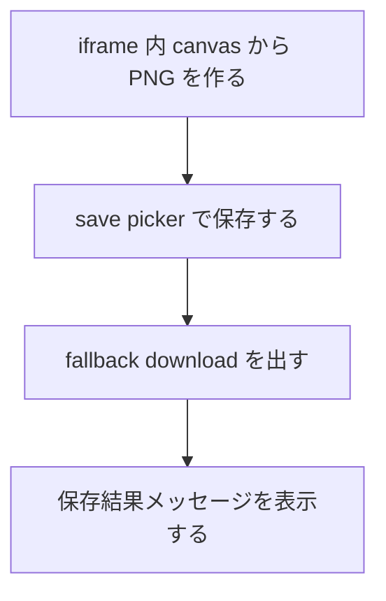
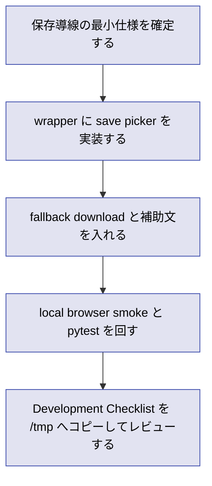

# 2026年5月26日 共有：Chromebook向けスクショ保存導線を実装する

> 状態：① Journey
> 次のゲート：（CC）`Chrome Canvas 型 + Show in folder` の最小仕様を wrapper 実装案へ落とす

---

## 1) Journey（どこへ行くか）

> 補足：深層的目的 子どもが `撮る -> 保存する -> 見つけ直す` を自分で扱えるようにする
> 補足：やらないこと 今回は絵文字スタンプの焼き込みや upload までは進めない
> 補足：責務分担厳格度 basic

1. 前提条件
   1. 💦 主な利用端末は Chromebook である
   2. 💦 保存導線は `Chrome Canvas 型 + Show in folder` を第1候補にする
   3. 💦 現行 Web 版は `play.html -> iframe(pyxel.html)` の wrapper 構成である
   4. 💦 既存調査 note に類似事例と trusted voices が整理済みである

2. Before
   1. 💦 スクショを保存する UI が wrapper にまだ存在しない
   2. 💦 保存先を見失わない導線も実装されていない
   3. ❌ 撮れたとしても `どこに入ったか` が分からず止まりうる

3. After
   1. 💦 `保存する` の最小導線が Chromebook 前提で動く
   2. ✅ save picker 主導線と download fallback が分かれる
   3. ✅ 保存完了後に `見つけ直す` 補助が出る
   4. ❤️ 子どもが `ここに保存した` と言える

4. 例外
   1. File System Access API は secure context と user gesture が要る
   2. 管理ポリシーや環境差で save picker が使えない場合がある

5. 境界条件
   1. `Code Maker` を主役から外さない
   2. 第1段階では server upload を持たない
   3. `capture` と `save` を wrapper で完結させる

6. 委任度
   1. 🟢 全体として最小実装と smoke までは CC が自走できる
   2. 🟢 CCのみで可: wrapper 実装、fallback、記録、検証
   3. 🔴 人の判断: 保存後メッセージの最終文言と親向け補助量

---

## 2) ユーザーストーリーマップ

> Gherkin の前に、保存導線の実装をどの順番で固めるかだけをそろえる。
> 委任度：🟢 この順でそのまま実装に入れる
> 残る曖昧さ：保存後メッセージの言い回しは実装時に微調整の余地がある

### 事前確認

- [ ] tasknote確認済み
- [ ] skill・tool・MCP確認済み
  - [ ] `manage-tasknotes`
  - [ ] `manage-tasknotes-create`
  - [ ] `brainstorming`
  - [ ] `playwright`
- [ ] 永続的ドキュメント確認済み
  - [ ] `AGENTS.md`
  - [ ] `docs/architecture.md`
  - [ ] `docs/framework-rule.md`
  - [ ] `docs/customer-jobs.md`
  - [ ] `docs/customer-journeys.md`
  - [ ] `templates/wrapper.html`
  - [ ] `steering/done/2026年5月26日 調査：Chromebook向けつっこみスクショの保存導線を比較する.md`

### 本体

#### 話題1：save picker 主導線を作る

##### ユーザー：保存場所を自分で選びたい子ども

1. 当初計画
   1. 👀 `showSaveFilePicker` の呼び出し条件を wrapper に閉じる
   2. ✂️ 保存ファイル名と初期フォルダを最小決定する
   3. 📝 保存成功時の結果表示を出す

#### 話題2：非対応時の fallback を出す

##### ユーザー：非対応環境でも保存を諦めたくない子ども

1. 当初計画
   1. 👀 file picker 非対応時だけ download へ落とす
   2. ✂️ `Downloads を見てね` 系の補助文を付ける
   3. 📝 主導線と fallback の分岐条件を残す

#### 話題3：保存後に見つけ直せるようにする

##### ユーザー：あとで親に見せたい子ども

1. 当初計画
   1. 👀 保存完了メッセージに `フォルダ` の手がかりを含める
   2. ✂️ Chromebook らしい再発見導線を 1 つに絞る
   3. 📝 次段で `Show in folder` 相当を足せる余地を残す

---

## 3) Gherkin（完了条件）

> 委任度：🟢 このまま最後まで CC が進められる
> 残る曖昧さ：なし

### シナリオ一覧

- [ ] シナリオ1：保存ボタンから save picker を開ける

1. 🧱 子どもが wrapper 上でスクショ保存画面を見ている（play.html）
2. 🎬 `ほぞん` ボタンを押す（play.html）
3. ✅ 保存ダイアログが開き、保存先とファイル名を選べる（OS UI）

```gherkin
Given 子どもが Chromebook 上でスクショ保存画面を開いている
When 子どもが `ほぞん` ボタンを押す
Then 保存ダイアログが開く
And 子どもは保存先とファイル名を自分で選べる
```

- [ ] シナリオ2：保存後に結果がその場で分かる

1. 🧱 子どもが保存ダイアログで保存先を選んでいる（OS UI）
2. 🎬 保存を完了する（OS UI）
3. ✅ wrapper 上に保存完了メッセージが出る（play.html）

```gherkin
Given 子どもが保存ダイアログを開いている
When 子どもが保存先を選び PNG を保存する
Then wrapper 上に保存できたことを示すメッセージが出る
And 子どもは保存先を見つけ直す手がかりを得られる
```

- [ ] シナリオ3：file picker 非対応時でも保存できる

1. 🧱 ブラウザが `showSaveFilePicker` を提供していない（play.html）
2. 🎬 子どもが `ほぞん` ボタンを押す（play.html）
3. ✅ download fallback と補助文で保存へ進める（play.html）

```gherkin
Given ブラウザが `showSaveFilePicker` を提供していない
When 子どもが `ほぞん` ボタンを押す
Then PNG は download fallback で保存できる
And `Downloads` を見ればよい補助文が表示される
```

---

## 4) Design（どうやるか）

### 責務分担概要

- root cause は `Chromebook 向けスクショ保存導線が wrapper に未実装` である
- 正本は `templates/wrapper.html` と保存導線調査 note に置く
- 修正入口は `templates/wrapper.html` と `tools/render_release_selector.py` に閉じる
- 保存対象 PNG は wrapper が iframe 内 canvas から生成し、Pyxel 側へ保存 UI を持ち込まない

### 責務分担概要図



### 責務分担詳細

- `templates/wrapper.html` （✏️：保存ボタン、save picker、fallback、結果表示）
- `tools/render_release_selector.py` （✏️：wrapper 生成面を維持する）
- `dist/play.html` （❌：生成物のため直接編集しない）
- `src/runtime/app.py` （❌：保存 UI を追加しない）

### 関連スキル・MCP

- `manage-tasknotes`
- `playwright`
- `brainstorming`

### 【参照】

- Steering: `steering/done/2026年5月26日 調査：Chromebook向けつっこみスクショの保存導線を比較する.md`
- Architecture: `docs/architecture.md`
- UXPolicy: `docs/customer-jobs.md` / `docs/customer-journeys.md`

### 変更範囲

- やること: save picker 主導線、download fallback、保存結果表示
- やらないこと: 絵文字スタンプ焼き込み、server upload、Pyxel scene UI 追加

### 検証

- 検証コマンド: `python -m pytest test/ -q` と local browser smoke
- 成功条件: save picker 主導線と fallback が desktop smoke で確認できる
- 未実施時の扱い: 実機未確認は未確認として記録し、desktop smoke と分ける

---

## 5) Tasklist



> 必ず上から順に実施。CCがCoVeで自力検証しながら進める。

- [ ] （CC）保存導線の最小仕様を確定する
- [ ] （CC）wrapper に save picker を実装する
- [ ] （CC）fallback download と補助文を入れる → **作業ログに事実を記録** → **Discussionに判断を記録**
- [ ] （CC）local browser smoke と `python -m pytest test/ -q` を回す
- [ ] （CC）Development Checklist を `/tmp` へコピーしてレビューする

### 記録の分け方

#### 作業ログ に書く

- 変更したファイルや差分
- 実行した確認コマンドと結果
- save picker / fallback の成否

#### Discussion に書く

- なぜその保存後導線を選んだか
- 文言をどう決めたか
- 次のスタンプ tasknote に何を渡すか

### レビュー

- 原本 checklist: `docs/development-checklist.md`
- /tmp コピー: `/tmp/development-checklist-20260526-1904.md`
- レビュー結果: 未実施
- 未通過時の扱い: fail があれば修正して再レビューし、全部通るまで Close しない

---

## 6) 作業ログ

- 起票した
  - 保存導線だけを先行タスクとして切り出した
  - 絵文字スタンプ焼き込みは別 tasknote へ分離した

---

## 7) 評価と成果物

> 評価：🟡 起票のみ完了

### 成果物

- `steering/2026年5月26日 共有：Chromebook向けスクショ保存導線を実装する.md` （保存導線タスク）

---

## 8) Discussion

### 反省とルール化

- 記入先：manage-tasknotes
- 次にやること：save picker 主導線の最小仕様を決める
- 関連tasknote: `steering/2026年5月26日 共有：つっこみスクショに絵文字スタンプ書き出しを加える.md`

---

## 9) Closing

- 状態: open
- 次のゲート: （CC）`Chrome Canvas 型 + Show in folder` の最小仕様を wrapper 実装案へ落とす
- close 条件:
  - [ ] save picker 主導線と fallback が実装される
  - [ ] smoke と pytest の結果が残る
  - [ ] 次のスタンプ tasknote へ渡す条件が整理される

---

## 10) 参考資料

- Local: `docs/architecture.md`
- Local: `docs/framework-rule.md`
- Local: `docs/customer-jobs.md`
- Local: `docs/customer-journeys.md`
- Local: `templates/wrapper.html`
- Local: `steering/done/2026年5月26日 調査：Chromebook向けつっこみスクショの保存導線を比較する.md`
