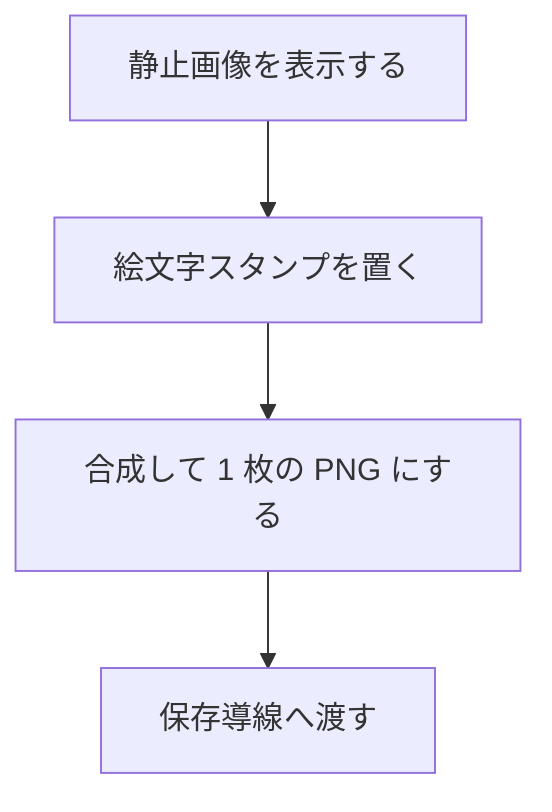
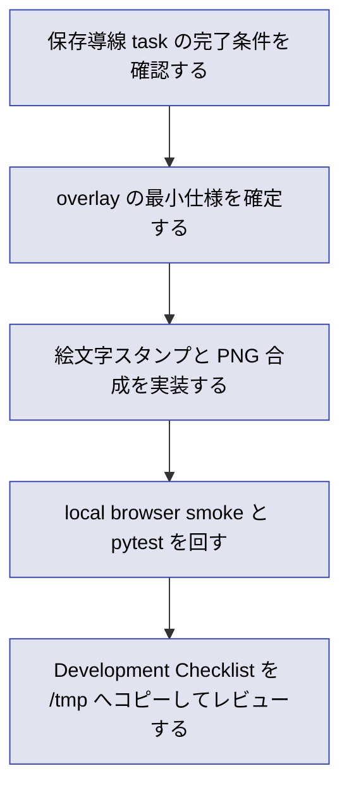

# 2026年5月26日 共有：つっこみスクショに絵文字スタンプ書き出しを加える

> 状態：① Journey
> 次のゲート：（CC）保存導線 tasknote の主導線が固まったら、絵文字スタンプ 50 個の最小仕様を切る

---

## 1) Journey（どこへ行くか）

> 補足：深層的目的 子どもが `ここすき / ここへん / ここむずい` を残してから保存できるようにする
> 補足：やらないこと 今回は save picker や upload 機能の実装までは含めない
> 補足：責務分担厳格度 basic

1. 前提条件
   1. 💦 つっこみスクショは絵文字スタンプ最大 50 個で始める
   2. 💦 スタンプは wrapper 側の静止画像オーバーレイで扱う
   3. 💦 保存導線 tasknote が先に `保存できる` を作る
   4. 💦 PNG 化の成立条件は既存調査 note で確認済みである

2. Before
   1. 💦 いまはスクショに `つっこみ` を重ねて残せない
   2. 💦 子どもの批評を保存物へ直接写し込めない
   3. ❌ `撮っただけ` で終わりやすい

3. After
   1. 💦 絵文字スタンプを最大 50 個まで置ける
   2. ✅ スタンプ付きの見た目を PNG へ焼き込める
   3. ✅ 保存導線へ自然につなげられる
   4. ❤️ 子どもの判断が保存物に残る

4. 例外
   1. スタンプ数や再描画方法しだいでパフォーマンス差が出る
   2. 位置調整 UI はタッチ前提で微調整が要る

5. 境界条件
   1. `Code Maker` を主役から外さない
   2. スタンプは第1段階では絵文字のみで始める
   3. 保存導線そのものは先行 tasknote の責務に残す

6. 委任度
   1. 🟡 全体として先行 task の結果を見てから着手するのが安全である
   2. 🟢 CCのみで可: 保存導線が固まった後の overlay 実装と書き出し
   3. 🔴 人の判断: スタンプ種別と見た目の最終調整

---

## 2) ユーザーストーリーマップ

> Gherkin の前に、絵文字スタンプ書き出しの仕事をどの順番で進めるかだけをそろえる。
> 委任度：🟡 保存導線 task の結果待ちがある
> 残る曖昧さ：保存導線 task の UI 配置しだいで操作導線が少し変わる

### 事前確認

- [ ] tasknote確認済み
- [ ] skill・tool・MCP確認済み
  - [ ] `manage-tasknotes`
  - [ ] `manage-tasknotes-create`
  - [ ] `brainstorming`
  - [ ] `playwright`
- [ ] 永続的ドキュメント確認済み
  - [ ] `AGENTS.md`
  - [ ] `docs/architecture.md`
  - [ ] `docs/framework-rule.md`
  - [ ] `docs/customer-jobs.md`
  - [ ] `docs/customer-journeys.md`
  - [ ] `templates/wrapper.html`
  - [ ] `steering/done/2026年5月26日 調査：つっこみスクショ機能の技術選定を進める.md`
  - [ ] `steering/2026年5月26日 共有：Chromebook向けスクショ保存導線を実装する.md`

### 本体

#### 話題1：絵文字スタンプ overlay を作る

##### ユーザー：気になった場所にすぐ印を付けたい子ども

1. 当初計画
   1. 👀 静止画像の上へスタンプを置く overlay を作る
   2. ✂️ 絵文字種別と上限 50 個の制約を入れる
   3. 📝 置いたスタンプを見た目で確認できるようにする

#### 話題2：PNG へ焼き込む

##### ユーザー：つっこみごと保存したい子ども

1. 当初計画
   1. 👀 オーバーレイ込みの最終見た目を offscreen へ合成する
   2. ✂️ save 導線へ渡す blob か data を 1 本にそろえる
   3. 📝 保存導線 tasknote へ受け渡し条件を残す

#### 話題3：子ども向けの操作量を抑える

##### ユーザー：複雑な編集はしたくない子ども

1. 当初計画
   1. 👀 最初は `置く` を優先し、細かい編集は後回しにする
   2. ✂️ `削除` `全消し` の最小導線だけを考える
   3. 📝 保存前に迷わない UI を目指す

---

## 3) Gherkin（完了条件）

> 委任度：🟢 保存導線 task 完了後ならこのまま CC が進められる
> 残る曖昧さ：なし

### シナリオ一覧

- [ ] シナリオ1：絵文字スタンプを最大 50 個まで置ける

1. 🧱 子どもがスクショ静止画像を見ている（play.html）
2. 🎬 絵文字スタンプを選んで画面上へ置く（play.html）
3. ✅ スタンプが見た目に反映され、50 個を超えない（play.html）

```gherkin
Given 子どもがスクショ静止画像を見ている
When 子どもが絵文字スタンプを選んで画面上へ置く
Then スタンプが見た目に反映される
And スタンプ数は 50 個を超えない
```

- [ ] シナリオ2：スタンプ込みの見た目を PNG へ焼き込める

1. 🧱 子どもがスタンプを置き終えている（play.html）
2. 🎬 保存へ進む（play.html）
3. ✅ 最終 PNG にスタンプが焼き込まれている（export）

```gherkin
Given 子どもがスタンプを置き終えている
When 保存へ進む
Then 最終 PNG にスタンプが焼き込まれている
And 保存導線 task へ渡す画像は 1 枚にまとまっている
```

- [ ] シナリオ3：保存前のやり直しが最小限できる

1. 🧱 子どもがスタンプを置いている（play.html）
2. 🎬 直前の選択をやり直す（play.html）
3. ✅ 保存前に最小限の修正ができる（play.html）

```gherkin
Given 子どもがスタンプを置いている
When 子どもが保存前に最小限のやり直しをする
Then スタンプ配置を必要最小限だけ修正できる
And 保存導線へ進む前に迷い過ぎない
```

---

## 4) Design（どうやるか）

### 責務分担概要

- root cause は `スクショへ子どもの批評を重ねて保存する overlay が未実装` である
- 正本は wrapper 上の静止画像とスタンプ状態に置く
- 修正入口は `templates/wrapper.html` と、その保存導線 task で整う capture/save 面に閉じる
- 合成は wrapper 側で行い、Pyxel 側にスタンプ UI を持ち込まない

### 責務分担概要図



### 責務分担詳細

- `templates/wrapper.html` （✏️：スタンプ palette、overlay、最終合成）
- `tools/render_release_selector.py` （✏️：wrapper 生成面を維持する）
- `steering/2026年5月26日 共有：Chromebook向けスクショ保存導線を実装する.md` （👀：保存導線の受け渡し先）
- `src/runtime/app.py` （❌：スタンプ UI を追加しない）

### 関連スキル・MCP

- `manage-tasknotes`
- `playwright`
- `brainstorming`

### 【参照】

- Steering: `steering/done/2026年5月26日 調査：つっこみスクショ機能の技術選定を進める.md`
- Steering: `steering/2026年5月26日 共有：Chromebook向けスクショ保存導線を実装する.md`
- Architecture: `docs/architecture.md`
- UXPolicy: `docs/customer-jobs.md` / `docs/customer-journeys.md`

### 変更範囲

- やること: 絵文字スタンプ overlay、50 個上限、PNG への焼き込み
- やらないこと: save picker 実装、server upload、Pyxel scene UI 追加

### 検証

- 検証コマンド: `python -m pytest test/ -q` と local browser smoke
- 成功条件: スタンプ overlay と最終 PNG 合成が smoke で確認できる
- 未実施時の扱い: 先行 task 未完了なら `later` のままにし、close しない

---

## 5) Tasklist



> 必ず上から順に実施。CCがCoVeで自力検証しながら進める。

- [ ] （CC）保存導線 task の完了条件を確認する
- [ ] （CC）overlay の最小仕様を確定する
- [ ] （CC）絵文字スタンプと PNG 合成を実装する → **作業ログに事実を記録** → **Discussionに判断を記録**
- [ ] （CC）local browser smoke と `python -m pytest test/ -q` を回す
- [ ] （CC）Development Checklist を `/tmp` へコピーしてレビューする

### 記録の分け方

#### 作業ログ に書く

- 変更したファイルや差分
- 実行した確認コマンドと結果
- スタンプ数上限と合成結果

#### Discussion に書く

- なぜその操作量にしたか
- 50 個上限の妥当性
- 次に共有や upload へ進める条件

### レビュー

- 原本 checklist: `docs/development-checklist.md`
- /tmp コピー: `/tmp/development-checklist-20260526-1904-stamp.md`
- レビュー結果: 未実施
- 未通過時の扱い: fail があれば修正して再レビューし、全部通るまで Close しない

---

## 6) 作業ログ

- 起票した
  - 絵文字スタンプ焼き込みを保存導線 tasknote から切り離した
  - 先行 task 完了後に着手する follow-on として置いた

---

## 7) 評価と成果物

> 評価：🟡 起票のみ完了

### 成果物

- `steering/2026年5月26日 共有：つっこみスクショに絵文字スタンプ書き出しを加える.md` （スタンプ書き出しタスク）

---

## 8) Discussion

### 反省とルール化

- 記入先：manage-tasknotes
- 次にやること：保存導線 task の主導線確定を待つ
- 関連tasknote: `steering/2026年5月26日 共有：Chromebook向けスクショ保存導線を実装する.md`

---

## 9) Closing

- 状態: later
- 次のゲート: （CC）保存導線 tasknote の主導線が固まったら、絵文字スタンプ 50 個の最小仕様を切る
- close 条件:
  - [ ] 絵文字スタンプ 50 個上限が実装される
  - [ ] PNG 合成と smoke の結果が残る
  - [ ] 保存導線 task との受け渡し条件が整理される

---

## 10) 参考資料

- Local: `docs/architecture.md`
- Local: `docs/framework-rule.md`
- Local: `docs/customer-jobs.md`
- Local: `docs/customer-journeys.md`
- Local: `templates/wrapper.html`
- Local: `steering/done/2026年5月26日 調査：つっこみスクショ機能の技術選定を進める.md`
- Local: `steering/2026年5月26日 共有：Chromebook向けスクショ保存導線を実装する.md`
