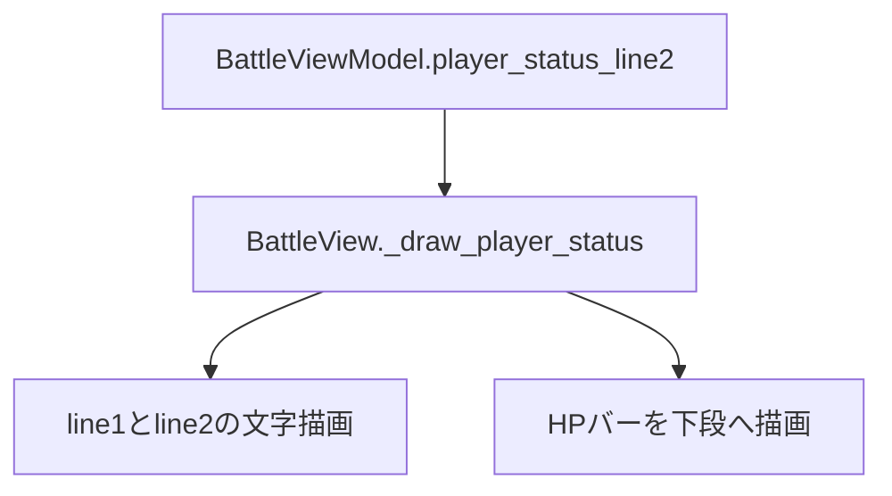
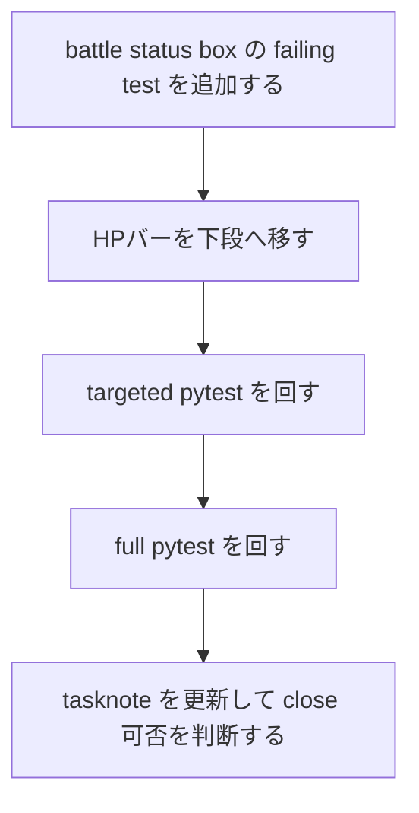

# 2026年5月26日 戦闘：HPバーがはみ出す不具合を直す

> 状態：⑤ Tasklist
> 次のゲート：（CC）battle player status の bar を line2 と分離する failing test を先に書く

---

## 1) Journey（どこへ行くか）

> 補足：深層的目的 子どもが battle 中の HP/MP を最後まで自然に読めるようにする
> 補足：やらないこと battle ルール変更や別 scene の status bar 改修までは広げない
> 補足：責務分担厳格度 basic

1. 前提条件
   1. 💦 battle の player status 枠で MP 表示が HP バーに隠れている
   2. 💦 `player_status_line2` は `HP a/b  MP c/d` の 1 行文字列で渡る
   3. 💦 `_draw_player_status` が line2 と HP バーを同じ高さに描いている

2. Before
   1. 💦 HP/MP 数値の右端がバーに隠れ、子どもが読み切れない
   2. 💦 現物を見ずに直すと shared HUD を誤って触りやすい
   3. ❌ もやもやする

3. After
   1. 💦 battle の player status 枠で HP/MP 数値が最後まで読める
   2. ✅ HP バーは同じ枠内で line2 と別の段へ移る
   3. ✅ Presenter / Model を触らず View の最小変更で直る
   4. ❤️ 安心

4. 例外
   1. 英字 UI や極端に長い将来文言への全面再設計は今回の範囲外
   2. 上部 enemy HP バーや下部 command panel のレイアウト調整は今回の主語ではない

5. 境界条件
   1. 今回の主語は battle の player status box に限定する
   2. `BattleViewModel` の public shape は増やさず、既存 2 行テキストは保つ
   3. 変更は `src/scenes/battle/view.py` と regression test に閉じる

6. 委任度
   1. 🟢 全体として battle View の局所修正は CC が完走できる
   2. 🟢 CCのみで可: 現物確認から test・修正・検証まで自律で進めてよい
   3. 🔴 人の判断: battle 枠サイズを変える大改修は今回の依頼外

---

## 2) ユーザーストーリーマップ

> 委任度：🟢 battle status box の regression fix として範囲を固定できている
> 残る曖昧さ：なし

### 事前確認

- [x] tasknote確認済み
- [x] skill・tool・MCP確認済み
  - [x] `manage-tasknotes`
  - [x] `using-git-worktrees`
  - [x] `systematic-debugging`
  - [x] `test-driven-development`
  - [x] `pyxel`
- [x] 永続的ドキュメント確認済み
  - [x] `AGENTS.md`
  - [x] `README.md`
  - [x] `docs/architecture.md`
  - [x] `docs/framework-rule.md`
  - [x] `docs/ux-policy.md`
  - [x] `~/dotfiles/claude/.claude/skills/manage-tasknotes/TEMPLATE.md`

### 本体

#### 話題1：修正先を battle 専用 status box に固定する

##### ユーザー：Block Quest のプレイヤー

1. 当初計画
    1. 👀 screenshot を見て、shared top HUD ではなく battle 枠の line2 と bar の衝突だと確定する
    2. 👀 `src/shared/ui/status_bar.py` ではなく `src/scenes/battle/view.py` が主語だと確認する
    3. ✂️ battle 専用レイアウトだけに修正範囲を絞る

#### 話題2：root cause を View の Y 座標衝突に固定する

##### ユーザー：この repo の保守者

1. 当初計画
    1. 👀 `player_status_line2` の描画 Y が 116 であることを確認する
    2. 👀 HP バー背景 / 残量の描画 Y も 116 であることを確認する
    3. 🧭 Presenter の文言ではなく View の配置衝突が根因だと固定する

#### 話題3：TDD で新レイアウトを固定する

##### ユーザー：この repo の保守者（回帰防止）

1. 当初計画
    1. 🧪 player status line2 と HP バーが別の段に分かれる期待を failing test に落とす
    2. ✅ line1 / line2 の文字描画位置は維持する
    3. ✅ targeted pytest と full pytest を通して close 可否を判断する

---

## 3) Gherkin（完了条件）

> 委任度：🟢 このまま最後まで CC が進められる
> 残る曖昧さ：なし

### シナリオ一覧

- [ ] シナリオ1：battle の player status 数値と HP バーが重ならない

1. 🧱 プレイヤーが battle の player status box を見ている（battle）
2. 🎬 battle view が player status box を描画する（battle）
3. ✅ HP/MP 数値の行と HP バーが別の段に描画され、同じ Y 座標帯を使わない（battle）

```gherkin
Given battle の player status box に "HP 112/120  MP 46/48" の line2 が入っている
When battle view が player status box を描画する
Then line2 の文字列は従来どおり 2 行目へ描画される
And HP バーは line2 より下の段に描画される
And HP バー背景と残量バーはどちらも status box の内側に収まる
```

- [ ] シナリオ2：battle の他の status text 位置は維持される

1. 🧱 プレイヤーが従来どおりの battle status 情報を見ている（battle）
2. 🎬 battle view が player status box を描画する（battle）
3. ✅ line1 / line2 のテキスト位置は変わらず、bar だけが安全な位置へ移る（battle）

```gherkin
Given battle の player status box に line1 と line2 が入っている
When battle view が player status box を描画する
Then line1 は x=16 y=104 に描画される
And line2 は x=16 y=116 に描画される
And HP バーだけが line2 と重ならない位置へ描画される
```

---

## 4) Design（どうやるか）

### 責務分担概要

- root cause は `src/scenes/battle/view.py` の `_draw_player_status` が `player_status_line2` と HP バーを同じ Y=116 帯で描画していること
- 正本の battle status layout は `BattleView` 側にあり、Presenter / ViewModel は既存の解釈済み文字列と比率を渡すだけに留める
- 修正の入口は `BattleView._draw_player_status` に閉じ、レイアウト定数をそこで整理する
- 先に failing test で「line2 は据え置き、HP バーだけ下段へ移動」を固定する

### 責務分担概要図



### 責務分担詳細

- `src/scenes/battle/view.py` （✏️：player status box 内の HP バー Y 座標を line2 と分離する）
- `src/scenes/battle/presenter.py` （❌：文言内容や HP 比率計算には触らない）
- `src/scenes/battle/view_model.py` （❌：public fields は増やさない）
- `test/test_cjg_battle_player_status_bar_layout.py` （➕：line2 と HP バーの非重複を固定する）

### 関連スキル・MCP

- `manage-tasknotes`
- `using-git-worktrees`
- `systematic-debugging`
- `test-driven-development`

### 【参照】

- Steering: `steering/2026年5月24日 戦闘：魔法選択でカーソルが画面外へ出る不具合を直す.md`
- Architecture: `docs/architecture.md`
- FrameworkRule: `docs/framework-rule.md`
- UXPolicy: `docs/ux-policy.md`

### 変更範囲

- やること: battle の player status box 内で HP バーと line2 を分離する
- やること: regression test を追加して line2 位置維持と bar 下段化を固定する
- やらないこと: Presenter の文言変更
- やらないこと: shared top status bar や別 scene の UI 改修

### 検証

- 検証コマンド: `python -m pytest test/test_cjg_battle_player_status_bar_layout.py -q`
- 検証コマンド: `python -m pytest test/test_cjg_battle_message_wrap.py test/test_cjg_battle_spell_select_window.py test/test_cjg_battle_player_status_bar_layout.py -q`
- 検証コマンド: `python -m pytest test/ -q`
- 成功条件: player status line2 の位置は維持され、HP バーが line2 と別の段に描画される
- 成功条件: targeted pytest と full pytest が通る
- 未実施時の扱い: いずれか未実施なら Closing へ進めない

---

## 5) Tasklist



- [ ] （CC）battle status box の failing test を追加する
- [ ] （CC）`_draw_player_status` の最小修正を入れる → 作業ログに事実を書く → Discussion に判断を書く
- [ ] （CC）`python -m pytest test/test_cjg_battle_player_status_bar_layout.py -q` を通す
- [ ] （CC）targeted battle pytest を通す
- [ ] （CC）`python -m pytest test/ -q` を通す

### レビュー

- 原本 checklist: `docs/development-checklist.md`
- /tmp コピー: `/tmp/development-checklist-20260526-1415.md`
- レビュー結果: pending
- 未通過時の扱い: fail があれば修正して再レビューし、全部通るまで Close しない

---

## 6) 作業ログ

- ユーザー提供 screenshot を確認し、shared top HUD ではなく battle の player status box が主語だと固定した
- `src/shared/ui/status_bar.py` ではなく `src/scenes/battle/view.py::_draw_player_status` が relevant だと確認した
- `player_status_line2` と HP バー背景 / 残量バーの描画 Y がどちらも 116 であることを確認した
- `.worktrees/20260526-battle-hp-bar-overflow` を作成し、branch `20260526-battle-hp-bar-overflow` で作業を開始した
- baseline として `python -m pytest test/test_cjg_battle_message_wrap.py test/test_cjg_battle_spell_select_window.py -q` を実行し、5 passed を確認した

---

## 7) 評価と成果物

> 評価：🟡 調査と tasknote 起票は完了、実装は未着手

### 成果物

- `steering/2026年5月26日 戦闘：HPバーがはみ出す不具合を直す.md`

---

## 8) Discussion

- shared top status bar を先に疑ったが、現物 screenshot を見ると battle 専用枠の問題だったので、修正先を `shared/ui/status_bar.py` に広げない方が安全
- 文字列を短くする案より、View 内で HP バーを下段へ移す方が child-facing 可読性を保ちつつ Presenter の責務も増やさない

### 反省とルール化

- 記入先：observe-situation / manage-tasknotes / CLAUDE.md
- 次にやること：battle レイアウト系の報告は screenshot から scene を先に確定してから search を始める

---

## 9) Closing

- 状態: in-progress
- 次のゲート: failing test を通じて bar 下段化を確定する
- close 条件: targeted pytest と full pytest が通り、note の review が pass になる

---

## 10) 参考資料

- `src/scenes/battle/view.py`
- `test/test_cjg_battle_message_wrap.py`
- `test/test_cjg_battle_spell_select_window.py`
