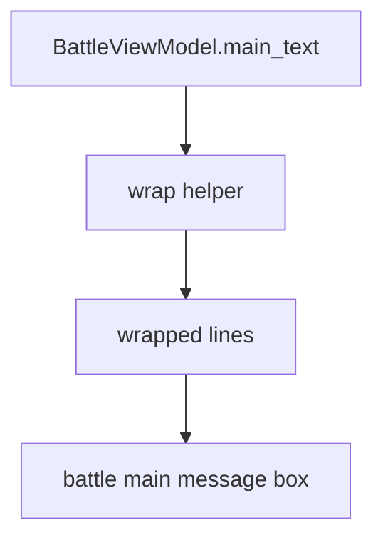
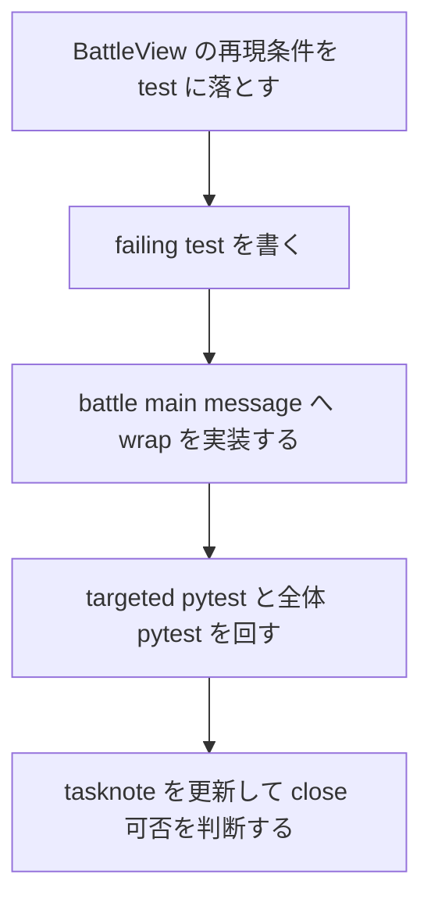

# 2026年5月26日 戦闘：結果メッセージが枠からはみ出す不具合を直す

> 状態：④ Design
> 次のゲート：（CC）戦闘の結果メッセージを failing test で固定する

---

## 1) Journey（どこへ行くか）

> 補足：深層的目的 子どもが戦闘結果を途中で欠けずに自然に読めるようにする
> 補足：やらないこと 戦闘画面全体のレイアウト変更や別UIの同時改修までは広げない
> 補足：責務分担厳格度 basic

1. 前提条件
   1. 💦 戦闘の上側メッセージ枠は固定幅で描画されている
   2. 💦 勝利時の文言は敵名や追加文によって長くなることがある
   3. 💦 共有の message service には簡易 wrap helper がある

2. Before
   1. 💦 長い結果メッセージが 1 行のまま描画され、右端ではみ出す
   2. 💦 子ども視点では文の終わりが読めず、何が起きたか分かりにくい
   3. ❌ もやもやする

3. After
   1. 💦 戦闘の結果メッセージが枠内で自然に改行される
   2. ✅ 敵名が長くても文の続きが欠けずに読める
   3. ✅ 既存の battle UI 構造を崩さず最小修正で直る
   4. ❤️ 安心

4. 例外
   1. 3 行を超える極端に長い文言は今回の battle 枠高さの範囲で扱う
   2. message state 用の共通 window 仕様は今回の主語ではない

5. 境界条件
   1. 今回の主語は battle の main message だけに絞る
   2. presenter で文言内容を変えず、描画時の折返しだけを直す
   3. shop / town / menu の別 message 表示には手を広げない

6. 委任度
   1. 🟢 全体として battle main message の修正は CC が完走できる
   2. 🟢 CCのみで可: 既存 helper を使う最小変更で進めてよい
   3. 🔴 人の判断: 別UIのはみ出し修正は今回の範囲外とする

---

## 2) ユーザーストーリーマップ

> 委任度：🟢 今回の進め方は battle main message の regression fix に固定できている
> 残る曖昧さ：なし

### 事前確認

- [x] tasknote確認済み
- [x] skill・tool・MCP確認済み
  - [x] `manage-tasknotes`
  - [x] `using-git-worktrees`
  - [x] `systematic-debugging`
  - [x] `test-driven-development`
  - [x] `pyxel`
- [x] 永続的ドキュメント確認済み
  - [x] `AGENTS.md`
  - [x] `README.md`
  - [x] `docs/ux-policy.md`
  - [x] `~/dotfiles/claude/.claude/skills/manage-tasknotes/TEMPLATE.md`

### 本体

#### 話題1：はみ出しの主語を battle result message に固定する

##### ユーザー：Block Quest のプレイヤー

1. 当初計画
    1. 👀 スクリーンショットから battle の上側メッセージ枠が主語だと確認する
    2. 👀 共通 dialog window ではなく `BattleView._draw_main_message` が描画している事実を確認する
    3. ✂️ battle main message だけに修正範囲を絞る

#### 話題2：root cause を 1 行描画に固定する

##### ユーザー：この repo の保守者

1. 当初計画
    1. 👀 `vm.main_text` が単一文字列として View に渡されることを確認する
    2. 👀 View が `text_writer.text()` で 1 回だけ描いていることを確認する
    3. 🧭 共有 wrap helper があるのに battle 側で使っていないのが根因だと固定する

#### 話題3：failing test で回帰条件を固定する

##### ユーザー：この repo の保守者（回帰防止）

1. 当初計画
    1. 🧪 長い battle 文言で複数行描画になる期待を test に落とす
    2. ✅ 短い文言は従来どおり 1 行描画のまま保つ
    3. ✅ 修正後も targeted pytest と全体 pytest を回す

---

## 3) Gherkin（完了条件）

> 委任度：🟢 このまま最後まで CC が進められる
> 残る曖昧さ：なし

### シナリオ一覧

- [ ] シナリオ1：長い battle 結果メッセージは枠内で改行される

1. 🧱 プレイヤーが長い結果メッセージを出す battle 状態にいる（battle）
2. 🎬 battle の main message を描画する（battle）
3. ✅ 2 行以上に分かれて枠内へ表示され、右端へはみ出さない（battle）

```gherkin
Given battle の main message に 1 行では収まらない長い文言が入っている
When battle view が main message 枠を描画する
Then 文字列は複数行に分けて描画される
And 先頭行と続きの行は同じ枠内の Y 座標で順に描画される
And 1 行のまま右端へ流し込まない
```

- [ ] シナリオ2：短い battle メッセージの表示位置は変わらない

1. 🧱 プレイヤーが短いメッセージを出す battle 状態にいる（battle）
2. 🎬 battle の main message を描画する（battle）
3. ✅ 既存どおり先頭行 1 行だけが描画される（battle）

```gherkin
Given battle の main message に短い文言が入っている
When battle view が main message 枠を描画する
Then 先頭行の描画位置は既存どおりである
And 余計な追加行は描画されない
```

---

## 4) Design（どうやるか）

### 責務分担概要

- root cause は `src/scenes/battle/view.py` の `_draw_main_message` が `vm.main_text` を 1 行のまま `text_writer.text()` へ渡していること
- 正本の wrap ルールは `src/shared/services/message_display.py` の `wrap_text()` にあり、今回の battle view はそれを描画で利用する側に留める
- 修正の入口は `BattleView._draw_main_message` に閉じ、presenter の文言生成や battle model の state は変えない
- 先に failing test で「長い文言は複数行描画、短い文言は従来どおり」を固定する

### 責務分担概要図



### 責務分担詳細

- `src/scenes/battle/view.py` （✏️：battle main message の折返し描画を追加する）
- `src/shared/services/message_display.py` （❌：既存 wrap helper を参照するだけでロジック変更は必要なら最小に留める）
- `src/scenes/battle/presenter.py` （❌：文言内容や state 遷移には触らない）
- `test/test_cjg_battle_message_wrap.py` （➕：長文の複数行描画と短文の非回帰を固定する）

### 関連スキル・MCP

- `manage-tasknotes`
- `using-git-worktrees`
- `systematic-debugging`
- `test-driven-development`

### 【参照】

- Steering: `steering/2026年5月24日 戦闘：魔法選択でカーソルが画面外へ出る不具合を直す.md`
- Architecture: `docs/architecture.md`
- UXPolicy: `docs/ux-policy.md`
- Runtime: `src/scenes/battle/view.py`

### 変更範囲

- やること: battle の main message を枠内で改行表示にする
- やること: regression test を追加して長文と短文の表示を固定する
- やらないこと: battle 以外の message UI 変更
- やらないこと: メッセージ文言そのものや window サイズの変更

### 検証

- 検証コマンド: `python -m pytest test/test_cjg_battle_message_wrap.py -q`
- 検証コマンド: `python -m pytest test/ -q`
- 成功条件: 長い battle 結果メッセージが複数行描画になり、短いメッセージの位置回帰がない
- 成功条件: targeted pytest と全体 pytest が通る
- 未実施時の扱い: いずれか未実施なら Closing へ進めない

---

## 5) Tasklist



- [ ] （CC）BattleView の再現条件を test に落とす
- [ ] （CC）failing test を書く
- [ ] （CC）battle main message へ最小修正を入れる → 作業ログに事実を書く → Discussion に判断を書く
- [ ] （CC）`python -m pytest test/test_cjg_battle_message_wrap.py -q` を通す
- [ ] （CC）`python -m pytest test/ -q` を通す

### レビュー

- 原本 checklist: `docs/development-checklist.md`
- /tmp コピー: `/tmp/development-checklist-20260526-1355.md`
- レビュー結果:
- 未通過時の扱い: fail があれば修正して再レビューし、全部通るまで Close しない

---

## 6) 作業ログ

- ユーザー提供の screenshot を確認し、主語が battle の上側メッセージ枠だと固定した
- `src/scenes/battle/view.py` の `_draw_main_message` が 1 回の `text_writer.text()` で main text を描いていることを確認した
- `src/shared/services/message_display.py` に既存の `wrap_text()` helper があることを確認した
- `.worktrees/20260526-battle-message-wrap` を作成し、targeted baseline として `python -m pytest test/test_cjg_battle_spell_select_window.py -q` が通ることを確認した

---

## 7) 評価と成果物

> 評価：🟡 実装前

### 成果物

- tasknote 起票

---

## 8) Discussion

- battle 以外にも独自 message 枠はあるが、今回のスクリーンショット主語は battle main message なので scope を広げない
- wrap helper を battle view 側で使えば presenter や model の責務を動かさず直せる見込み

---

## 9) Closing

- 未記入

---

## 10) 参考資料

- ユーザー提供 screenshot: battle の結果メッセージが右端ではみ出している事実
