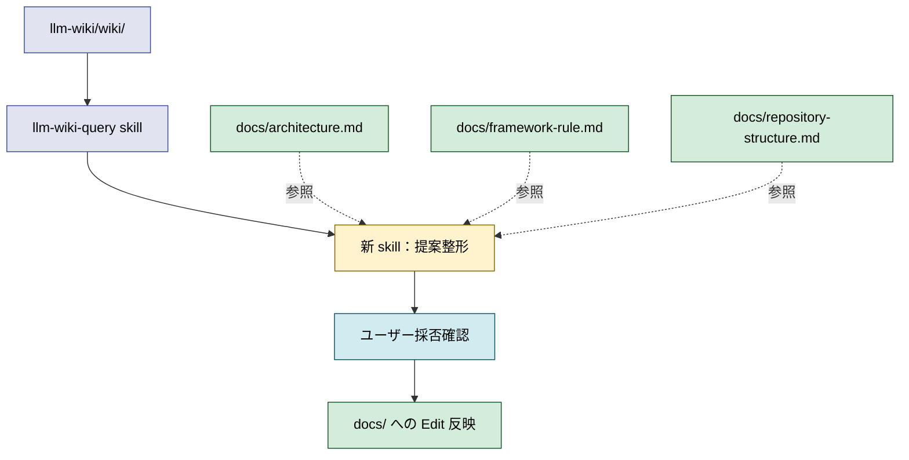

# 2026年5月26日 開発基盤：llm-wiki-queryで開発文書を更新するスキルをつくる

> 状態：① Journey
> 次のゲート：（ユーザー）skill 名と配置先（プロジェクト固有 / 全プロジェクト共通）を 1 点だけ決める

---

## 1) Journey（どこへ行くか）

> 補足：深層的目的　llm-wiki が育てた最新知見と docs/ 3 層のドリフトを定期的に検出し docs/ を最新に保つ
> 補足：やらないこと　llm-wiki 中身の改変、docs/ への自動上書き（ユーザー確認必須）
> 補足：責務分担厳格度 full

1. 前提条件
    1. 💦 llm-wiki と docs/ の 2 系統が並行進化しドリフトが発生する
    2. 💦 直近の wiki→docs 逆流 sweep（commit `b956bb7` 等）は手作業
    3. 💦 docs/ 3 層構造（commit `27dc33c`）が確立済み

2. Before
    1. 💦 ドリフト sweep を手で回しているため頻度が低い
    2. 💦 docs/ が古くなるが気づきにくい
    3. ❌ docs/ が SSoT として信頼できなくなる不安

3. After
    1. 💦 skill 呼び出しで llm-wiki に「更新候補ある？」と問える
    2. ✅ 提案がリスト化され、ユーザーが採否を選び docs/ に反映できる
    3. ❤️ docs/ が常に新鮮で安心

4. 例外
    1. llm-wiki に該当情報が無い場合は「ドリフト無し」と報告して止める

5. 境界条件
    1. 対象 docs：`docs/architecture.md` / `framework-rule.md` / `repository-structure.md`
    2. クエリは llm-wiki-query skill 経由
    3. 適用は **必ずユーザー確認後**（自動上書き禁止）

6. 委任度
    1. 🟡 一部判断要：採否レビューは人の必須作業
    2. 🟢 llm-wiki-query 呼び出しと提案整形は CC で可
    3. 🔴 skill 名と配置先（固有 vs 共通）は人判断

---

## 2) ユーザーストーリーマップ

> 委任度：🟡 ドラフト化は進められるが、skill 名と配置先は人の確認が必要
> 残る曖昧さ：問いの文面・出力形式の細部

### 事前確認

- [ ] tasknote確認済み
- [ ] skill・tool・MCP確認済み
  - [ ] llm-wiki-query（問いを投げる本体）
  - [ ] create-skill（新 skill 作成）
  - [ ] manage-tasknotes（本起票）
- [ ] 永続的ドキュメント確認済み
  - [ ] docs/architecture.md（設計判断 SSoT）
  - [ ] docs/framework-rule.md（M1〜M5 規約）
  - [ ] docs/repository-structure.md（責務分担表）
  - [ ] llm-wiki/wiki/（知見の蓄積）

### 本体

#### 話題1：問い文と skill 名を確定する

##### ユーザー：開発者

1. 当初計画
    1. ❓ 問いの定型文を確定（例：「これら docs で更新した方が良さそうな所ある？」）
    2. ❓ skill 名を確定（候補：`llm-wiki-propose-docs-update` 等）
    3. 📝 配置先（プロジェクト固有 / 全プロジェクト共通）を確定

#### 話題2：提案の出力形式を決める

##### ユーザー：CC + 開発者

1. 当初計画
    1. ❓ 出力形式（提案リスト / diff 候補 / patch）の温度感を決める
    2. 👀 提案ごとに「対象 docs / 該当セクション / 提案内容 / 根拠 wiki page」を併記する形を試作
    3. 📝 雛形を 1 件作り人にレビュー依頼

#### 話題3：適用ステップの設計

##### ユーザー：CC（適用補助担当）

1. 当初計画
    1. 👀 採否選択 → 採用分を docs/ に Edit で反映する手順を整理
    2. 📝 反映後の commit メッセージ雛形を用意
    3. ✂️ 自動上書きを禁止するガード文を SKILL.md に明記

---

## 3) Gherkin（完了条件）

> 委任度：🔴 skill 名と配置先未確定のため Gherkin は仮置き
> 残る曖昧さ：出力形式の細部、commit 雛形の文面

### シナリオ一覧

- [ ] シナリオ1-1：skill を呼ぶと llm-wiki に問いが投げられ、提案リストが返る

1. 🧱 開発者が docs/ 3 層がそろう repo にいる（ターミナル）
2. 🎬 新 skill を呼ぶ（ターミナル）
3. ✅ llm-wiki-query 経由で「更新した方がよさそうな箇所」リストが出る（出力）

```gherkin
Given 開発者が docs/architecture.md / framework-rule.md / repository-structure.md がそろう repo にいる
When 新 skill を呼ぶ
Then llm-wiki-query 経由で更新提案リストが出力される
```

- [ ] シナリオ1-2：提案が無い場合は「ドリフト無し」で止まる

1. 🧱 llm-wiki に該当ドリフト情報が無い（前提）
2. 🎬 新 skill を呼ぶ（ターミナル）
3. ✅ 「ドリフト無し」と報告して終了する（出力）

```gherkin
Given llm-wiki に docs/ 更新候補となる知見が無い
When 新 skill を呼ぶ
Then ドリフト無しと報告して出力を止める
```

- [ ] シナリオ1-3：採用した提案だけが docs/ に反映される

1. 🧱 提案リストが出力済み（前提）
2. 🎬 ユーザーが採否を指示する（ターミナル）
3. ✅ 採用したものだけが docs/ に Edit で反映され、他は触らない（出力）

```gherkin
Given skill から提案リストが出ている
When ユーザーが採否を指示する
Then 採用したものだけが docs/ に Edit で反映され、他は触らない
And 自動上書きはされない
```

---

## 4) Design（どうやるか）

### 責務分担概要

| 親ディレクトリ | ファイル案 | 責務概要 | 負わせない責務 |
| --- | --- | --- | --- |
| `~/.claude/skills/llm-wiki-propose-docs-update/`（仮） | `SKILL.md` | llm-wiki-query 呼び出し → 提案リスト整形 → 採否確認 → docs/ Edit | llm-wiki の更新、docs/ の自動上書き |
| `llm-wiki/wiki/` | `areas/` / `master-index.md` 等 | 知見の正本 | docs/ への直接反映 |
| `docs/` | `architecture.md` / `framework-rule.md` / `repository-structure.md` | 開発文書の SSoT | llm-wiki の更新ロジック |

### 責務分担概要図



### 責務分担詳細

- `~/.claude/skills/llm-wiki-propose-docs-update/` （➕：新規 skill、名称は仮）
  - `SKILL.md` （➕：skill 本体定義）
    - `entry point`: llm-wiki-query を呼び提案を整形して採否確認まで進める
- `~/.claude/skills/llm-wiki-query/` （❌：参照のみ、今回触らない）
  - `SKILL.md` （❌：既存問い合わせ skill）
    - `delegate`: 新 skill が定型文クエリを委譲する先
- `docs/architecture.md` （✏️：採用時のみ Edit）
  - `update target`: 採用された提案を反映する対象
- `docs/framework-rule.md` （✏️：採用時のみ Edit）
  - `update target`: 採用された提案を反映する対象
- `docs/repository-structure.md` （✏️：採用時のみ Edit）
  - `update target`: 採用された提案を反映する対象

### 関連スキル・MCP

- `llm-wiki-query`（問い合わせ本体）
- `create-skill`（新 skill 雛形）
- `manage-tasknotes`（本起票）

### 【参照】

- 既存 skill: `~/.claude/skills/llm-wiki-query/SKILL.md`
- 直近の手作業 sweep: commit `b956bb7`（docs: extend framework-rule via wiki drift sweep）

### 変更範囲

- やること：新 skill を `~/.claude/skills/` または `.claude/skills/` に新規作成
- やらないこと：llm-wiki 中身の更新、docs/ の自動上書き、提案以外の修正

### 検証

- 検証コマンド：（後段で確定）新 skill 呼び出し → 提案リスト出力 → 採否選択 → docs/ Edit 確認
- 成功条件：採用した提案だけが docs/ に反映され、commit が個別に切れる
- 未実施時の扱い：（① Journey と ② USM のゲート通過後に確定）

---

## 5) Tasklist

> ① Journey と ② USM のゲート通過後に詳細化する。

- [ ] （ユーザー）skill 名と配置先（固有 / 共通）を 1 点だけ決める
- [ ] （ユーザー）問いの定型文を確定する
- [ ] （CC）新 skill ディレクトリと SKILL.md を作成
- [ ] （CC）SKILL.md に動作仕様（query → 提案整形 → 採否確認 → Edit）を明文化
- [ ] （CC）skill 一覧で新名前が登場することを確認
- [ ] （CC）1 回実行して提案出力 → 採否ループの動作確認

---

## 6) 作業ログ

（着手後に記録）

---

## 7) 評価と成果物

> 評価：🔴 未着手

### 成果物

- （未着手）

---

## 8) Discussion

（着手後に記録）

---

## 9) Closing

- 状態: draft（① Journey まで埋め、次のゲートはユーザー判断待ち）
- 次のゲート: skill 名と配置先（プロジェクト固有 / 全プロジェクト共通）を 1 点だけ決める
- close 条件:
  - [ ] 新 skill 本体が登録される
  - [ ] llm-wiki-query 経由で提案リストが出る挙動を 1 回確認
  - [ ] docs/ への自動上書き禁止が SKILL.md に明記される

---

## 10) 参考資料

- 既存 skill：`~/.claude/skills/llm-wiki-query/SKILL.md`
- 関連 skill：`make-development-checklist`（docs/ から派生物を作る逆方向）
- 関連 commit：`b956bb7`（手作業 sweep の最近例）/ `27dc33c`（docs/ 3 層構造確立）
- 関連 tasknote：`steering/done/2026年5月26日 開発基盤：make-checklist を汎用化してリネームする.md`
