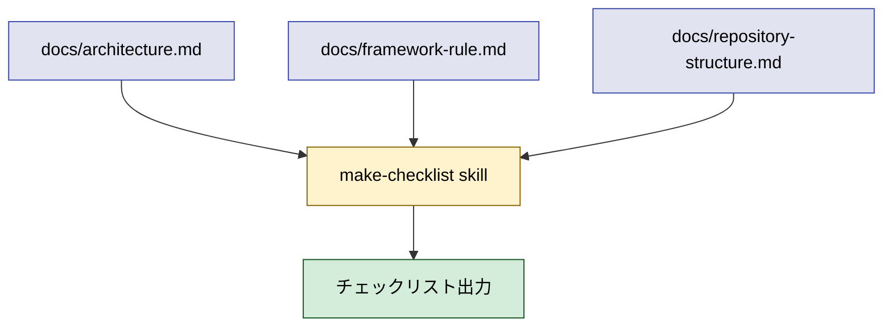

# 2026年5月26日 開発基盤：make-checklist スキルを新設する

> 状態：① Journey
> 次のゲート：（ユーザー）設計／実装／レビューの 3 シーンのうち、最初に対応する 1 シーンを 1 点だけ決める

---

## 1) Journey（どこへ行くか）

> 補足：深層的目的　docs/ 3 層を AI が毎回読まず機械的に網羅できるチェックリスト化
> 補足：やらないこと　docs/ 本体の規約変更、M1〜M5 の強化、対象 3 文書以外の取り込み
> 補足：責務分担厳格度 full

1. 前提条件
    1. 💦 2026-05-26 commit `27dc33c` で docs/ 3 層構造が確立
    2. 💦 docs/ は AI コーディング前提で M1〜M5 自力検証を狙う
    3. 💦 「3 文書を毎回読む」コストでチェック漏れが起きる

2. Before
    1. 💦 レビュー時に 3 文書を毎回スキャンしている
    2. 💦 M1〜M5・ディレクトリ規約・採用技術制約を見落とす
    3. ❌ 規約はあっても踏み外しが減らない不安

3. After
    1. 💦 `/make-checklist` で設計・実装・レビュー項目を一覧化できる
    2. ✅ docs/ 3 層の規約を機械的に網羅できる
    3. ❤️ レビューで見落とさない安心

4. 例外
    1. docs 更新時は make-checklist を再生成する運用を skill 本文に明記

5. 境界条件
    1. スキル置き場：`~/.claude/skills/make-checklist/`
    2. 対象 docs は code-quest-pyxel の 3 文書限定
    3. 出力先は呼び出し時に決定（標準は標準出力）

6. 委任度
    1. 🟡 一部判断要：粒度・シーン優先順位は人の確認
    2. 🟢 docs 3 文書のスキャン・ドラフト化は CC で可
    3. 🔴 3 シーンを別 skill にするか統合かは人判断

---

## 2) ユーザーストーリーマップ

> 委任度：🟡 ドラフト化は進められるが、3 シーンの優先順位は人の確認が必要
> 残る曖昧さ：最初に対応する 1 シーン（設計／実装／レビュー）が未確定

### 事前確認

- [ ] tasknote確認済み
- [ ] skill・tool・MCP確認済み
  - [ ] create-skill（スキル雛形作成）
  - [ ] manage-tasknotes（本起票）
- [ ] 永続的ドキュメント確認済み
  - [ ] docs/architecture.md（設計判断 SSoT）
  - [ ] docs/framework-rule.md（M1〜M5 規約）
  - [ ] docs/repository-structure.md（責務分担表）

### 本体

#### 話題1：3 シーン（設計・実装・レビュー）を 1 つに絞って始める

##### ユーザー：開発者

1. 当初計画
    1. ❓ 3 シーンを並べて最初に着手する 1 つを決める
    2. 👀 各シーンで「何を確認するか」を 3 文書から抽出
    3. 📝 抽出結果を skill draft に落とす

#### 話題2：チェックリストの粒度と出力形式を決める

##### ユーザー：CC + 開発者

1. 当初計画
    1. ❓ 項目数（1 シーン 10〜20 項目）の温度感を決める
    2. 👀 出力形式（標準出力 / markdown / Gherkin 風）を決める
    3. 📝 雛形（SAMPLE 1 つ）を作って人にレビュー依頼

#### 話題3：docs 更新時の再生成運用を決める

##### ユーザー：CC

1. 当初計画
    1. 👀 docs/ 3 文書更新時に make-checklist 再実行する運用フック
    2. 📝 運用ルールを skill 本文か CLAUDE.md に明記

---

## 3) Gherkin（完了条件）

> 委任度：🔴 まだ 3 シーン未確定のため Gherkin は仮置き
> 残る曖昧さ：シーン優先順位、項目粒度、出力形式

### シナリオ一覧

- [ ] シナリオ1-1：`/make-checklist` を呼ぶと 3 文書から項目を生成できる

1. 🧱 開発者が docs/ 3 層の規約を踏まえてレビューしたい（ターミナル）
2. 🎬 `/make-checklist` を呼ぶ（ターミナル）
3. ✅ docs/ 3 文書を読まずにチェック項目一覧が得られる（出力）

```gherkin
Given 開発者がターミナルで code-quest-pyxel のリポジトリにいる
When `/make-checklist` を呼ぶ
Then docs/ 3 文書（architecture / framework-rule / repository-structure）から派生したチェック項目が出力される
```

> 詳細シナリオ（シナリオ 1-2 以降）は ① Journey と ② USM のゲート通過後に確定する。

---

## 4) Design（どうやるか）

### 責務分担概要

| 親ディレクトリ | ファイル案 | 責務概要 | 負わせない責務 |
| --- | --- | --- | --- |
| `~/.claude/skills/make-checklist/` | `SKILL.md` | docs/ 3 層を読み設計・実装・レビュー時のチェックリストを生成 | docs/ 規約の更新、対象外文書の取り込み |
| `docs/` | `architecture.md` / `framework-rule.md` / `repository-structure.md` | チェック項目の正本（SSoT） | チェックリスト形式の出力 |

### 責務分担概要図



### 責務分担詳細

- `~/.claude/skills/make-checklist/` （➕：新規 skill）
  - `SKILL.md` （➕：skill 本体定義）
    - `entry point`: docs/ 3 文書を読んでチェック項目を出力する入口
- `docs/` （❌：参照のみ、今回触らない）
  - `architecture.md` （❌：設計判断 SSoT）
    - `read only`: チェック項目の元データとして読む
  - `framework-rule.md` （❌：M1〜M5 規約）
    - `read only`: チェック項目の元データとして読む
  - `repository-structure.md` （❌：責務分担表）
    - `read only`: チェック項目の元データとして読む

### 関連スキル・MCP

- `create-skill`
- `manage-tasknotes`

### 【参照】

- Architecture: `docs/architecture.md`
- Framework: `docs/framework-rule.md`
- Structure: `docs/repository-structure.md`

### 変更範囲

- やること：`~/.claude/skills/make-checklist/` の新規作成（SKILL.md + 必要なら shared asset）
- やらないこと：docs/ 3 文書の更新、対象外文書の取り込み

### 検証

- 検証コマンド：（後段で確定）スキル呼び出し → チェック項目出力の目視
- 成功条件：docs/ 3 文書を開かずに必要なチェック項目が一覧で出る
- 未実施時の扱い：（① Journey と ② USM のゲート通過後に確定）

---

## 5) Tasklist

> ① Journey と ② USM のゲート通過後に詳細化する。

- [ ] （CC）docs/ 3 文書をスキャンしてチェック項目候補を抽出
- [ ] （CC）抽出結果を skill draft に落とす
- [ ] （ユーザー）粒度・出力形式をレビュー
- [ ] （CC）skill 本文を `~/.claude/skills/make-checklist/SKILL.md` に書く
- [ ] （CC）SAMPLE 出力を 1 件作って動作確認

---

## 6) 作業ログ

（着手後に記録）

---

## 7) 評価と成果物

> 評価：🔴 未着手

### 成果物

- （未着手）

---

## 8) Discussion

（着手後に記録）

---

## 9) Closing

- 状態: draft（① Journey まで埋め、次のゲートはユーザー判断待ち）
- 次のゲート: 設計／実装／レビューの 3 シーンのうち最初に対応する 1 シーンを 1 点だけ決める
- close 条件:
  - [ ] make-checklist スキル本体が動く
  - [ ] docs/ 3 文書を開かずにチェック項目一覧が出ることを確認
  - [ ] docs 更新時の再生成運用ルールを skill 本文に明記

---

## 10) 参考資料

- `docs/architecture.md`（設計判断 SSoT）
- `docs/framework-rule.md`（M1〜M5 規約）
- `docs/repository-structure.md`（責務分担表）
- 関連 commit：`27dc33c`（3 層構造確立）/ `346c97f`（schema update）
- 既存 skill 例：`~/.claude/skills/create-skill/`, `~/.claude/skills/manage-tasknotes/`
