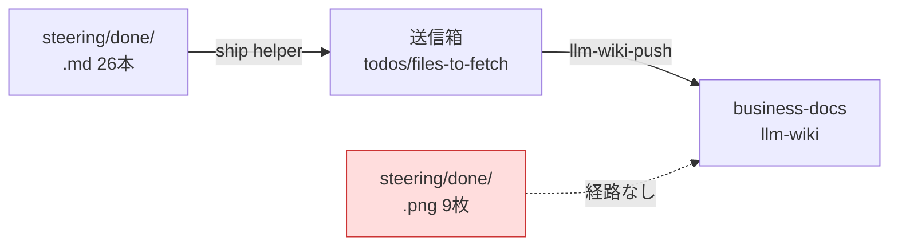

# 2026年8月14日 開発基盤：スクショPNGをbdへ運ぶ経路を用意する

> 状態：devStage brainstorming
> 次のゲート：（ユーザー）要判断1・要判断2に答える。要調査はbdアクセスのあるマシンで行う

## 概要

- When: 2026年8月14日
- Where: code-quest-pyxel、および共有の llm-wiki 送信経路（shared/llm-wiki-core）
- Who: AIエージェント
- What: 完了ノートに紐づくスクショ画像を business-docs へ届ける手立てを決める
- Why: いま画像だけが repo に取り残され、bd 側のノートを読んだ人が「何がどう困っていたか」を目で確認できないため

2026年8月14日に done tasknote 26本を bd へ送信したとき、送信の仕組みが `.md` だけを
対象にしているため、スクショ9枚が `steering/done/` に残った。ノート本文は
「HPバーがはみ出ている」など画像ありきの記述なので、画像が無いと再現状況が伝わらない。

## Spec

### 決定事項

- 対象は `steering/done/` に残った9枚のスクショ（子どもからの不具合報告画像）。

### 却下案

- 画像を repo に置いたまま bd のノートから相対パスで参照する
  - 却下理由: bd 側から見て別 repo のパスは解決できず、リンク切れになる。

### 調査済みの材料

2026年8月14日に `shared/llm-wiki-core/node/llm-wiki-push.mjs` と実ファイルを読んで確認した。

| 調べたこと | 分かったこと | 根拠 |
| --- | --- | --- |
| 送信の上限 | 1ファイル 1MB | `MAX_NOTE_BYTES = 1024 * 1024`（server の `CONTENT_LIMIT_BYTES` と揃える旨のコメントあり） |
| PNG 9枚の実サイズ | 各 約140KB、合計 1.2MB | `ls -la steering/done/*.png` |
| 送信データの作り方 | `bytes.toString("utf8")` で文字列化。**バイナリはそのまま通らない** | `pushOutbox()` の payload 構築部 |
| 送信対象の絞り込み | `.md` で終わるファイルだけ収集する | `collectMarkdown()` の `endsWith(".md")` |

ここから言えること: 1枚ずつ base64 化しても約187KB で上限に収まる（サイズは障害にならない）。
ただし文字列前提なので、**client と bd 側受け口の両方**を直す必要がある。bd はこのVMに無いため、
案1は必ず別マシンでの作業を含む。

### 未決事項

#### 要判断1: どの方式でPNGを運ぶか

材料はそろっている。3案を同じ軸で並べた。

| 案 | 影響範囲 | 導入コスト | 戻しやすさ |
| --- | --- | --- | --- |
| 1. push client を `.png` 対応にする | 全VM共有コード + bd 側受け口。**別マシン作業が必ず入る** | 高 | 低（共有コードなので他repoも巻き込む） |
| 2. 画像の要点をノート本文へ書き写す | このrepoのノートだけ | 低 | 高（テキストなのでいつでも直せる） |
| 3. bd 側の画像置き場へ手で運ぶ | bd の1ディレクトリ | 中（毎回発生） | 高 |

推奨は **案2**。理由は、画像が要るのは「子どもが何に困ったか」を後から読む人であり、
そこはテキストで代替できるため。案1は根本解決だが、共有コードとbd受け口の同時変更に見合う
頻度（3か月で9枚）ではない。

#### 要判断2: 既存9枚を今すぐ運ぶか

- 今すぐ運ぶ / 今後のぶんだけ仕組み化して9枚は repo に残す、の二択。
- 材料: 9枚は5月の不具合報告で、対応する tasknote はすべて close 済み・bd へ送信済み。
  つまり「これから読む人」は bd 側のノートだけを読む。

#### 要調査（bd へのアクセスが要る。このVMでは未着手）

- bd 側に画像を置く規約（配置先・命名・ノートからの参照方法）があるか。
  - このVMには llm-wiki の**読み取り** token が未設定（`llm-wiki-remote` が configuration unavailable）。
    Mac か bd 側のセッションで確認する。
  - 案3を採るなら必須。案2を採るなら不要。

### 完了条件

- [ ] 3案から方式を1つ選び、選んだ理由と却下理由を Spec に残した
- [ ] 既存9枚の扱い（運ぶ／テキスト化／残す）を決めた
- [ ] 次回 close 分が同じ取りこぼしを起こさない状態にした（仕組みか AGENTS.md の手順か）

### 設計レビュー

- 原本 checklist: `docs/development-checklist.md`
- /tmp コピー: 未作成
- レビュー結果: 未実施
- 未通過時の扱い: 実装へ進まず Spec または Discussion へ戻す

## 作業ログ

- skill・tool・MCP確認済み: 0件
- 2026年8月14日: 未決事項を「要判断」と「要調査」に分け、要判断ぶんの材料を集めて表にした。
  送信の上限・PNG実サイズ・文字列前提・拡張子フィルタの4点をコード実物で確認済み。

## Result

- 未実装

## Discussion

- なし

## Closing

- 状態: open
- 次のゲート: Spec を固めて implementing へ上げる
- close 条件:
  - [ ] Spec から外れていない
  - [ ] 実装成果が Result に記録されている
  - [ ] 最終レビューを実施した
  - [ ] 未記録の作業ログが記録済み
