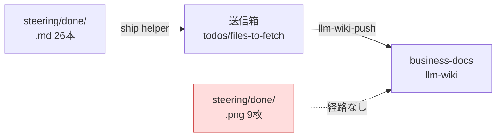

# 2026年8月14日 開発基盤：スクショPNGをbdへ運ぶ経路を用意する

> 状態：devStage brainstorming
> 次のゲート：（AIエージェント）Specを固め、implementingへ上げて設計レビューを行う

## 概要

- When: 2026年8月14日
- Where: code-quest-pyxel、および共有の llm-wiki 送信経路（shared/llm-wiki-core）
- Who: AIエージェント
- What: 完了ノートに紐づくスクショ画像を business-docs へ届ける手立てを決める
- Why: いま画像だけが repo に取り残され、bd 側のノートを読んだ人が「何がどう困っていたか」を目で確認できないため

2026年8月14日に done tasknote 26本を bd へ送信したとき、送信の仕組みが `.md` だけを
対象にしているため、スクショ9枚が `steering/done/` に残った。ノート本文は
「HPバーがはみ出ている」など画像ありきの記述なので、画像が無いと再現状況が伝わらない。

## Spec

### 決定事項

- 対象は `steering/done/` に残った9枚のスクショ（子どもからの不具合報告画像）。

### 却下案

- 画像を repo に置いたまま bd のノートから相対パスで参照する
  - 却下理由: bd 側から見て別 repo のパスは解決できず、リンク切れになる。

### 未決事項

- どの方式を採るか。候補は3つ。
  1. **push client を `.png` 対応にする**（`shared/llm-wiki-core` の変更）。根本解決だが共有コードに手を入れるので影響範囲が広い。ingest 側の受理サイズ上限とバイナリ扱いも要確認。
  2. **画像の要点をノート本文へ書き写す**（テキスト化）。今すぐできて壊れないが、絵の情報は失われる。
  3. **bd 側の画像置き場へ手で運ぶ**。1回きりなら早いが、次回また同じ手作業が発生する。
- 9枚を今すぐ運ぶ必要があるか、それとも今後のぶんだけ仕組み化すれば足りるか。
- bd 側に画像を置く規約（配置先・命名・ノートからの参照方法）が既にあるかどうか。

### 完了条件

- [ ] 3案から方式を1つ選び、選んだ理由と却下理由を Spec に残した
- [ ] 既存9枚の扱い（運ぶ／テキスト化／残す）を決めた
- [ ] 次回 close 分が同じ取りこぼしを起こさない状態にした（仕組みか AGENTS.md の手順か）

### 設計レビュー

- 原本 checklist: `docs/development-checklist.md`
- /tmp コピー: 未作成
- レビュー結果: 未実施
- 未通過時の扱い: 実装へ進まず Spec または Discussion へ戻す

## 作業ログ

- skill・tool・MCP確認済み: 0件
- 未着手

## Result

- 未実装

## Discussion

- なし

## Closing

- 状態: open
- 次のゲート: Spec を固めて implementing へ上げる
- close 条件:
  - [ ] Spec から外れていない
  - [ ] 実装成果が Result に記録されている
  - [ ] 最終レビューを実施した
  - [ ] 未記録の作業ログが記録済み
