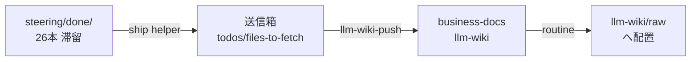

# 2026年8月14日 開発基盤：完了ノートの知見をbdへ送る経路を通す

> 状態：devStage closing / status done
> 次のゲート：なし

## 概要

- When: 2026年8月14日
- Where: code-quest-pyxel（`llm-wiki/adapter.yml` / `AGENTS.md` / `docs/` / `.githooks/`）
- Who: AIエージェント
- What: close 済み tasknote を business-docs の llm-wiki へ送る経路を開通させ、滞留していた26本を送る
- Why: 完了ノートの知見が repo に閉じたままだと、他プロジェクトから参照できず bd を全マシンの頭脳として育てられないため

さかのぼり起票（backfill）。作業の実績にもとづいて書いている。

## Spec

### 決定事項

- bd 側の保管カテゴリは `5-製品開発/code-quest` にする。将来この題材が情報教育の製品へ移る可能性を踏まえ、`9-個人` ではなく製品開発配下に置く（ユーザー判断）。
- 送信箱 `todos/files-to-fetch/` は git 管理外にする。中身は push 成功時に client が自動で消す。
- 送信の手順本体は `docs/llm-wiki-ops-schema.md` に置き、`AGENTS.md` からは1行で参照する（M5-3 の文書2層構造）。

### 却下案

- bd 側からの fetch 回収を待つ
  - 却下理由: 2026-07-26 に廃止済み。送信箱に置くだけでは届かない。ディレクトリ名 `files-to-fetch` は当時の名残で、名前に引きずられると取りこぼす。
- 手順を `AGENTS.md` に全文書く
  - 却下理由: 100行制限（`test_cjg_framework_rule_guards.py`）を超える。実際に一度124行にして落とした。

### 未決事項

- なし（スクショPNGの扱いは別ノート「2026年8月14日 開発基盤：スクショPNGをbdへ運ぶ経路を用意する」へ分離済み）

### 完了条件

- [x] 26本すべてが bd に受理された
- [x] 次回 close 分が同じ取りこぼしを起こさない導線が repo に書かれている
- [x] テストが通っている

### 設計レビュー

- 原本 checklist: `docs/development-checklist.md`
- /tmp コピー: /tmp/development-design-checklist-20260814-1210.md
- レビュー結果: 実施済み（131項目すべてチェック済み。最終レビューと同内容）
- 未通過時の扱い: 実装へ進まず Spec または Discussion へ戻す

## 作業ログ

- skill・tool・MCP確認済み: `connect-satellite-to-ingest`、`llm-wiki-push`、`llm_wiki_tasknote_ship_helper.py`
- `llm-wiki/adapter.yml` に `tasknote_ship`（enabled: true / category: `5-製品開発/code-quest`）を追加した。
- `.gitignore` に `todos/files-to-fetch/` を追加した。
- ship helper で26本を送信箱へ出した（失敗0）。
- `llm-wiki-push push --dry-run` で対象を確認し、`push` を実行した。
- `.githooks/pre-commit` が存在しない `~/dotfiles/` を参照していて tasknote-lint が起動できなかったため、`chezmoi source-path` から解決する形に直した。
- `AGENTS.md` に手順を書いたところ124行になり、≤100行ガードが落ちた。手順を `docs/llm-wiki-ops-schema.md` へ移し、100行へ戻した。

## Result

- **26本すべて bd に受理された**（`pushed: 26` / `duplicate: 0` / `conflict: 0` / `skipped: 0` / `failed: 0`）。送信箱は空になった。
- 送れたのは `.md` のみ。スクショ9枚（各約140KB）は `steering/done/` に残った。
- commit: `bbaf79c`（送信と設定）、`ce141a7`（AGENTS.md 導線）、`6c48813`（100行制限の修正）。
- テスト: 688 passed / 2 skipped / 14232 subtests passed。`test_llm_wiki_adapter.py` と `test_llm_wiki_health_check_helper.py` の collection error は変更前の HEAD でも同じで、今回とは無関係の既存不具合。

## Discussion

### 反省とルール化

- **3か月ぶん26本が滞留していた原因は、導線が repo のどこにも書かれていなかったこと**。仕組みは全マシンに配られていたが、この repo の `AGENTS.md` に「close したら送る」が無かった。共有の仕組みを入れたら、使う側の repo にも入口を書く。
- **`make verify` は pytest を含まない**。docs だけの変更でもガードテストが落ちうる（AGENTS.md の行数制限がまさにそれ）。docs 変更でも close 前に `python -m pytest test/` を通す。
- ディレクトリ名 `files-to-fetch` のように、実態と合わなくなった名前は誤解を生む。名前を信じず、手順書に「2手目を省かない」と明示した。

### 判断メモ

- カテゴリを `9-個人` ではなく `5-製品開発` にしたのはユーザー判断。`~/tare-mountain/llm-wiki/adapter.yml` は `9-個人/code-quest` のままだが、実作業は code-quest-pyxel 側なので実害はない。気になるなら後で揃える。

## Closing

- 状態: done
- 次のゲート: なし
- close 条件:
  - [x] Spec から外れていない
  - [x] 実装成果が Result に記録されている
  - [x] 最終レビューを実施した
  - [x] 未記録の作業ログが記録済み

### 最終レビュー

- 原本 checklist: `docs/development-checklist.md`
- /tmp コピー: /tmp/development-final-checklist-20260814-1210.md
- レビュー結果: 通過（131項目すべてチェック済み）。変更範囲は docs / 運用設定 / tasknote のみで `src/` `assets/` `dist/` に差分が無く、A〜D のゲーム実装項目はガードテスト全通過で現状維持を確認した。A3「AGENTS.md ≤100行」のみ一度違反したが、`6c48813` で解消済み。
- 利用者 checklist: 該当なし（`docs/customer-checklist.md` は存在しない）
- 利用者 checklist レビュー結果: 該当なし（子どもに見える変更が無いため）
- 未通過時の扱い: 通過したため該当なし
