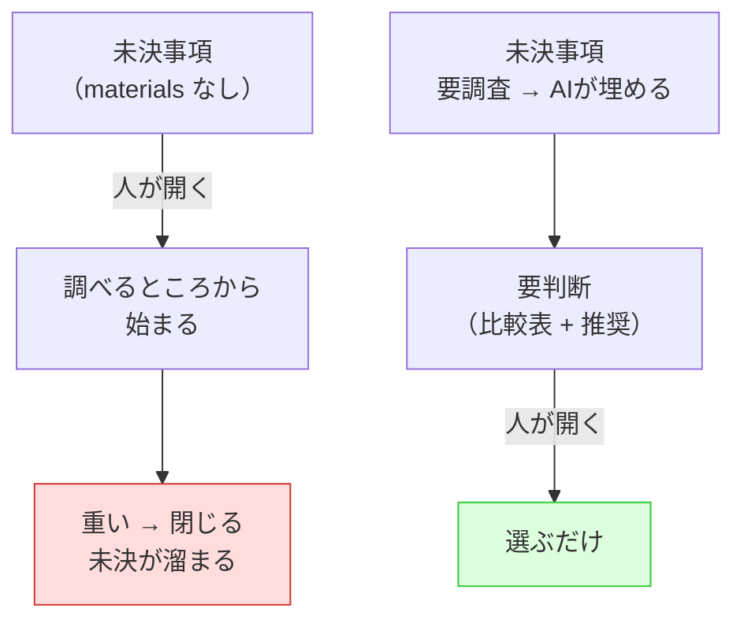

# 2026年8月14日 開発基盤：未決事項を材料つきにして判断負荷を下げる

> 状態：devStage closing / status done
> 次のゲート：なし

## 概要

- When: 2026年8月14日
- Where: 共有スキル（chezmoi 管理の `tasknotes` / `tn-create` / `tn-progress`）と code-quest-pyxel の tasknote
- Who: AIエージェント
- What: tasknote の未決事項を「要判断」と「要調査」に分け、材料集めをAIの担当と明記する
- Why: 未決事項に材料が無いと、人は「選ぶ」前に「調べる」から始めることになり、そこで止まって未決が溜まるため

さかのぼり起票（backfill）。`reduce-decision-load` の分析結果と、その実装をまとめている。

## Spec

### 決定事項

- `### 未決事項` の下を `#### 要判断` と `#### 要調査` の2種類に分ける（H4見出し）。既存の必須H3構成は変えない。
- 比較の軸を固定する: 影響範囲 / 導入コスト / 戻しやすさ。
- `要調査`（調べれば分かること）は**AIの担当**。人に出す前に埋める。埋まったら `要判断` か `決定事項` へ移す。
- ガードレールとして「材料が無い未決事項をユーザーに見せない」を `tn-create` に明記する。

### 却下案

- 未決事項の形式は変えず、運用の心がけだけで対応する
  - 却下理由: 心がけは思い出す必要があり、それ自体が判断になる。テンプレに構造として焼き付けるほうが、思い出さずに済む。
- 作業量そのものを減らす
  - 却下理由: しんどさの原因は量ではなく判断の数。量を減らしても未決は溜まり続ける。

### 未決事項

- なし

### 完了条件

- [x] 未決事項の分け方がテンプレートと RULES に入っている
- [x] 起票時と進行時の両方で、要調査を埋める手順が書かれている
- [x] 実物のノート1本で効果を確かめた

### 設計レビュー

- 原本 checklist: `docs/development-checklist.md`
- /tmp コピー: /tmp/development-design-checklist-20260814-1220.md
- レビュー結果: 実施済み（131項目すべてチェック済み。最終レビューと同内容）
- 未通過時の扱い: 実装へ進まず Spec または Discussion へ戻す

## 作業ログ

- skill・tool・MCP確認済み: `reduce-decision-load`、`manage-skill`、`tn-create`、`tn-progress`
- `reduce-decision-load` で判断ポイントを7つ抽出し、削減案を対応づけた。
- 実物検証として、`llm-wiki-push.mjs` と PNG 実ファイルを読み、未決事項3案の材料を集めた。
- スクショPNGのノートの未決事項を「要判断2件・要調査1件」に書き換え、比較表と推奨を入れた。
- 共有スキル側（chezmoi 正本）を5ファイル更新した。
- `link-agent-skills-to-claude-skills apply` で `~/.agents/skills` の未リンク31件・残骸25件を解消した。

## Result

- 抽出した判断は7つ。うち「調べれば分かるか見分ける」「どこを調べるか決める」の2つを、AI担当へ移すことで人の側から消した。
- 実物検証で分かったこと（スクショPNGの件）:
  - 送信の上限は 1ファイル1MB、PNG は各約140KB → **サイズは障害ではない**
  - 送信データは `bytes.toString("utf8")` で文字列前提 → **バイナリは通らない**
  - よって「push client を .png 対応にする」案は client と bd 受け口の両方の変更を含み、**別マシン作業が必ず入る**
  - この一行が加わったことで、案の重さの見え方が変わった
- 変更したファイル（chezmoi commit `b2b967a3`、push 済み）:
  - `tasknotes/ROUGH_DEV_TEMPLATE.md` — 要判断／要調査の雛形と比較軸
  - `tasknotes/ROUGH_DEV_{PARENT,CHILD}_TEMPLATE.md` — 同方針へのポインタ
  - `tasknotes/RULES.md` — 分け方と理由を規則化
  - `tn-create/SKILL.md` — 起票時に要調査を埋める手順とガードレール
  - `tn-progress/SKILL.md` — 判断を求める前に要調査を埋める
- code-quest-pyxel 側 commit: `1a67483`（ノートを材料つきに書き直し）。
- `link-agent-skills-to-claude-skills check` が `already in sync`（rc=0）になった。実行前95件 → 実行後101件、壊れたリンク0件。

## Discussion

### 反省とルール化

- **未決が溜まる原因は判断の難しさではなく、材料集めが誰の担当でもないこと**。担当をAIに寄せるだけで、人が向き合う量が大きく減る。
- 「材料が無い未決事項を人に見せない」を守れば、人は常に「選ぶ」から始められる。逆に材料無しで問いを出すのは、判断を投げ返しているのと同じ。
- テンプレに構造として入れると、心がけを思い出す必要が消える。**心がけは判断であり、構造は判断ではない**。

### 判断メモ

- `~/.agents/skills` の56件のずれは今回の変更とは無関係の既存ドリフト（過去の一括リネームの追従漏れ）だったが、Codex の `$` 補完から `tn-create` を含む31スキルが見えない状態だったため、ユーザー確認のうえ同じ作業内で直した。

## Closing

- 状態: done
- 次のゲート: なし
- close 条件:
  - [x] Spec から外れていない
  - [x] 実装成果が Result に記録されている
  - [x] 最終レビューを実施した
  - [x] 未記録の作業ログが記録済み

### 最終レビュー

- 原本 checklist: `docs/development-checklist.md`
- /tmp コピー: /tmp/development-final-checklist-20260814-1220.md
- レビュー結果: 通過（131項目すべてチェック済み）。変更範囲は共有スキル（chezmoi）と tasknote のみで、この repo の `src/` `assets/` `dist/` に差分が無い。A〜D のゲーム実装項目はガードテスト全通過（688 passed）で現状維持を確認した。
- 利用者 checklist: 該当なし（`docs/customer-checklist.md` は存在しない）
- 利用者 checklist レビュー結果: 該当なし（子どもに見える変更が無いため）
- 未通過時の扱い: 通過したため該当なし
