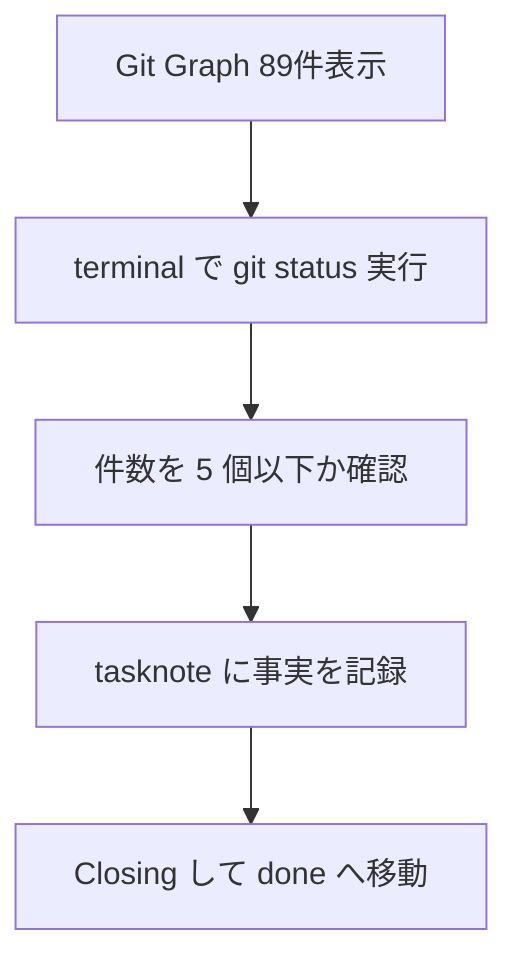

# 2026年5月22日 未コミットを5個以下に保って安心して進める

> 状態：⑧ Closing 完了
> 次のゲート：なし

---

## 1) Journey（どこへ行くか）

> 補足：深層的目的 `git status` を見た瞬間に「何が残っているか」を言える状態へ戻す
> 補足：やらないこと 変更内容そのものの実装判断や、無理な一括コミットまで今回の note に混ぜない
> 補足：責務分担厳格度 basic

1. 前提条件
   1. 💦 2026-05-22 時点の `git status --short` は 2 パス
   2. 💦 残っているのは screenshot 移動 1 件と tasknote 1 件
   3. 💦 数が少なくても、意図が読めない未コミットは不安を増やす

2. Before
   1. 💦 何が残り、何を先に片づけるかが頭の中だけにある
   2. 💦 未コミットが増える前に整理方針を固定できていない
   3. ❌ 不安

3. After
   1. 💦 未コミットは 5 個以下を維持する運用に落とせる
   2. ✅ `git status` を見れば次の 1 手がすぐ決まる
   3. ❤️ 安心

4. 例外
   1. 1 つの話題で 5 個を超える差分が必須なら、親子 note に分割する
   2. ユーザーの保留中変更は、勝手に破棄せず残したまま仕分ける

5. 境界条件
   1. 最初にやるのは棚卸し、次に分割、最後に commit か handoff を決める
   2. 変更意図が 2 系統以上なら、1 note で無理に閉じない

6. 委任度
   1. 🟢 全体として CC 単独で棚卸しと起票までは進められる
   2. 🟡 実際にどの変更を今 commit するかはユーザー意図確認が要る
   3. 🔴 変更を捨てる判断はユーザーのみが行う

---

## 2) ユーザーストーリーマップ

> 今回の仕事を「未コミットを見える数に抑える流れ」として並べる。
> 委任度：🟢 棚卸しと分割案までは CC が進められる
> 残る曖昧さ：各変更を今すぐ commit するか、保留にするか

### 話題一覧

#### 話題1：まず未コミットを数えて意味ごとに分ける

##### ユーザー：私

1. 当初計画
    1. 👀 `git status --short` で残件数を固定する
    2. 🧩 変更を話題ごとに 1 行で言い直す
    3. ✂️ 同じ話題だけを同じ束にまとめる
2. 追加分
    1. 📝 5 個を超えそうなら親 note へ切り替える
    2. 🔗 子 note が要る束だけ後続起票する
    3. 👆 最後に未コミット件数を再確認する

---

## 3) Gherkin（完了条件）

> 委任度：🟢 検証と記録まで CC が完走できる
> 残る曖昧さ：なし

### シナリオ一覧

- [x] シナリオ1：未コミット件数が上限内に収まっている

1. 🧱 repo の作業木に未コミットが残っているかもしれない
2. 🎬 `git status --short -uall` で件数を数える
3. ✅ 出てきたパス数が 5 個以下で、次の 1 手を落ち着いて選べる

- [x] シナリオ2：GUI の件数表示が揺れても正本を見失わない

1. 🧱 Git Graph が `Uncommitted Changes (89)` を出したまま更新中になる
2. 🎬 terminal の `git status` と拡張ホストログを見比べる
3. ✅ 件数の正本は terminal と判断でき、UI の古い表示に振り回されない

---

## 4) Design（どうやるか）

### 責務分担概要

- `git status` を件数の正本にする
- Git Graph は補助表示として扱う
- tasknote は差分の読み方だけを固定する

### 責務分担概要図

### 責務分担詳細

- `git status --short -uall` （➕：未コミット件数の正本）
- `remoteexthost.log` （➕：Git 拡張の異常の証跡）
- `steering/2026年5月22日未コミット89件？.png` （➕：Git Graph 表示の証拠）

---

## 5) Tasklist

- [x] Git Graph の 89 件表示を画像で確認した
- [x] terminal の `git status` と突き合わせた
- [x] Git Graph 拡張の実装と VS Code ログを確認した
- [x] 「件数の正本は terminal」と tasknote に固定した
- [x] 未コミットが 5 個以下であることを確認して Closing へ進んだ

---

## 6) Result（成果物）

- 2026-05-22、Git Graph の表示は `Uncommitted Changes (89)` のまま更新中になった
- 画像証跡を `steering/2026年5月22日未コミット89件？.png` として保持した
- `git status --short -uall | wc -l` の fresh 実行では 5 行で、目標の「5個以下」は満たした
- 5 行のうち 2 行は同じ tasknote の `steering/` から `steering/done/` への移動で生じた
- 拡張ホストログに built-in Git の `Error: Git error` 連発を確認した
- そのため「GUI 表示ではなく terminal を正本にする」という読み方で収束した

---

## 7) Discussion（反省）

Git Graph のスピナーが回り続ける間は、件数表示を意思決定に使わない方がよい。`git status` が即返るなら repo 本体は詰まっていないので、まず terminal を正とし、必要なら拡張ログを見て UI 側の不調として切り分ける。

### 反省とルール化

- 記入先：observe-situation / manage-tasknotes / AGENTS.md
- 次にやること：Git Graph の件数と terminal がずれたら、先に `git status --short -uall` を打つ

---

## 8) Closing

- 状態: done
- 次のゲート: なし
- close 条件:
    - [x] fresh な `git status --short -uall | wc -l` が 5 以下
    - [x] Git Graph 89 件表示の読み方を記録した
    - [x] 後続 handoff なしで閉じられる

---

## 9) 参考文献

- `AGENTS.md`
- `README.md`
- `docs/repository-structure.md`
- `steering/20260517-battle-stale-spell-message.md`
- 事実メモ：起票時の `git status --short` は 2 パス
- 参考画像：`steering/2026年5月22日未コミット89件？.png`
- 事実メモ：Git Graph は `Uncommitted Changes (89)` と表示
- 事実メモ：Closing 時の `git status --short -uall | wc -l` は 5
- 参考コード：`~/.vscode-server/extensions/mhutchie.git-graph-1.30.0/out/dataSource.js`
- 参考ログ：`~/.vscode-server/data/logs/20260522T012220/exthost1/remoteexthost.log`
